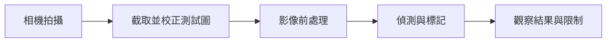
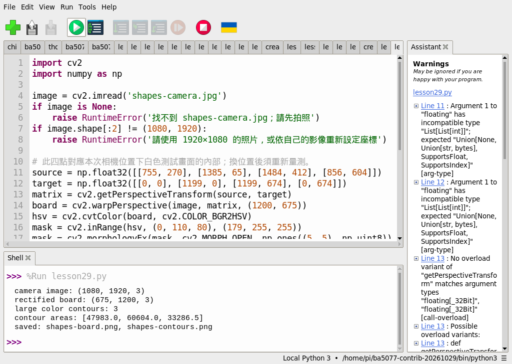
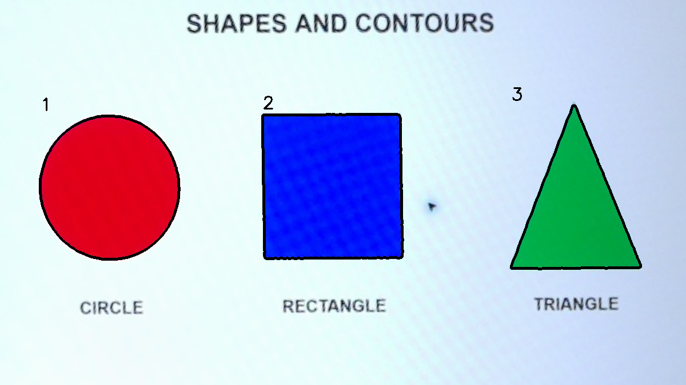

# 第 29 課｜使用 OpenCV 進行輪廓檢測與繪製

[原始文章](https://liusming.pixnet.net/blog/posts/14222886531) · 實測日期：2026-10-29

> 已在 Thonny 實測：以先前相機照片進行透視校正及輪廓偵測；照片由先前終端機操作拍攝，Thonny 拍照流程待重測。[逐篇進度](./Thonny逐篇實測狀態.md) · [圖片與程式下載方式](./練習素材/素材下載與使用.md)

## 學習目標與先備知識

解釋輪廓與二值遮罩的關係；從實拍影像找出主要色塊邊界；比較輪廓面積與像素數。 本課適合已完成 Python 變數、影像讀取與相機基礎的學生；若尚不熟悉，先閱讀第 13、15 與 17 課。

## 背景：這個技術能解決什麼問題？

自動化產線需要知道物件從哪裡開始、在哪裡結束；輪廓就是對物件邊界的描述。先把物件從背景分離，再找邊界，便能計算面積或外接框。本課使用螢幕上的三個圖形模擬待檢查零件。

## 核心原理

輪廓是一連串描述相鄰邊界的點。`findContours` 通常接收單通道二值圖，白色視為前景，黑色視為背景；`RETR_EXTERNAL` 只取最外層輪廓，`CHAIN_APPROX_SIMPLE` 壓縮邊界上可省略的點。輪廓面積是依邊界估算的幾何面積，不一定等於白色像素數。畫面中的線條、陰影或螢幕反光都可能變成額外輪廓。



上圖是教學流程示意，不是操作截圖。原理可參考 [OpenCV 官方文件](https://docs.opencv.org/4.x/d4/d73/tutorial_py_contours_begin.html)。


### Thonny 環境與下載準備

依[Thonny 環境指南](./Thonny環境與套件安裝.md#第-2527-課在-thonny-建立-opencv-擴充環境)建立並選取獨立環境。本次處理影像使用 Python 3.11、NumPy 1.26.4 和 opencv-contrib-python 4.11.0.86；相機拍照則需另選能使用 Picamera2 的環境。先從 [GitHub 教材](https://github.com/Samuel-ncu/BA5077-RP5-compatibility) 的 **Code → Download ZIP** 下載並解壓，複製所需檔案到新的練習資料夾；詳細步驟見[素材指南](./練習素材/素材下載與使用.md)。此次 ZIP 下載和解壓步驟尚未在 RP5 瀏覽器重測。

## 實作準備與步驟

1. 將[本課範例程式](./範例程式/第29課-相機輪廓.py)下載到新的練習資料夾。要自行拍攝時，將[相機測試畫面](./練習素材/RP5相機測試.html)及同目錄所需圖片下載到顯示畫面的電腦，開啟並選「形狀與輪廓」。
2. 參考[第 18 課](./第%2018%20課｜使用%20Picamera2%20拍攝照片並保存至本地.md)，切換到可使用 Picamera2 的環境，在 Thonny 拍 1920 × 1080 照片，放入練習資料夾並命名 `shapes-camera.jpg`。照片可能包含螢幕外環境，分享前先檢查；本次舊照片因現場環境未公開，學生不能下載到相同原始圖。本課以 Thonny 拍照的完整替代流程尚待重測。
3. 把範例程式放在照片相同目錄，切回影像處理環境。`source` 的四組座標是本次相機照片中測試圖的左上、右上、右下、左下，**不是通用設定**：換相機位置或畫面大小時，必須在自己的照片上重新量測與修改。程式執行後會產生 `shapes-board.png` 與 `shapes-contours.png`。

## 在 Thonny 重測的照片處理程式

把下列程式儲存為 `第29課-相機輪廓.py`：

```python
import cv2
import numpy as np

image = cv2.imread('shapes-camera.jpg')
if image is None:
    raise RuntimeError('找不到 shapes-camera.jpg；請先拍照')
if image.shape[:2] != (1080, 1920):
    raise RuntimeError('請使用 1920×1080 的照片，或依自己的影像重新設定座標')

# 此四點對應本次相機位置下白色測試畫面的內部；換位置後須重新量測。
source = np.float32([[755, 270], [1385, 65], [1484, 412], [856, 604]])
target = np.float32([[0, 0], [1199, 0], [1199, 674], [0, 674]])
matrix = cv2.getPerspectiveTransform(source, target)
board = cv2.warpPerspective(image, matrix, (1200, 675))
hsv = cv2.cvtColor(board, cv2.COLOR_BGR2HSV)
mask = cv2.inRange(hsv, (0, 110, 80), (179, 255, 255))
mask = cv2.morphologyEx(mask, cv2.MORPH_OPEN, np.ones((5, 5), np.uint8))
contours, _ = cv2.findContours(mask, cv2.RETR_EXTERNAL, cv2.CHAIN_APPROX_SIMPLE)
large = sorted((c for c in contours if cv2.contourArea(c) > 4000), key=lambda c: cv2.boundingRect(c)[0])
annotated = board.copy()
for i, contour in enumerate(large, 1):
    cv2.drawContours(annotated, [contour], -1, (0, 0, 0), 3)
    x, y, w, h = cv2.boundingRect(contour)
    cv2.putText(annotated, str(i), (x, max(30, y-10)), cv2.FONT_HERSHEY_SIMPLEX, 1, (0, 0, 0), 2)
if not cv2.imwrite('shapes-board.png', board) or not cv2.imwrite('shapes-contours.png', annotated):
    raise RuntimeError('無法儲存影像')
print('camera image:', image.shape)
print('rectified board:', board.shape)
print('large color contours:', len(large))
print('contour areas:', [round(cv2.contourArea(c), 1) for c in large])
print('saved: shapes-board.png, shapes-contours.png')
```

在 Thonny 選 **File → Open** 開啟練習資料夾中的程式，選取影像處理環境後按綠色執行鈕。

## 本次 Thonny 實際輸出與結果圖

以下是這台 RP5、這次影像及參數的輸出；換照片、曝光、版本或參數時，數字可能不同。

```text
camera image: (1080, 1920, 3)
rectified board: (675, 1200, 3)
large color contours: 3
contour areas: [47983.0, 60604.0, 33286.5]
saved: shapes-board.png, shapes-contours.png
```



截圖中的 `lesson29.py` 是儲存庫本課程式的測試副本，內容相同；實測讀取的照片在此之前已拍攝。



RP5 實拍螢幕後，裁出測試圖並做透視校正；黑色線條為程式畫出的輪廓，數字依由左到右排序。這是實拍後經處理的結果，不是安裝畫面。

## 逐步理解結果

程式先依四個手動座標取得測試圖，將斜拍的四邊形轉換為矩形，再依 HSV 飽和度篩選有色像素，去除小雜點，最後找出面積大於 4000 的輪廓。此次找到 3 個，不代表任何照片都會得到 3 個。

若顯示找不到圖片，先用檔案管理員確認檔名、目前目錄與副檔名。若找不到目標，檢查相機照片、校正點與測試圖尺寸，再依條件調整閾值；不要把偵測失敗直接當成相機故障。

## 學生練習與後續應用

把面積門檻 4000 改為 10000，觀察是否仍找到三個輪廓；再改變測試圖大小，說明為何以像素為單位的面積門檻需要調整。

輪廓可用於零件外形檢查、簡單計數與區域量測；要用來判斷合格與否，還須建立標準樣本，測試光照、角度、遮擋及誤判。

## 與原文章的差異

- 本次增加 Thonny 影像處理實測與操作截圖；尚未完成的相機流程以文中註記為準。

- 原文以外部圖片做輪廓範例；本版先以合成矩形驗證 API，再加入這台 RP5 實拍螢幕的彩色形狀。透視校正座標與篩選門檻只適用本次拍攝，須依各自相機調整。
- 圖片是攝影機拍攝後的影像處理結果，並非安裝截圖。
