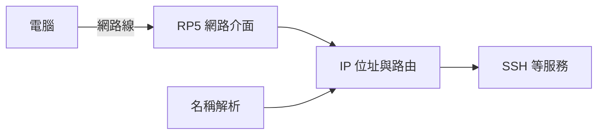

# 第 3 課｜網路基礎與作業系統：應用於 Raspberry Pi（上）

[原始文章](https://liusming.pixnet.net/blog/posts/14222880474) · 更新日期：2026-10-29

## 學習目標

區分網路線的實體連接、IP 位址、名稱解析與遠端登入。這些是不同的檢查項目：網路線顯示已連接，不一定代表已取得可用 IP；能解析名稱也不代表目標服務一定已啟動。

## 背景：作業系統和網路各負責什麼？

作業系統管理電腦硬體、程式、檔案和使用者。RP5 上的 Linux 讓 Python 程式能讀取相機、存取檔案，也能透過網路送出或接收資料。網路則連接不同裝置，讓它們交換資料；接上一條網路線只是建立實體連線的第一步。

可以把 IP 位址想成一個網路中的收件地址，名稱解析則像查通訊錄：將名稱查成位址。服務埠可想成地址下的服務入口；一台機器能連到另一台，並不代表對方的 SSH 或網頁服務一定正在運作。這些比喻是入門理解，實際網路的位址、路由與傳輸方式還有更多細節。



上圖是概念圖，不是實際網路狀態截圖。電腦與 RP5 可以直接連線，也可以透過路由器；能否上網還取決於閘道與網路設定。

## 常見連線方式

1. **透過路由器：**電腦與 RP5 接到同一網路，由路由器提供位址。
2. **電腦與 RP5 直連：**兩端用網路線互連，需要相容的位址設定。沒有路由器時，不能假設一定有 DHCP 位址。
3. **Wi-Fi 與網路線並用：**可以讓 RP5 透過 Wi-Fi 上網，並保留網路線連到電腦；要確認路由與位址各自正確。

## 實作：確認網路介面

在 RP5 執行：

```bash
printf 'eth0: '; cat /sys/class/net/eth0/operstate
```

本機實際輸出：

```text
eth0: up
```

`up` 表示介面目前是啟用狀態；仍要檢查 IP 是否能讓兩端互相抵達。若要查看目前位址，可在 RP5 終端機執行 `ip -br addr`。位址是本地網路資訊，發布畫面前應自行檢查是否需要遮蔽。

## 實作：名稱解析

```bash
getent hosts localhost
```

本機實際輸出：

```text
::1             localhost ip6-localhost ip6-loopback
```

`localhost` 指向本機；這項測試不證明外網 DNS 或網際網路可用。

## 練習與後續應用

1. 解釋網路線已接好、取得 IP 位址與 SSH 可登入，為什麼是三個不同問題。
2. 如果 `localhost` 可解析，是否足以證明外網可以使用？請說明理由。
3. 畫出自己的電腦、RP5 和路由器之間的連線，標出資料要經過哪條線或哪個無線網路。

理解網路分層有助排除 AIoT 裝置無法回報資料的問題。後續可測試不同網段與名稱解析，但不要把實際網路位址和認證資訊直接貼到公開作業。

參考：[Raspberry Pi 遠端存取文件](https://www.raspberrypi.com/documentation/computers/remote-access.html)。

## 與原文章的差異

- 增加電腦直連 RP5 的情境，並分開說明介面狀態、IP 位址與名稱解析。
- 命令與輸出取自本次 RP5 實測；未將實際區網位址寫入公開教材。
- 尚未補拍本課畫面。
- 加入作業系統、IP、名稱解析與服務入口的初學者背景、示意圖和練習。
