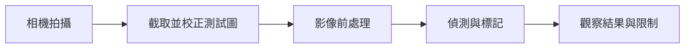
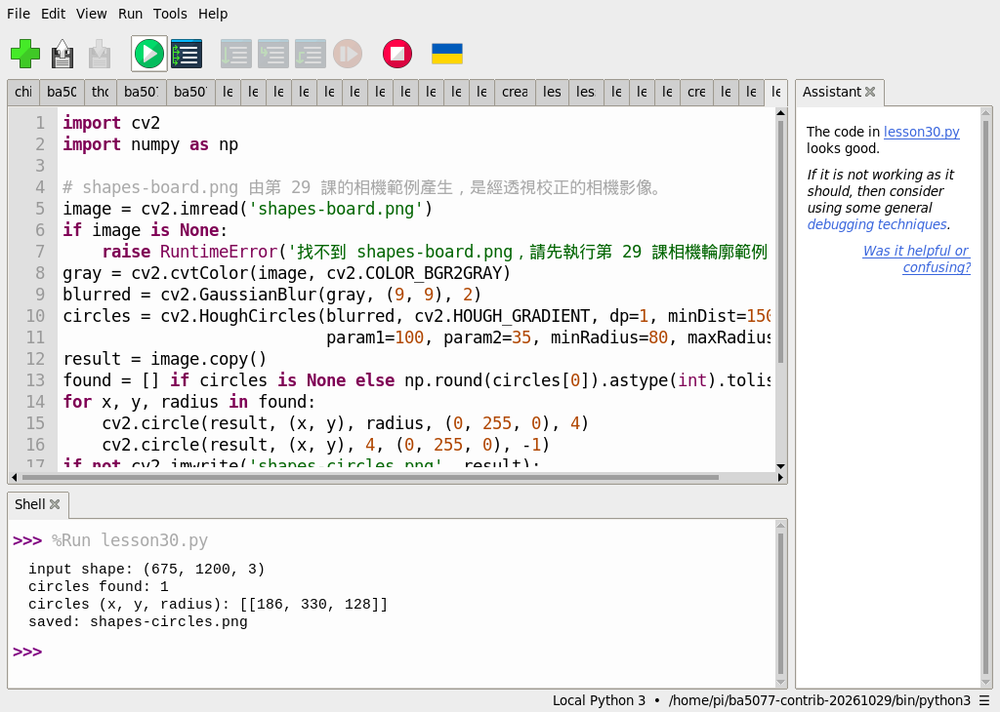
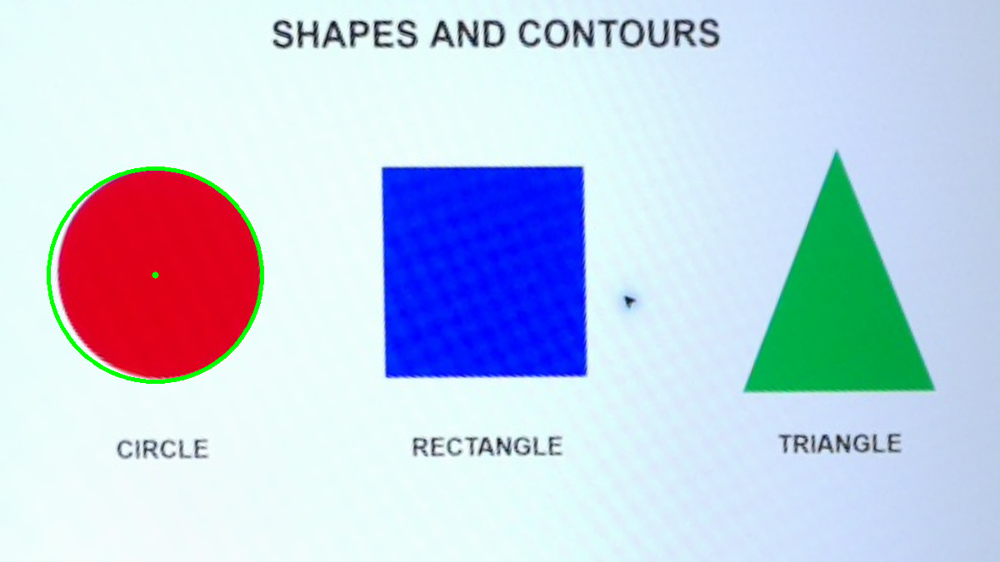

# 第 30 課｜使用 OpenCV 進行圓形檢測與繪製

[原始文章](https://liusming.pixnet.net/blog/posts/14222886537) · 實測日期：2026-10-29

> 已在 Thonny 實測：讀取先前相機校正圖並偵測圓形；其他照片與即時情境待測。[逐篇進度](./Thonny逐篇實測狀態.md) · [圖片與程式下載方式](./練習素材/素材下載與使用.md)

## 學習目標與先備知識

理解圓心與半徑如何描述圓；利用 HoughCircles 在實拍圖中找圓，並解釋參數變化可能造成的漏檢與誤檢。 本課適合已完成 Python 變數、影像讀取與相機基礎的學生；若尚不熟悉，先閱讀第 13、15 與 17 課。

## 背景：這個技術能解決什麼問題？

瓶蓋、按鈕和硬幣在正面影像中常接近圓形。若相機能估計圓心和半徑，便能進行簡單的計數或位置提示；實際零件因透視、遮擋與鏡頭畸變，未必會呈現完美圓形。

## 核心原理

一個圓可由中心 `(x, y)` 與半徑 `r` 描述。Hough 圓形偵測利用邊緣與梯度資訊，尋找可能的圓心和半徑；`dp` 控制累加器解析度比例，`minDist` 限制圓心距離，`param1`、`param2` 影響邊緣與候選圓判定，`minRadius`、`maxRadius` 指定半徑搜尋範圍。這些是影像處理參數，不是可保證適用於每個場景的常數。



上圖是教學流程示意，不是操作截圖。原理可參考 [OpenCV 官方文件](https://docs.opencv.org/4.x/d4/d70/tutorial_hough_circle.html)。


### Thonny 環境與下載準備

依[Thonny 環境指南](./Thonny環境與套件安裝.md#第-2527-課在-thonny-建立-opencv-擴充環境)建立並選取獨立環境。本次處理影像使用 Python 3.11、NumPy 1.26.4 和 opencv-contrib-python 4.11.0.86；相機拍照則需另選能使用 Picamera2 的環境。先從 [GitHub 教材](https://github.com/Samuel-ncu/BA5077-RP5-compatibility) 的 **Code → Download ZIP** 下載並解壓，複製所需檔案到新的練習資料夾；詳細步驟見[素材指南](./練習素材/素材下載與使用.md)。此次 ZIP 下載和解壓步驟尚未在 RP5 瀏覽器重測。

## 實作準備與步驟

1. 先完成[第 29 課相機輪廓範例](./第%2029%20課｜使用%20OpenCV%20進行輪廓檢測與繪製.md)，在練習目錄產生 `shapes-board.png`；這是先裁切並校正過的實拍圖。
2. 若暫時沒有相機，可下載[本次 RP5 的校正影像](./圖檔/shapes-board.png)，放到練習目錄並命名 `shapes-board.png`，用它重做後續偵測。
3. 從教材下載[範例程式](./範例程式/第30課-相機圓形.py)放在與 `shapes-board.png` 同一個新的練習資料夾。輸出會儲存為 `shapes-circles.png`。

## 在 Thonny 重測的圓形偵測程式

把下列程式儲存為 `第30課-相機圓形.py`：

```python
import cv2
import numpy as np

# shapes-board.png 由第 29 課的相機範例產生，是經透視校正的相機影像。
image = cv2.imread('shapes-board.png')
if image is None:
    raise RuntimeError('找不到 shapes-board.png，請先執行第 29 課相機輪廓範例')
gray = cv2.cvtColor(image, cv2.COLOR_BGR2GRAY)
blurred = cv2.GaussianBlur(gray, (9, 9), 2)
circles = cv2.HoughCircles(blurred, cv2.HOUGH_GRADIENT, dp=1, minDist=150,
                           param1=100, param2=35, minRadius=80, maxRadius=160)
result = image.copy()
found = [] if circles is None else np.round(circles[0]).astype(int).tolist()
for x, y, radius in found:
    cv2.circle(result, (x, y), radius, (0, 255, 0), 4)
    cv2.circle(result, (x, y), 4, (0, 255, 0), -1)
if not cv2.imwrite('shapes-circles.png', result):
    raise RuntimeError('無法儲存影像')
print('input shape:', image.shape)
print('circles found:', len(found))
print('circles (x, y, radius):', found)
print('saved: shapes-circles.png')
```

在 Thonny 選 **File → Open** 開啟練習資料夾中的程式，選取影像處理環境後按綠色執行鈕。

## 本次 Thonny 實際輸出與結果圖

以下是這台 RP5、這次影像及參數的輸出；換照片、曝光、版本或參數時，數字可能不同。

```text
input shape: (675, 1200, 3)
circles found: 1
circles (x, y, radius): [[186, 330, 128]]
saved: shapes-circles.png
```



截圖中的 `lesson30.py` 是儲存庫本課程式的測試副本，內容相同；實測讀取的照片在此之前已拍攝。



此圖來自 RP5 相機拍攝螢幕圖形後的透視校正影像；綠色圓與圓心為程式實際偵測結果。

## 逐步理解結果

先轉灰階，再用 GaussianBlur 降低雜訊；HoughCircles 尋找半徑 80–160 像素的候選圓。此照片找到 1 個，圓心約為 (186, 330)、半徑約 128 像素。座標屬於校正後的 1200 × 675 影像，不是原始相機照片座標。

若顯示找不到圖片，先用檔案管理員確認檔名、目前目錄與副檔名。若找不到目標，檢查相機照片、校正點與測試圖尺寸，再依條件調整閾值；不要把偵測失敗直接當成相機故障。

## 學生練習與後續應用

先將最小與最大半徑設為 80–160，再嘗試把最大半徑設為 100，預測並觀察這個圓是否會漏檢；記錄你實際得到的結果，不要預先假設每個環境的輸出相同。

圓形檢測可作為旋鈕定位、零件計數或實驗裝置定位的基礎；偏斜拍攝時圓可能呈橢圓，量測尺寸還需校正並建立像素與實際距離的換算。

## 與原文章的差異

- 本次增加 Thonny 影像處理實測與操作截圖；尚未完成的相機流程以文中註記為準。

- 原文讀取外部杯子圖片；本版新增 RP5 實拍、透視校正後的測試圖，並明確列出本次實際偵測參數與結果；尚未驗證原始杯子圖片。
- 圖片是攝影機拍攝後的影像處理結果，並非安裝截圖。
