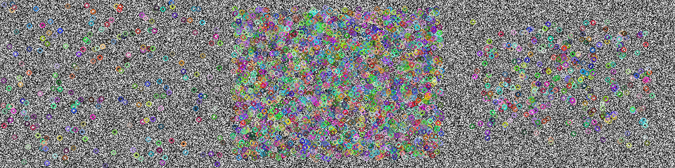

# 第 31 課｜使用 OpenCV 比較 SIFT、SURF 與 ORB 特徵檢測

[原始文章](https://liusming.pixnet.net/blog/posts/14222886546) · 更新日期：2026-10-29

## 學習目標

認識 SIFT、SURF、ORB 並確認本機能建立三種偵測器。

## 事前準備

需要相容的 OpenCV；SURF 依賴有啟用 nonfree 的建置。

本教學程式使用合成資料，沒有把私人相機影像上傳公開 repo；請在自己的練習目錄操作。

## 程式與執行

將下列程式存為 `第31課.py`，或使用[已測試的範例程式](./範例程式/第31課.py)。

```python
import cv2
import numpy as np
sift = cv2.SIFT_create()
surf = cv2.xfeatures2d.SURF_create()
orb = cv2.ORB_create()
image = np.random.default_rng(42).integers(0, 256, (240, 320), dtype=np.uint8)
panels = [cv2.drawKeypoints(image, detector.detect(image, None), None) for detector in (sift, surf, orb)]
if not cv2.imwrite('lesson31-features.png', cv2.hconcat(panels)):
    raise RuntimeError('image save failed')
print('SIFT created', bool(sift))
print('SURF created', bool(surf))
print('ORB created', bool(orb))
```

在該檔案所在目錄執行 `python3 第31課.py`。

## 本機實際輸出

```text
SIFT created True
SURF created True
ORB created True
```

本機三種物件均可建立；不代表所有 Raspberry Pi OS 的 OpenCV 都包含 SURF，也未測試原文圖片的特徵數。

## RP5 實際產生的結果圖



合成隨機圖上的特徵點，由左至右分別使用 SIFT、SURF、ORB。 圖片由本課程式在 RP5 執行時儲存，是程式輸出，不是操作畫面截圖。

## 背景與核心概念

### 什麼是影像特徵點？

特徵點是影像中可用於描述或比對的局部結構，常出現在角點或紋理附近。SIFT、SURF 和 ORB 的方法、速度與可用性不同；SURF 是否可使用取決於 OpenCV 建置。

### 思考、練習與後續應用

同一張圖分別用三種方法取得特徵點，數量一定相同嗎？程式能建立偵測器是否代表實際場景都可辨識？

特徵可用於影像拼接、定位或比對，但低紋理、重複圖案與視角變化會影響結果。

進一步閱讀：[相關官方文件](https://docs.opencv.org/4.x/db/d27/tutorial_py_table_of_contents_feature2d.html)。下方的程式與輸出以標明的本機實測範圍為準；沒有測過的部分不代表已完成。

## 與原文章的差異

- 新版 SIFT 改用 `cv2.SIFT_create()`；本次環境的 SURF 實測可建立，其他環境需自行確認。
- 以上是本機實際合成資料輸出；不同版本可能產生不同數值。
- 尚未保存操作畫面截圖。
- 新增初學者背景、概念、思考練習及後續應用，實測範圍仍以本文標示為準。
