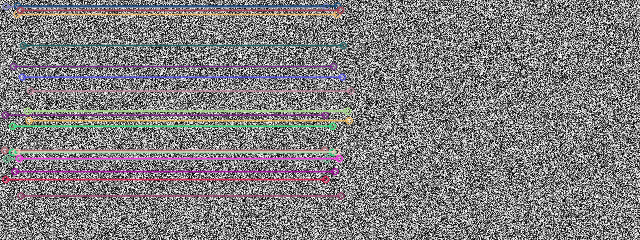

# 第 32 課｜使用 OpenCV 比較兩張圖片的特徵匹配（SURF 與 SIFT）

[原始文章](https://liusming.pixnet.net/blog/posts/14222886555) · 更新日期：2026-10-29

## 學習目標

使用 SIFT 產生描述子並以 L2 距離進行基礎匹配。

## 事前準備

需要 OpenCV、NumPy；本例使用固定種子的合成圖。

本教學程式使用合成資料，沒有把私人相機影像上傳公開 repo；請在自己的練習目錄操作。

## 程式與執行

將下列程式存為 `第32課.py`，或使用[已測試的範例程式](./範例程式/第32課.py)。

```python
import cv2
import numpy as np
image = np.random.default_rng(42).integers(0, 256, (240, 320), dtype=np.uint8)
sift = cv2.SIFT_create()
keypoints, desc = sift.detectAndCompute(image, None)
if desc is None:
    raise RuntimeError('no descriptors')
matches = cv2.BFMatcher(cv2.NORM_L2).match(desc, desc)
result = cv2.drawMatches(image, keypoints, image, keypoints, matches[:30], None, flags=cv2.DrawMatchesFlags_NOT_DRAW_SINGLE_POINTS)
if not cv2.imwrite('lesson32-sift-matches.png', result):
    raise RuntimeError('image save failed')
print('descriptors found', len(desc) > 0)
print('same-image matches', len(matches))
```

在該檔案所在目錄執行 `python3 第32課.py`。

## 本機實際輸出

```text
descriptors found True
same-image matches 318
```

同一張圖片與自身配對，只用於確認 API 流程；匹配數依 OpenCV 版本可能變動，不能代表不同照片的匹配品質。

## RP5 實際產生的結果圖



合成圖與自身的 SIFT 配對示意，畫出前 30 個配對。 圖片由本課程式在 RP5 執行時儲存，是程式輸出，不是操作畫面截圖。

## 與原文章的差異

- 原文示範 SURF 與 SIFT；本版先以 SIFT 自身匹配實測，完整跨圖片 SURF 比較尚未測試。
- 以上是本機實際合成資料輸出；不同版本可能產生不同數值。
- 尚未保存操作畫面截圖。
