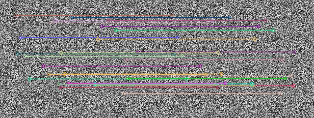
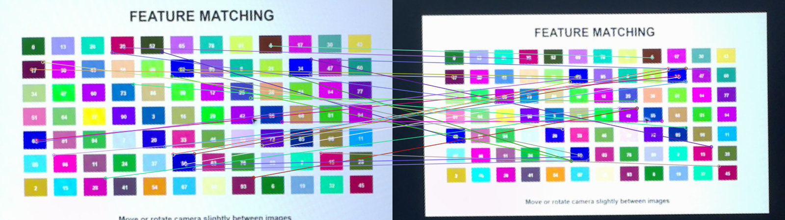

# 第 33 課｜使用 OpenCV ORB 特徵檢測與匹配

[原始文章](https://liusming.pixnet.net/blog/posts/14222886561) · 更新日期：2026-10-29

## 學習目標

使用 ORB 與 Hamming 距離建立描述子匹配。

## 事前準備

需要 OpenCV、NumPy；本例使用固定種子的合成圖。

本教學程式使用合成資料，沒有把私人相機影像上傳公開 repo；請在自己的練習目錄操作。

## 程式與執行

將下列程式存為 `第33課.py`，或使用[已測試的範例程式](./範例程式/第33課.py)。

```python
import cv2
import numpy as np
image = np.random.default_rng(42).integers(0, 256, (240, 320), dtype=np.uint8)
orb = cv2.ORB_create()
keypoints, desc = orb.detectAndCompute(image, None)
if desc is None:
    raise RuntimeError('no descriptors')
matches = cv2.BFMatcher(cv2.NORM_HAMMING).match(desc, desc)
result = cv2.drawMatches(image, keypoints, image, keypoints, matches[:30], None, flags=cv2.DrawMatchesFlags_NOT_DRAW_SINGLE_POINTS)
if not cv2.imwrite('lesson33-orb-matches.png', result):
    raise RuntimeError('image save failed')
print('descriptors found', len(desc) > 0)
print('same-image matches', len(matches))
```

在該檔案所在目錄執行 `python3 第33課.py`。

## 本機實際輸出

```text
descriptors found True
same-image matches 453
```

這是同圖自我匹配的基礎測試；特徵數受版本和參數影響，不代表真實圖片的匹配品質。

## RP5 實際產生的結果圖



合成圖與自身的 ORB 配對示意，畫出前 30 個配對。 圖片由本課程式在 RP5 執行時儲存，是程式輸出，不是操作畫面截圖。

## 背景與核心概念

### ORB 為何常用於輕量特徵？

ORB 會產生二進位描述子，常搭配 Hamming 距離比較不同位元的數量。它和使用 L2 距離的浮點描述子不同，使用錯誤的距離會影響匹配。

### 思考、練習與後續應用

說明 Hamming 距離在比較什麼；為何同一圖與自身的匹配數不等於真實兩張照片的正確匹配數？

ORB 可用於影像配對與定位，應在實際尺度、光照和視角變化下評估效果。

進一步閱讀：[相關官方文件](https://docs.opencv.org/4.x/dc/dc3/tutorial_py_matcher.html)。下方的程式與輸出以標明的本機實測範圍為準；沒有測過的部分不代表已完成。

## 進階實測：比對兩張 RP5 相機照片

### 為什麼需要兩張不同影像？

原本的合成範例用同一張圖與自己比對，只能確認基本 API。這次在螢幕上顯示同一個彩色測試圖，分別設定 90% 與 75% 大小，由 RP5 相機各拍攝一張，再裁切並透視校正；因此這是**兩次拍攝螢幕圖案**，不是兩張真實環境照片。

### 準備與執行

可將本次[第一張校正圖](./圖檔/feature-board-a.png)、[第二張校正圖](./圖檔/feature-board-b.png)分別下載為 `feature-board-a.png`、`feature-board-b.png`，與[範例程式](./範例程式/第31至33課-相機特徵比對.py)放到 RP5 同一練習目錄。確認系統 Python 有 OpenCV 和 NumPy；SURF 需 OpenCV 建置啟用 nonfree，其他環境可能會顯示不可用。執行前檢查輸出檔名，避免覆蓋已有資料。

若自行重新拍攝，下載[相機測試畫面](./練習素材/RP5相機測試.html)並選「特徵匹配」，用相同相機位置在 90% 和 75% 畫面大小各拍一張 1920 × 1080 照片，分別存為 `feature-camera-a.jpg`、`feature-camera-b.jpg`。程式的四角座標只適用本次位置；自己的照片需重新量測。要公開校正圖片前，檢查是否包含畫面外的私人資訊。

```python
import argparse
import cv2
import numpy as np

parser = argparse.ArgumentParser()
parser.add_argument('--rectified', action='store_true', help='讀取已裁切校正的測試圖片')
args = parser.parse_args()
if args.rectified:
    image_a = cv2.imread('feature-board-a.png')
    image_b = cv2.imread('feature-board-b.png')
    if image_a is None or image_b is None:
        raise RuntimeError('請準備 feature-board-a.png 與 feature-board-b.png')
else:
    # 相機照片分別拍攝相同圖案的 90% 和 75% 顯示大小。
    first = cv2.imread('feature-camera-a.jpg')
    second = cv2.imread('feature-camera-b.jpg')
    if first is None or second is None:
        raise RuntimeError('請準備 feature-camera-a.jpg 與 feature-camera-b.jpg')
    if first.shape[:2] != (1080, 1920) or second.shape[:2] != (1080, 1920):
        raise RuntimeError('照片尺寸與本次設定不同，請重新量測座標')
    # 本次相機位置的四角；改變位置時應重新量測。
    source = np.float32([[755, 270], [1385, 65], [1484, 412], [856, 604]])
    target = np.float32([[0, 0], [799, 0], [799, 449], [0, 449]])
    matrix = cv2.getPerspectiveTransform(source, target)
    image_a = cv2.warpPerspective(first, matrix, (800, 450))
    image_b = cv2.warpPerspective(second, matrix, (800, 450))
    if not cv2.imwrite('feature-board-a.png', image_a) or not cv2.imwrite('feature-board-b.png', image_b):
        raise RuntimeError('無法儲存校正圖片')
gray_a = cv2.cvtColor(image_a, cv2.COLOR_BGR2GRAY)
gray_b = cv2.cvtColor(image_b, cv2.COLOR_BGR2GRAY)

detectors = [('SIFT', cv2.SIFT_create(), cv2.NORM_L2),
             ('ORB', cv2.ORB_create(nfeatures=1200), cv2.NORM_HAMMING)]
try:
    detectors.insert(1, ('SURF', cv2.xfeatures2d.SURF_create(), cv2.NORM_L2))
except (AttributeError, cv2.error):
    print('SURF unavailable in this OpenCV build')
for name, detector, norm in detectors:
    keys_a, desc_a = detector.detectAndCompute(gray_a, None)
    keys_b, desc_b = detector.detectAndCompute(gray_b, None)
    if desc_a is None or desc_b is None:
        raise RuntimeError(f'{name} 找不到描述子')
    matches = cv2.BFMatcher(norm, crossCheck=True).match(desc_a, desc_b)
    matches = sorted(matches, key=lambda item: item.distance)
    result = cv2.drawMatches(image_a, keys_a, image_b, keys_b, matches[:30], None,
                             flags=cv2.DrawMatchesFlags_NOT_DRAW_SINGLE_POINTS)
    output = f'feature-camera-{name.lower()}-matches.png'
    if not cv2.imwrite(output, result):
        raise RuntimeError('無法儲存結果')
    print(name, 'keypoints:', len(keys_a), len(keys_b))
    print(name, 'cross-check matches:', len(matches))
    print('saved:', output)
```

使用下載的校正圖片時執行：

```bash
python3 第31至33課-相機特徵比對.py --rectified
```

若使用自行拍攝的兩張原始照片，省略 `--rectified`；程式會先產生校正圖再進行比對。本次兩種方式均已在 RP5 執行，原始相機全景未公開。

### 本次 RP5 實際輸出

```text
SIFT keypoints: 1320 1192
SIFT cross-check matches: 567
saved: feature-camera-sift-matches.png
SURF keypoints: 2108 2372
SURF cross-check matches: 579
saved: feature-camera-surf-matches.png
ORB keypoints: 1200 1200
ORB cross-check matches: 432
saved: feature-camera-orb-matches.png
```



圖中的左右畫面來自不同時間、不同顯示大小的相機照片；連線由本次程式繪出，每種方法只顯示按距離排序的前 30 個候選匹配。圖像經裁切和校正，不是操作截圖。

### 讀懂數字並檢查結果

`keypoints` 是兩張圖各自找到的特徵點數。`cross-check matches` 是通過雙向最近鄰檢查的候選配對數，不是經人工標註確認的正確數量。畫面中有重複色塊和文字，即使是前 30 個連線，也可能有錯誤配對；應觀察連線是否落在相同位置，必要時再用幾何方法篩選。

SIFT 和 SURF 使用 L2 距離，本例 ORB 使用 Hamming 距離。各方法的點數、時間及匹配數不能直接視為準確率或速度排名；還需在更多圖像、光線和視角下測試。修改影像大小或重複圖案後，預測哪種匹配容易出錯，再實際觀察並記錄。

## 與原文章的差異

- 原文使用兩張外部圖片；本版先用固定合成圖驗證 ORB 與 Hamming 匹配流程。
- 以上是本機實際合成資料輸出；不同版本可能產生不同數值。
- 尚未保存操作畫面截圖。
- 新增初學者背景、概念、思考練習及後續應用，實測範圍仍以本文標示為準。
- 新增兩張不同顯示大小的 RP5 相機實拍圖，實測 SIFT、SURF、ORB 候選匹配；尚未量測正確率或不同真實場景。
