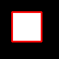
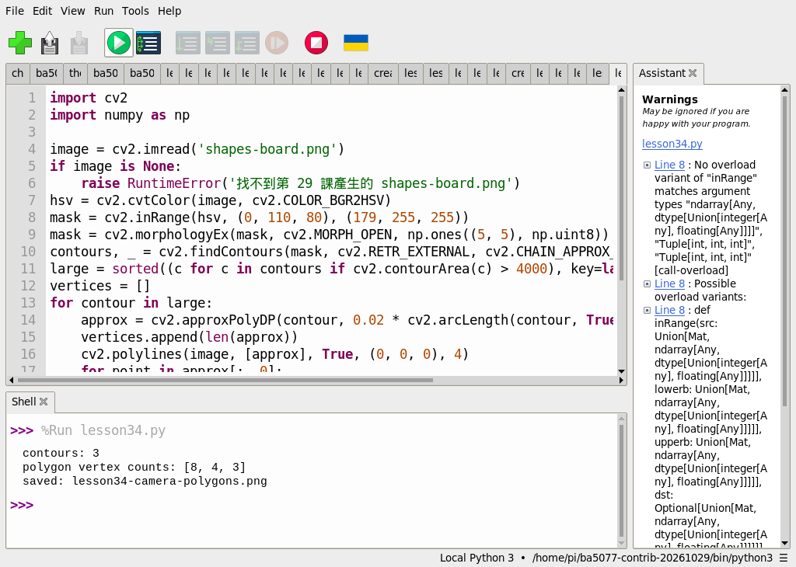
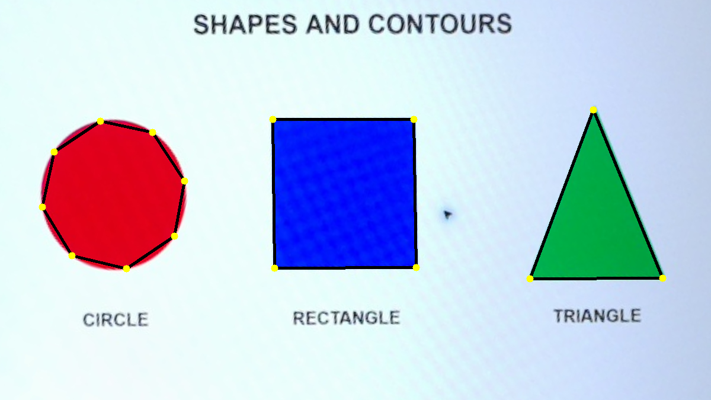

# 第 34 課｜使用 OpenCV 檢測與簡化多邊形輪廓

[原始文章](https://liusming.pixnet.net/blog/posts/14222886567) · 更新日期：2026-10-29

> 已在 Thonny 實測先前相機拍攝並校正的圖形多邊形近似；合成入門範例及自行拍攝流程仍待 Thonny 重測。[逐篇進度](./Thonny逐篇實測狀態.md) · [圖片與程式下載方式](./練習素材/素材下載與使用.md)

## 學習目標

用輪廓周長計算近似多邊形。

## 事前準備

需要 OpenCV、NumPy；本例建立矩形二值圖。

本教學程式使用合成資料，沒有把私人相機影像上傳公開 repo；請在自己的練習目錄操作。


### Thonny 準備與素材下載

1. 在 Thonny 依[擴充環境指南](./Thonny環境與套件安裝.md#第-2527-課在-thonny-建立-opencv-擴充環境)建立並選擇已安裝 OpenCV 和 NumPy 的環境。本次使用 Python 3.11、NumPy 1.26.4 和 opencv-contrib-python 4.11.0.86。
2. 從[教材儲存庫](https://github.com/Samuel-ncu/BA5077-RP5-compatibility)按 **Code → Download ZIP** 並解壓；或依[素材指南](./練習素材/素材下載與使用.md)下載單檔。此次 ZIP 下載與解壓未在 RP5 瀏覽器重測。
3. 將[本課程式](./範例程式/第34課-相機多邊形.py)與[已校正的相機圖片](./圖檔/shapes-board.png)複製到同一個新的練習資料夾，圖片檔名維持 `shapes-board.png`。在 Thonny 用 **File → Open** 開啟程式並按綠色執行鈕；結果為 `lesson34-camera-polygons.png`。

結果檔可能覆寫同名檔案，執行前先確認練習資料夾。兩張素材皆為 RP5 拍攝螢幕上的圖形後裁切、校正的照片；不是 Thonny 操作截圖。

## 先前終端機入門範例（待 Thonny 重測）

### 程式與執行

將下列程式存為 `第34課.py`，或使用[已測試的範例程式](./範例程式/第34課.py)。

```python
import cv2
import numpy as np
image = np.zeros((100, 100), dtype=np.uint8)
cv2.rectangle(image, (20, 20), (70, 70), 255, -1)
contours, _ = cv2.findContours(image, cv2.RETR_EXTERNAL, cv2.CHAIN_APPROX_SIMPLE)
approx = cv2.approxPolyDP(contours[0], 0.02 * cv2.arcLength(contours[0], True), True)
result = cv2.cvtColor(image, cv2.COLOR_GRAY2BGR)
cv2.polylines(result, [approx], True, (0, 0, 255), 2)
if not cv2.imwrite('lesson34-polygon.png', result):
    raise RuntimeError('image save failed')
print('polygon vertices', len(approx))
```

用 Thonny 開啟 `第34課.py` 並按綠色執行鈕；此入門例尚未在新環境重測。

## 先前終端機實測輸出

```text
polygon vertices 4
```

矩形近似得到四個頂點；若變更 epsilon 或圖片形狀，頂點數可能改變。

## RP5 實際產生的結果圖



合成矩形與近似多邊形。 圖片由本課程式在 RP5 執行時儲存，是程式輸出，不是操作畫面截圖。

## 背景與核心概念

### 為什麼要簡化輪廓？

數位輪廓可能包含許多點；多邊形近似以允許的誤差 epsilon 保留較少頂點。誤差越大可能越簡化，也可能漏掉重要形狀細節。

### 思考、練習與後續應用

對同一輪廓使用不同 epsilon，觀察頂點數；說明四個頂點不一定就代表影像中的物體是完美矩形。

輪廓簡化可減少形狀分析的資料量，但參數應依物件尺寸與量測目的調整。

進一步閱讀：[相關官方文件](https://docs.opencv.org/4.x/dd/d49/tutorial_py_contour_features.html)。下方的程式與輸出以標明的本機實測範圍為準；沒有測過的部分不代表已完成。

## 進階實測：分析 RP5 相機拍攝的圖形

### 準備與操作

下載[第 29 課的校正相機影像](./圖檔/shapes-board.png)，存為 `shapes-board.png`；影像是 RP5 拍攝螢幕上的圓形、矩形與三角形後校正所得。 與[範例程式](./範例程式/第34課-相機多邊形.py)放在 RP5 練習目錄，並確認 OpenCV 和 NumPy 可用；執行前檢查輸出檔名以免覆蓋。

```python
import cv2
import numpy as np

image = cv2.imread('shapes-board.png')
if image is None:
    raise RuntimeError('找不到第 29 課產生的 shapes-board.png')
hsv = cv2.cvtColor(image, cv2.COLOR_BGR2HSV)
mask = cv2.inRange(hsv, (0, 110, 80), (179, 255, 255))
mask = cv2.morphologyEx(mask, cv2.MORPH_OPEN, np.ones((5, 5), np.uint8))
contours, _ = cv2.findContours(mask, cv2.RETR_EXTERNAL, cv2.CHAIN_APPROX_SIMPLE)
large = sorted((c for c in contours if cv2.contourArea(c) > 4000), key=lambda c: cv2.boundingRect(c)[0])
vertices = []
for contour in large:
    approx = cv2.approxPolyDP(contour, 0.02 * cv2.arcLength(contour, True), True)
    vertices.append(len(approx))
    cv2.polylines(image, [approx], True, (0, 0, 0), 4)
    for point in approx[:, 0]:
        cv2.circle(image, tuple(int(x) for x in point), 6, (0, 255, 255), -1)
if not cv2.imwrite('lesson34-camera-polygons.png', image):
    raise RuntimeError('無法儲存結果')
print('contours:', len(large))
print('polygon vertex counts:', vertices)
print('saved: lesson34-camera-polygons.png')
```

在 Thonny 開啟本課範例程式，確認環境並按綠色執行鈕。

程式直接讀取第 29 課的校正影像。

### 本次 Thonny 在 RP5 實際輸出

```text
contours: 3
polygon vertex counts: [8, 4, 3]
saved: lesson34-camera-polygons.png
```



截圖中的 `lesson34.py` 是本課測試程式的副本；圖片由先前相機拍攝並校正。



`approxPolyDP` 依周長的 2% 作為允許誤差近似邊界。由左到右，本次圓形近似為 8 點、矩形 4 點、三角形 3 點；黃色圓點表示近似頂點。圓形得到 8 點不表示它實際是八邊形，而是這個參數下的近似結果。 圖案是螢幕上的測試素材，圖片由 RP5 相機拍攝後裁切、校正與處理，不是操作截圖。原始照片的周圍環境未公開。

### 學生練習與限制

修改近似誤差或面積／深度門檻前，先預測哪些點可能消失，再記錄實際結果。單一生成測試圖不能證明演算法對其他形狀、光線、反光或視角都有相同效果。

## 與原文章的差異

- 新增使用可下載校正圖的 Thonny 實測和操作截圖。

- 原文使用外部圖片；本版使用合成矩形，並列出此機器的實際頂點數。
- 以上是本機實際合成資料輸出；不同版本可能產生不同數值。
- 新增校正圖範例的 Thonny 操作截圖；合成入門及自行拍攝流程尚待重測。
- 新增初學者背景、概念、思考練習及後續應用，實測範圍仍以本文標示為準。
- 新增 RP5 相機拍攝螢幕圖形的實測；圖片經校正，尚未驗證原文外部圖片。
