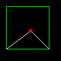
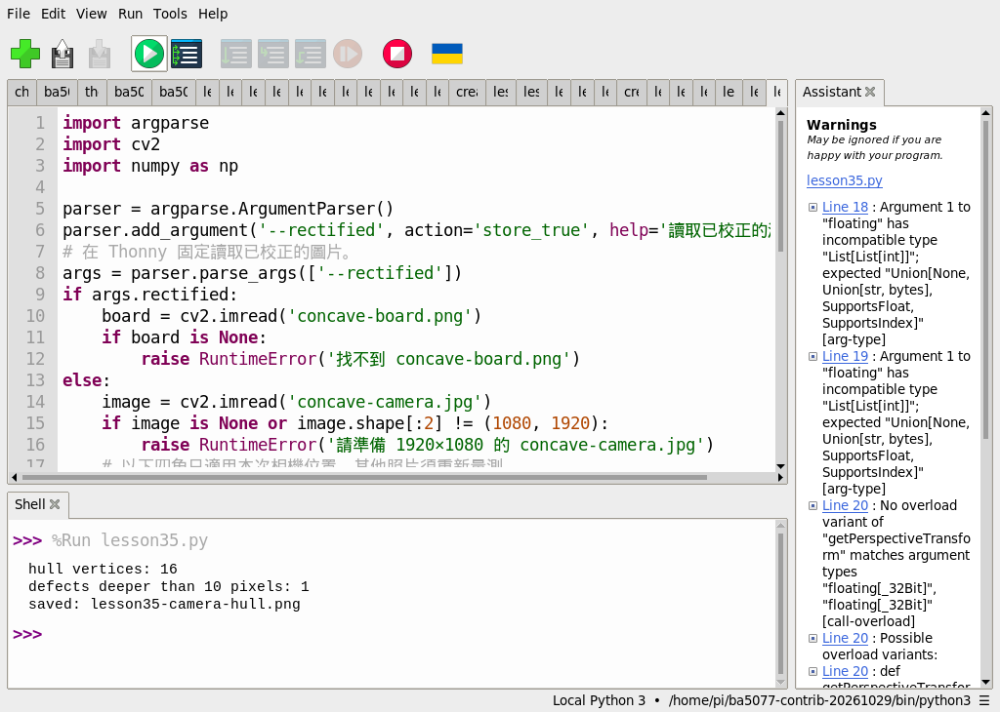
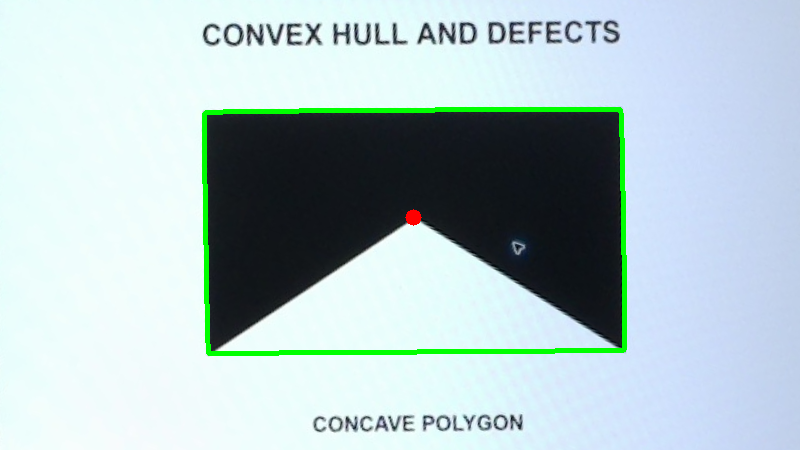

# 第 35 課｜使用 OpenCV 檢測凸包與凹缺點

[原始文章](https://liusming.pixnet.net/blog/posts/14222886573) · 更新日期：2026-10-29

> 已在 Thonny 實測先前相機拍攝並校正的圖形凸包和凹缺陷；合成入門範例及自行拍攝流程仍待 Thonny 重測。[逐篇進度](./Thonny逐篇實測狀態.md) · [圖片與程式下載方式](./練習素材/素材下載與使用.md)

## 學習目標

建立凸包並計算輪廓的凸缺陷。

## 事前準備

需要 OpenCV、NumPy；本例建立五個頂點的合成凹多邊形。

本教學程式使用合成資料，沒有把私人相機影像上傳公開 repo；請在自己的練習目錄操作。


### Thonny 準備與素材下載

1. 在 Thonny 依[擴充環境指南](./Thonny環境與套件安裝.md#第-2527-課在-thonny-建立-opencv-擴充環境)建立並選擇已安裝 OpenCV 和 NumPy 的環境。本次使用 Python 3.11、NumPy 1.26.4 和 opencv-contrib-python 4.11.0.86。
2. 從[教材儲存庫](https://github.com/Samuel-ncu/BA5077-RP5-compatibility)按 **Code → Download ZIP** 並解壓；或依[素材指南](./練習素材/素材下載與使用.md)下載單檔。此次 ZIP 下載與解壓未在 RP5 瀏覽器重測。
3. 將[Thonny 版凸包程式](./範例程式/第35課-Thonny校正圖凸包.py)與[已校正的相機圖片](./圖檔/concave-board.png)複製到同一個新的練習資料夾，圖片檔名維持 `concave-board.png`。在 Thonny 用 **File → Open** 開啟程式並按綠色執行鈕；結果為 `lesson35-camera-hull.png`。此版固定使用校正圖，不需要輸入命令列參數。

結果檔可能覆寫同名檔案，執行前先確認練習資料夾。兩張素材皆為 RP5 拍攝螢幕上的圖形後裁切、校正的照片；不是 Thonny 操作截圖。

## 先前終端機入門範例（待 Thonny 重測）

### 程式與執行

將下列程式存為 `第35課.py`，或使用[已測試的範例程式](./範例程式/第35課.py)。

```python
import cv2
import numpy as np
points = np.array([[10, 10], [80, 10], [80, 80], [50, 50], [10, 80]], dtype=np.int32).reshape(-1, 1, 2)
hull = cv2.convexHull(points, returnPoints=False)
defects = cv2.convexityDefects(points, hull)
image = np.zeros((100, 100, 3), dtype=np.uint8)
cv2.polylines(image, [points], True, (255, 255, 255), 1)
cv2.polylines(image, [cv2.convexHull(points)], True, (0, 255, 0), 1)
if defects is not None:
    for defect in defects:
        far = tuple(int(v) for v in points[defect[0][2], 0])
        cv2.circle(image, far, 3, (0, 0, 255), -1)
if not cv2.imwrite('lesson35-hull.png', image):
    raise RuntimeError('image save failed')
print('hull indices', len(hull))
print('defect count', 0 if defects is None else len(defects))
```

用 Thonny 開啟 `第35課.py` 並按綠色執行鈕；此入門例尚未在新環境重測。

## 先前終端機實測輸出

```text
hull indices 4
defect count 1
```

凸包包住原輪廓；凹缺陷數會受點序與輸入形狀影響。

## RP5 實際產生的結果圖



白色為輪廓、綠色為凸包、紅色為凸缺陷位置。 圖片由本課程式在 RP5 執行時儲存，是程式輸出，不是操作畫面截圖。

## 背景與核心概念

### 凸包與凹缺陷是什麼？

凸包可想成用橡皮筋包住輪廓最外圍形成的凸形邊界；凸缺陷描述輪廓相對凸包向內凹陷的位置。影像雜訊與輪廓點的順序可能影響結果。

### 思考、練習與後續應用

解釋一個凹多邊形為什麼可能有凸缺陷；改變點的位置後，凸包和缺陷是否仍相同？

凸包與缺陷可輔助輪廓分析，例如檢查形狀，但不能直接推論手勢或真實物件的身分。

進一步閱讀：[相關官方文件](https://docs.opencv.org/4.x/dd/d49/tutorial_py_contour_features.html)。下方的程式與輸出以標明的本機實測範圍為準；沒有測過的部分不代表已完成。

## 進階實測：分析 RP5 相機拍攝的圖形

### 準備與操作

下載本次[校正後的相機圖](./圖檔/concave-board.png)，存為 `concave-board.png`。若自行拍攝，請在[相機測試畫面](./練習素材/RP5相機測試.html)選「凸包與凹缺陷」，拍成 `concave-camera.jpg`；四個校正點只適用本次相機位置，其他照片須重新量測。 與[Thonny 版範例程式](./範例程式/第35課-Thonny校正圖凸包.py)放在 RP5 練習目錄，並確認 OpenCV 和 NumPy 可用；執行前檢查輸出檔名以免覆蓋。

```python
import argparse
import cv2
import numpy as np

parser = argparse.ArgumentParser()
parser.add_argument('--rectified', action='store_true', help='讀取已校正的測試圖')
# 在 Thonny 固定讀取已校正的圖片。
args = parser.parse_args(['--rectified'])
if args.rectified:
    board = cv2.imread('concave-board.png')
    if board is None:
        raise RuntimeError('找不到 concave-board.png')
else:
    image = cv2.imread('concave-camera.jpg')
    if image is None or image.shape[:2] != (1080, 1920):
        raise RuntimeError('請準備 1920×1080 的 concave-camera.jpg')
    # 以下四角只適用本次相機位置，其他照片須重新量測。
    source = np.float32([[755, 270], [1385, 65], [1484, 412], [856, 604]])
    target = np.float32([[0, 0], [799, 0], [799, 449], [0, 449]])
    board = cv2.warpPerspective(image, cv2.getPerspectiveTransform(source, target), (800, 450))
    if not cv2.imwrite('concave-board.png', board):
        raise RuntimeError('無法儲存校正圖片')
gray = cv2.cvtColor(board, cv2.COLOR_BGR2GRAY)
_, mask = cv2.threshold(gray, 90, 255, cv2.THRESH_BINARY_INV)
contours, _ = cv2.findContours(mask, cv2.RETR_EXTERNAL, cv2.CHAIN_APPROX_SIMPLE)
if not contours:
    raise RuntimeError('找不到輪廓，請檢查相機畫面、座標及閾值')
contour = max(contours, key=cv2.contourArea)
hull = cv2.convexHull(contour, returnPoints=False)
defects = cv2.convexityDefects(contour, hull)
deep = [] if defects is None else [d for d in defects if d[0][3] / 256.0 > 10]
cv2.drawContours(board, [cv2.convexHull(contour)], -1, (0, 255, 0), 3)
for defect in deep:
    far_index = defect[0][2]
    x, y = (int(v) for v in contour[far_index, 0])
    cv2.circle(board, (x, y), 8, (0, 0, 255), -1)
if not cv2.imwrite('lesson35-camera-hull.png', board):
    raise RuntimeError('無法儲存結果')
print('hull vertices:', len(hull))
print('defects deeper than 10 pixels:', len(deep))
print('saved: lesson35-camera-hull.png')
```

在 Thonny 開啟上面的 Thonny 版程式並按綠色執行鈕。本次只在 Thonny 驗證校正圖，自行拍攝的原始照片模式是先前終端機紀錄，待 Thonny 重測。

### 本次 Thonny 在 RP5 實際輸出

```text
hull vertices: 16
defects deeper than 10 pixels: 1
saved: lesson35-camera-hull.png
```



截圖中的 `lesson35.py` 是本課測試程式的副本；圖片由先前相機拍攝並校正。



綠線是凸包，紅點為深度大於 10 像素的凹缺陷位置。凸包有 16 個點不代表物體有 16 個人工設計的角；數位輪廓、拍攝、閾值和縮放均可能產生更多點。缺陷深度採 OpenCV 輸出的固定點格式除以 256 轉為像素。 圖案是螢幕上的測試素材，圖片由 RP5 相機拍攝後裁切、校正與處理，不是操作截圖。原始照片的周圍環境未公開。

### 學生練習與限制

修改近似誤差或面積／深度門檻前，先預測哪些點可能消失，再記錄實際結果。單一生成測試圖不能證明演算法對其他形狀、光線、反光或視角都有相同效果。

## 與原文章的差異

- 新增使用可下載校正圖的 Thonny 實測和操作截圖。

- 原文使用外部圖片；本版以固定多邊形驗證凸包和凹缺陷 API，未測試原圖。
- 以上是本機實際合成資料輸出；不同版本可能產生不同數值。
- 新增校正圖範例的 Thonny 操作截圖；合成入門及自行拍攝流程尚待重測。
- 新增初學者背景、概念、思考練習及後續應用，實測範圍仍以本文標示為準。
- 新增 RP5 相機拍攝螢幕圖形的實測；圖片經校正，尚未驗證原文外部圖片。
