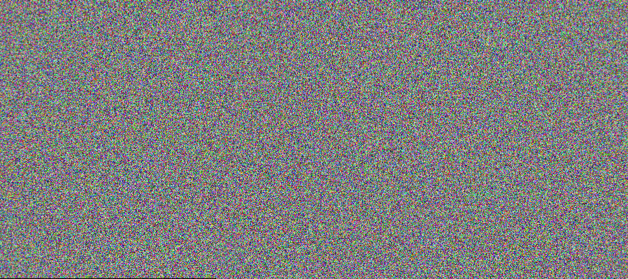

# 第 36 課｜使用 OpenCV 進行全景拼接

[原始文章](https://liusming.pixnet.net/blog/posts/14222886579) · 更新日期：2026-10-29

## 學習目標

驗證 OpenCV 拼接器能否處理兩張有重疊的影像。

## 事前準備

OpenCV、NumPy；程式使用同一合成場景裁出的兩張影像。

## 程式與執行

將下列已在 RP5 執行的程式存為 `第36課.py`，或使用[範例程式](./範例程式/第36課.py)。先確認目前目錄及檔案，避免覆蓋已有資料。

```python
import cv2
import numpy as np

rng = np.random.default_rng(42)
scene = rng.integers(0, 256, (400, 900, 3), dtype=np.uint8)
left = scene[:, :600].copy()
right = scene[:, 300:].copy()
stitcher = cv2.Stitcher_create(cv2.Stitcher_PANORAMA)
status, panorama = stitcher.stitch([left, right])
if panorama is not None and not cv2.imwrite('lesson36-panorama.png', panorama):
    raise RuntimeError('image save failed')
print('stitch status', status)
print('panorama produced', panorama is not None)
```

執行 `python3 第36課.py`。

## 本機實際輸出

```text
stitch status 0
panorama produced True
```

狀態 0 表示這個合成案例成功。真實照片需要足夠重疊、紋理和合適拍攝角度；並未測試原文的照片。

## RP5 實際產生的結果圖



合成隨機影像拼接後的結果；輸入不是相機照片。 圖片由本課程式在 RP5 執行時儲存，是程式輸出，不是操作畫面截圖。

## 與原文章的差異

- 原文以實際圖片檔進行拼接；本版先以重疊的合成影像驗證流程。
- 真實場景的準確率、速度和操作畫面尚未完整驗證。
- 尚未保存操作畫面截圖。
