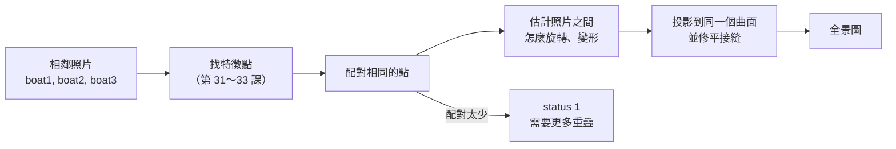
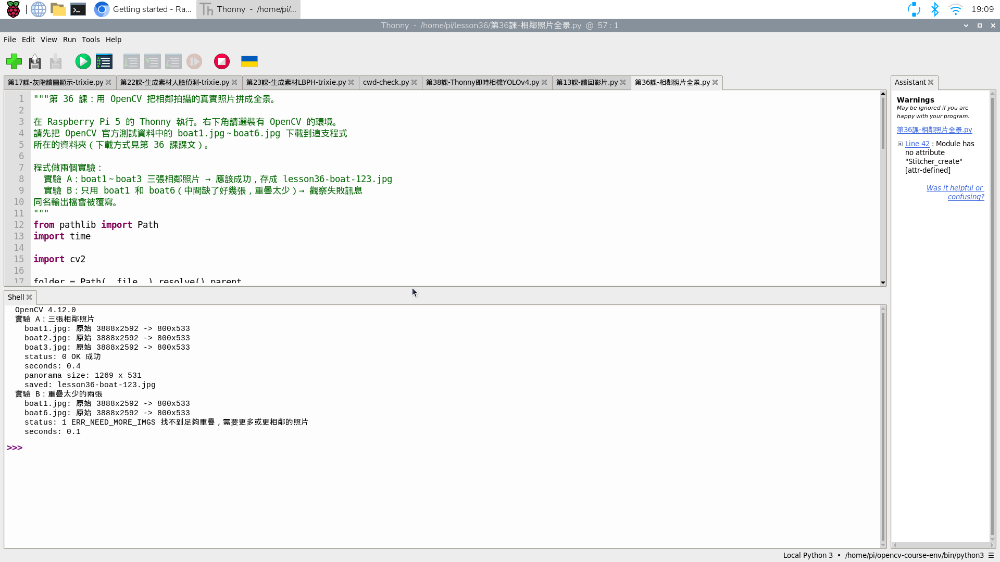
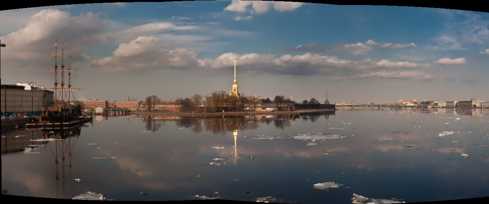
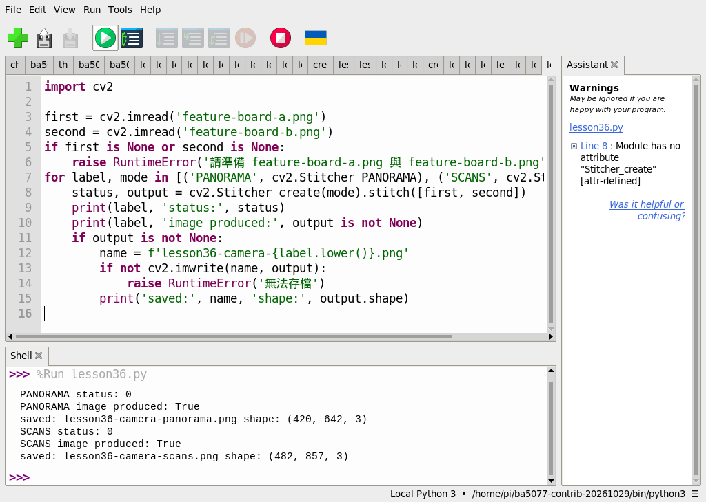
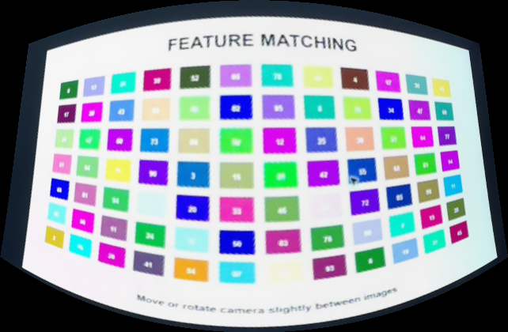
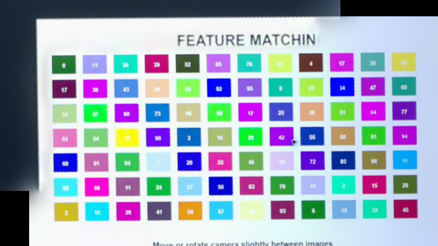
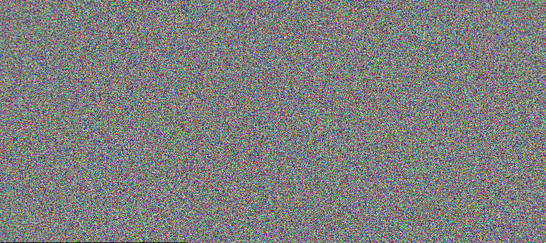

# 第 36 課｜使用 OpenCV 進行全景拼接

[原始文章](https://liusming.pixnet.net/blog/posts/14222886579) · 教學編排修訂：2026-11-11（編修前版本存於[歷史紀錄](./歷史紀錄/第36課-編修前-20261111.md)）

手機的「全景模式」會要你一邊拍、一邊慢慢轉身。為什麼不能隨便拍幾張？因為電腦要在相鄰兩張照片裡找到**同一棟房子、同一朵雲**，才知道它們該怎麼接。這一課我們拿三張真的相鄰拍攝的港口照片，在 RP5 上接成一張寬廣的全景，再故意拿兩張重疊太少的照片，看看失敗時 OpenCV 怎麼告訴我們。

第一次準備環境的同學，可以先讀[課前學習說明](./學習前先讀我.md)；操作遇到紅字時，我們用[排錯故事](./程式卡住時怎麼辦.md)一起找原因。

## 這一課要完成什麼

1. 用自己的話說明全景拼接的三個步驟：找共同特徵、估計照片間的對應關係、變形後接在一起。
2. 在 RP5 的 Thonny 執行程式，把三張相鄰照片拼成 `lesson36-boat-123.jpg`。
3. 看懂 `status` 數字：0 代表成功，1 代表重疊不夠；並能說出失敗時要補什麼照片。

## 先想一想：電腦怎麼知道兩張照片要接在哪裡？



這張流程圖是教學示意，不是操作截圖。

- **特徵點**：照片中很好認的小角落或花紋，例如屋頂尖端、船桅。第 31～33 課已經用 SIFT、ORB 找過它們。
- **重疊**：兩張照片拍到同一塊區域。一般建議相鄰照片重疊約三成以上；重疊越少，能配對的點就越少。
- **`cv2.Stitcher`**：OpenCV 內建的拼接器，把上面所有步驟包成一個 `stitch()` 呼叫。我們先會用它，再慢慢理解裡面的步驟。

## 第一步：準備環境、資料夾與照片

**為什麼先做這一步：**拼接需要 OpenCV，也需要真的相鄰拍攝的照片。這一課不用相機，所以不必擔心相機被占用。

1. **Thonny 環境（在 RP5 桌面）。**使用[第 14 課](./第%2014%20課｜在%20Raspberry%20Pi%205%20安裝%20OpenCV.md)建立並裝好 OpenCV 的環境。本課紀錄使用 `/home/pi/opencv-course-env/bin/python3`。在 Thonny 的 **Tools → Options → Interpreter** 選它，回主畫面確認右下角路徑。拼接器屬於一般 OpenCV，不需要 contrib 擴充版。
2. **練習資料夾。**在 RP5 的檔案管理員於家目錄建立新資料夾，例如 `/home/pi/lesson36`。把[本課程式](./範例程式/第36課-相鄰照片全景.py)下載放進去。
3. **下載照片。**照片來自 OpenCV 官方的測試資料（[opencv_extra 的 stitching 資料夾](https://github.com/opencv/opencv_extra/tree/4.x/testdata/stitching)），是同一位置轉向拍攝的港口景色，本教材庫不另外附上。在 RP5 開啟**終端機**，貼上下面整段指令後按 Enter：

   ```bash
   cd ~/lesson36
   for n in 1 2 3 6; do
     curl -fL -o boat$n.jpg https://raw.githubusercontent.com/opencv/opencv_extra/4.x/testdata/stitching/boat$n.jpg
   done
   ls -l boat*.jpg
   ```

   `cd` 先進入練習資料夾，`curl` 逐一下載 `boat1.jpg`、`boat2.jpg`、`boat3.jpg` 和 `boat6.jpg`。最後的 `ls -l` 應列出四個檔案，每個約 0.6～0.8 MB。若出現 `Could not resolve host`，表示 RP5 沒有連上網路；也可以在瀏覽器開啟上面的 GitHub 連結，點檔名後按下載，再把檔案移到 `~/lesson36`。

如果你自己的練習資料夾名稱不同，請把第一行的 `~/lesson36` 改成你的資料夾。程式只會從**程式所在的資料夾**讀照片。

## 第二步：讀程式，找到兩個實驗

完整程式如下，和可下載的[範例程式](./範例程式/第36課-相鄰照片全景.py)相同：

```python
from pathlib import Path
import time

import cv2

folder = Path(__file__).resolve().parent
WIDTH = 800  # 先縮小到 800 像素寬，RP5 算得比較快

STATUS_TEXT = {
    cv2.Stitcher_OK: "OK 成功",
    cv2.Stitcher_ERR_NEED_MORE_IMGS: "ERR_NEED_MORE_IMGS 找不到足夠重疊，需要更多或更相鄰的照片",
    cv2.Stitcher_ERR_HOMOGRAPHY_EST_FAIL: "ERR_HOMOGRAPHY_EST_FAIL 無法估計照片間的對應關係",
    cv2.Stitcher_ERR_CAMERA_PARAMS_ADJUST_FAIL: "ERR_CAMERA_PARAMS_ADJUST_FAIL 相機參數調整失敗",
}


def load(name):
    path = folder / name
    image = cv2.imread(str(path))
    if image is None:
        raise FileNotFoundError(f"讀不到 {path}，請確認檔名與資料夾")
    scale = WIDTH / image.shape[1]
    small = cv2.resize(image, None, fx=scale, fy=scale, interpolation=cv2.INTER_AREA)
    print(f"  {name}: 原始 {image.shape[1]}x{image.shape[0]} -> {small.shape[1]}x{small.shape[0]}")
    return small


def experiment(title, names, output_name):
    print(title)
    images = [load(name) for name in names]
    stitcher = cv2.Stitcher_create(cv2.Stitcher_PANORAMA)
    started = time.monotonic()
    status, panorama = stitcher.stitch(images)
    seconds = time.monotonic() - started
    print("  status:", status, STATUS_TEXT.get(status, "其他錯誤"))
    print("  seconds:", round(seconds, 1))
    if status == cv2.Stitcher_OK:
        cv2.imwrite(str(folder / output_name), panorama)
        print("  panorama size:", panorama.shape[1], "x", panorama.shape[0])
        print("  saved:", output_name)


print("OpenCV", cv2.__version__)
experiment("實驗 A：三張相鄰照片", ["boat1.jpg", "boat2.jpg", "boat3.jpg"], "lesson36-boat-123.jpg")
experiment("實驗 B：重疊太少的兩張", ["boat1.jpg", "boat6.jpg"], "lesson36-boat-16.jpg")
```

先找這幾個地方：

- `load()`：讀照片並縮小到 800 像素寬。原圖是 3888 × 2592，直接拼接也行，但 RP5 要算比較久；縮小後特徵仍夠用。`imread` 讀不到檔案時會得到 `None`，程式就停下來告訴你哪個檔案找不到。
- `cv2.Stitcher_create(cv2.Stitcher_PANORAMA)`：建立「全景模式」的拼接器，適合站在原地轉動相機拍的照片。
- `stitcher.stitch(images)`：一次完成找特徵、配對、變形與接合，回傳 `status` 和結果圖。**先看 `status`**，只有 0 才有可用的全景圖。
- 最後兩行就是兩個實驗：A 用三張緊鄰的照片；B 跳過中間四張，只拿第一張和第六張。

## 第三步：在 Thonny 執行並看結果

1. 在 Thonny 選 **File → Open**，開啟 `~/lesson36/第36課-相鄰照片全景.py`。
2. 確認右下角是第一步選的環境，按綠色 **Run**。
3. 幾秒內 Shell 會印出兩個實驗的結果；`lesson36-boat-123.jpg` 會出現在練習資料夾。再次執行會覆寫它。
4. 在檔案管理員雙擊 `lesson36-boat-123.jpg` 打開來看。

### 本次 RP5 實測結果（2026-11-11）

環境：Raspberry Pi 5 Model B、既有 Debian 13（Trixie）64 位元、Python 3.13.5、OpenCV 4.12.0；直譯器 `/home/pi/opencv-course-env/bin/python3`（第 14 課建立的環境）。照片以上面的 `curl` 指令下載，和程式一起放在 `~/lesson36`。

下面是在 RP5 桌面的 Thonny 按 **Run** 的實際畫面。Shell 被往上拉大，好讓兩個實驗的輸出一次看完；右下角狀態列是 `/home/pi/opencv-course-env/bin/python3`：



*圖：RP5 桌面操作截圖（2026-11-11）。右側 Assistant 面板出現「Module has no attribute "Stitcher_create"」的提醒，那是 Thonny 靜態檢查看不懂 OpenCV 的寫法，程式實際上執行成功，可以忽略。*

Thonny Shell 的文字輸出：

```text
OpenCV 4.12.0
實驗 A：三張相鄰照片
  boat1.jpg: 原始 3888x2592 -> 800x533
  boat2.jpg: 原始 3888x2592 -> 800x533
  boat3.jpg: 原始 3888x2592 -> 800x533
  status: 0 OK 成功
  seconds: 0.4
  panorama size: 1269 x 531
  saved: lesson36-boat-123.jpg
實驗 B：重疊太少的兩張
  boat1.jpg: 原始 3888x2592 -> 800x533
  boat6.jpg: 原始 3888x2592 -> 800x533
  status: 1 ERR_NEED_MORE_IMGS 找不到足夠重疊，需要更多或更相鄰的照片
  seconds: 0.1
```

同一天較早曾以 SSH 用同一個直譯器執行（不是在 Thonny 按 Run），結果相同，只有實驗 A 的秒數是 0.5：

```text
OpenCV 4.12.0
實驗 A：三張相鄰照片
  boat1.jpg: 原始 3888x2592 -> 800x533
  boat2.jpg: 原始 3888x2592 -> 800x533
  boat3.jpg: 原始 3888x2592 -> 800x533
  status: 0 OK 成功
  seconds: 0.5
  panorama size: 1269 x 531
  saved: lesson36-boat-123.jpg
實驗 B：重疊太少的兩張
  boat1.jpg: 原始 3888x2592 -> 800x533
  boat6.jpg: 原始 3888x2592 -> 800x533
  status: 1 ERR_NEED_MORE_IMGS 找不到足夠重疊，需要更多或更相鄰的照片
  seconds: 0.1
```



這張是程式輸出的 `lesson36-boat-123.jpg`，不是操作截圖；輸入照片來自 OpenCV 官方測試資料 boat1～boat3，不是 RP5 相機拍攝。

### 這些結果代表什麼

- **實驗 A 的 `status: 0`**：三張照片之間找到足夠的共同特徵，成功接成一張。寬度從單張 800 變成 1269，代表視野確實變寬了。
- **四周彎曲的黑邊**：拼接器把照片投影到圓柱或球面上，再攤平，所以邊緣會彎。這是全景的正常現象，不是失敗；需要時可以自己裁掉黑邊。
- **實驗 B 的 `status: 1`**：boat1 和 boat6 中間差了四張，幾乎沒有共同區域，拼接器找不到足夠配對，乾脆拒絕。這時程式不會存出 `lesson36-boat-16.jpg`。解決方法不是調程式，而是**補上中間的照片**，例如改成 boat1～boat6 全部六張。
- `seconds` 會隨 RP5 當下負擔改變，你的數字不一定相同；判斷成功看的是 `status` 和輸出圖，而不是秒數。

## 遇到問題時

| 你看到的情況 | 可能原因 | 先試試看 |
| --- | --- | --- |
| `FileNotFoundError: 讀不到 ...boat1.jpg` | 照片沒放在程式同一個資料夾，或檔名打錯 | 在終端機 `ls ~/lesson36` 確認；檔名要全部小寫、副檔名 `.jpg`。 |
| `ModuleNotFoundError: No module named 'cv2'` | Thonny 右下角選錯環境 | 改選第 14 課的 OpenCV 環境。參考[排錯故事二](./程式卡住時怎麼辦.md#第二個故事明明裝好了程式卻說找不到-cv2)。 |
| `curl: (6) Could not resolve host` | RP5 沒有網路 | 檢查右上角網路圖示，或改用另一台電腦下載後用隨身碟複製。 |
| `status: 1` | 照片之間重疊太少、或照片是不同地點 | 加入中間的照片；自己拍時讓相鄰照片重疊約三成以上。 |
| `status: 2` 或 `3` | 配對到的點不一致，例如畫面中有大量重複圖案或移動的物體 | 換一組照片；拍攝時站在原地只轉動相機，避免拍到移動中的人車。 |
| 很久沒有反應 | 照片太大或太多 | 確認 `WIDTH` 有縮小；先試三張再增加。 |

## 練習：一次只改一個地方

1. 把實驗 A 改成六張：`["boat1.jpg", "boat2.jpg", ..., "boat6.jpg"]`（需先把 boat4、boat5 也下載下來）。預測全景會變多寬，再執行驗證。
2. 把實驗 A 的照片順序打亂，例如 `boat3, boat1, boat2`，觀察結果是否仍成功。拼接器會自己找配對，不一定依照你給的順序。
3. 把 `WIDTH` 改成 `400`，比較秒數與結果圖的細節；再改成 `1600` 比較一次。
4. 延伸：用[第 18 課](./第%2018%20課｜使用%20Picamera2%20拍攝照片並保存至本地.md)的方法，讓 RP5 相機在原地慢慢轉向，拍三張互相重疊的照片後拼接。拍攝前確認畫面裡沒有他人臉孔或私人資料。本延伸尚未實測。

每次只改一項，記下改了什麼、`status`、秒數和結果圖的變化。

## 補充一：相機拍攝的校正圖拼接（先前 Thonny 實測）

第 31～33 課使用的兩張相機實拍、裁切校正圖 [feature-board-a.png](./圖檔/feature-board-a.png) 和 [feature-board-b.png](./圖檔/feature-board-b.png)，是同一個測試板以不同顯示大小分別拍攝，**不是相鄰的風景照**。把它們與[程式檔](./範例程式/第36課-相機影像拼接.py)放在同一資料夾，在 Thonny 執行，可比較 PANORAMA 與 SCANS 兩種模式：

```python
import cv2

first = cv2.imread('feature-board-a.png')
second = cv2.imread('feature-board-b.png')
if first is None or second is None:
    raise RuntimeError('請準備 feature-board-a.png 與 feature-board-b.png')
for label, mode in [('PANORAMA', cv2.Stitcher_PANORAMA), ('SCANS', cv2.Stitcher_SCANS)]:
    status, output = cv2.Stitcher_create(mode).stitch([first, second])
    print(label, 'status:', status)
    print(label, 'image produced:', output is not None)
    if output is not None:
        name = f'lesson36-camera-{label.lower()}.png'
        if not cv2.imwrite(name, output):
            raise RuntimeError('無法存檔')
        print('saved:', name, 'shape:', output.shape)
```

先前 RP5 Thonny Shell 實際輸出：

```text
PANORAMA status: 0
PANORAMA image produced: True
saved: lesson36-camera-panorama.png shape: (420, 642, 3)
SCANS status: 0
SCANS image produced: True
saved: lesson36-camera-scans.png shape: (482, 857, 3)
```



截圖中的 `lesson36.py` 是本段程式的測試副本，內容相同；這是 Thonny 操作截圖。





這兩張是程式輸出。雖然狀態都是 0，結果仍有彎曲、裁切或黑邊；兩張圖拍的是同一塊板子，所以並沒有「擴大視野」。這正好和主線的港口全景對照：`status: 0` 只說明接得起來，是否真的變成全景要看輸入照片是不是相鄰的。

## 補充二：合成隨機影像（先前終端機實測）

如果還沒有網路下載照片，可以先用程式自己產生一張隨機雜訊圖，切成左右重疊的兩半再拼回去，確認 OpenCV 拼接器能運作。完整檔案見[範例程式](./範例程式/第36課.py)。

```python
import cv2
import numpy as np

rng = np.random.default_rng(42)
scene = rng.integers(0, 256, (400, 900, 3), dtype=np.uint8)
left = scene[:, :600].copy()
right = scene[:, 300:].copy()
stitcher = cv2.Stitcher_create(cv2.Stitcher_PANORAMA)
status, panorama = stitcher.stitch([left, right])
if panorama is not None and not cv2.imwrite('lesson36-panorama.png', panorama):
    raise RuntimeError('image save failed')
print('stitch status', status)
print('panorama produced', panorama is not None)
```

先前以終端機執行的輸出（尚未在 Thonny 重測）：

```text
stitch status 0
panorama produced True
```



輸入不是相機照片，結果圖是程式輸出。

## 後續應用與提醒

全景拼接可用於記錄教室、展場或實驗環境的全貌。實際應用要注意：拍攝時盡量站在原地轉動、讓相鄰照片重疊、避開移動中的人車；公開前檢查畫面裡有沒有他人臉孔、車牌或私人資料。

延伸閱讀：[OpenCV 拼接器官方教學](https://docs.opencv.org/4.x/d8/d19/tutorial_stitcher.html)。

## 與原文章的差異

- 2026-11-11 全文重編為零基礎學生路徑，主線改為**真實相鄰照片**拼接，新增[主程式](./範例程式/第36課-相鄰照片全景.py)、照片下載指令、`status` 對照、失敗對照實驗與排錯表；原有校正圖及合成例改列補充。
- 新增實測：既有 Trixie 的 RP5，以第 14 課 `opencv-course-env`（OpenCV 4.12.0）拼接 OpenCV 官方測試照片 boat1～3，`status 0`、1269 × 531；boat1＋boat6 回報 `status 1`。首次以 SSH 執行；同日稍晚在 RP5 桌面的 **Thonny 按 Run** 重現相同結果（實驗 A 0.4 秒），附完整操作截圖。
- 輸入照片來自 OpenCV 官方測試資料，不是 RP5 相機拍攝；學生自行用相機拍攝相鄰照片的延伸尚未實測。
- 未驗證原文使用的照片、拼接品質評分或速度比較；上述輸出為本次實機紀錄，其他版本或環境可能不同。

<details>
<summary>給教師：實測範圍與版本備註</summary>

> - 2026-11-11 主線實測位於 `/home/pi/ba5077-validation-20261111/lesson36/`。照片自 `https://raw.githubusercontent.com/opencv/opencv_extra/4.x/testdata/stitching/` 下載，SHA-256：boat1 `c084dab5…3f2e`、boat2 `3bb4e222…33ad`、boat3 `dd3c5c15…3e65`、boat6 `48f20d18…4e34`。opencv_extra 根目錄未見授權檔，因此本庫不收錄原始照片，只收錄縮小後拼接的輸出圖並註明來源；若需更嚴格的授權，可改用自行拍攝的照片取代輸出圖。
> - 先前兩張校正圖的 Thonny 結果與合成例保持原狀，不重做。2026-11-11 晚間 Thonny 補測：程式與 boat1、2、3、6 複製到學生路徑 `~/lesson36/`，經 SSH 通道連到 RP5 上僅聽本機的臨時 wayvnc，在 Thonny 以 **File → Open** 開檔、選 `opencv-course-env`、按 Run，截圖以 `grim` 擷取整個 RP5 桌面。仍待補：相機自拍相鄰照片。
> - [逐篇進度](./Thonny逐篇實測狀態.md) · [圖片與程式下載方式](./練習素材/素材下載與使用.md)

</details>
