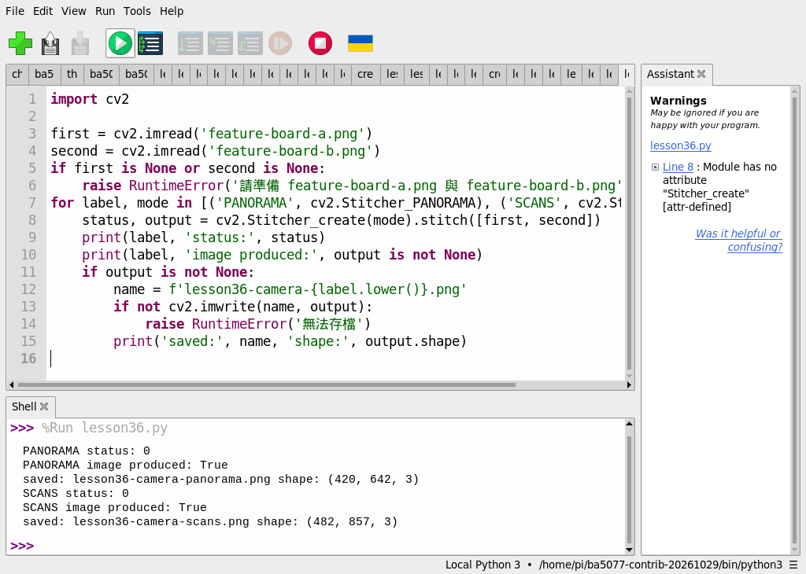
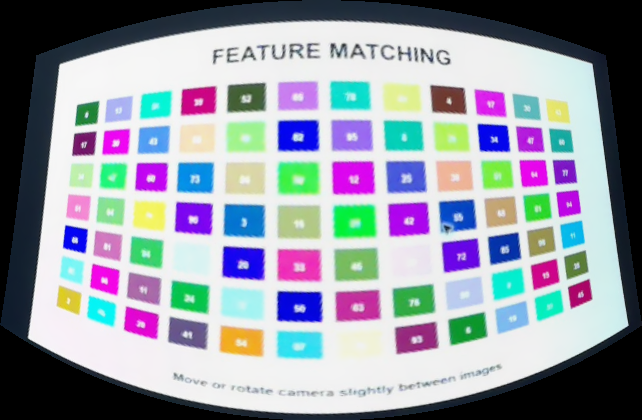
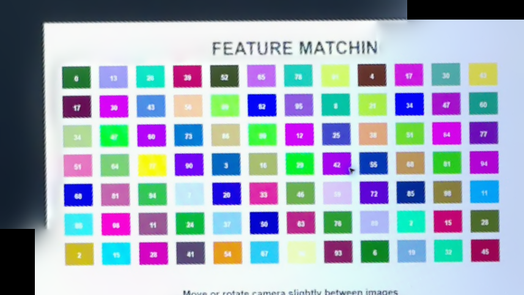

# 第 36 課｜使用 OpenCV 進行全景拼接

[原始文章](https://liusming.pixnet.net/blog/posts/14222886579) · 更新日期：2026-10-29

> 已在 Thonny 實測兩張先前相機校正圖的 PANORAMA 與 SCANS 拼接；合成範例與真實相鄰場景仍待重測。[逐篇進度](./Thonny逐篇實測狀態.md) · [圖片與程式下載方式](./練習素材/素材下載與使用.md)

## 學習目標

驗證 OpenCV 拼接器能否處理兩張有重疊的影像。

## 事前準備

OpenCV、NumPy；程式使用同一合成場景裁出的兩張影像。


### 在 Thonny 準備環境與素材

1. 依[Thonny 擴充環境指南](./Thonny環境與套件安裝.md#第-2527-課在-thonny-建立-opencv-擴充環境)建立並選擇環境。本次使用 Python 3.11、NumPy 1.26.4 與 opencv-contrib-python 4.11.0.86。
2. 從[教材儲存庫](https://github.com/Samuel-ncu/BA5077-RP5-compatibility)按 **Code → Download ZIP** 並解壓，或依[素材指南](./練習素材/素材下載與使用.md)下載單檔。本次 ZIP 下載及解壓步驟未在 RP5 瀏覽器重測。
3. 把[本課相機圖拼接程式](./範例程式/第36課-相機影像拼接.py)、[校正圖 A](./圖檔/feature-board-a.png)及[校正圖 B](./圖檔/feature-board-b.png)複製到同一個新的練習資料夾，保留圖片檔名。圖是 RP5 分兩次拍攝螢幕上相同圖案並校正得到，並非相鄰風景照。
4. 在 Thonny 選 **File → Open** 開啟程式，確認右下角解譯器，按綠色執行鈕。輸出 PNG 保存在練習目錄，重新執行可能覆寫同名檔案。

## 先前終端機合成範例（待 Thonny 重測）

### 程式與執行

將下列已在 RP5 執行的程式存為 `第36課.py`，或使用[範例程式](./範例程式/第36課.py)。先確認目前目錄及檔案，避免覆蓋已有資料。

```python
import cv2
import numpy as np

rng = np.random.default_rng(42)
scene = rng.integers(0, 256, (400, 900, 3), dtype=np.uint8)
left = scene[:, :600].copy()
right = scene[:, 300:].copy()
stitcher = cv2.Stitcher_create(cv2.Stitcher_PANORAMA)
status, panorama = stitcher.stitch([left, right])
if panorama is not None and not cv2.imwrite('lesson36-panorama.png', panorama):
    raise RuntimeError('image save failed')
print('stitch status', status)
print('panorama produced', panorama is not None)
```

在 Thonny 開啟 `第36課.py` 並按綠色執行鈕；此合成入門例尚未在新環境重測。

## 先前終端機實測輸出

```text
stitch status 0
panorama produced True
```

狀態 0 表示這個合成案例成功。真實照片需要足夠重疊、紋理和合適拍攝角度；並未測試原文的照片。

## RP5 實際產生的結果圖


合成隨機影像拼接後的結果；輸入不是相機照片。 圖片由本課程式在 RP5 執行時儲存，是程式輸出，不是操作畫面截圖。

## 背景與核心概念

### 全景影像如何拼接？

相鄰照片若有足夠重疊與可辨識特徵，可以先找出匹配點，再估計影像之間的幾何關係並合成。實際拍攝的視角、重疊比例、光線及移動物體都可能使拼接失敗。

### 思考、練習與後續應用

合成影像拼接成功能證明什麼？如果兩張照片沒有重疊或圖案重複，預期會遇到什麼困難？

全景可用於場景記錄；實際應用需要測試失敗狀況，並處理透視、接縫與個人資訊。

進一步閱讀：[相關官方文件](https://docs.opencv.org/4.x/d8/d19/tutorial_stitcher.html)。下方的程式與輸出以標明的本機實測範圍為準；沒有測過的部分不代表已完成。

## 進一步實驗：兩張相機照片的拼接模式

將第 31 至 33 課使用的兩張相機實拍、裁切校正圖 [feature-board-a.png](./圖檔/feature-board-a.png) 和 [feature-board-b.png](./圖檔/feature-board-b.png) 下載到練習目錄，再保存[程式檔](./範例程式/第36課-相機影像拼接.py)，在 Thonny 開啟並按綠色執行鈕。兩張圖是同一測試板以不同顯示大小分別拍攝；它們不是相鄰的真實風景照片。

```python
import cv2

first = cv2.imread('feature-board-a.png')
second = cv2.imread('feature-board-b.png')
if first is None or second is None:
    raise RuntimeError('請準備 feature-board-a.png 與 feature-board-b.png')
for label, mode in [('PANORAMA', cv2.Stitcher_PANORAMA), ('SCANS', cv2.Stitcher_SCANS)]:
    status, output = cv2.Stitcher_create(mode).stitch([first, second])
    print(label, 'status:', status)
    print(label, 'image produced:', output is not None)
    if output is not None:
        name = f'lesson36-camera-{label.lower()}.png'
        if not cv2.imwrite(name, output):
            raise RuntimeError('無法存檔')
        print('saved:', name, 'shape:', output.shape)
```

RP5 本次 Thonny Shell 實際輸出：

```text
PANORAMA status: 0
PANORAMA image produced: True
saved: lesson36-camera-panorama.png shape: (420, 642, 3)
SCANS status: 0
SCANS image produced: True
saved: lesson36-camera-scans.png shape: (482, 857, 3)
```



截圖中的 `lesson36.py` 是本課程式的測試副本，內容相同。





這兩張是程式輸出的圖，不是操作截圖。雖然兩次狀態皆為 0，結果仍有彎曲、裁切或黑邊；成功狀態不保證視覺品質，也未證明擴大視野的風景全景已成功。比較兩種模式的形變，思考相片重疊率、鏡頭旋轉及重複圖案會如何影響結果。

## 與原文章的差異

- 本次在 Thonny 使用可下載的兩張校正圖，記錄兩種模式的實際輸出和操作截圖。

- 新增兩張相機拍攝測試板的 PANORAMA 與 SCANS 結果；它們不是相鄰風景照。

- 原文以實際圖片檔進行拼接；本版使用合成影像及兩張相機拍攝的同一測試板驗證流程。
- 真實場景的準確率、速度和操作畫面尚未完整驗證。
- 新增上方校正圖片拼接的 Thonny 操作截圖；合成與真實相鄰場景待重測。
- 新增初學者背景、概念、思考練習及後續應用，實測範圍仍以本文標示為準。
