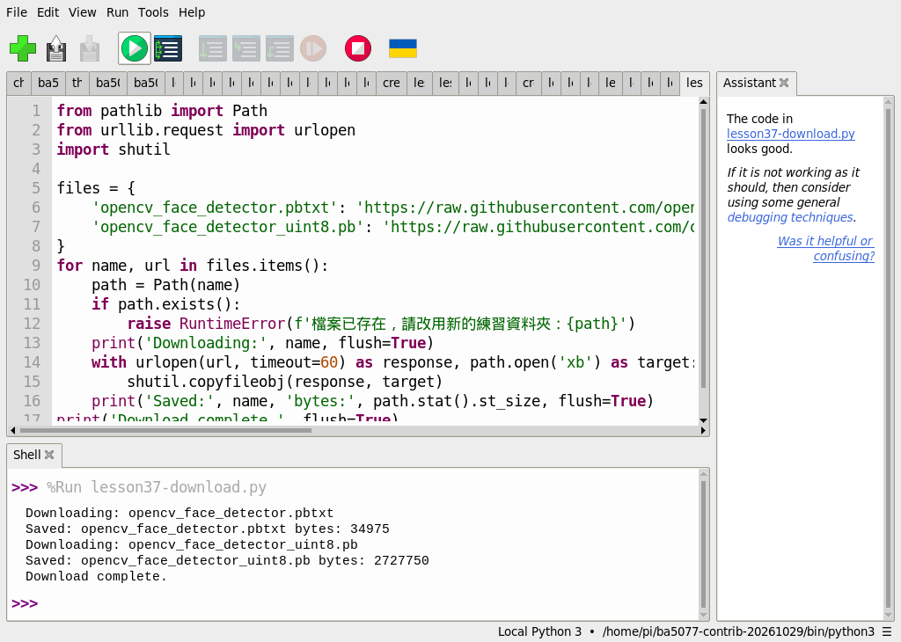
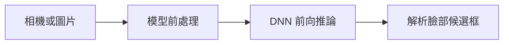
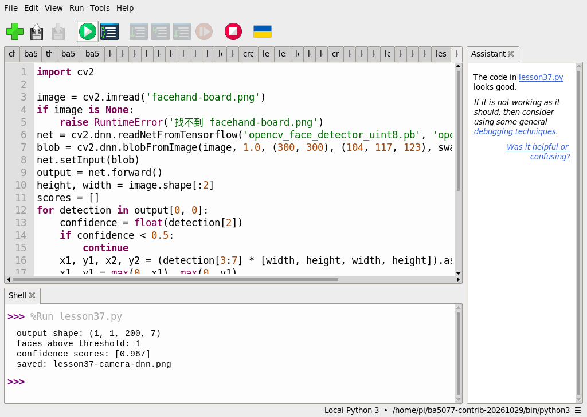
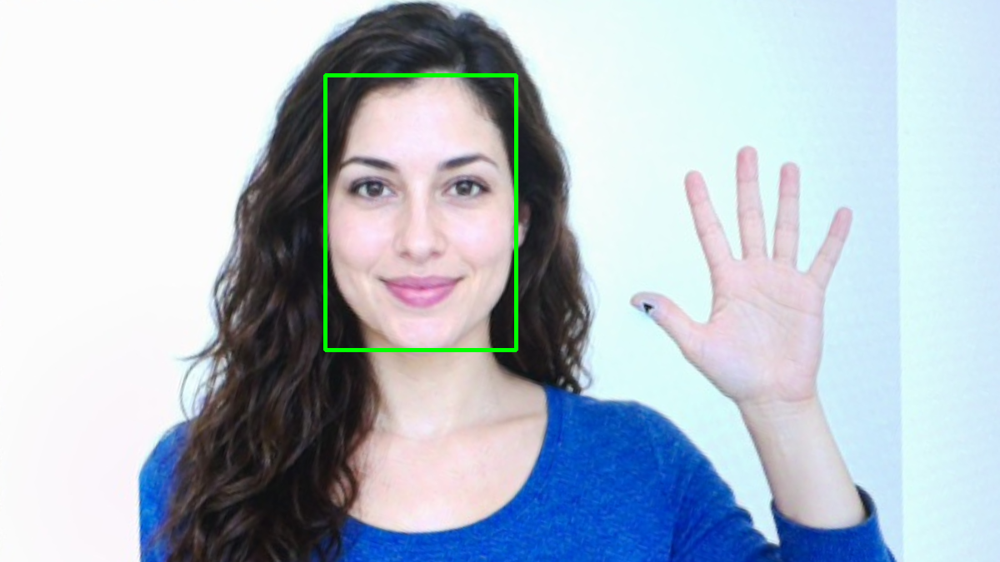

# 第 37 課｜使用 OpenCV DNN 模型進行人臉檢測

[原始文章](https://liusming.pixnet.net/blog/posts/14222886585) · 更新日期：2026-10-29

> 已在 Thonny 實測下載 OpenCV 人臉模型與生成素材照片的單張推論；真人、即時相機及合成空白圖流程仍待重測。[逐篇進度](./Thonny逐篇實測狀態.md) · [圖片與程式下載方式](./練習素材/素材下載與使用.md)

## 學習目標

載入 OpenCV 人臉 DNN 模型並對空白圖像執行一次前向推論。

## 事前準備

需要 OpenCV、NumPy、網路，以及兩個 OpenCV 人臉模型檔。本次在 Thonny 的獨立環境使用 Python 3.11、NumPy 1.26.4 與 opencv-contrib-python 4.11.0.86；依[環境指南](./Thonny環境與套件安裝.md#第-2527-課在-thonny-建立-opencv-擴充環境)建立並選擇環境。模型檔不是 Python 套件，下載模型不等於安裝套件。

### 透過 Thonny 下載模型與準備圖片

1. 從[教材儲存庫](https://github.com/Samuel-ncu/BA5077-RP5-compatibility)按 **Code → Download ZIP** 並解壓，或依[素材指南](./練習素材/素材下載與使用.md)下載單檔。本次 ZIP 下載及解壓未在 RP5 瀏覽器重測。
2. 建立新的練習資料夾，將[模型下載程式](./範例程式/第37課-Thonny下載DNN模型.py)、[單張人臉偵測程式](./範例程式/第37課-相機DNN人臉.py)及[校正後的生成素材照片](./圖檔/facehand-board.png)複製到同一資料夾。圖片檔名須維持 `facehand-board.png`。
3. 在 Thonny 用 **File → Open** 開啟下載程式，閱讀來源網址後按綠色執行鈕。此程式從 OpenCV 的 GitHub 來源取得 `opencv_face_detector.pbtxt` 與 `opencv_face_detector_uint8.pb`，並顯示檔案大小；成功後才繼續。若資料夾已有同名檔，程式會停止而不覆寫，請選用新練習資料夾。網路中斷可能留下不完整檔案，請檢查後使用新資料夾重試。

本次 Thonny 下載實際輸出：

```text
Downloading: opencv_face_detector.pbtxt
Saved: opencv_face_detector.pbtxt bytes: 34975
Downloading: opencv_face_detector_uint8.pb
Saved: opencv_face_detector_uint8.pb bytes: 2727750
Download complete.
```



本次檔案 SHA-256：`opencv_face_detector.pbtxt` 為 `ca0eb6b3a0e0b124282d093a3d8a9d453967f37af3c1a933978ac55605a8f2cb`，`opencv_face_detector_uint8.pb` 為 `5c71d752ef2cbf2f457ac82fdd580fcb2522fd04c5efdaed18eb6d9e2843fbed`。其中一個來源使用 `master`，日後內容可能變動；本課結果以本次檔案和測試日期為準。

4. 在同一資料夾以 Thonny 開啟單張人臉偵測程式，確認右下角解譯器，按綠色執行鈕。結果寫入 `lesson37-camera-dnn.png`；再執行可能覆寫同名檔。照片是相機拍攝螢幕上的 AI 生成虛構人物後經裁切校正，不能代表真人人臉測試。

## 先前終端機空白圖範例（待 Thonny 重測）

### 程式與執行

將下列已在 RP5 執行的程式存為 `第37課.py`，或使用[範例程式](./範例程式/第37課.py)。先確認目前目錄及檔案，避免覆蓋已有資料。

```python
import cv2
import numpy as np

net = cv2.dnn.readNetFromTensorflow('opencv_face_detector_uint8.pb', 'opencv_face_detector.pbtxt')
image = np.zeros((300, 300, 3), dtype=np.uint8)
blob = cv2.dnn.blobFromImage(image, 1.0, (300, 300), (104, 117, 123), False, False)
net.setInput(blob)
result = net.forward()
print('DNN loaded', True)
print('output shape', result.shape)
```

在 Thonny 開啟 `第37課.py` 並按綠色執行鈕；空白圖範例尚未在此新環境重測。

## 先前終端機實際輸出

```text
DNN loaded True
output shape (1, 1, 200, 7)
```

輸出張量形狀不是偵測準確率；此測試並未使用真人影像，也未驗證即時攝影機畫面。

## 背景與核心概念

### 從影像輸出到人臉框

深度神經網路透過訓練後的權重，將影像轉換為候選位置與分數；前向推論是把輸入送過模型取得輸出，不包含重新訓練。輸出張量的形狀不是辨識準確率。

### 思考、練習與後續應用

空白影像能檢查模型載入和執行；為何不能推論真人人臉偵測效果？需要哪些經授權的測試資料？

人臉偵測可用於互動介面；真實影像涉及個人資料，還需考慮誤判與各種光線、臉部角度。

進一步閱讀：[相關官方文件](https://docs.opencv.org/4.x/d2/d58/tutorial_table_of_content_dnn.html)。請以下方實測狀態為準；尚未實作或測試的情境不能視為已通過。

## 概念流程圖



此圖用於說明文章的概念或完整目標流程，**不是操作截圖，也不代表每個步驟都已實測**；本機實測範圍請看文章中的標示。

## 進階實測：對相機拍攝的生成素材執行 DNN 人臉偵測

本次素材是 AI 生成的虛構人物，先顯示於電腦螢幕，再由 RP5 相機拍照並截取校正；詳見[相機實拍與校正流程](./練習素材/相機實拍與校正流程.md)。圖片不是實拍真人。可下載[本次校正後影像](./圖檔/facehand-board.png)作為 `facehand-board.png`，與本篇上方準備的兩個模型檔及[範例程式](./範例程式/第37課-相機DNN人臉.py)放在同一練習目錄。

```python
import cv2

image = cv2.imread('facehand-board.png')
if image is None:
    raise RuntimeError('找不到 facehand-board.png')
net = cv2.dnn.readNetFromTensorflow('opencv_face_detector_uint8.pb', 'opencv_face_detector.pbtxt')
blob = cv2.dnn.blobFromImage(image, 1.0, (300, 300), (104, 117, 123), swapRB=False, crop=False)
net.setInput(blob)
output = net.forward()
height, width = image.shape[:2]
scores = []
for detection in output[0, 0]:
    confidence = float(detection[2])
    if confidence < 0.5:
        continue
    x1, y1, x2, y2 = (detection[3:7] * [width, height, width, height]).astype(int)
    x1, y1 = max(0, x1), max(0, y1)
    x2, y2 = min(width-1, x2), min(height-1, y2)
    cv2.rectangle(image, (x1, y1), (x2, y2), (0, 255, 0), 3)
    scores.append(round(confidence, 3))
if not cv2.imwrite('lesson37-camera-dnn.png', image):
    raise RuntimeError('無法儲存結果')
print('output shape:', output.shape)
print('faces above threshold:', len(scores))
print('confidence scores:', scores)
print('saved: lesson37-camera-dnn.png')
```

在 Thonny 開啟同一練習資料夾中的 `第37課-相機DNN人臉.py`，確認解譯器後按綠色執行鈕。

本次 RP5 的 Thonny Shell 實際輸出：

```text
output shape: (1, 1, 200, 7)
faces above threshold: 1
confidence scores: [0.967]
saved: lesson37-camera-dnn.png
```



截圖中的 `lesson37.py` 是本課偵測程式的測試副本，內容相同。



綠框是本次程式輸出的候選位置。`blobFromImage` 將輸入調整為模型所需的資料格式，`forward` 產生候選結果；程式只畫出信心分數至少 0.5 的候選框。0.967 是此候選的模型分數，不能當作模型在所有人臉上的準確率或判斷身分的證據。

### 練習與應用

比較[第 22 課的 Haar Cascade](./第%2022%20課｜使用%20OpenCV%20進行臉部檢測.md)與本課 DNN：兩者都回答「臉大約在哪裡」，模型輸入和演算法不同。自行調整門檻，記錄候選框變化；真實環境須以獲授權的多樣測試資料評估光線、角度與遮擋，不能只用這一張生成圖。實際人物照片涉及隱私，不要直接公開。

## 與原文章的差異

- 本次改以 Thonny 下載 OpenCV 模型，並對可下載的生成素材照片進行單張推論，保留實測畫面與輸出。

- 原文使用相機即時檢測，來源程式含非標準空白；本版重新寫入程式並以空白圖測試模型。
- 真實場景的準確率、速度和操作畫面尚未完整驗證。
- 新增 Thonny 模型下載及單張照片偵測截圖；即時相機與真人情境仍待測。
- 新增初學者背景、概念、思考練習及後續應用，實測範圍仍以本文標示為準。
- 加入教學流程示意；圖中的完整目標流程不代表已逐步實測。
- 新增相機拍攝 AI 生成素材後的單張 DNN 偵測；未宣稱完成即時視訊或真人資料準確率驗證。
