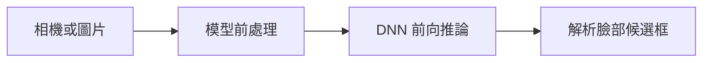

# 第 37 課｜使用 OpenCV DNN 模型進行人臉檢測

[原始文章](https://liusming.pixnet.net/blog/posts/14222886585) · 更新日期：2026-10-29

## 學習目標

載入 OpenCV 人臉 DNN 模型並對空白圖像執行一次前向推論。

## 事前準備

需要系統 OpenCV、NumPy 及下方兩個模型檔。

在練習目錄下載本次測試使用的官方 OpenCV 模型：

```bash
curl -fL https://raw.githubusercontent.com/opencv/opencv/master/samples/dnn/face_detector/opencv_face_detector.pbtxt -o opencv_face_detector.pbtxt
curl -fL https://raw.githubusercontent.com/opencv/opencv_3rdparty/dnn_samples_face_detector_20180220_uint8/opencv_face_detector_uint8.pb -o opencv_face_detector_uint8.pb
```

## 程式與執行

將下列已在 RP5 執行的程式存為 `第37課.py`，或使用[範例程式](./範例程式/第37課.py)。先確認目前目錄及檔案，避免覆蓋已有資料。

```python
import cv2
import numpy as np

net = cv2.dnn.readNetFromTensorflow('opencv_face_detector_uint8.pb', 'opencv_face_detector.pbtxt')
image = np.zeros((300, 300, 3), dtype=np.uint8)
blob = cv2.dnn.blobFromImage(image, 1.0, (300, 300), (104, 117, 123), False, False)
net.setInput(blob)
result = net.forward()
print('DNN loaded', True)
print('output shape', result.shape)
```

執行 `python3 第37課.py`。

## 本機實際輸出

```text
DNN loaded True
output shape (1, 1, 200, 7)
```

輸出張量形狀不是偵測準確率；此測試並未使用真人影像，也未驗證即時攝影機畫面。

## 背景與核心概念

### 從影像輸出到人臉框

深度神經網路透過訓練後的權重，將影像轉換為候選位置與分數；前向推論是把輸入送過模型取得輸出，不包含重新訓練。輸出張量的形狀不是辨識準確率。

### 思考、練習與後續應用

空白影像能檢查模型載入和執行；為何不能推論真人人臉偵測效果？需要哪些經授權的測試資料？

人臉偵測可用於互動介面；真實影像涉及個人資料，還需考慮誤判與各種光線、臉部角度。

進一步閱讀：[相關官方文件](https://docs.opencv.org/4.x/d2/d58/tutorial_table_of_content_dnn.html)。請以下方實測狀態為準；尚未實作或測試的情境不能視為已通過。

## 概念流程圖



此圖用於說明文章的概念或完整目標流程，**不是操作截圖，也不代表每個步驟都已實測**；本機實測範圍請看文章中的標示。

## 與原文章的差異

- 原文使用相機即時檢測，來源程式含非標準空白；本版重新寫入程式並以空白圖測試模型。
- 真實場景的準確率、速度和操作畫面尚未完整驗證。
- 尚未保存操作畫面截圖。
- 新增初學者背景、概念、思考練習及後續應用，實測範圍仍以本文標示為準。
- 加入教學流程示意；圖中的完整目標流程不代表已逐步實測。
