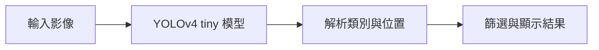

# 第 38 課｜使用 YOLOv4-tiny 與 OpenCV 進行即時物件檢測

[原始文章](https://liusming.pixnet.net/blog/posts/14222886591) · 更新日期：2026-10-29

## 學習目標

載入 YOLOv4-tiny 的設定與權重，以 OpenCV DNN 執行 CPU 前向推論。

## 事前準備

需要系統 OpenCV、NumPy 及下方設定與權重檔。

在練習目錄下載本次測試使用的 Darknet 設定與權重：

```bash
curl -fL https://raw.githubusercontent.com/AlexeyAB/darknet/master/cfg/yolov4-tiny.cfg -o yolov4-tiny.cfg
curl -fL https://github.com/AlexeyAB/darknet/releases/download/yolov4/yolov4-tiny.weights -o yolov4-tiny.weights
```

## 程式與執行

將下列已在 RP5 執行的程式存為 `第38課.py`，或使用[範例程式](./範例程式/第38課.py)。先確認目前目錄及檔案，避免覆蓋已有資料。

```python
import cv2
import numpy as np

net = cv2.dnn.readNetFromDarknet('yolov4-tiny.cfg', 'yolov4-tiny.weights')
image = np.zeros((416, 416, 3), dtype=np.uint8)
blob = cv2.dnn.blobFromImage(image, 1 / 255.0, (416, 416), swapRB=True, crop=False)
net.setInput(blob)
outputs = net.forward(net.getUnconnectedOutLayersNames())
print('YOLOv4-tiny loaded', True)
print('output layers', len(outputs))
```

執行 `python3 第38課.py`。

## 本機實際輸出

```text
YOLOv4-tiny loaded True
output layers 2
```

空白圖產生兩個輸出層，只驗證模型可載入和前向運算；未執行框選、類別解碼與即時偵測。

## 背景與核心概念

### 物件偵測與模型輸出

物件偵測嘗試指出圖中物體的類別和位置；YOLOv4-tiny 是一種較小的偵測模型。設定檔、模型權重、影像前處理和結果解碼須相互相容。

### 思考、練習與後續應用

成功載入網路與取得輸出層，是否代表已畫出正確偵測框？請列出還要測試的步驟。

可作為邊緣辨識原型；在真實環境還需要測試輸入尺寸、速度、誤判及漏判。

進一步閱讀：[相關官方文件](https://docs.opencv.org/4.x/d2/d58/tutorial_table_of_content_dnn.html)。請以下方實測狀態為準；尚未實作或測試的情境不能視為已通過。

## 概念流程圖



此圖用於說明文章的概念或完整目標流程，**不是操作截圖，也不代表每個步驟都已實測**；本機實測範圍請看文章中的標示。

## 與原文章的差異

- 原文程式含非標準空白且面向相機；本版清理程式並以空白影像先驗證模型。
- 真實場景的準確率、速度和操作畫面尚未完整驗證。
- 尚未保存操作畫面截圖。
- 新增初學者背景、概念、思考練習及後續應用，實測範圍仍以本文標示為準。
- 加入教學流程示意；圖中的完整目標流程不代表已逐步實測。
