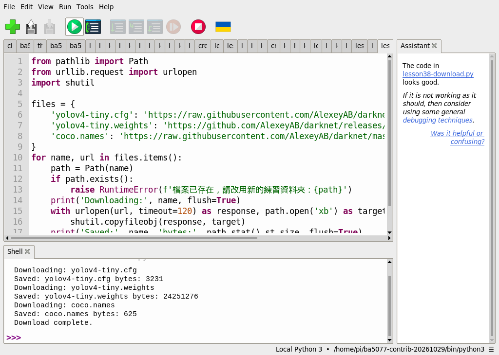
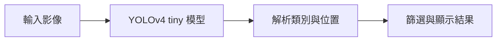
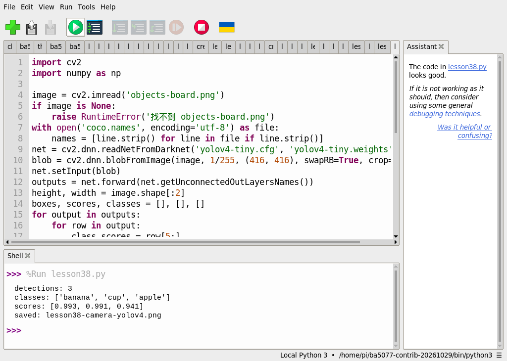
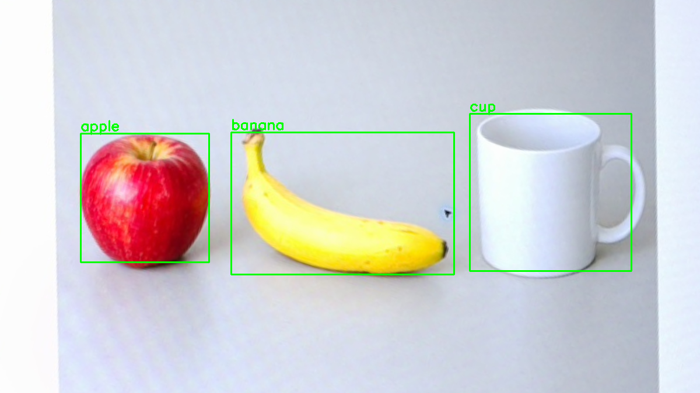
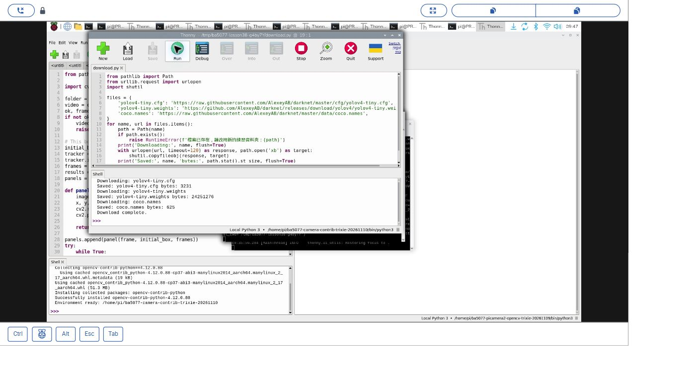
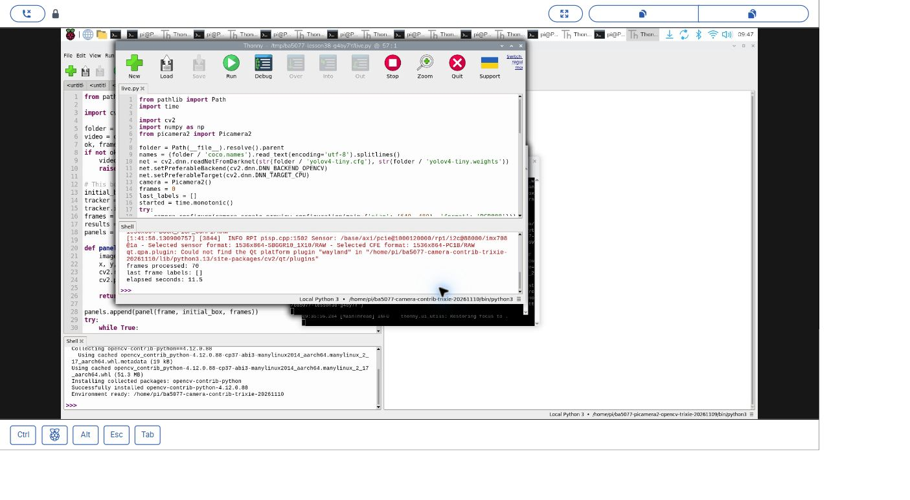
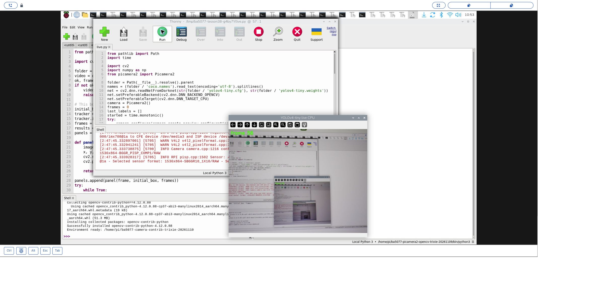
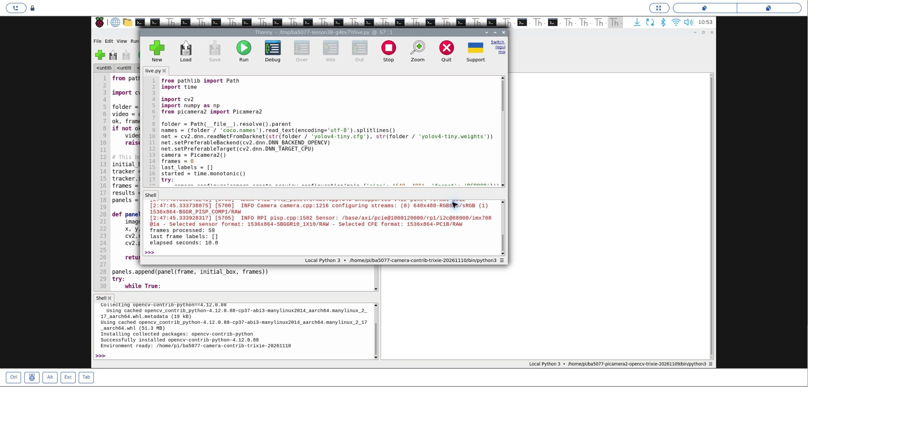

# 第 38 課｜使用 YOLOv4-tiny 與 OpenCV 進行即時物件檢測

[原始文章](https://liusming.pixnet.net/blog/posts/14222886591) · 更新日期：2026-10-29

> 已在既有 Trixie 的 Thonny 實測 YOLOv4-tiny 相機連續 CPU 推論與退出；本次最後影格沒有標籤，有目標的即時辨識仍待驗。[逐篇進度](./Thonny逐篇實測狀態.md) · [圖片與程式下載方式](./練習素材/素材下載與使用.md)

## 學習目標

載入 YOLOv4-tiny 的設定與權重，以 OpenCV DNN 執行 CPU 前向推論。

## 事前準備

需要 OpenCV、NumPy、網路及模型檔。本次在 Thonny 使用 Python 3.11、NumPy 1.26.4 與 opencv-contrib-python 4.11.0.86，依[環境指南](./Thonny環境與套件安裝.md#第-2527-課在-thonny-建立-opencv-擴充環境)建立環境並選取；模型檔不是 Python 套件，下載模型不等於套件安裝。

### 透過 Thonny 準備模型與測試圖

1. 從[教材儲存庫](https://github.com/Samuel-ncu/BA5077-RP5-compatibility)按 **Code → Download ZIP** 並解壓，或依[素材指南](./練習素材/素材下載與使用.md)下載單檔。本次 ZIP 下載及解壓未在 RP5 瀏覽器重測。
2. 建立新的練習資料夾，把[模型下載程式](./範例程式/第38課-Thonny下載YOLOv4模型.py)、[單張偵測程式](./範例程式/第38課-相機YOLOv4-tiny.py)和[相機校正後的物件圖](./圖檔/objects-board.png)複製到同一資料夾；圖片檔名維持 `objects-board.png`。圖中的物品是 AI 生成圖，經 RP5 拍攝螢幕、裁切和校正，並非真實水果或杯子。
3. 在 Thonny 用 **File → Open** 開啟下載程式，閱讀來源網址後按綠色執行鈕。程式從 Darknet 專案來源下載模型設定、權重與類別名稱；權重約 24 MB，需要網路和儲存空間。若已有同名檔，程式會停止不覆寫；網路中斷可能留下不完整檔，請檢查後使用新的練習資料夾重試。

本次 Thonny 下載實際輸出：

```text
Downloading: yolov4-tiny.cfg
Saved: yolov4-tiny.cfg bytes: 3231
Downloading: yolov4-tiny.weights
Saved: yolov4-tiny.weights bytes: 24251276
Downloading: coco.names
Saved: coco.names bytes: 625
Download complete.
```



本次 SHA-256：設定檔 `f858e3724962eedf3ac44e3b6cb3f0c3d9ed067c306bb831f539c578b924c90e`；權重 `cf9fbfd0f6d4869b35762f56100f50ed05268084078805f0e7989efe5bb8ca87`；類別檔 `634a1132eb33f8091d60f2c346ababe8b905ae08387037aed883953b7329af84`。部分來源使用 `master`，日後內容可能變動。

4. 在同一資料夾用 Thonny 開啟單張偵測程式，確認解譯器後按綠色執行鈕。程式會產生 `lesson38-camera-yolov4.png`，可能覆寫同名結果。

## 先前終端機空白圖範例（待 Thonny 重測）

### 程式與執行

將下列已在 RP5 執行的程式存為 `第38課.py`，或使用[範例程式](./範例程式/第38課.py)。先確認目前目錄及檔案，避免覆蓋已有資料。

```python
import cv2
import numpy as np

net = cv2.dnn.readNetFromDarknet('yolov4-tiny.cfg', 'yolov4-tiny.weights')
image = np.zeros((416, 416, 3), dtype=np.uint8)
blob = cv2.dnn.blobFromImage(image, 1 / 255.0, (416, 416), swapRB=True, crop=False)
net.setInput(blob)
outputs = net.forward(net.getUnconnectedOutLayersNames())
print('YOLOv4-tiny loaded', True)
print('output layers', len(outputs))
```

在 Thonny 開啟 `第38課.py` 並按綠色執行鈕；空白圖範例尚未在新環境重測。

## 先前終端機實際輸出

```text
YOLOv4-tiny loaded True
output layers 2
```

空白圖產生兩個輸出層，只驗證模型可載入和前向運算；未執行框選、類別解碼與即時偵測。

## 背景與核心概念

### 物件偵測與模型輸出

物件偵測嘗試指出圖中物體的類別和位置；YOLOv4-tiny 是一種較小的偵測模型。設定檔、模型權重、影像前處理和結果解碼須相互相容。

### 思考、練習與後續應用

成功載入網路與取得輸出層，是否代表已畫出正確偵測框？請列出還要測試的步驟。

可作為邊緣辨識原型；在真實環境還需要測試輸入尺寸、速度、誤判及漏判。

進一步閱讀：[相關官方文件](https://docs.opencv.org/4.x/d2/d58/tutorial_table_of_content_dnn.html)。請以下方實測狀態為準；尚未實作或測試的情境不能視為已通過。

## 概念流程圖



此圖用於說明文章的概念或完整目標流程，**不是操作截圖，也不代表每個步驟都已實測**；本機實測範圍請看文章中的標示。

## 進階實測：YOLOv4-tiny 偵測相機拍攝的測試圖

此實驗與第 40 課使用相同的[校正後影像](./圖檔/objects-board.png)：先以 AI 生成蘋果、香蕉及杯子圖片，顯示於螢幕，再由 RP5 相機拍攝、裁切與透視校正。圖中的物品不是實際擺放的水果或杯子；這是單張圖測試，不是即時影片或真實場景準確率評估。

### 準備與執行

1. 依本課上方的步驟準備 `yolov4-tiny.cfg` 及 `yolov4-tiny.weights`。模型約 24 MB，下載前確認網路和儲存空間。
2. 下載[相機校正圖](./圖檔/objects-board.png)存成 `objects-board.png`，以及[範例程式](./範例程式/第38課-相機YOLOv4-tiny.py)，放入同一個練習目錄。
3. 使用上方「透過 Thonny 準備模型與測試圖」的下載程式準備類別檔，並在 Thonny 開啟偵測程式執行。

```python
import cv2
import numpy as np

image = cv2.imread('objects-board.png')
if image is None:
    raise RuntimeError('找不到 objects-board.png')
with open('coco.names', encoding='utf-8') as file:
    names = [line.strip() for line in file if line.strip()]
net = cv2.dnn.readNetFromDarknet('yolov4-tiny.cfg', 'yolov4-tiny.weights')
blob = cv2.dnn.blobFromImage(image, 1/255, (416, 416), swapRB=True, crop=False)
net.setInput(blob)
outputs = net.forward(net.getUnconnectedOutLayersNames())
height, width = image.shape[:2]
boxes, scores, classes = [], [], []
for output in outputs:
    for row in output:
        class_scores = row[5:]
        class_id = int(np.argmax(class_scores))
        score = float(class_scores[class_id])
        if score < 0.4:
            continue
        center_x, center_y, w, h = row[:4] * [width, height, width, height]
        x, y = int(center_x-w/2), int(center_y-h/2)
        boxes.append([x, y, int(w), int(h)])
        scores.append(score)
        classes.append(class_id)
indices = cv2.dnn.NMSBoxes(boxes, scores, 0.4, 0.45)
selected = np.array(indices).reshape(-1).tolist() if len(indices) else []
for i in selected:
    x, y, w, h = boxes[i]
    cv2.rectangle(image, (x, y), (x+w, y+h), (0, 255, 0), 2)
    cv2.putText(image, names[classes[i]], (x, max(25, y-5)), cv2.FONT_HERSHEY_SIMPLEX, 0.8, (0, 255, 0), 2)
if not cv2.imwrite('lesson38-camera-yolov4.png', image):
    raise RuntimeError('無法儲存結果')
print('detections:', len(selected))
print('classes:', [names[classes[i]] for i in selected])
print('scores:', [round(scores[i], 3) for i in selected])
print('saved: lesson38-camera-yolov4.png')
```

### 本次 RP5 在 Thonny 的實際輸出

```text
detections: 3
classes: ['banana', 'cup', 'apple']
scores: [0.993, 0.991, 0.941]
saved: lesson38-camera-yolov4.png
```



截圖中的 `lesson38.py` 是本課偵測程式的測試副本，內容相同。



輸出順序依模型分數排列；綠框由本次程式繪製。程式把影像調整到 416 × 416 輸入、篩選類別分數至少 0.4 的候選，再以非極大值抑制減少重疊框。影像比例、門檻與模型版本都可能影響結果；分數不是整體準確率。此例未實測 GUI 即時顯示或影片效能。

### 學生練習

比較第 40 課的 YOLOv8n 結果與本課 YOLOv4-tiny，記錄類別與框的位置。這兩次測試的模型與前處理不同，且只有一張合成素材，**不能依此比較整體準確率或速度**。再設計有物體、無物體和被遮擋的多張測試資料，記錄誤檢與漏檢。

## 既有 Trixie：Thonny 即時相機 CPU 推論（2026-11-10）

本次在**既有** Trixie、Python 3.13.5、OpenCV 4.12.0、NumPy 2.2.4、Picamera2 0.3.38 的 Thonny 執行；解譯器為 `/home/pi/ba5077-camera-contrib-trixie-20261110/bin/python3`，其建立方式見 [Thonny 環境指南](./Thonny環境與套件安裝.md)。這不是全新系統實測。

1. 接妥相機，關閉其他占用相機的程式，鏡頭對準可公開、無個資的場景。建立新的練習資料夾，依上方步驟使用 Thonny 下載三個模型檔；也把[本節程式](./範例程式/第38課-Thonny即時相機YOLOv4.py)放在同一資料夾。本次三檔大小與上方相同，SHA-256 亦與上方列出的三個值一致。
2. 選同時能匯入 Picamera2、OpenCV 與 NumPy 的解譯器，在 Thonny 開啟本節程式按 Run。程式使用 CPU 逐影格推論並顯示視窗；點選視窗後按 **q** 結束，或最多運行約 30 秒。模型載入及影格推論需要時間，停止時間可能略超過限制。
3. 視窗上的標籤與框會隨場景改變；Shell 的 `last frame labels` 只描述最後影格的結果，不代表先前每一影格均相同，也不保證有目標一定能偵測。

```python
from pathlib import Path
import time

import cv2
import numpy as np
from picamera2 import Picamera2

folder = Path(__file__).resolve().parent
names = (folder / 'coco.names').read_text(encoding='utf-8').splitlines()
net = cv2.dnn.readNetFromDarknet(str(folder / 'yolov4-tiny.cfg'), str(folder / 'yolov4-tiny.weights'))
net.setPreferableBackend(cv2.dnn.DNN_BACKEND_OPENCV)
net.setPreferableTarget(cv2.dnn.DNN_TARGET_CPU)
camera = Picamera2()
frames = 0
last_labels = []
started = time.monotonic()
try:
    camera.configure(camera.create_preview_configuration(main={'size': (640, 480), 'format': 'RGB888'}))
    camera.start()
    while time.monotonic() - started < 30:
        frame = camera.capture_array()
        height, width = frame.shape[:2]
        blob = cv2.dnn.blobFromImage(frame, 1 / 255.0, (416, 416), swapRB=True, crop=False)
        net.setInput(blob)
        outputs = net.forward(net.getUnconnectedOutLayersNames())
        boxes, scores, classes = [], [], []
        for output in outputs:
            for row in output:
                class_id = int(np.argmax(row[5:]))
                score = float(row[5 + class_id])
                if score < 0.4:
                    continue
                center_x, center_y, w, h = row[:4] * [width, height, width, height]
                boxes.append([int(center_x - w / 2), int(center_y - h / 2), int(w), int(h)])
                scores.append(score)
                classes.append(class_id)
        indices = cv2.dnn.NMSBoxes(boxes, scores, 0.4, 0.45)
        selected = np.array(indices).reshape(-1).tolist() if len(indices) else []
        last_labels = [names[classes[i]] for i in selected]
        for i in selected:
            x, y, w, h = boxes[i]
            cv2.rectangle(frame, (x, y), (x + w, y + h), (0, 255, 0), 2)
            cv2.putText(frame, f'{names[classes[i]]} {scores[i]:.2f}', (x, max(20, y - 5)),
                        cv2.FONT_HERSHEY_SIMPLEX, 0.6, (0, 255, 0), 2)
        frames += 1
        cv2.putText(frame, f'frame {frames}', (10, 25), cv2.FONT_HERSHEY_SIMPLEX, 0.7, (0, 255, 0), 2)
        cv2.imshow('YOLOv4-tiny live CPU', frame)
        if cv2.waitKey(1) & 0xFF == ord('q'):
            break
finally:
    camera.stop()
    camera.close()
    cv2.destroyAllWindows()
print('frames processed:', frames)
print('last frame labels:', last_labels)
print('elapsed seconds:', round(time.monotonic() - started, 1))
```

本次 Thonny Shell 實際輸出節錄：

```text
frames processed: 70
last frame labels: []
elapsed seconds: 11.5
```

本次按 q 提早結束，視窗關閉且程式返回提示符；執行時間與影格數受設備與負載影響，不能當作保證速度。Shell 也顯示 Qt `wayland` 外掛提示，但本次預覽有顯示。相機當時對準電腦畫面，本次僅保存不含該影像的 Shell 截圖；因此**沒有可公開的即時預覽截圖**。本次證明相機取像、連續前向推論、顯示及結束流程，最後影格無標籤；不能據此宣稱已驗證有物件時的即時辨識品質。上方單張生成物件正例仍是另一項實測。





排錯：若模型讀取失敗，核對三個檔名與路徑；若 `picamera2` 匯入失敗，核對所選環境；若相機忙碌，關閉其他相機程式。練習在取得可公開的物件素材後，記錄不同門檻的框與標籤並人工檢查；本例沿用單張範例的類別分數門檻與跨類 NMS，結果可能有誤檢、漏檢或跨類抑制，不能當成完整準確率評估。

### 後續重測：可公開的預覽（2026-11-10）

在同一既有 Trixie 與 Thonny 環境重跑相同相機程式。相機拍攝的是顯示 Thonny 的電腦螢幕，形成畫面遞迴；預覽視窗顯示影格計數。點選預覽視窗並按 q 後，程式在 59 張影格結束，最後一張沒有標籤。此次沒有觀察到可確認的物件偵測框，故只驗證公開預覽、執行與退出流程，**有目標的即時辨識仍待測**；不能把上方舊單張圖片的結果當作本次即時相機結果。

```text
frames processed: 59
last frame labels: []
elapsed seconds: 10.8
```





## 與原文章的差異

- 本次在 Thonny 下載模型並以 CPU 偵測可下載的單張生成素材照片，記錄操作截圖與實際輸出。

- 原文程式含非標準空白且面向相機；本版清理程式並以空白影像先驗證模型。
- 真實場景的準確率、速度和操作畫面尚未完整驗證。
- 新增 Thonny 模型下載、單張偵測及既有 Trixie 即時相機推論 Shell 截圖；後續已補可公開的即時預覽；有目標即時辨識待補。
- 新增初學者背景、概念、思考練習及後續應用，實測範圍仍以本文標示為準。
- 加入教學流程示意；圖中的完整目標流程不代表已逐步實測。
- 新增單張生成素材偵測，並在既有 Trixie 測相機即時視窗及按 q 結束；有目標即時辨識仍待驗。
