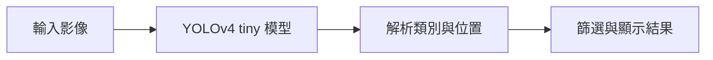
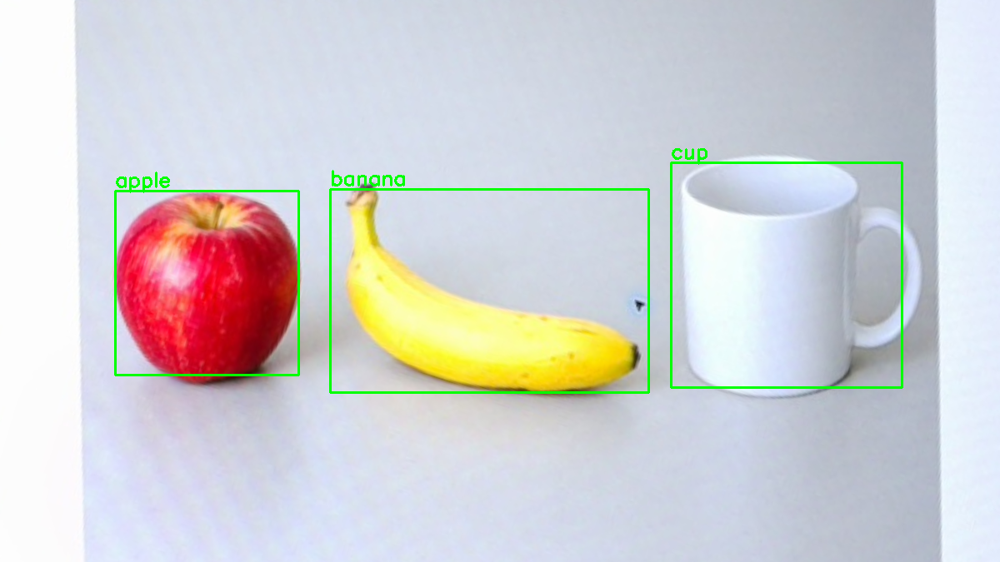

# 第 38 課｜使用 YOLOv4-tiny 與 OpenCV 進行即時物件檢測

[原始文章](https://liusming.pixnet.net/blog/posts/14222886591) · 更新日期：2026-10-29

## 學習目標

載入 YOLOv4-tiny 的設定與權重，以 OpenCV DNN 執行 CPU 前向推論。

## 事前準備

需要系統 OpenCV、NumPy 及下方設定與權重檔。

在練習目錄下載本次測試使用的 Darknet 設定與權重：

```bash
curl -fL https://raw.githubusercontent.com/AlexeyAB/darknet/master/cfg/yolov4-tiny.cfg -o yolov4-tiny.cfg
curl -fL https://github.com/AlexeyAB/darknet/releases/download/yolov4/yolov4-tiny.weights -o yolov4-tiny.weights
```

## 程式與執行

將下列已在 RP5 執行的程式存為 `第38課.py`，或使用[範例程式](./範例程式/第38課.py)。先確認目前目錄及檔案，避免覆蓋已有資料。

```python
import cv2
import numpy as np

net = cv2.dnn.readNetFromDarknet('yolov4-tiny.cfg', 'yolov4-tiny.weights')
image = np.zeros((416, 416, 3), dtype=np.uint8)
blob = cv2.dnn.blobFromImage(image, 1 / 255.0, (416, 416), swapRB=True, crop=False)
net.setInput(blob)
outputs = net.forward(net.getUnconnectedOutLayersNames())
print('YOLOv4-tiny loaded', True)
print('output layers', len(outputs))
```

執行 `python3 第38課.py`。

## 本機實際輸出

```text
YOLOv4-tiny loaded True
output layers 2
```

空白圖產生兩個輸出層，只驗證模型可載入和前向運算；未執行框選、類別解碼與即時偵測。

## 背景與核心概念

### 物件偵測與模型輸出

物件偵測嘗試指出圖中物體的類別和位置；YOLOv4-tiny 是一種較小的偵測模型。設定檔、模型權重、影像前處理和結果解碼須相互相容。

### 思考、練習與後續應用

成功載入網路與取得輸出層，是否代表已畫出正確偵測框？請列出還要測試的步驟。

可作為邊緣辨識原型；在真實環境還需要測試輸入尺寸、速度、誤判及漏判。

進一步閱讀：[相關官方文件](https://docs.opencv.org/4.x/d2/d58/tutorial_table_of_content_dnn.html)。請以下方實測狀態為準；尚未實作或測試的情境不能視為已通過。

## 概念流程圖



此圖用於說明文章的概念或完整目標流程，**不是操作截圖，也不代表每個步驟都已實測**；本機實測範圍請看文章中的標示。

## 進階實測：YOLOv4-tiny 偵測相機拍攝的測試圖

此實驗與第 40 課使用相同的[校正後影像](./圖檔/objects-board.png)：先以 AI 生成蘋果、香蕉及杯子圖片，顯示於螢幕，再由 RP5 相機拍攝、裁切與透視校正。圖中的物品不是實際擺放的水果或杯子；這是單張圖測試，不是即時影片或真實場景準確率評估。

### 準備與執行

1. 依本課上方的步驟準備 `yolov4-tiny.cfg` 及 `yolov4-tiny.weights`。模型約 24 MB，下載前確認網路和儲存空間。
2. 下載[相機校正圖](./圖檔/objects-board.png)存成 `objects-board.png`，以及[範例程式](./範例程式/第38課-相機YOLOv4-tiny.py)，放入同一個練習目錄。
3. 在練習目錄下載 Darknet 類別名稱檔，再執行範例：

```bash
curl -fsSL https://raw.githubusercontent.com/AlexeyAB/darknet/master/data/coco.names -o coco.names
python3 第38課-相機YOLOv4-tiny.py
```

```python
import cv2
import numpy as np

image = cv2.imread('objects-board.png')
if image is None:
    raise RuntimeError('找不到 objects-board.png')
with open('coco.names', encoding='utf-8') as file:
    names = [line.strip() for line in file if line.strip()]
net = cv2.dnn.readNetFromDarknet('yolov4-tiny.cfg', 'yolov4-tiny.weights')
blob = cv2.dnn.blobFromImage(image, 1/255, (416, 416), swapRB=True, crop=False)
net.setInput(blob)
outputs = net.forward(net.getUnconnectedOutLayersNames())
height, width = image.shape[:2]
boxes, scores, classes = [], [], []
for output in outputs:
    for row in output:
        class_scores = row[5:]
        class_id = int(np.argmax(class_scores))
        score = float(class_scores[class_id])
        if score < 0.4:
            continue
        center_x, center_y, w, h = row[:4] * [width, height, width, height]
        x, y = int(center_x-w/2), int(center_y-h/2)
        boxes.append([x, y, int(w), int(h)])
        scores.append(score)
        classes.append(class_id)
indices = cv2.dnn.NMSBoxes(boxes, scores, 0.4, 0.45)
selected = np.array(indices).reshape(-1).tolist() if len(indices) else []
for i in selected:
    x, y, w, h = boxes[i]
    cv2.rectangle(image, (x, y), (x+w, y+h), (0, 255, 0), 2)
    cv2.putText(image, names[classes[i]], (x, max(25, y-5)), cv2.FONT_HERSHEY_SIMPLEX, 0.8, (0, 255, 0), 2)
if not cv2.imwrite('lesson38-camera-yolov4.png', image):
    raise RuntimeError('無法儲存結果')
print('detections:', len(selected))
print('classes:', [names[classes[i]] for i in selected])
print('scores:', [round(scores[i], 3) for i in selected])
print('saved: lesson38-camera-yolov4.png')
```

### 本次 RP5 實際輸出

```text
detections: 3
classes: ['banana', 'cup', 'apple']
scores: [0.993, 0.991, 0.941]
saved: lesson38-camera-yolov4.png
```



輸出順序依模型分數排列；綠框由本次程式繪製。程式把影像調整到 416 × 416 輸入、篩選類別分數至少 0.4 的候選，再以非極大值抑制減少重疊框。影像比例、門檻與模型版本都可能影響結果；分數不是整體準確率。此例未實測 GUI 即時顯示或影片效能。

### 學生練習

比較第 40 課的 YOLOv8n 結果與本課 YOLOv4-tiny，記錄類別與框的位置。這兩次測試的模型與前處理不同，且只有一張合成素材，**不能依此比較整體準確率或速度**。再設計有物體、無物體和被遮擋的多張測試資料，記錄誤檢與漏檢。

## 與原文章的差異

- 原文程式含非標準空白且面向相機；本版清理程式並以空白影像先驗證模型。
- 真實場景的準確率、速度和操作畫面尚未完整驗證。
- 尚未保存操作畫面截圖。
- 新增初學者背景、概念、思考練習及後續應用，實測範圍仍以本文標示為準。
- 加入教學流程示意；圖中的完整目標流程不代表已逐步實測。
- 新增單張相機拍攝生成素材的 YOLOv4-tiny 偵測與圖片；原文即時相機視窗及長時間性能仍待測試。
