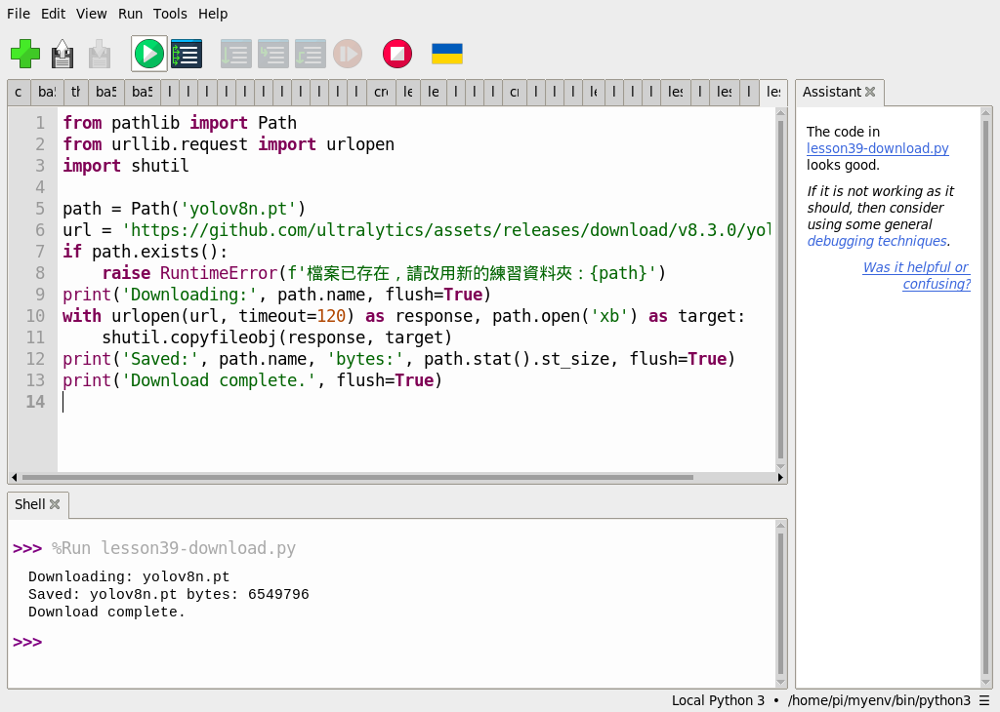
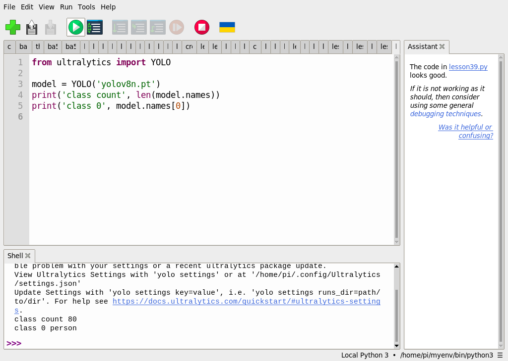

# 第 39 課｜YOLOv8 與 COCO 資料集完整教學

[原始文章](https://liusming.pixnet.net/blog/posts/14222888508) · 更新日期：2026-10-29

> **部分實測。** 已在這台 RP5 的 Thonny 測試模型下載和讀取類別；從全新環境安裝 YOLO 套件及資料集下載、訓練仍待驗證。[逐篇進度](./Thonny逐篇實測狀態.md) · [素材下載說明](./練習素材/素材下載與使用.md)

## 學習目標

理解資料集、模型與類別名稱的關係；使用 Thonny 下載並載入 YOLOv8n，讀取類別資料。

## 背景與理論

COCO 提供影像與物件標註，是訓練及評估模型時可用的資料集。訓練後的模型將學到的參數保存在模型檔；本例的 `yolov8n.pt` 含有類別名稱。讀取這份名稱只能證明模型可載入，**不能證明已下載完整資料集，也不能代表辨識準確率**。

物件偵測除了回答「是什麼」，還要給出圖片中的位置。下一課會以一張照片練習。

## 事前準備

這次使用已存在的 `/home/pi/myenv/bin/python3`，Python 3.11.2、Ultralytics 8.3.50、PyTorch 2.5.1。它同時含有不同 OpenCV 發行套件；它只代表這台機器當時可執行，**不是已驗證可從零重現的乾淨安裝方案**。透過 Thonny 新建環境及安裝 YOLO/PyTorch 的完整步驟仍待測試。第 25–38 課所用的獨立 OpenCV 環境也尚未安裝 Ultralytics。

使用已具備 YOLO 套件的環境時，在 Thonny 選擇「工具 → 選項 → 直譯器」，選擇該環境的 Python。下載模型時需要網路。

## 下載模型及範例

1. 依[素材下載與使用說明](./練習素材/素材下載與使用.md)下載並解壓本倉庫；建立一個新的練習資料夾，將[模型下載程式](./範例程式/第39課-Thonny下載YOLOv8模型.py)和[第 39 課程式](./範例程式/第39課.py)複製進去。
2. 在 Thonny 使用「檔案 → 開啟」開啟下載程式，按綠色執行鈕。它從 Ultralytics 的 GitHub 版本資產下載 `yolov8n.pt` 到程式所在的練習資料夾。為避免覆蓋，若檔案已存在請改用新資料夾；下載中斷時請檢查不完整檔案。
3. 本次下載的檔案大小為 6,549,796 bytes，SHA-256 為 `f59b3d833e2ff32e194b5bb8e08d211dc7c5bdf144b90d2c8412c47ccfc83b36`。檔案由上游提供，不包含在本倉庫。

本機 Thonny 的下載輸出：

```text
Downloading: yolov8n.pt
Saved: yolov8n.pt bytes: 6549796
Download complete.
```



## 在 Thonny 載入模型

在同一資料夾開啟 `第39課.py`，按綠色執行鈕：

```python
from ultralytics import YOLO

model = YOLO('yolov8n.pt')
print('class count', len(model.names))
print('class 0', model.names[0])
```

本次 Shell 中最後的輸出如下，首次載入可能另有套件設定提示：

```text
class count 80
class 0 person
```



模型列出 80 個類別，第 0 類名稱是 person。輸出的是模型內的名稱，尚未對人像做推論。

## 練習與後續應用

1. 將 `model.names[0]` 改為其他編號，觀察名稱；超出可用編號會發生什麼事？
2. 用自己的話區分訓練資料、模型檔和模型推論結果。為什麼只有類別名稱無法保證測試圖片一定會被正確辨識？
3. 延伸到物品盤點前，需要蒐集適用場景的測試圖片，並比較漏檢與誤檢。

參考：[Ultralytics COCO 資料集文件](https://docs.ultralytics.com/datasets/detect/coco/)。

## 與原文章的差異

- 本版改用 RP5 CPU 與 Thonny 操作，未採原文 CUDA 安裝流程。
- 本版已實測模型下載與類別讀取；原文涉及的資料集下載、訓練和完整辨識流程尚未全部重做。
- 增加真實 Thonny 截圖與下載檔案資訊；乾淨環境中的套件安裝仍待驗證。
