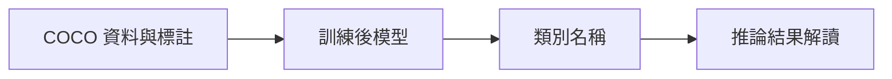

# 第 39 課｜YOLOv8 與 COCO 資料集完整教學

[原始文章](https://liusming.pixnet.net/blog/posts/14222888508) · 更新日期：2026-10-29

> **Thonny 轉換待完成。** 本篇既有程式、安裝步驟與輸出仍須逐項改寫並在 Thonny 重新操作；現有終端機紀錄不代表已用 Thonny 測試。[逐篇進度](./Thonny逐篇實測狀態.md) · [圖片與程式下載方式](./練習素材/素材下載與使用.md)

## 學習目標

載入 YOLOv8n，查看模型的類別數及第一個類別。

## 事前準備

需要已驗證的 YOLO CPU 虛擬環境和模型檔。

依[安裝操作與實測紀錄](../安裝操作與實測紀錄.md#7-yolo-與-pytorch)建立並啟用 YOLO CPU 環境，再於練習目錄下載模型：

```bash
curl -fL https://github.com/ultralytics/assets/releases/download/v8.3.0/yolov8n.pt -o yolov8n.pt
```

不要使用原文的 CUDA 11.8 索引。

## 程式與執行

將下列已在 RP5 執行的程式存為 `第39課.py`，或使用[範例程式](./範例程式/第39課.py)。先確認目前目錄及檔案，避免覆蓋已有資料。

```python
from ultralytics import YOLO

model = YOLO('yolov8n.pt')
print('class count', len(model.names))
print('class 0', model.names[0])
```

執行 `python3 第39課.py`。

## 本機實際輸出

```text
class count 80
class 0 person
```

此模型包含 80 個類別，編號 0 是 person。這不等於資料集訓練或物件辨識精度已驗證。

## 背景與核心概念

### 模型、資料集與類別

COCO 是影像資料集，包含物件類別及標註；模型類別名稱是輸出解讀所需的資訊。列出 80 個類別不等於已下載或評估完整資料集。

### 思考、練習與後續應用

解釋資料集、訓練後模型與單次推論的不同；讀到 person 類別是否代表已成功偵測人？

建構應用時要檢查資料來源、標註品質、適用場景及資料授權。

進一步閱讀：[相關官方文件](https://docs.ultralytics.com/datasets/detect/coco/)。請以下方實測狀態為準；尚未實作或測試的情境不能視為已通過。

## 概念流程圖



此圖用於說明文章的概念或完整目標流程，**不是操作截圖，也不代表每個步驟都已實測**；本機實測範圍請看文章中的標示。

## 與原文章的差異

- 原文涵蓋 COCO 資料集與模型推論；本版先驗證模型類別資訊，未測試資料集下載及訓練。
- 真實場景的準確率、速度和操作畫面尚未完整驗證。
- 尚未保存操作畫面截圖。
- 新增初學者背景、概念、思考練習及後續應用，實測範圍仍以本文標示為準。
- 加入教學流程示意；圖中的完整目標流程不代表已逐步實測。
