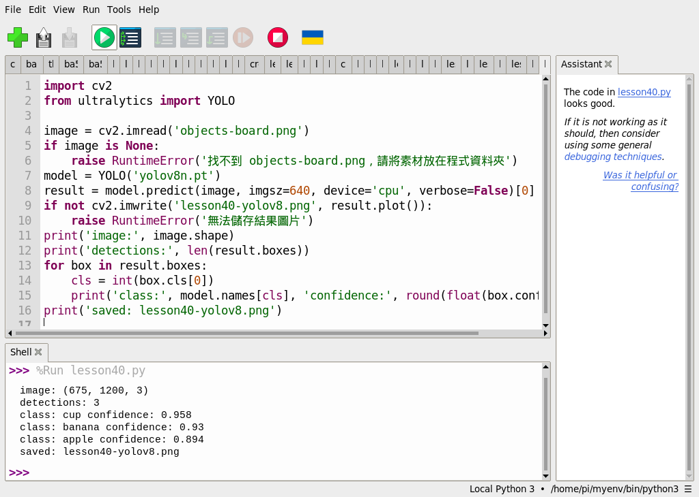
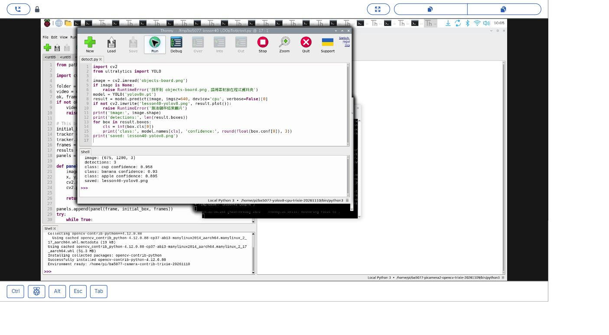
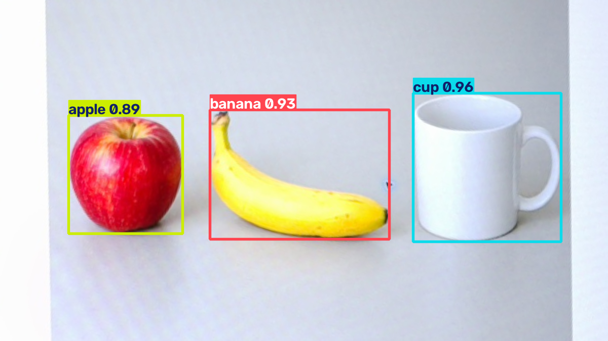

# 第 40 課｜YOLOv8 圖像目標檢測教學（使用 COCO 資料集）

[原始文章](https://liusming.pixnet.net/blog/posts/14222899812) · 更新日期：2026-10-29

> **部分實測。** 已在既有 Trixie 的新建 CPU 環境以 Thonny 對可下載的生成素材照片推論；自行拍攝、真實物件及全新系統仍待驗。[逐篇進度](./Thonny逐篇實測狀態.md) · [素材下載說明](./練習素材/素材下載與使用.md)

## 學習目標

了解偵測框、類別與信心值；在 Thonny 使用 YOLOv8n 辨識圖片，觀察並儲存結果。

## 背景與理論

影像辨識把像素送入模型，物件偵測進一步回傳候選物體的位置、類別和信心值。程式將候選框與類別畫回圖片，方便人類檢查。信心值反映模型對該候選類別的分數，**不等於保證正確的機率或整體準確率**；遮擋、光線和輸入影像皆會影響結果。

## 素材與環境

測試圖片的內容先由 AI 生成，再顯示在螢幕上，經 RP5 相機拍攝及透視校正；蘋果、香蕉與杯子是圖片中的生成物件，不是真實擺放的物品。[下載校正後的相機照片](./圖檔/objects-board.png)。原始全景照片含周圍環境，未公開。這是單張照片，不是即時影片。

先前測試使用 `/home/pi/myenv/bin/python3`；2026-11-10 既有 Trixie 的新建 CPU 環境測試另見下文，全新重灌系統的套件安裝仍未驗證。請在 Thonny 選擇已具備這些套件的 Python，並完成[第 39 課模型下載](./第%2039%20課｜YOLOv8%20與%20COCO%20資料集完整教學.md)。

## 在 Thonny 操作

1. 依[素材下載與使用說明](./練習素材/素材下載與使用.md)取得本倉庫並解壓，在新的練習資料夾放入[本課程式](./範例程式/第40課-Thonny校正圖YOLO.py)與 `objects-board.png`。圖片來源是本倉庫的 `教材/圖檔/objects-board.png`。
2. 在同一資料夾依第 39 課執行下載程式，取得 `yolov8n.pt`。模型檔、圖片和本課程式須放在一起。
3. 在 Thonny 選擇「檔案 → 開啟」開啟本課程式，按綠色執行鈕，觀察下方 Shell。結果圖 `lesson40-yolov8.png` 會寫入練習資料夾；先確認不會覆蓋既有同名結果。

本次執行的完整程式：

```python
import cv2
from ultralytics import YOLO

image = cv2.imread('objects-board.png')
if image is None:
    raise RuntimeError('找不到 objects-board.png，請將素材放在程式資料夾')
model = YOLO('yolov8n.pt')
result = model.predict(image, imgsz=640, device='cpu', verbose=False)[0]
if not cv2.imwrite('lesson40-yolov8.png', result.plot()):
    raise RuntimeError('無法儲存結果圖片')
print('image:', image.shape)
print('detections:', len(result.boxes))
for box in result.boxes:
    cls = int(box.cls[0])
    print('class:', model.names[cls], 'confidence:', round(float(box.conf[0]), 3))
print('saved: lesson40-yolov8.png')
```

## 本機實際輸出與截圖

```text
image: (675, 1200, 3)
detections: 3
class: cup confidence: 0.958
class: banana confidence: 0.93
class: apple confidence: 0.894
saved: lesson40-yolov8.png
```




照片尺寸以「高、寬、色彩通道」表示；輸出三個框。上方結果圖來自先前對同一張校正後照片的 RP5 推論，本次 Thonny 再次對該照片推論並得到上述數值。不同模型或輸入條件可能產生不同結果。

## 既有 Trixie 新建 CPU 環境實測（2026-11-10）

依 [第 39 課 CPU 環境與模型準備](./第%2039%20課｜YOLOv8%20與%20COCO%20資料集完整教學.md)建立環境後，將上方的程式、`objects-board.png` 和**預訓練** `yolov8n.pt` 放到同一新的練習資料夾。在 Thonny 選擇該 CPU 環境，開啟程式並按 Run；本次副本名為 `detect.py`，與上方程式內容相同。程式寫入 `lesson40-yolov8.png`，請先確認不會覆寫要保留的資料。

本次為既有 Trixie、Python 3.13.5、Ultralytics 8.4.208、PyTorch 2.15.0+cpu、OpenCV 5.0.0；解譯器 `/home/pi/ba5077-yolov8-cpu-trixie-20261110/bin/python3`。此處使用原始預訓練 `yolov8n.pt`，不是第 39 課 COCO8 訓練後的 `best.pt`。相機素材沿用先前拍攝螢幕上 AI 生成物件並校正的照片，不是本次新拍或真實水果。

本次 Thonny 實際輸出：

```text
image: (675, 1200, 3)
detections: 3
class: cup confidence: 0.958
class: banana confidence: 0.93
class: apple confidence: 0.895
saved: lesson40-yolov8.png
```





第一張是操作截圖，第二張是本次程式產生的結果圖；標籤分數、順序與框可能隨套件版本、模型和影像變動。這次只測一張生成素材照片，不代表真實場景的準確率，也不是全新系統實測。若找不到模型或圖片，先核對檔名、目前解譯器及三個檔案所在的練習資料夾。

## 練習與後續應用

- 把其中一個物品局部遮住，再觀察框與分數是否改變；記錄你自己的結果。
- 準備正例、沒有物品的負例，以及不同光線下的照片，比較人工標註與模型結果。單張示範不足以估算準確率。
- 可延伸為教室物品計數原型，但須測試誤檢、漏檢和速度後才能評估適用性。

參考：[Ultralytics 偵測文件](https://docs.ultralytics.com/tasks/detect/)。

## 與原文章的差異

- 本版以 RP5 CPU 和 Thonny 執行，素材為相機拍攝螢幕上的 AI 生成圖，並非原文外部圖像或完整 COCO 資料集。
- 新增可下載的校正照片、程式、操作截圖與實際輸出；新拍照片及校正步驟尚未在 Thonny 重測。
- 2026-11-10 在既有 Trixie 新建 CPU 環境重測；全新重灌系統安裝、自行拍攝及真實物件仍待驗證。
