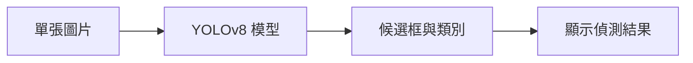
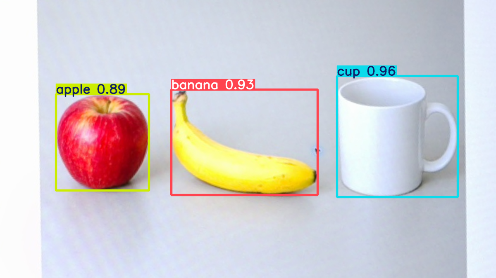

# 第 40 課｜YOLOv8 圖像目標檢測教學（使用 COCO 資料集）

[原始文章](https://liusming.pixnet.net/blog/posts/14222899812) · 更新日期：2026-10-29

> **Thonny 轉換待完成。** 本篇既有程式、安裝步驟與輸出仍須逐項改寫並在 Thonny 重新操作；現有終端機紀錄不代表已用 Thonny 測試。[逐篇進度](./Thonny逐篇實測狀態.md) · [圖片與程式下載方式](./練習素材/素材下載與使用.md)

## 學習目標

使用 YOLOv8n 對合成圖片執行一次 CPU 推論。

## 事前準備

需要 YOLO CPU 虛擬環境與模型檔。

依[安裝操作與實測紀錄](../安裝操作與實測紀錄.md#7-yolo-與-pytorch)建立並啟用 YOLO CPU 環境，再於練習目錄下載模型：

```bash
curl -fL https://github.com/ultralytics/assets/releases/download/v8.3.0/yolov8n.pt -o yolov8n.pt
```

不要使用原文的 CUDA 11.8 索引。

## 程式與執行

將下列已在 RP5 執行的程式存為 `第40課.py`，或使用[範例程式](./範例程式/第40課.py)。先確認目前目錄及檔案，避免覆蓋已有資料。

```python
from ultralytics import YOLO
import numpy as np

model = YOLO('yolov8n.pt')
image = np.zeros((320, 320, 3), dtype=np.uint8)
results = model.predict(image, imgsz=320, device='cpu', verbose=False)
print('results', len(results))
print('boxes', len(results[0].boxes))
```

執行 `python3 第40課.py`。

## 本機實際輸出

```text
results 1
boxes 0
```

空白圖片得到 1 筆結果、0 個框；不能用它判斷真實圖片的偵測品質。

## 背景與核心概念

### 單張圖片物件偵測

模型接收經前處理的圖片，輸出候選類別、位置及分數；後續篩選決定顯示哪些框。零個框可能是圖中沒有目標，也可能受到閾值、輸入或模型限制影響。

### 思考、練習與後續應用

為何空白圖得到零個框不能證明模型在真實圖片中表現良好？應如何設計正例、負例與人工標註比較？

可用在物品計數等原型；部署前須量測漏檢、誤檢及在 RP5 上的運算時間。

進一步閱讀：[相關官方文件](https://docs.ultralytics.com/tasks/detect/)。請以下方實測狀態為準；尚未實作或測試的情境不能視為已通過。

## 概念流程圖



此圖用於說明文章的概念或完整目標流程，**不是操作截圖，也不代表每個步驟都已實測**；本機實測範圍請看文章中的標示。

## RP5 相機拍攝測試圖：辨識蘋果、香蕉和杯子

### 測試的來龍去脈

本例先使用內建圖片生成工具製作包含紅蘋果、香蕉和白色杯子的[測試素材](./練習素材/AI生成物件測試.png)，再將它顯示在螢幕上，由 RP5 的 IMX708 相機拍照。**物件是 AI 生成的影像，不是真實放在桌上的物體**；拍照、透視校正與 YOLOv8n CPU 推論則在 RP5 實際執行。

本例照片還拍到螢幕周圍環境，因此程式只截取測試圖並做透視校正，公開的兩張結果圖不含原始照片的周圍環境。本次使用一張照片，不是即時相機推論，也無法據此估計模型的真實場景準確率。

### 給學生的操作步驟

1. 依[安裝操作與實測紀錄](../安裝操作與實測紀錄.md#7-yolo-與-pytorch)建立並啟用 YOLO CPU 環境，確認目前的 Python 可以匯入 `ultralytics`、OpenCV 和 NumPy。確保沒有其他程式占用相機。
2. 下載[相機測試畫面](./練習素材/RP5相機測試.html)及同一資料夾中的[AI 生成物件圖片](./練習素材/AI生成物件測試.png)，在電腦瀏覽器開啟測試畫面，選擇「AI 生成物件圖」。兩個檔案需放在同一資料夾。
3. 將 RP5 相機對準螢幕。在 RP5 的練習目錄拍照，並下載本篇上方說明的 `yolov8n.pt` 模型。確認目錄沒有同名檔案，以免覆蓋。

```bash
rpicam-still --nopreview --timeout 1500 --width 1920 --height 1080 --output objects-camera.jpg
```

4. 將[相機照片 YOLO 範例](./範例程式/第40課-相機照片YOLO.py)存到練習目錄，檔名為 `第40課-相機照片YOLO.py`。程式中四個 `source` 座標是本次拍攝的測試圖四個角落；其他相機位置或照片必須先自行量測並修改。執行前確認 `objects-camera.jpg` 和 `yolov8n.pt` 都在同一目錄。

```python
import cv2
import numpy as np
from ultralytics import YOLO

image = cv2.imread('objects-camera.jpg')
if image is None:
    raise RuntimeError('找不到 objects-camera.jpg，請先拍攝測試畫面')
if image.shape[:2] != (1080, 1920):
    raise RuntimeError('請使用 1920×1080 的照片，或依自己的照片重新設定座標')

# 下列座標只對應本次相機位置；換位置後必須在照片上重新量測。
source = np.float32([[755, 270], [1385, 65], [1484, 412], [856, 604]])
target = np.float32([[0, 0], [1199, 0], [1199, 674], [0, 674]])
board = cv2.warpPerspective(image, cv2.getPerspectiveTransform(source, target), (1200, 675))
model = YOLO('yolov8n.pt')
result = model.predict(board, imgsz=640, device='cpu', verbose=False)[0]
annotated = result.plot()
if not cv2.imwrite('objects-board.png', board) or not cv2.imwrite('objects-yolo.png', annotated):
    raise RuntimeError('無法儲存結果')
print('camera image:', image.shape)
print('rectified board:', board.shape)
print('detections:', len(result.boxes))
for box in result.boxes:
    cls = int(box.cls[0])
    print('class:', model.names[cls], 'confidence:', round(float(box.conf[0]), 3))
print('saved: objects-board.png, objects-yolo.png')
```

```bash
python3 第40課-相機照片YOLO.py
```

### 本次 RP5 實際輸出

```text
camera image: (1080, 1920, 3)
rectified board: (675, 1200, 3)
detections: 3
class: cup confidence: 0.958
class: banana confidence: 0.93
class: apple confidence: 0.894
saved: objects-board.png, objects-yolo.png
```

這次模型輸出三個框：cup（杯子）、banana（香蕉）、apple（蘋果）。分數和順序會隨模型、程式版本、曝光與拍攝條件改變。分數是模型對候選類別的信心值，**不是保證正確的機率或整體準確率**。



圖中框線由本次 RP5 推論結果繪製；輸入是相機拍攝螢幕後的照片，經裁切與透視校正，不是原始全景照片。[下載校正後的模型輸入](./圖檔/objects-board.png)可以只重做後續圖片推論。

### 思考與延伸

比較本篇原來的空白圖片與這次三個物件：兩次分別能驗證什麼？如果把圖片轉小、遮住一部分，或改用真實水果，再比較預測結果，是否仍能正確辨識？這些變化需要你實際執行後記錄，不能從本次結果推論。

## 與原文章的差異

- 原文使用外部圖像；本版先使用合成空白圖驗證推論，不聲稱測過 COCO 圖片。
- 真實場景的準確率、速度和操作畫面尚未完整驗證。
- 尚未保存操作畫面截圖。
- 新增初學者背景、概念、思考練習及後續應用，實測範圍仍以本文標示為準。
- 加入教學流程示意；圖中的完整目標流程不代表已逐步實測。
- 新增 AI 生成測試圖經 RP5 相機拍攝後的單張 YOLOv8n CPU 推論；沒有聲稱已驗證真實物件、完整 COCO 資料集或即時影片。
