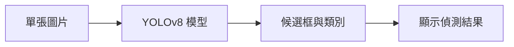

# 第 40 課｜YOLOv8 圖像目標檢測教學（使用 COCO 資料集）

[原始文章](https://liusming.pixnet.net/blog/posts/14222899812) · 更新日期：2026-10-29

## 學習目標

使用 YOLOv8n 對合成圖片執行一次 CPU 推論。

## 事前準備

需要 YOLO CPU 虛擬環境與模型檔。

依[安裝操作與實測紀錄](../安裝操作與實測紀錄.md#7-yolo-與-pytorch)建立並啟用 YOLO CPU 環境，再於練習目錄下載模型：

```bash
curl -fL https://github.com/ultralytics/assets/releases/download/v8.3.0/yolov8n.pt -o yolov8n.pt
```

不要使用原文的 CUDA 11.8 索引。

## 程式與執行

將下列已在 RP5 執行的程式存為 `第40課.py`，或使用[範例程式](./範例程式/第40課.py)。先確認目前目錄及檔案，避免覆蓋已有資料。

```python
from ultralytics import YOLO
import numpy as np

model = YOLO('yolov8n.pt')
image = np.zeros((320, 320, 3), dtype=np.uint8)
results = model.predict(image, imgsz=320, device='cpu', verbose=False)
print('results', len(results))
print('boxes', len(results[0].boxes))
```

執行 `python3 第40課.py`。

## 本機實際輸出

```text
results 1
boxes 0
```

空白圖片得到 1 筆結果、0 個框；不能用它判斷真實圖片的偵測品質。

## 背景與核心概念

### 單張圖片物件偵測

模型接收經前處理的圖片，輸出候選類別、位置及分數；後續篩選決定顯示哪些框。零個框可能是圖中沒有目標，也可能受到閾值、輸入或模型限制影響。

### 思考、練習與後續應用

為何空白圖得到零個框不能證明模型在真實圖片中表現良好？應如何設計正例、負例與人工標註比較？

可用在物品計數等原型；部署前須量測漏檢、誤檢及在 RP5 上的運算時間。

進一步閱讀：[相關官方文件](https://docs.ultralytics.com/tasks/detect/)。請以下方實測狀態為準；尚未實作或測試的情境不能視為已通過。

## 概念流程圖



此圖用於說明文章的概念或完整目標流程，**不是操作截圖，也不代表每個步驟都已實測**；本機實測範圍請看文章中的標示。

## 與原文章的差異

- 原文使用外部圖像；本版先使用合成空白圖驗證推論，不聲稱測過 COCO 圖片。
- 真實場景的準確率、速度和操作畫面尚未完整驗證。
- 尚未保存操作畫面截圖。
- 新增初學者背景、概念、思考練習及後續應用，實測範圍仍以本文標示為準。
- 加入教學流程示意；圖中的完整目標流程不代表已逐步實測。
