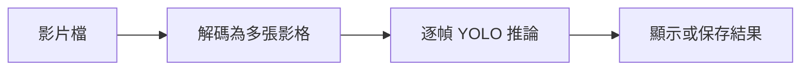
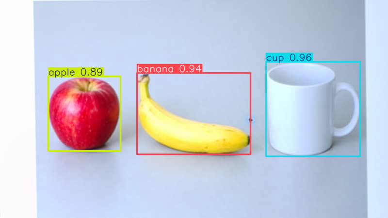

# 第 41 課｜YOLOv8 影片目標檢測完整教學

[原始文章](https://liusming.pixnet.net/blog/posts/14222899833) · 更新日期：2026-10-29

## 學習目標

建立合成短影片，再以 YOLOv8n 對影片逐幀執行 CPU 推論。

## 事前準備

需要 YOLO CPU 虛擬環境、模型與可用 MJPG 影片編碼器；會在目前目錄產生 lesson41-demo.avi。

依[安裝操作與實測紀錄](../安裝操作與實測紀錄.md#7-yolo-與-pytorch)建立並啟用 YOLO CPU 環境，再於練習目錄下載模型：

```bash
curl -fL https://github.com/ultralytics/assets/releases/download/v8.3.0/yolov8n.pt -o yolov8n.pt
```

不要使用原文的 CUDA 11.8 索引。

## 程式與執行

將下列已在 RP5 執行的程式存為 `第41課.py`，或使用[範例程式](./範例程式/第41課.py)。先確認目前目錄及檔案，避免覆蓋已有資料。

```python
import cv2
import numpy as np
from ultralytics import YOLO

path = 'lesson41-demo.avi'
writer = cv2.VideoWriter(path, cv2.VideoWriter_fourcc(*'MJPG'), 5.0, (320, 240))
if not writer.isOpened():
    raise RuntimeError('VideoWriter could not open')
for _ in range(3):
    writer.write(np.zeros((240, 320, 3), dtype=np.uint8))
writer.release()
model = YOLO('yolov8n.pt')
results = list(model.predict(path, imgsz=320, device='cpu', stream=True, verbose=False))
print('frames processed', len(results))
```

執行 `python3 第41課.py`。

## 本機實際輸出

```text
frames processed 3
```

本機處理了 3 個合成影格；此測試未產生加框影片，也未評估長影片速度。

## 背景與核心概念

### 影片偵測和即時處理

影片是一連串影格。逐幀推論需解碼、模型運算及必要的輸出編碼；每秒處理速度和影像品質、輸入尺寸、模型與硬體都有關。

### 思考、練習與後續應用

處理三個合成影格只能證明什麼？為何仍不能推論長影片速度與輸出影片的品質？

影片檢測可延伸到排隊計數或設備監控；需處理來源授權、掉幀與儲存容量。

進一步閱讀：[相關官方文件](https://docs.ultralytics.com/tasks/detect/)。請以下方實測狀態為準；尚未實作或測試的情境不能視為已通過。

## 概念流程圖



此圖用於說明文章的概念或完整目標流程，**不是操作截圖，也不代表每個步驟都已實測**；本機實測範圍請看文章中的標示。

## 進階實測：對相機短影片逐影格偵測

本次先由 RP5 相機拍攝顯示在螢幕上的 AI 生成蘋果、香蕉和杯子圖片，經裁切與透視校正後保存成[四張影格的測試影片](./練習素材/lesson42-input.avi)。下載該影片為 `lesson42-input.avi`，並把 `yolov8n.pt` 與[範例程式](./範例程式/第41課-相機影片YOLO.py)放在相同練習目錄；啟用本篇上方的 YOLO CPU 環境。

```python
import cv2
from ultralytics import YOLO

model = YOLO('yolov8n.pt')
video = cv2.VideoCapture('lesson42-input.avi')
writer = None
counts, first_result = [], None
try:
    while True:
        ok, frame = video.read()
        if not ok:
            break
        if writer is None:
            height, width = frame.shape[:2]
            writer = cv2.VideoWriter('lesson41-detected.avi', cv2.VideoWriter_fourcc(*'MJPG'), 3, (width, height))
            if not writer.isOpened():
                raise RuntimeError('無法建立輸出影片')
        result = model.predict(frame, imgsz=640, device='cpu', verbose=False)[0]
        annotated = result.plot()
        writer.write(annotated)
        counts.append(len(result.boxes))
        if first_result is None:
            first_result = annotated.copy()
finally:
    video.release()
    if writer is not None:
        writer.release()
if not counts or first_result is None:
    raise RuntimeError('輸入影片沒有讀取到影格')
if not cv2.imwrite('lesson41-detected-frame.png', first_result):
    raise RuntimeError('無法儲存結果圖')
print('frames processed:', len(counts))
print('detections per frame:', counts)
print('saved: lesson41-detected.avi, lesson41-detected-frame.png')
```

```bash
python3 第41課-相機影片YOLO.py
```

本次 RP5 實際輸出：

```text
frames processed: 4
detections per frame: [3, 3, 3, 3]
saved: lesson41-detected.avi, lesson41-detected-frame.png
```



本次每張影格各有 3 個偵測框；圖片是第一張處理後的標註影格，並非安裝截圖。程式將影片逐張讀取、執行模型推論、畫框並寫成新影片。播放速率設定為 3 FPS，並非實際運算速度；本次沒有量測長影片速度或不同編碼器相容性。

練習：比較原始影片與輸出影格，找出 3 個框。若輸入影片為空或輸出無法建立，檢查檔名、影片編碼器及寫入權限。AI 生成圖案只有一種場景，不能代表真實物件的偵測準確率。

## 與原文章的差異

- 原文處理使用者影片；本版先用短合成影片驗證讀取與逐幀推論。
- 真實場景的準確率、速度和操作畫面尚未完整驗證。
- 尚未保存操作畫面截圖。
- 新增初學者背景、概念、思考練習及後續應用，實測範圍仍以本文標示為準。
- 加入教學流程示意；圖中的完整目標流程不代表已逐步實測。
- 新增 RP5 相機拍攝生成素材的四影格影片、逐幀推論、輸出影片及結果圖；長影片與即時效能仍待測。
