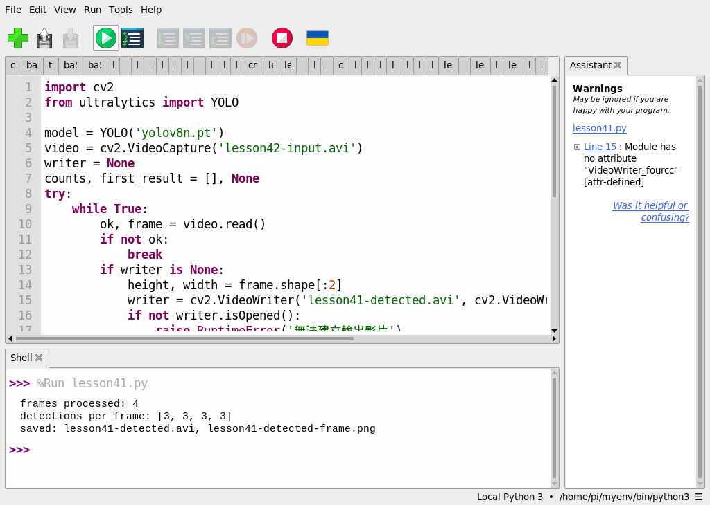
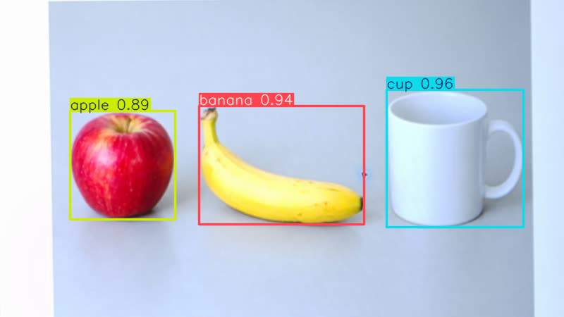
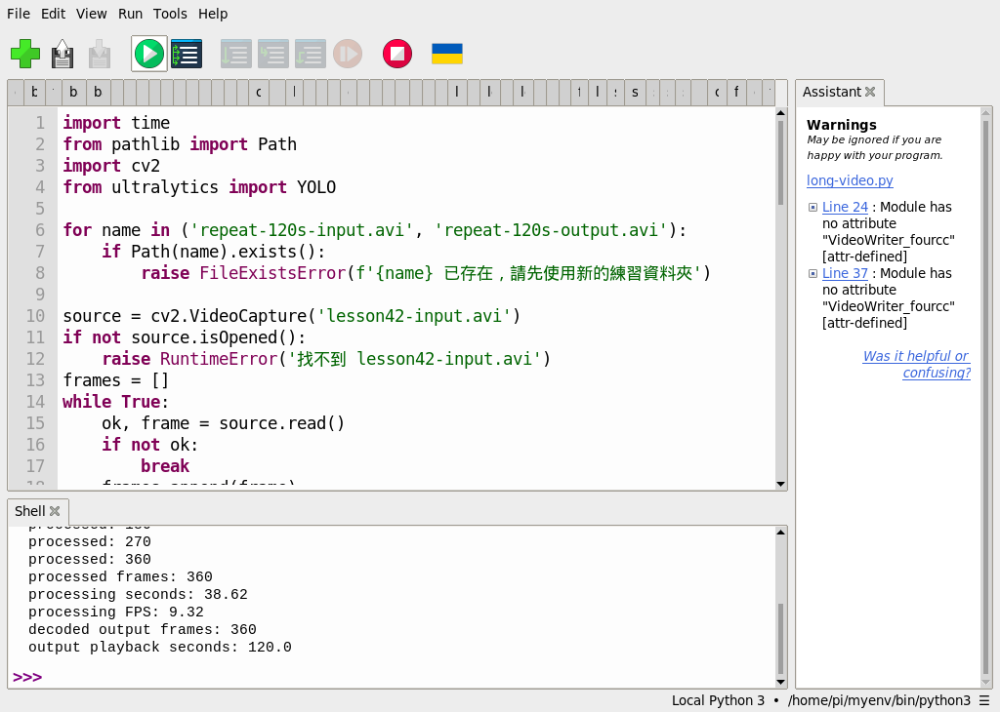
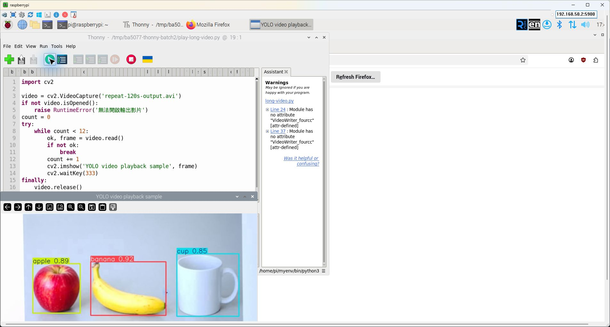
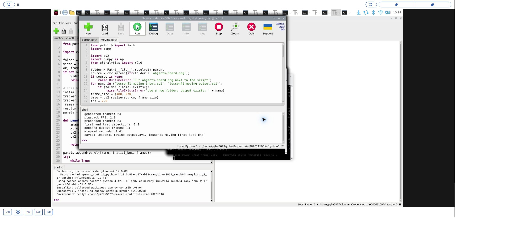
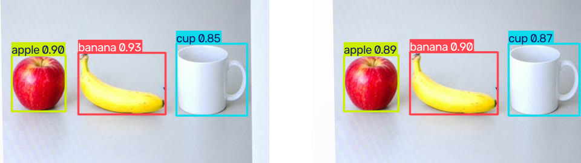
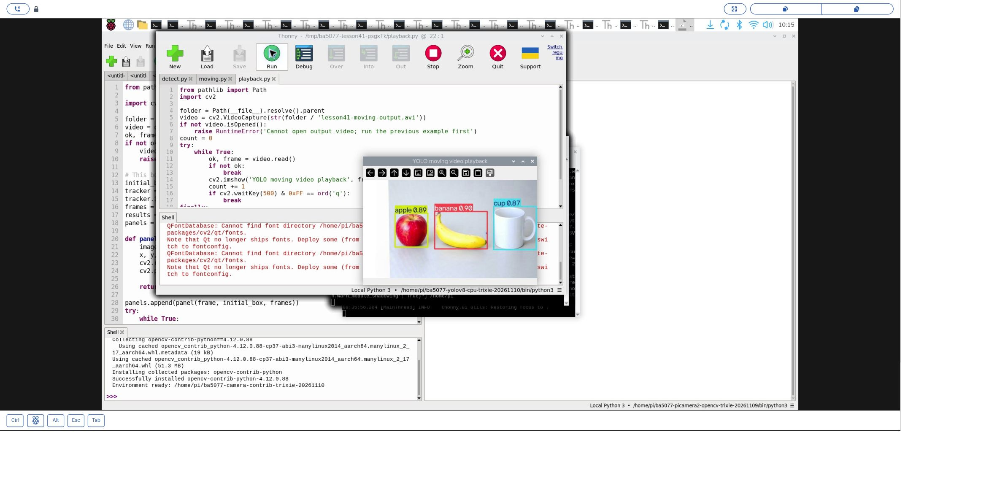

# 第 41 課｜YOLOv8 影片目標檢測完整教學

[原始文章](https://liusming.pixnet.net/blog/posts/14222899833) · 更新日期：2026-10-29

影片中的每一格都可以當成照片送給模型。我們先處理短片，讀回成果，再比較輸入和輸出的影格數。

第一次準備環境的同學，可以先讀[課前學習說明](./學習前先讀我.md)；操作遇到紅字時，我們用[排錯故事](./程式卡住時怎麼辦.md)一起找原因。

如果你使用 Trixie，我們先從[這一套系統的練習](#既有-trixie合成移動影片的逐格推論與播放2026-11-10)開始；前後的舊版例子可留到比較時閱讀。

## 學習目標與背景

影片是按順序排列的影格。物件偵測程式逐格解碼、推論、畫框再編碼；輸出影片的播放 FPS 是時間設定，與電腦實際每秒處理影格的速度不同。本課練習讀取影片、保存每格的框數，並產生新影片和結果圖片。

## 準備與素材

本次在這台 RP5 的既有 `/home/pi/myenv/bin/python3` 環境執行，含 Python 3.11.2、Ultralytics 8.3.50、PyTorch 2.5.1，以及 OpenCV。第 42、43 課另使用 Picamera2。這是當時既有混合環境；2026-11-10 既有 Trixie 新建 CPU 環境的影片測試另見下文，不代表全新重灌系統已驗證。

在瀏覽器下載並解壓本倉庫，依[素材下載與使用說明](./練習素材/素材下載與使用.md)建立新的練習資料夾；模型由[第 39 課](./第%2039%20課｜YOLOv8%20與%20COCO%20資料集完整教學.md)的 Thonny 下載程式取得，並放入同一資料夾。

將 [lesson42-input.avi](./練習素材/lesson42-input.avi) 和[本課程式](./範例程式/第41課-相機影片YOLO.py)複製到練習資料夾，與 `yolov8n.pt` 放在一起。影片由 RP5 相機拍攝螢幕上的 AI 生成物件圖，再裁切、校正並保存為四個影格；圖中的物件不是實體物品。執行會覆寫同名結果，請使用新的練習資料夾。

## 在 Thonny 操作

1. 「工具 → 選項 → 直譯器」選擇已有上述套件的 Python；選「檔案 → 開啟」開啟本課程式。
2. 按綠色執行鈕。觀察下方 Shell，並用檔案管理員開啟產生的 `lesson41-detected.avi` 與 `lesson41-detected-frame.png`。影片播放需適合的影片播放器。

完整程式：

```python
import cv2
from ultralytics import YOLO

model = YOLO('yolov8n.pt')
video = cv2.VideoCapture('lesson42-input.avi')
writer = None
counts, first_result = [], None
try:
    while True:
        ok, frame = video.read()
        if not ok:
            break
        if writer is None:
            height, width = frame.shape[:2]
            writer = cv2.VideoWriter('lesson41-detected.avi', cv2.VideoWriter_fourcc(*'MJPG'), 3, (width, height))
            if not writer.isOpened():
                raise RuntimeError('無法建立輸出影片')
        result = model.predict(frame, imgsz=640, device='cpu', verbose=False)[0]
        annotated = result.plot()
        writer.write(annotated)
        counts.append(len(result.boxes))
        if first_result is None:
            first_result = annotated.copy()
finally:
    video.release()
    if writer is not None:
        writer.release()
if not counts or first_result is None:
    raise RuntimeError('輸入影片沒有讀取到影格')
if not cv2.imwrite('lesson41-detected-frame.png', first_result):
    raise RuntimeError('無法儲存結果圖')
print('frames processed:', len(counts))
print('detections per frame:', counts)
print('saved: lesson41-detected.avi, lesson41-detected-frame.png')
```

## 本次 Thonny 實際輸出

```text
frames processed: 4
detections per frame: [3, 3, 3, 3]
saved: lesson41-detected.avi, lesson41-detected-frame.png
```





四個影格各有三個框；結果圖為先前處理同一練習影片所保存的第一個影格。Thonny 右側靜態檢查曾提示 `VideoWriter_fourcc` 屬性，但本次程式實際成功執行與寫檔，應同時查看 Shell 和產生的檔案。

## 延伸實驗：兩分鐘影片的逐格推論與讀回

### 素材和操作

此練習把上面的四張相機拍攝生成圖影格循環 90 次，建立 360 張影格、播放設定為 3 FPS 的兩分鐘影片。它能測試較多影格的讀寫和推論，但**不是兩分鐘不同的真實動態場景**，不能用它推論長時間實景準確率或長時間相機穩定性。

1. 在新練習資料夾放入 [lesson42-input.avi](./練習素材/lesson42-input.avi)、`yolov8n.pt` 和 [兩分鐘影片測試程式](./範例程式/第41課-Thonny兩分鐘影片測試.py)。模型取得方式見前節。若已有相同名稱的輸出影片，程式會停止，請改用新資料夾。
2. 在 Thonny 選擇前節已具備 YOLO 與 OpenCV 的直譯器，開啟程式並按綠色執行鈕。它先建立 `repeat-120s-input.avi`，再逐格推論、建立 `repeat-120s-output.avi`，最後重新讀取每一張輸出影格並計數。
3. 在同一資料夾下載並於 Thonny 執行[影片片段播放程式](./範例程式/第41課-Thonny播放影片片段.py)，它顯示前 12 張影格後結束。本次只目視播放前 12 張，整段 360 張由程式逐張解碼讀回，沒有目視播放全程。

兩分鐘測試完整程式：

```python
import time
from pathlib import Path
import cv2
from ultralytics import YOLO

for name in ('repeat-120s-input.avi', 'repeat-120s-output.avi'):
    if Path(name).exists():
        raise FileExistsError(f'{name} 已存在，請先使用新的練習資料夾')

source = cv2.VideoCapture('lesson42-input.avi')
if not source.isOpened():
    raise RuntimeError('找不到 lesson42-input.avi')
frames = []
while True:
    ok, frame = source.read()
    if not ok:
        break
    frames.append(frame)
source.release()
if len(frames) != 4:
    raise RuntimeError('本練習預期 4 張來源影格')
height, width = frames[0].shape[:2]
fps = 3.0
writer = cv2.VideoWriter('repeat-120s-input.avi', cv2.VideoWriter_fourcc(*'MJPG'), fps, (width, height))
if not writer.isOpened():
    raise RuntimeError('無法建立輸入影片')
for i in range(360):
    writer.write(frames[i % len(frames)])
writer.release()
print('input: repeated four frames', flush=True)
print('input frames: 360', flush=True)
print('playback FPS: 3.0', flush=True)
print('input duration seconds: 120.0', flush=True)

model = YOLO('yolov8n.pt')
video = cv2.VideoCapture('repeat-120s-input.avi')
output = cv2.VideoWriter('repeat-120s-output.avi', cv2.VideoWriter_fourcc(*'MJPG'), fps, (width, height))
if not video.isOpened() or not output.isOpened():
    video.release()
    output.release()
    raise RuntimeError('無法讀取或建立影片')
count = 0
start = time.perf_counter()
try:
    while True:
        ok, frame = video.read()
        if not ok:
            break
        result = model.predict(frame, imgsz=320, device='cpu', verbose=False)[0]
        output.write(result.plot())
        count += 1
        if count % 90 == 0:
            print('processed:', count, flush=True)
finally:
    video.release()
    output.release()
elapsed = time.perf_counter() - start
check = cv2.VideoCapture('repeat-120s-output.avi')
readback = 0
while True:
    ok, _ = check.read()
    if not ok:
        break
    readback += 1
check.release()
print('processed frames:', count)
print('processing seconds:', round(elapsed, 2))
print('processing FPS:', round(count / elapsed, 2))
print('decoded output frames:', readback)
print('output playback seconds:', round(readback / fps, 2))
```

播放片段完整程式：

```python
import cv2

video = cv2.VideoCapture('repeat-120s-output.avi')
if not video.isOpened():
    raise RuntimeError('無法開啟輸出影片')
count = 0
try:
    while count < 12:
        ok, frame = video.read()
        if not ok:
            break
        count += 1
        cv2.imshow('YOLO video playback sample', frame)
        cv2.waitKey(333)
finally:
    video.release()
    cv2.destroyAllWindows()
print('displayed frames:', count)
```

### 2026-10-29 RP5 的實際結果

```text
input: repeated four frames
input frames: 360
playback FPS: 3.0
input duration seconds: 120.0
processed: 90
processed: 180
processed: 270
processed: 360
processed frames: 360
processing seconds: 38.62
processing FPS: 9.32
decoded output frames: 360
output playback seconds: 120.0
```



播放片段的 Shell 輸出為 `displayed frames: 12`：



這是**操作截圖與程式結果**；來源為相機拍攝 AI 生成物件圖片。`3.0 FPS` 決定影片每秒播放幾張；`9.32 FPS` 是本次從解碼、YOLO 推論到寫出 360 張的平均處理速度，與影片播放速度不同。首次模型載入和最後重新讀回時間不計入 38.62 秒；不同負載會影響結果。

Thonny 偵測器可能對 `cv2.VideoWriter_fourcc` 顯示靜態提示。本次程式實際建立並讀回 360 張，這個提示並非此次執行失敗；若你的 Shell 實際報錯，應先確認 OpenCV 版本與影片編碼器。

## 既有 Trixie：合成移動影片的逐格推論與播放（2026-11-10）

此例以[公開的校正圖](./圖檔/objects-board.png)為來源，將影像每次水平平移 3 像素，建立 24 張不同影格的影片。原圖是先前相機拍攝螢幕上 AI 生成物件並校正後的照片；**影片的移動由程式合成，不是真實物體運動或新拍攝的相機影片**。它可以練習影片編碼、逐格推論、讀回和播放，不能用來評估實景遮擋或真實動態影片的準確率。

1. 建立新的練習資料夾，放入 `objects-board.png`、依[第 39 課](./第%2039%20課｜YOLOv8%20與%20COCO%20資料集完整教學.md)取得的預訓練 `yolov8n.pt`，以及[本例程式](./範例程式/第41課-Thonny合成動態影片.py)。本次使用原始預訓練模型，並非第 39 課單回合後的權重。
2. Thonny 選擇第 39 課 CPU 環境，開啟程式並按 Run。本次既有 Trixie 使用 Python 3.13.5、Ultralytics 8.4.208、PyTorch 2.15.0+cpu、OpenCV 5.0.0；解譯器是 `/home/pi/ba5077-yolov8-cpu-trixie-20261110/bin/python3`。本次測試副本名為 `moving.py`，內容與本例程式相同。
3. 程式會建立輸入、輸出影片和首尾影格比較圖；若輸入或輸出影片同名已存在會停止，請用新的目錄。比較圖同名時可能覆寫，先確認沒有需要保留的檔案。

```python
from pathlib import Path
import time

import cv2
import numpy as np
from ultralytics import YOLO

folder = Path(__file__).resolve().parent
source = cv2.imread(str(folder / 'objects-board.png'))
if source is None:
    raise RuntimeError('Put objects-board.png next to the script')
for name in ('lesson41-moving-input.avi', 'lesson41-moving-output.avi'):
    if (folder / name).exists():
        raise FileExistsError('Use a new folder; output exists: ' + name)
frame_size = (480, 270)
base = cv2.resize(source, frame_size)
fps = 2.0
writer = cv2.VideoWriter(str(folder / 'lesson41-moving-input.avi'), cv2.VideoWriter_fourcc(*'MJPG'), fps, frame_size)
if not writer.isOpened():
    raise RuntimeError('Cannot create input video')
try:
    for i in range(24):
        shift = -35 + 3 * i
        matrix = np.float32([[1, 0, shift], [0, 1, 0]])
        writer.write(cv2.warpAffine(base, matrix, frame_size, borderValue=(255, 255, 255)))
finally:
    writer.release()

model = YOLO(str(folder / 'yolov8n.pt'))
video = cv2.VideoCapture(str(folder / 'lesson41-moving-input.avi'))
output = cv2.VideoWriter(str(folder / 'lesson41-moving-output.avi'), cv2.VideoWriter_fourcc(*'MJPG'), fps, frame_size)
if not video.isOpened() or not output.isOpened():
    video.release()
    output.release()
    raise RuntimeError('Cannot open video input or output')
count = 0
counts = []
first = last = None
start = time.monotonic()
try:
    while True:
        ok, frame = video.read()
        if not ok:
            break
        result = model.predict(frame, imgsz=320, device='cpu', verbose=False)[0]
        annotated = result.plot()
        output.write(annotated)
        counts.append(len(result.boxes))
        count += 1
        if first is None:
            first = annotated.copy()
        last = annotated.copy()
finally:
    video.release()
    output.release()
elapsed = time.monotonic() - start
if count != 24 or first is None or last is None:
    raise RuntimeError(f'Expected 24 frames, got {count}')
if not cv2.imwrite(str(folder / 'lesson41-moving-first-last.png'), cv2.hconcat([first, last])):
    raise RuntimeError('Cannot save comparison image')
check = cv2.VideoCapture(str(folder / 'lesson41-moving-output.avi'))
readback = 0
try:
    while True:
        ok, _ = check.read()
        if not ok:
            break
        readback += 1
finally:
    check.release()
print('generated frames:', 24)
print('playback FPS:', fps)
print('processed frames:', count)
print('first and last detections:', counts[0], counts[-1])
print('decoded output frames:', readback)
print('elapsed seconds:', round(elapsed, 2))
print('saved: lesson41-moving-output.avi, lesson41-moving-first-last.png')
```

本次 Thonny 實際輸出：

```text
generated frames: 24
playback FPS: 2.0
processed frames: 24
first and last detections: 3 3
decoded output frames: 24
elapsed seconds: 3.41
saved: lesson41-moving-output.avi, lesson41-moving-first-last.png
```





[下載本次 RP5 產生的輸出影片](./練習素材/lesson41-trixie-moving-output-20261110.avi)。它是由上述既有校正圖透過程式位移、YOLO 偵測及編碼的結果，不是實景錄影。首尾影格各有三個框；程式未逐項核對中間各影格的正確性。影片設定 2 FPS，24 張的播放長度為 12 秒；3.41 秒是此次逐格讀取、推論與寫出的時間，不包含後續讀回，數值隨負載及版本改變。

### 在 Thonny 播放成果

把[播放程式](./範例程式/第41課-Thonny合成影片播放.py)與產生的 `lesson41-moving-output.avi` 放在同一資料夾，在 Thonny 開啟並按 Run。若使用上方下載的成果影片，請先複製到練習資料夾並改名為 `lesson41-moving-output.avi`。畫面視窗可按 q 提前結束；不按鍵時會播到影片結束。

```python
from pathlib import Path
import cv2

folder = Path(__file__).resolve().parent
video = cv2.VideoCapture(str(folder / 'lesson41-moving-output.avi'))
if not video.isOpened():
    raise RuntimeError('Cannot open output video; run the previous example first')
count = 0
try:
    while True:
        ok, frame = video.read()
        if not ok:
            break
        cv2.imshow('YOLO moving video playback', frame)
        count += 1
        if cv2.waitKey(500) & 0xFF == ord('q'):
            break
finally:
    video.release()
    cv2.destroyAllWindows()
print('displayed frames:', count)
```

本次 Shell 輸出 `displayed frames: 24`，並目視到播放視窗：



Shell 另顯示 Qt 字型目錄提示，但本次視窗仍可播放。若無法建立或開啟影片，核對 OpenCV、MJPG 編碼支援、輸出目錄及檔名；若未顯示視窗，先確認圖形桌面可用。練習觀察首尾影格的框如何移動，並說明播放 FPS 與推論速度的差別。全新重灌系統、真正的動態場景及較長的實景影片仍待驗。

## 練習與應用

觀察四影格的框是否一致；再自行更換影片並記錄框數。為什麼四影格成功不能保證長影片效能？可延伸到物品計數，並比較漏檢、誤檢與每秒處理速度。

## 與原文章的差異

- 以 RP5 CPU 和 Thonny 執行，採可下載的四影格練習影片；並非原文所有影片及即時情境。
- 新增既有 Trixie 的 24 張平移合成影片推論、讀回及完整播放；保留舊兩分鐘重複影格測試。真實動態長影片與全新系統仍待驗。

<details>
<summary>給教師：原有實測範圍與版本備註</summary>

> **部分實測**：既有 Trixie 的 Thonny 已測 24 張逐步平移的合成影片推論、讀回與播放；真實動態長影片和全新系統安裝仍待驗。[逐篇進度](./Thonny逐篇實測狀態.md)

</details>
