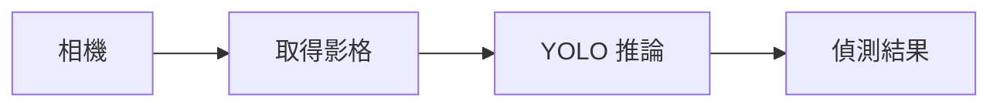

# 第 42 課｜YOLOv8 即時攝影機目標偵測教學

[原始文章](https://liusming.pixnet.net/blog/posts/14222899842) · 更新日期：2026-10-29

## 學習目標

從 Pi 相機取得一張影格並交給 YOLOv8n 推論。

## 事前準備

需要 Pi 相機、Picamera2、YOLO CPU 虛擬環境與模型檔。

依[安裝操作與實測紀錄](../安裝操作與實測紀錄.md#7-yolo-與-pytorch)建立並啟用 YOLO CPU 環境，再於練習目錄下載模型：

```bash
curl -fL https://github.com/ultralytics/assets/releases/download/v8.3.0/yolov8n.pt -o yolov8n.pt
```

不要使用原文的 CUDA 11.8 索引。

## 程式與執行

將下列已在 RP5 執行的程式存為 `第42課.py`，或使用[範例程式](./範例程式/第42課.py)。先確認目前目錄及檔案，避免覆蓋已有資料。

```python
from picamera2 import Picamera2
from ultralytics import YOLO

camera = Picamera2()
try:
    camera.configure(camera.create_still_configuration(main={'size': (320, 240), 'format': 'RGB888'}))
    camera.start()
    frame = camera.capture_array()
finally:
    camera.stop()
    camera.close()
results = YOLO('yolov8n.pt').predict(frame, imgsz=320, device='cpu', verbose=False)
print('camera frame', frame.shape)
print('results', len(results))
```

執行 `python3 第42課.py`。

## 本機實際輸出

```text
camera frame (240, 320, 3)
results 1
```

此測試只處理一張相機影格，不是即時影片，也未驗證偵測準確率。

## 背景與核心概念

### 相機影格如何進入模型？

相機資料需符合模型預期的大小與顏色格式，推論結果才有意義。單張影格可先測資料流，但即時系統還需要連續擷取、顯示和計算延遲。

### 思考、練習與後續應用

如果只處理一張影格，為何不能宣稱即時偵測已完成？請列出需要額外量測的兩項指標。

可用於監測原型；正式使用前要測試光線、遮擋、隱私和不同場景。

進一步閱讀：[相關官方文件](https://docs.ultralytics.com/tasks/detect/)。請以下方實測狀態為準；尚未實作或測試的情境不能視為已通過。

## 概念流程圖



此圖用於說明文章的概念或完整目標流程，**不是操作截圖，也不代表每個步驟都已實測**；本機實測範圍請看文章中的標示。

## 與原文章的差異

- 原文透過 VideoCapture(0) 使用攝影機；本機 CSI 相機改用 Picamera2，先驗證單張影格。
- 真實場景的準確率、速度和操作畫面尚未完整驗證。
- 尚未保存操作畫面截圖。
- 新增初學者背景、概念、思考練習及後續應用，實測範圍仍以本文標示為準。
- 加入教學流程示意；圖中的完整目標流程不代表已逐步實測。
