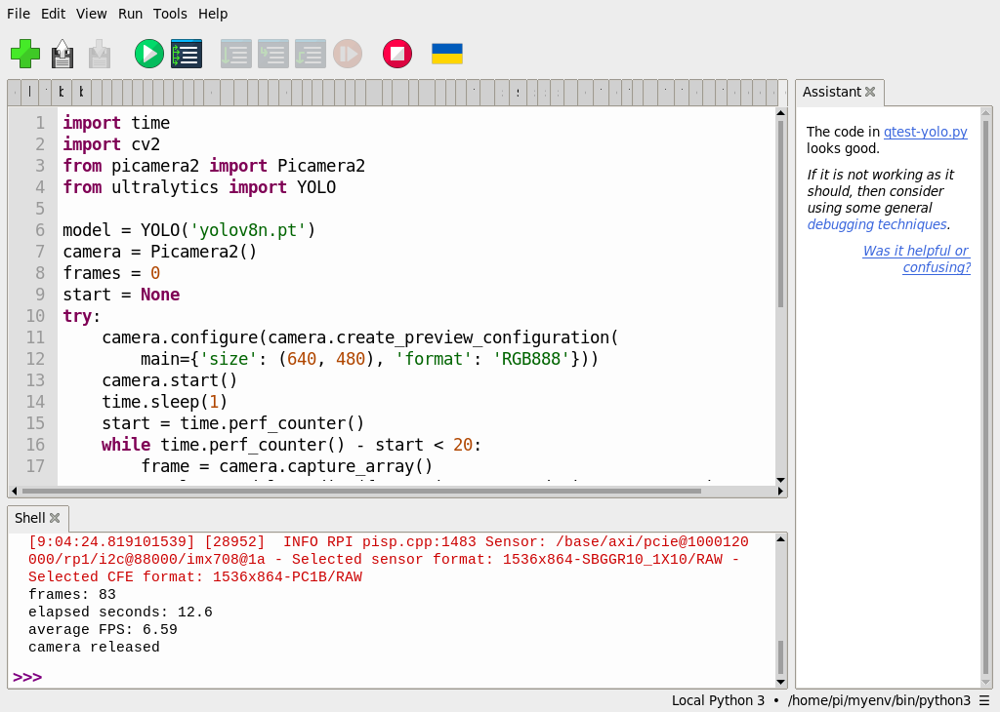
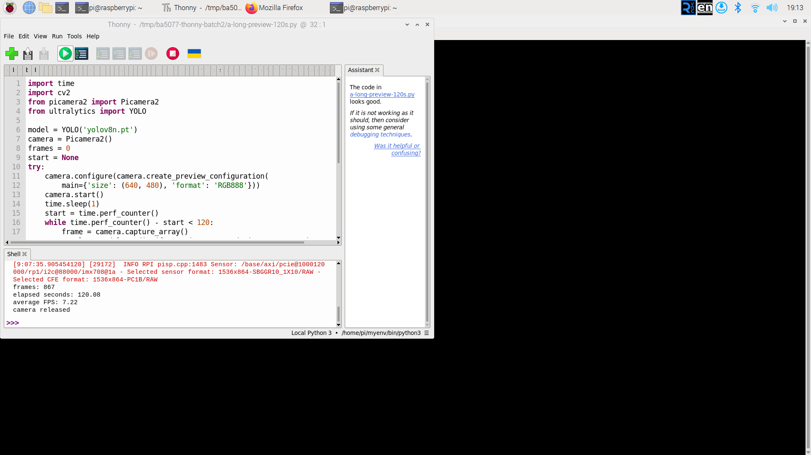
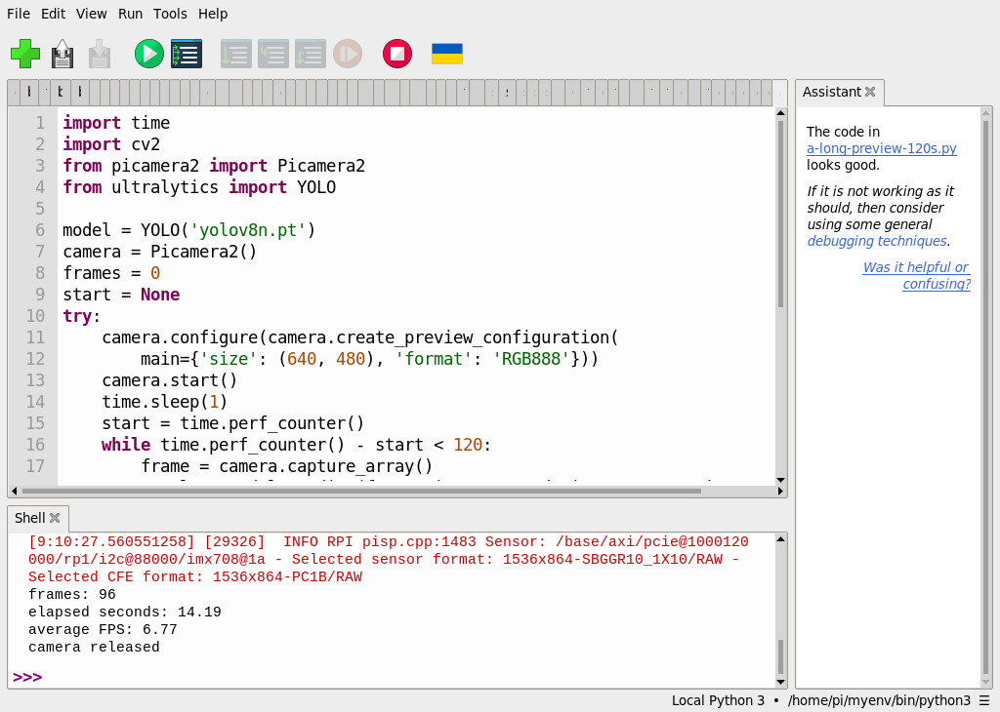

# 第 42 課｜YOLOv8 即時攝影機目標偵測教學

[原始文章](https://liusming.pixnet.net/blog/posts/14222899842) · 更新日期：2026-10-29

> **部分實測**：已在 Thonny 連續擷取及推論四張相機影格；已再實測約 20 秒連續預覽與相機重新開啟；另完成兩分鐘連續預覽和 Q 鍵停止；數小時穩定性、乾淨環境安裝與 Hailo 待驗證。[逐篇進度](./Thonny逐篇實測狀態.md)

## 學習目標與背景

CSI 相機由 Picamera2 擷取影格，YOLO 模型分析影格並回傳候選物件框。連續影格依序取像及推論，和先前拍好的影片不同；程式結束時釋放相機，其他程式才可使用它。原文標題的 PyCamera2 在此指 Python 套件 Picamera2。

第一個練習只列印偵測框數；後面的獨立範例則實測連續預覽。框數也不能證明辨識正確；相機內容和光線會改變結果。

## 準備

本次在這台 RP5 的既有 `/home/pi/myenv/bin/python3` 環境執行，含 Python 3.11.2、Ultralytics 8.3.50、PyTorch 2.5.1，以及 OpenCV。第 42、43 課另使用 Picamera2。這是本機既有混合環境；在全新虛擬環境透過 Thonny 安裝全部 YOLO 套件仍待實測，不能當成已驗證的乾淨安裝教學。

在瀏覽器下載並解壓本倉庫，依[素材下載與使用說明](./練習素材/素材下載與使用.md)建立新的練習資料夾；模型由[第 39 課](./第%2039%20課｜YOLOv8%20與%20COCO%20資料集完整教學.md)的 Thonny 下載程式取得，並放入同一資料夾。

將[共用相機範例](./範例程式/第42-43課-Thonny相機偵測.py)放在模型所在的練習資料夾。接妥 CSI 相機並確認未被其他程式占用。本範例直接取得當前相機畫面，無需下載圖片；可對準不含個人資訊的物品。相機內容不會被本程式保存。

## Thonny 操作

1. 在「工具 → 選項 → 直譯器」選擇已有 Picamera2 與 Ultralytics 的 Python，開啟共用相機範例。
2. 按綠色執行鈕，等待四張影格推論完成；Shell 列出尺寸、框數和這次平均迴圈速度。

```python
import time
from picamera2 import Picamera2
from ultralytics import YOLO

model = YOLO('yolov8n.pt')
camera = Picamera2()
counts = []
try:
    camera.configure(camera.create_preview_configuration(
        main={'size': (640, 480), 'format': 'RGB888'}))
    camera.start()
    time.sleep(1)
    start = time.perf_counter()
    for index in range(4):
        frame = camera.capture_array()
        result = model.predict(frame, imgsz=320, device='cpu', verbose=False)[0]
        counts.append(len(result.boxes))
        print('frame:', index + 1, 'shape:', frame.shape,
              'detections:', counts[-1], flush=True)
    elapsed = time.perf_counter() - start
finally:
    camera.stop()
    camera.close()
print('processed:', len(counts))
print('elapsed seconds:', round(elapsed, 2))
print('average FPS:', round(len(counts) / elapsed, 2))
```

## 本次實際輸出

```text
frame: 1 shape: (480, 640, 3) detections: 2
frame: 2 shape: (480, 640, 3) detections: 2
frame: 3 shape: (480, 640, 3) detections: 2
frame: 4 shape: (480, 640, 3) detections: 2
processed: 4
elapsed seconds: 1.41
average FPS: 2.84
```


本次每張得到兩個候選框，並未人工核對框的正確性。時間涵蓋四次取像與推論、包含首次推論；不含模型載入和相機暖機。2.84 FPS 僅代表這次短暫的 CPU 測量，不能保證其他情況或長時間速度。

## Thonny 實測：連續相機預覽與 YOLO

在有 Picamera2、OpenCV 與 Ultralytics 的既有環境中，將[預覽程式](./範例程式/第42-43課-Thonny即時預覽.py)與依第 39 課下載的 `yolov8n.pt` 放在同一練習資料夾。確定相機沒有被其他程式占用；在 Thonny 開啟程式並按綠色執行。程式以 CPU 推論，在 OpenCV 視窗顯示影像和候選框，最多執行 20 秒後自動停止；聚焦預覽視窗後按小寫 q 可提前停止；下方另列兩次實測。

```python
import time
import cv2
from picamera2 import Picamera2
from ultralytics import YOLO

model = YOLO('yolov8n.pt')
camera = Picamera2()
frames = 0
start = None
try:
    camera.configure(camera.create_preview_configuration(
        main={'size': (640, 480), 'format': 'RGB888'}))
    camera.start()
    time.sleep(1)
    start = time.perf_counter()
    while time.perf_counter() - start < 20:
        frame = camera.capture_array()
        result = model.predict(frame, imgsz=320, device='cpu', verbose=False)[0]
        cv2.imshow('RP5 YOLO - press Q to stop', result.plot())
        frames += 1
        if cv2.waitKey(1) & 0xFF == ord('q'):
            break
    elapsed = time.perf_counter() - start
finally:
    camera.stop()
    camera.close()
    cv2.destroyAllWindows()
print('frames:', frames)
print('elapsed seconds:', round(elapsed, 2))
print('average FPS:', round(frames / elapsed, 2) if elapsed else 0)
print('camera released')
```

這次在 RP5 的 Thonny 實際輸出：

```text
frames: 139
elapsed seconds: 20.07
average FPS: 6.93
camera released
```


這次的計時包含取像、推論與顯示，不含模型載入與相機暖機。相機拍到螢幕周邊環境，因此未公開預覽畫面。測試結束後再次執行同一程式，確認相機可重新開啟；當時兩次均由 20 秒上限自動結束；之後的 Q 鍵測試見下節。這是短時間功能測試，無法保證長時間穩定或準確率。全新環境安裝仍待完成。

## Thonny 實測：按 Q 結束與重新開啟

1. 在 Thonny 執行上面的預覽程式；出現標題 `RP5 YOLO - press Q to stop` 的影像視窗後，**先用滑鼠點選影像視窗**，再按鍵盤上的小寫 `q`。若焦點在 Thonny 編輯區，字母會輸入到程式而不會送給影像視窗。
2. 等待視窗關閉並確認 Shell 印出 `camera released`。本次第一次在 20 秒上限以前按 Q，實際輸出為：

```text
frames: 83
elapsed seconds: 12.6
average FPS: 6.59
camera released
```



3. 隨後在 Thonny 再按執行，確認相機能重新開啟並看到連續預覽，再點選預覽視窗按 `q`；第二次實際輸出：

```text
frames: 100
elapsed seconds: 14.88
average FPS: 6.72
camera released
```


兩次使用相同程式與既有 `/home/pi/myenv/bin/python3` 環境。秒數從相機暖機後開始計算，平均值包含取像、CPU 推論和顯示，會隨負載與按鍵時間改變。預覽拍到個人物品與螢幕周邊，因此這裡只發布程式結束後的操作截圖；這兩次驗證可提前停止與重開，不代表任意異常中斷或長時間運作皆已驗證。

## Thonny 實測：兩分鐘連續預覽

下載[兩分鐘預覽程式](./範例程式/第42-43課-Thonny兩分鐘預覽.py)，放入前述含 `yolov8n.pt` 的練習資料夾，選擇同一個已有相機和 YOLO 套件的直譯器，並在 Thonny 開啟、按綠色執行鈕。此程式和前述 20 秒範例相同，將迴圈上限改為 120 秒；可以依上節先點選預覽視窗，再按 `q` 提前停止。本次不按鍵，讓程式到時間後自動結束。

2026-10-29 的 RP5 實際輸出：

```text
frames: 867
elapsed seconds: 120.08
average FPS: 7.22
camera released
```



相機對著螢幕與瓶子，程式依序擷取影格、執行 CPU 推論並顯示預覽，未儲存影片。計時從暖機完成後開始，包含取像、推論與視窗更新，不含模型載入及暖機；平均 FPS 是影格數除以迴圈時間，不是相機感測器的固定更新率或模型準確率。過程中觀察到畫面更新，並未逐格人工核對偵測結果；為避免公開周邊環境，截圖只展示停止後的 Thonny 畫面。

自動結束後，再執行同一程式確認相機能重開；本輪按 `q` 提前結束，輸出如下：

```text
frames: 96
elapsed seconds: 14.19
average FPS: 6.77
camera released
```



此為一次兩分鐘連續測試與一次重開，不能推論數小時運作、其他場景的準確率或完整資源使用趨勢。若要進行更久的測試，應另記錄時間、溫度、記憶體、速度變化與停止結果。

## 練習與延伸

比較 320 和 640 輸入尺寸時的偵測結果與耗時；分別記錄光線、畫面內容及執行次數。設計長時間測試時，還要考慮畫面顯示、停止方式、掉幀和資源釋放。

## 與原文章的差異

- 本版以 Picamera2 擷取 CSI 相機並在 RP5 CPU 上推論；不同於直接假設桌面電腦 CUDA 或攝影機介面。
- 本次以 Thonny 測試四張影格及 20 秒預覽，另測兩分鐘連續預覽與 Q 鍵；數小時測試及 Hailo 加速仍待驗證。
