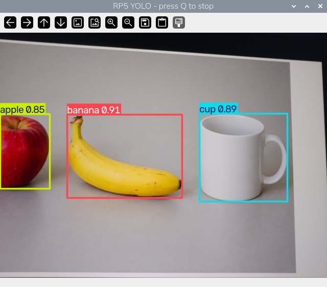
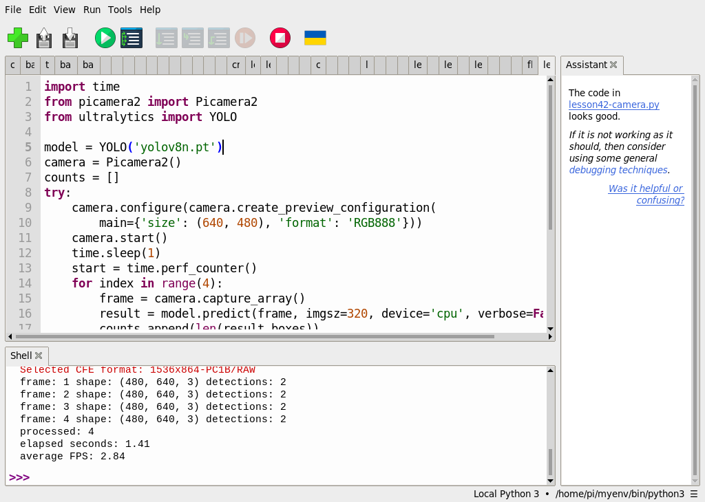
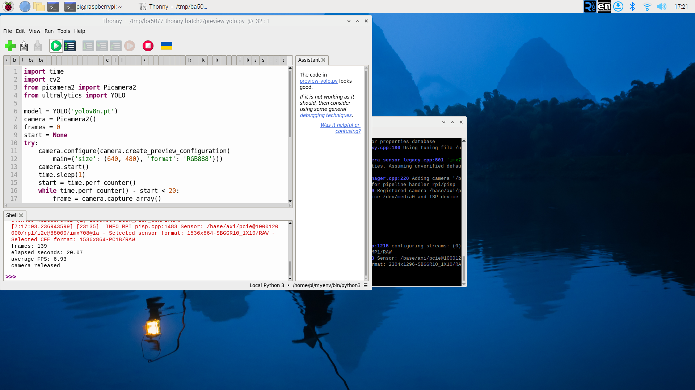
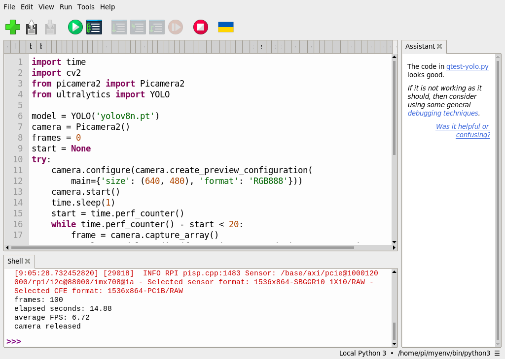
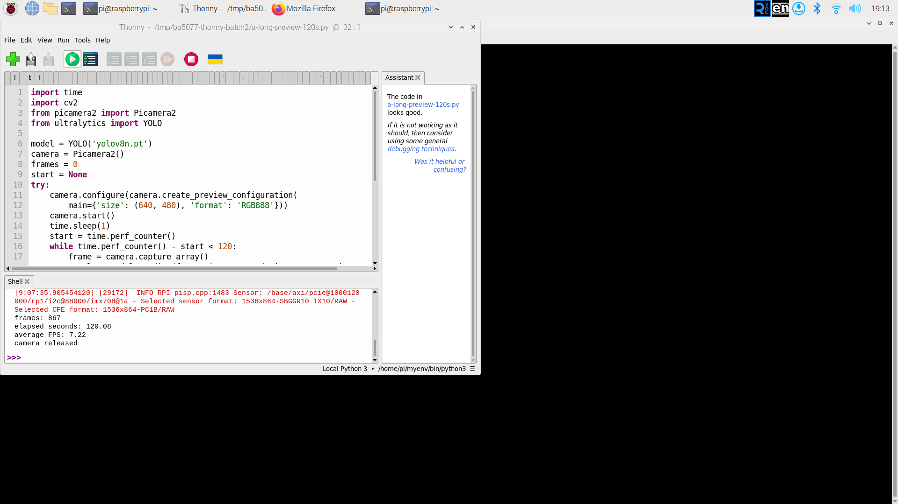
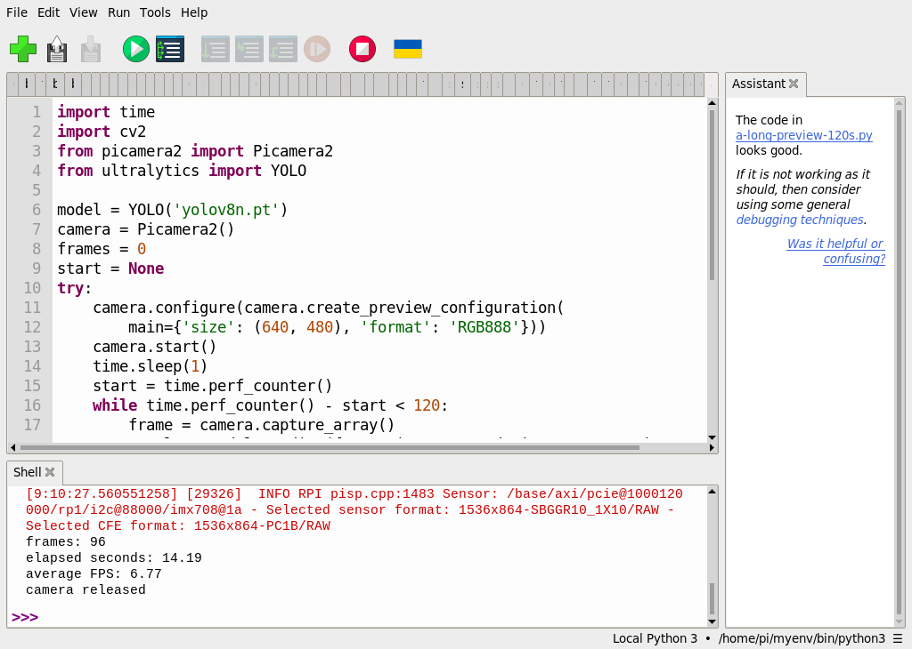

# 第 42 課｜YOLOv8 即時攝影機目標偵測教學

[原始文章](https://liusming.pixnet.net/blog/posts/14222899842) · 更新日期：2026-10-29

把模型接上相機前，先確認相機和模型各自能工作。接好後我們觀察即時框，再練習停止和重新啟動。

第一次準備環境的同學，可以先讀[課前學習說明](./學習前先讀我.md)；操作遇到紅字時，我們用[排錯故事](./程式卡住時怎麼辦.md)一起找原因。

這一課需要一個「同時能用相機（Picamera2）和 YOLO（Ultralytics）」的 Python 環境。第 39 課的 CPU 環境沒有 Picamera2，所以我們在下面的「準備」先建立一個新的相機 YOLO 環境；2026-11-12 已在目前的 Trixie 實測過這條路線。

## 學習目標與背景

CSI 相機由 Picamera2 擷取影格，YOLO 模型分析影格並回傳候選物件框。連續影格依序取像及推論，和先前拍好的影片不同；程式結束時釋放相機，其他程式才可使用它。原文標題的 PyCamera2 在此指 Python 套件 Picamera2。

第一個練習只列印偵測框數；後面的獨立範例則實測連續預覽。框數也不能證明辨識正確；相機內容和光線會改變結果。

## 準備：在目前 Trixie 建立相機 YOLO 環境（2026-11-12 實測）

**為什麼要另建環境：**相機套件 Picamera2 由系統提供，不能用 pip 單獨安裝；YOLO 需要 PyTorch 與 Ultralytics。我們建立一個「讀得到系統套件」的虛擬環境（`--system-site-packages`），再把 PyTorch CPU 版和 Ultralytics 裝進去，兩邊就能在同一個 Python 使用。舊版教材用的 `/home/pi/myenv` 是先前 Bookworm 的環境，目前的 Trixie 已經沒有。

1. **建立環境（Thonny）**：在 RP5 桌面開 Thonny，右下角先選系統的 Python 3（`/usr/bin/python3`）。開啟[環境建立程式](./範例程式/Thonny建立Trixie相機YOLO環境.py)，把 `target` 改成主目錄下**還不存在**的資料夾，按綠色執行鈕。下載 PyTorch 與 Ultralytics 需要網路，可能要十幾分鐘；看到 `Environment ready:` 才算完成。本次最後兩行實際輸出：

   ```text
   Picamera2 OK; OpenCV 5.0.0 PyTorch 2.15.0+cpu Ultralytics 8.4.208
   Environment ready: /home/pi/ba5077-yolo-camera-trixie-20261112/bin/python3
   ```

   若出現 `No module named 'picamera2'`，表示建立時沒有用系統 Python 或少了 `--system-site-packages`；請換一個新資料夾名稱重建，不要刪別人的環境。
2. **選直譯器**：到「工具 → 選項 → 直譯器」選新環境的 `bin/python3`，確認 Thonny 右下角顯示該路徑。
3. **準備模型**：建立新的練習資料夾，放入[第 39 課的模型下載程式](./範例程式/第39課-Thonny下載YOLOv8模型.py)，用同一環境執行，取得 `yolov8n.pt`（本次 6,549,796 bytes，SHA-256 `f59b3d83…fc83b36`，與第 39 課相同）。
4. **放程式**：把[共用相機範例](./範例程式/第42-43課-Thonny相機偵測.py)與[20 秒預覽程式](./範例程式/第42-43課-Thonny即時預覽.py)放進同一練習資料夾。接妥 CSI 相機，關閉其他使用相機的程式。相機要對著不含個人資訊的物品；本次對著另一台螢幕上的 [AI 生成物件圖](./練習素材/AI生成物件測試.png)（蘋果、香蕉、杯子都是生成圖片，不是實物）。

### 本次 Trixie 實際結果（2026-11-12）

以下以 SSH 在 RP5 桌面用上面同一個直譯器執行；Thonny 按 Run 的操作截圖待補，步驟與按 Run 相同。

- 共用相機範例（四張影格）：

  ```text
  frame: 1 shape: (480, 640, 3) detections: 3
  frame: 2 shape: (480, 640, 3) detections: 3
  frame: 3 shape: (480, 640, 3) detections: 3
  frame: 4 shape: (480, 640, 3) detections: 3
  processed: 4
  elapsed seconds: 1.91
  average FPS: 2.1
  ```

- 20 秒即時預覽：預覽視窗標示 `apple 0.85`、`banana 0.91`、`cup 0.89`，Shell 輸出 `frames: 162`、`elapsed seconds: 20.05`、`average FPS: 8.08`、`camera released`。

  

  *圖：RP5 桌面截圖，只裁切預覽視窗。畫面是相機拍攝螢幕上的 AI 生成圖，框與分數是 YOLO 輸出。*

**卡住時：**看到 `Could not load the Qt platform plugin "xcb"`，代表程式不是在 RP5 桌面環境中啟動（例如純 SSH）；請在 RP5 桌面的 Thonny 執行。看到 `Qt no longer ships fonts` 的提示可以忽略。相機開不起來時，先確認沒有其他程式（包括另一個 Thonny 分頁）正在用相機。

下面「Thonny 操作」以後的段落是**先前 Bookworm 的紀錄**（`/home/pi/myenv`、Python 3.11.2、Ultralytics 8.3.50），程式相同，可對照 Q 鍵停止、重開與兩分鐘預覽的做法；數字不是目前 Trixie 的結果。

## 先前 Bookworm：Thonny 操作

1. 在「工具 → 選項 → 直譯器」選擇已有 Picamera2 與 Ultralytics 的 Python，開啟共用相機範例。
2. 按綠色執行鈕，等待四張影格推論完成；Shell 列出尺寸、框數和這次平均迴圈速度。

```python
import time
from picamera2 import Picamera2
from ultralytics import YOLO

model = YOLO('yolov8n.pt')
camera = Picamera2()
counts = []
try:
    camera.configure(camera.create_preview_configuration(
        main={'size': (640, 480), 'format': 'RGB888'}))
    camera.start()
    time.sleep(1)
    start = time.perf_counter()
    for index in range(4):
        frame = camera.capture_array()
        result = model.predict(frame, imgsz=320, device='cpu', verbose=False)[0]
        counts.append(len(result.boxes))
        print('frame:', index + 1, 'shape:', frame.shape,
              'detections:', counts[-1], flush=True)
    elapsed = time.perf_counter() - start
finally:
    camera.stop()
    camera.close()
print('processed:', len(counts))
print('elapsed seconds:', round(elapsed, 2))
print('average FPS:', round(len(counts) / elapsed, 2))
```

## 先前 Bookworm 的實際輸出

```text
frame: 1 shape: (480, 640, 3) detections: 2
frame: 2 shape: (480, 640, 3) detections: 2
frame: 3 shape: (480, 640, 3) detections: 2
frame: 4 shape: (480, 640, 3) detections: 2
processed: 4
elapsed seconds: 1.41
average FPS: 2.84
```



本次每張得到兩個候選框，並未人工核對框的正確性。時間涵蓋四次取像與推論、包含首次推論；不含模型載入和相機暖機。2.84 FPS 僅代表這次短暫的 CPU 測量，不能保證其他情況或長時間速度。

## 先前 Bookworm 的 Thonny 實測：連續相機預覽與 YOLO

在有 Picamera2、OpenCV 與 Ultralytics 的既有環境中，將[預覽程式](./範例程式/第42-43課-Thonny即時預覽.py)與依第 39 課下載的 `yolov8n.pt` 放在同一練習資料夾。確定相機沒有被其他程式占用；在 Thonny 開啟程式並按綠色執行。程式以 CPU 推論，在 OpenCV 視窗顯示影像和候選框，最多執行 20 秒後自動停止；聚焦預覽視窗後按小寫 q 可提前停止；下方另列兩次實測。

```python
import time
import cv2
from picamera2 import Picamera2
from ultralytics import YOLO

model = YOLO('yolov8n.pt')
camera = Picamera2()
frames = 0
start = None
try:
    camera.configure(camera.create_preview_configuration(
        main={'size': (640, 480), 'format': 'RGB888'}))
    camera.start()
    time.sleep(1)
    start = time.perf_counter()
    while time.perf_counter() - start < 20:
        frame = camera.capture_array()
        result = model.predict(frame, imgsz=320, device='cpu', verbose=False)[0]
        cv2.imshow('RP5 YOLO - press Q to stop', result.plot())
        frames += 1
        if cv2.waitKey(1) & 0xFF == ord('q'):
            break
    elapsed = time.perf_counter() - start
finally:
    camera.stop()
    camera.close()
    cv2.destroyAllWindows()
print('frames:', frames)
print('elapsed seconds:', round(elapsed, 2))
print('average FPS:', round(frames / elapsed, 2) if elapsed else 0)
print('camera released')
```

這次在 RP5 的 Thonny 實際輸出：

```text
frames: 139
elapsed seconds: 20.07
average FPS: 6.93
camera released
```



這次的計時包含取像、推論與顯示，不含模型載入與相機暖機。相機拍到螢幕周邊環境，因此未公開預覽畫面。測試結束後再次執行同一程式，確認相機可重新開啟；當時兩次均由 20 秒上限自動結束；之後的 Q 鍵測試見下節。這是短時間功能測試，無法保證長時間穩定或準確率。全新環境安裝仍待完成。

## 先前 Bookworm 的 Thonny 實測：按 Q 結束與重新開啟

1. 在 Thonny 執行上面的預覽程式；出現標題 `RP5 YOLO - press Q to stop` 的影像視窗後，**先用滑鼠點選影像視窗**，再按鍵盤上的小寫 `q`。若焦點在 Thonny 編輯區，字母會輸入到程式而不會送給影像視窗。
2. 等待視窗關閉並確認 Shell 印出 `camera released`。本次第一次在 20 秒上限以前按 Q，實際輸出為：

```text
frames: 83
elapsed seconds: 12.6
average FPS: 6.59
camera released
```


3. 隨後在 Thonny 再按執行，確認相機能重新開啟並看到連續預覽，再點選預覽視窗按 `q`；第二次實際輸出：

```text
frames: 100
elapsed seconds: 14.88
average FPS: 6.72
camera released
```



兩次使用相同程式與既有 `/home/pi/myenv/bin/python3` 環境。秒數從相機暖機後開始計算，平均值包含取像、CPU 推論和顯示，會隨負載與按鍵時間改變。預覽拍到個人物品與螢幕周邊，因此這裡只發布程式結束後的操作截圖；這兩次驗證可提前停止與重開，不代表任意異常中斷或長時間運作皆已驗證。

## 先前 Bookworm 的 Thonny 實測：兩分鐘連續預覽

下載[兩分鐘預覽程式](./範例程式/第42-43課-Thonny兩分鐘預覽.py)，放入前述含 `yolov8n.pt` 的練習資料夾，選擇同一個已有相機和 YOLO 套件的直譯器，並在 Thonny 開啟、按綠色執行鈕。此程式和前述 20 秒範例相同，將迴圈上限改為 120 秒；可以依上節先點選預覽視窗，再按 `q` 提前停止。本次不按鍵，讓程式到時間後自動結束。

2026-10-29 的 RP5 實際輸出：

```text
frames: 867
elapsed seconds: 120.08
average FPS: 7.22
camera released
```



相機對著螢幕與瓶子，程式依序擷取影格、執行 CPU 推論並顯示預覽，未儲存影片。計時從暖機完成後開始，包含取像、推論與視窗更新，不含模型載入及暖機；平均 FPS 是影格數除以迴圈時間，不是相機感測器的固定更新率或模型準確率。過程中觀察到畫面更新，並未逐格人工核對偵測結果；為避免公開周邊環境，截圖只展示停止後的 Thonny 畫面。

自動結束後，再執行同一程式確認相機能重開；本輪按 `q` 提前結束，輸出如下：

```text
frames: 96
elapsed seconds: 14.19
average FPS: 6.77
camera released
```



此為一次兩分鐘連續測試與一次重開，不能推論數小時運作、其他場景的準確率或完整資源使用趨勢。若要進行更久的測試，應另記錄時間、溫度、記憶體、速度變化與停止結果。

## 練習與延伸

比較 320 和 640 輸入尺寸時的偵測結果與耗時；分別記錄光線、畫面內容及執行次數。設計長時間測試時，還要考慮畫面顯示、停止方式、掉幀和資源釋放。

## 與原文章的差異

- 2026-11-12 全面盤點：原準備段只寫已不存在的 Bookworm `/home/pi/myenv`，目前 Trixie 沒有任何同時含 Picamera2 與 Ultralytics 的環境，學生無法照做；新增 Trixie 相機 YOLO 環境建立程式並實測四影格與 20 秒預覽。舊 Bookworm 紀錄保留並標示。編修前版本存於[歷史紀錄](./歷史紀錄/第42課-全面盤點前-20261112.md)。
- 本版以 Picamera2 擷取 CSI 相機並在 RP5 CPU 上推論；不同於直接假設桌面電腦 CUDA 或攝影機介面。
- 本次以 Thonny 測試四張影格及 20 秒預覽，另測兩分鐘連續預覽與 Q 鍵；數小時測試及 Hailo 加速仍待驗證。

<details>
<summary>給教師：原有實測範圍與版本備註</summary>

> **部分實測**：已在 Thonny 連續擷取及推論四張相機影格；已再實測約 20 秒連續預覽與相機重新開啟；另完成兩分鐘連續預覽和 Q 鍵停止；數小時穩定性、乾淨環境安裝與 Hailo 待驗證。[逐篇進度](./Thonny逐篇實測狀態.md)

</details>
