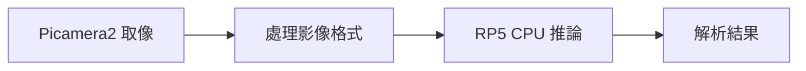

# 第 43 課｜使用 PyCamera2 與 YOLOv8 實現即時目標偵測（Raspberry Pi 5）

[原始文章](https://liusming.pixnet.net/blog/posts/14222899863) · 更新日期：2026-10-29

## 學習目標

結合 Picamera2 與 YOLOv8n 進行一次 CPU 影像推論。

## 事前準備

需要相機、Picamera2、YOLO CPU 虛擬環境與模型檔。

依[安裝操作與實測紀錄](../安裝操作與實測紀錄.md#7-yolo-與-pytorch)建立並啟用 YOLO CPU 環境，再於練習目錄下載模型：

```bash
curl -fL https://github.com/ultralytics/assets/releases/download/v8.3.0/yolov8n.pt -o yolov8n.pt
```

不要使用原文的 CUDA 11.8 索引。

## 程式與執行

將下列已在 RP5 執行的程式存為 `第43課.py`，或使用[範例程式](./範例程式/第43課.py)。先確認目前目錄及檔案，避免覆蓋已有資料。

```python
from picamera2 import Picamera2
from ultralytics import YOLO

camera = Picamera2()
try:
    camera.configure(camera.create_still_configuration(main={'size': (320, 240), 'format': 'RGB888'}))
    camera.start()
    frame = camera.capture_array()
finally:
    camera.stop()
    camera.close()
results = YOLO('yolov8n.pt').predict(frame, imgsz=320, device='cpu', verbose=False)
print('camera frame', frame.shape)
print('results', len(results))
print('boxes', len(results[0].boxes))
```

執行 `python3 第43課.py`。

## 本機實際輸出

```text
camera frame (240, 320, 3)
results 1
boxes 0
```

框數因相機當時拍攝內容而變；本次 0 個框不代表模型故障或準確率。

## 背景與核心概念

### RP5 的相機與 CPU 推論

Picamera2 取得 CSI 相機影格後，可送入 CPU 上執行的偵測模型。模型是否執行在特定硬體加速器，應由實際環境確認；不能把桌面 GPU 的 CUDA 步驟直接套到 RP5。

### 思考、練習與後續應用

比較一次相機影格推論與持續即時顯示；哪些步驟需要時間量測和資源釋放？

可進一步比較不同解析度與模型大小，但要明確區分 CPU 和已驗證的加速器。

進一步閱讀：[相關官方文件](https://docs.ultralytics.com/tasks/detect/)。請以下方實測狀態為準；尚未實作或測試的情境不能視為已通過。

## 概念流程圖



此圖用於說明文章的概念或完整目標流程，**不是操作截圖，也不代表每個步驟都已實測**；本機實測範圍請看文章中的標示。

## 與原文章的差異

- 移除原文 CUDA 11.8 安裝方式，使用本機已測的 ARM64 CPU 環境；目前只測單張影格而非即時視窗。
- 真實場景的準確率、速度和操作畫面尚未完整驗證。
- 尚未保存操作畫面截圖。
- 新增初學者背景、概念、思考練習及後續應用，實測範圍仍以本文標示為準。
- 加入教學流程示意；圖中的完整目標流程不代表已逐步實測。
