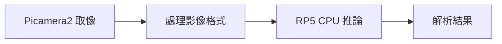
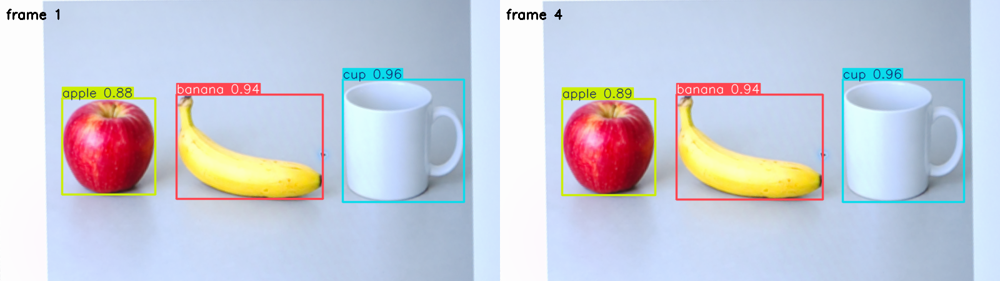

# 第 43 課｜使用 PyCamera2 與 YOLOv8 實現即時目標偵測（Raspberry Pi 5）

[原始文章](https://liusming.pixnet.net/blog/posts/14222899863) · 更新日期：2026-10-29

> **Thonny 轉換待完成。** 本篇既有程式、安裝步驟與輸出仍須逐項改寫並在 Thonny 重新操作；現有終端機紀錄不代表已用 Thonny 測試。[逐篇進度](./Thonny逐篇實測狀態.md) · [圖片與程式下載方式](./練習素材/素材下載與使用.md)

## 學習目標

結合 Picamera2 與 YOLOv8n 進行一次 CPU 影像推論。

## 事前準備

需要相機、Picamera2、YOLO CPU 虛擬環境與模型檔。

依[安裝操作與實測紀錄](../安裝操作與實測紀錄.md#7-yolo-與-pytorch)建立並啟用 YOLO CPU 環境，再於練習目錄下載模型：

```bash
curl -fL https://github.com/ultralytics/assets/releases/download/v8.3.0/yolov8n.pt -o yolov8n.pt
```

不要使用原文的 CUDA 11.8 索引。

## 程式與執行

將下列已在 RP5 執行的程式存為 `第43課.py`，或使用[範例程式](./範例程式/第43課.py)。先確認目前目錄及檔案，避免覆蓋已有資料。

```python
from picamera2 import Picamera2
from ultralytics import YOLO

camera = Picamera2()
try:
    camera.configure(camera.create_still_configuration(main={'size': (320, 240), 'format': 'RGB888'}))
    camera.start()
    frame = camera.capture_array()
finally:
    camera.stop()
    camera.close()
results = YOLO('yolov8n.pt').predict(frame, imgsz=320, device='cpu', verbose=False)
print('camera frame', frame.shape)
print('results', len(results))
print('boxes', len(results[0].boxes))
```

執行 `python3 第43課.py`。

## 本機實際輸出

```text
camera frame (240, 320, 3)
results 1
boxes 0
```

框數因相機當時拍攝內容而變；本次 0 個框不代表模型故障或準確率。

## 背景與核心概念

### RP5 的相機與 CPU 推論

Picamera2 取得 CSI 相機影格後，可送入 CPU 上執行的偵測模型。模型是否執行在特定硬體加速器，應由實際環境確認；不能把桌面 GPU 的 CUDA 步驟直接套到 RP5。

### 思考、練習與後續應用

比較一次相機影格推論與持續即時顯示；哪些步驟需要時間量測和資源釋放？

可進一步比較不同解析度與模型大小，但要明確區分 CPU 和已驗證的加速器。

進一步閱讀：[相關官方文件](https://docs.ultralytics.com/tasks/detect/)。請以下方實測狀態為準；尚未實作或測試的情境不能視為已通過。

## 概念流程圖



此圖用於說明文章的概念或完整目標流程，**不是操作截圖，也不代表每個步驟都已實測**；本機實測範圍請看文章中的標示。

## 進階實測：Picamera2 連續四張影格與 YOLO

### 準備

使用[相機測試畫面](./練習素材/RP5相機測試.html)及同資料夾的 AI 生成物件圖，在電腦螢幕選「AI 生成物件圖」，讓 RP5 相機對準並固定。物件是生成圖片，不是真實物品；原始相機畫面含螢幕外環境，不直接公開。

本次使用可同時匯入 Picamera2、OpenCV 與 Ultralytics 的 YOLO CPU 環境，在練習目錄放入 `yolov8n.pt` 與[範例程式](./範例程式/第42課-相機YOLO短片.py)。程式中的 `source` 座標只適用本次 1920 × 1080 的相機位置；不同位置須重新量測。輸出檔會覆寫同名檔，執行前請檢查。

```python
import time
import cv2
import numpy as np
from picamera2 import Picamera2
from ultralytics import YOLO

source = np.float32([[755, 270], [1385, 65], [1484, 412], [856, 604]])
target = np.float32([[0, 0], [799, 0], [799, 449], [0, 449]])
matrix = cv2.getPerspectiveTransform(source, target)
model = YOLO('yolov8n.pt')
camera = Picamera2()
writer = None
source_writer = None
panels, detected = [], []
try:
    camera.configure(camera.create_still_configuration(main={'size': (1920, 1080), 'format': 'RGB888'}))
    camera.start()
    time.sleep(1)
    writer = cv2.VideoWriter('lesson42-yolo.avi', cv2.VideoWriter_fourcc(*'MJPG'), 3, (800, 450))
    source_writer = cv2.VideoWriter('lesson42-input.avi', cv2.VideoWriter_fourcc(*'MJPG'), 3, (800, 450))
    if not writer.isOpened() or not source_writer.isOpened():
        raise RuntimeError('無法建立 MJPG 影片')
    start = time.perf_counter()
    for index in range(4):
        frame = camera.capture_array()
        board = cv2.warpPerspective(frame, matrix, (800, 450))
        source_writer.write(board)
        result = model.predict(board, imgsz=640, device='cpu', verbose=False)[0]
        labels = [model.names[int(box.cls[0])] for box in result.boxes]
        detected.append(labels)
        annotated = result.plot()
        cv2.putText(annotated, f'frame {index+1}', (10, 30), cv2.FONT_HERSHEY_SIMPLEX, 0.7, (0, 0, 0), 2)
        writer.write(annotated)
        if index in (0, 3):
            panels.append(annotated)
    elapsed = time.perf_counter() - start
finally:
    if writer is not None:
        writer.release()
    if source_writer is not None:
        source_writer.release()
    camera.stop()
    camera.close()

video = cv2.VideoCapture('lesson42-yolo.avi')
read_count = 0
try:
    while True:
        ok, _ = video.read()
        if not ok:
            break
        read_count += 1
finally:
    video.release()
if not cv2.imwrite('lesson42-yolo-frames.png', cv2.hconcat(panels)):
    raise RuntimeError('無法儲存圖片')
print('frames processed:', len(detected))
print('detected classes per frame:', detected)
print('frames read from video:', read_count)
print('elapsed seconds:', round(elapsed, 2))
print('observed loop FPS:', round(len(detected) / elapsed, 2))
print('saved: lesson42-input.avi, lesson42-yolo.avi, lesson42-yolo-frames.png')
```

```bash
python3 第42課-相機YOLO短片.py
```

### RP5 實際輸出與圖片

```text
frames processed: 4
detected classes per frame: [['cup', 'banana', 'apple'], ['cup', 'banana', 'apple'], ['cup', 'banana', 'apple'], ['cup', 'banana', 'apple']]
frames read from video: 4
elapsed seconds: 2.43
observed loop FPS: 1.65
saved: lesson42-input.avi, lesson42-yolo.avi, lesson42-yolo-frames.png
```



圖中分別是本次第 1、4 張相機影格，經裁切、校正及模型標框；是處理結果圖，不是操作截圖。本次拍攝的是靜止的螢幕測試圖，不能代表移動物體或長時間即時表現。

計時範圍包含四次取像、裁切、推論及寫入影片，包含首次推論，不包含啟動相機與載入模型。`1.65` 是此次觀察的整體迴圈平均 FPS；系統負載、溫度及其他條件改變時會不同。影片設定的 3 FPS 是播放參數，與這個實測速度不同。

### 練習與排錯

比較四次輸出的類別是否相同；再以不同圖片和解析度自行測試、分開記錄準確性與處理時間。若相機啟動失敗，先確認是否有其他程式占用；若找不到 `picamera2` 或 `ultralytics`，確認執行的是準備好的環境。此範例未驗證持續 GUI 預覽、多目標追蹤或 Hailo 加速。

## 與原文章的差異

- 移除原文 CUDA 11.8 安裝方式，使用本機已測的 ARM64 CPU 環境；目前只測單張影格而非即時視窗。
- 真實場景的準確率、速度和操作畫面尚未完整驗證。
- 尚未保存操作畫面截圖。
- 新增初學者背景、概念、思考練習及後續應用，實測範圍仍以本文標示為準。
- 加入教學流程示意；圖中的完整目標流程不代表已逐步實測。
- 新增 Picamera2 連續四張影格、YOLOv8n CPU 推論與影片讀回測試；仍未完成原文長時間即時視窗。
