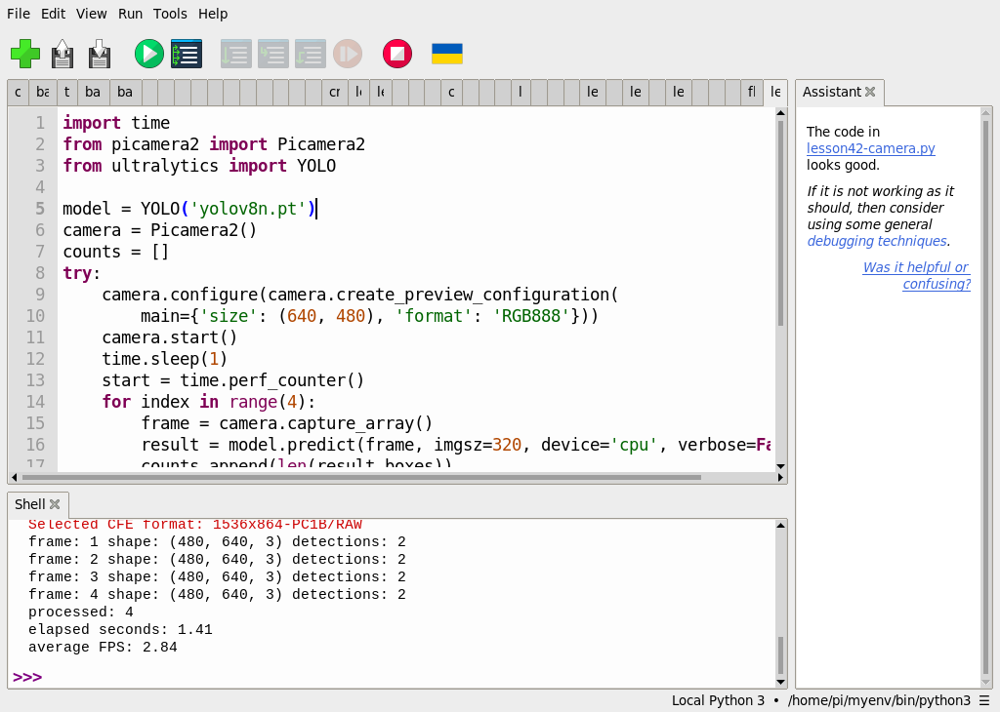

# 第 44 課｜YOLOv8 從圖片到即時檢測的完整教學與比較

[原始文章](https://liusming.pixnet.net/blog/posts/14222899881) · 更新日期：2026-10-29

圖片、影片和相機，用的是同一個模型，為什麼速度和結果不同？我們回看前三種來源，學會設計公平的比較。

第一次準備環境的同學，可以先讀[課前學習說明](./學習前先讀我.md)；操作遇到紅字時，我們用[排錯故事](./程式卡住時怎麼辦.md)一起找原因。

## 學習目標與背景

同一個模型可以處理不同來源的影像：圖片一次提供一張，影片需要逐格解碼，相機則持續產生新影格。讀取介面雖不同，都可以把影格送進模型；即時系統還必須考慮處理時間、畫面顯示及釋放資源。

這一課不要求重新跑一遍前面已完成的實驗。我們先讀取第 40～42 課保存的成果，辨認輸入、輸出和計時範圍，再設計一個可重現的比較。完成後，你應能說明圖片、影片與相機各提供什麼資料，並解釋為什麼影片播放 FPS 不能直接當成模型處理速度。

### 第一步：準備自己的比較表

準備紙筆或文字檔，畫出「來源、素材與場景、系統與模型、影格數、時間範圍、結果、限制」七欄。先閱讀下面的實測摘要；遇到未記錄的數字就寫「未記錄」，不要推算或沿用不同實驗的數值。生成圖、相機拍攝的螢幕，以及真實物品是不同來源。

如果要自行操作，先依[第 39 課](./第%2039%20課｜YOLOv8%20與%20COCO%20資料集完整教學.md)準備適合自己系統的模型與 Thonny 環境，再分別依各課指定程式與素材執行。第 39 課的 Trixie CPU 環境不代表已包含 Picamera2；相機路線需要另核對解譯器及套件。執行前先確認輸出位置和同名檔，避免覆寫。

## 三種來源的實際操作

依[素材下載說明](./練習素材/素材下載與使用.md)下載教材；模型的取得方式及目前套件環境限制請參考[第 39 課](./第%2039%20課｜YOLOv8%20與%20COCO%20資料集完整教學.md)。每篇都提供 Thonny 程式、操作截圖及輸出。

| 來源 | 到哪裡操作 | 本次觀察 |
| --- | --- | --- |
| 校正照片 | [第 40 課](./第%2040%20課｜YOLOv8%20圖像目標檢測教學（使用%20COCO%20資料集）.md) | AI 生成物件圖經相機拍攝，3 個框 |
| 四影格影片 | [第 41 課](./第%2041%20課｜YOLOv8%20影片目標檢測完整教學.md) | 每張影格各 3 個框 |
| CSI 相機 | [第 42 課](./第%2042%20課｜YOLOv8%20即時攝影機目標偵測教學.md) | 四次取像各有 2 個候選框，迴圈平均 2.84 FPS |

以上是不同時間與輸入內容的有限測試，不能直接比較準確率；相機測試沒有人工確認框是否正確。平均 FPS 包含取像和推論，與影片播放設定不同。

### 第二步：區分「播放」和「處理」

先看[第 41 課的 Trixie 範例](./第%2041%20課｜YOLOv8%20影片目標檢測完整教學.md)：24 張由既有照片平移產生的影格，以 2 FPS 設定播放，因此影片長度為 24 ÷ 2 = 12 秒；當次讀取、推論和寫出的計時為 3.41 秒，後續讀回不包含在這段計時中。前者是影片的播放設定，後者是本次處理一批影格的時間，不能把兩者當成同一個數字。

試著遮住這段說明，只看自己的表格：如果 24 張影片以 4 FPS 播放，播放長度是多少？答案是 6 秒；這個算術練習沒有重新執行模型，也不能推論實際處理時間。

### 第三步：檢查比較是否公平

上表的圖片、影片和相機資料在不同時間產生，可能使用不同系統、解析度、程式路徑與場景。框的數量只是模型輸出數量；沒有逐張人工核對時，不能說「三個框比兩個框更準」。若要自己比較，先固定模型版本、影像尺寸和場景，記下是否包含解碼、顯示及存檔時間，再對同一組已標註影格逐一核對漏檢和誤檢。相機有即時到達的影格，模型處理不及時，還要記下是否丟棄影格或延遲顯示。

如果圖片讀不到，先核對檔名與位置；影片無法播放時檢查輸出檔和編碼器；相機無法開啟時確認其他程式已釋放相機。每條路線的完整排錯與已測環境以第 40～42 課為準，不要把歷史結果當成自己的執行結果。

## 補充：連續預覽

第 42、43 課已在 Thonny 實測約 20 秒及兩分鐘連續相機 YOLO 預覽、Q 鍵停止與再次開啟相機。兩分鐘測試處理 867 張影格、耗時 120.08 秒，平均 7.22 FPS。詳見 [第 42 課](./第%2042%20課｜YOLOv8%20即時攝影機目標偵測教學.md)；不同場景的偵測準確率與數小時穩定性仍待測。

## 練習與延伸

1. 分別列出圖片不存在、影片解碼失敗及相機被占用時，可能出現的狀況。
2. 設計表格記錄來源、影格數、模型版本、耗時與人工核對結果；若要比較不同來源，應控制場景和解析度。
3. 將圖片、影片及相機的共用推論部分整理成函式，可讓程式更容易維護。

## 與原文章的差異

- 本版以 RP5 CPU 和 Thonny 分別實測照片、短影片與相機四影格；另完成兩分鐘預覽，未完成數小時預覽及真實場景精度比較。
- 新增對應各篇的素材、程式和操作截圖；YOLO 乾淨環境安裝仍待驗證。

給教師：原有實測範圍與版本備註

> **部分實測**：圖片、四影格影片及四張相機影格已有 Thonny 測試；已補 20 秒與兩分鐘即時預覽、Q 鍵與重開相機；數小時預覽及乾淨環境安裝仍待驗證。[逐篇進度](./Thonny逐篇實測狀態.md)

> 2026-11-11 增補比較表、FPS 算術與公平比較教學，引用第 40～42 課既有結果；沒有重跑已驗證的課程，也沒有新增準確率實驗。

