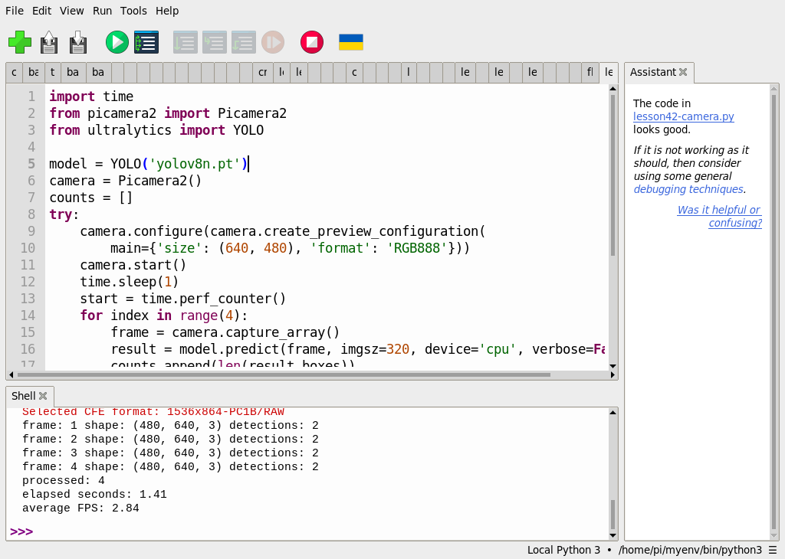

# 第 44 課｜YOLOv8 從圖片到即時檢測的完整教學與比較

[原始文章](https://liusming.pixnet.net/blog/posts/14222899881) · 更新日期：2026-10-29

> **部分實測**：圖片、四影格影片及四張相機影格已有 Thonny 測試；長時間即時預覽與乾淨環境安裝仍待驗證。[逐篇進度](./Thonny逐篇實測狀態.md)

## 學習目標與背景

同一個模型可以處理不同來源的影像：圖片一次提供一張，影片需要逐格解碼，相機則持續產生新影格。讀取介面雖不同，都可以把影格送進模型；即時系統還必須考慮處理時間、畫面顯示及釋放資源。

## 三種來源的實際操作

依[素材下載說明](./練習素材/素材下載與使用.md)下載教材；模型的取得方式及目前套件環境限制請參考[第 39 課](./第%2039%20課｜YOLOv8%20與%20COCO%20資料集完整教學.md)。每篇都提供 Thonny 程式、操作截圖及輸出。

| 來源 | 到哪裡操作 | 本次觀察 |
| --- | --- | --- |
| 校正照片 | [第 40 課](./第%2040%20課｜YOLOv8%20圖像目標檢測教學（使用%20COCO%20資料集）.md) | AI 生成物件圖經相機拍攝，3 個框 |
| 四影格影片 | [第 41 課](./第%2041%20課｜YOLOv8%20影片目標檢測完整教學.md) | 每張影格各 3 個框 |
| CSI 相機 | [第 42 課](./第%2042%20課｜YOLOv8%20即時攝影機目標偵測教學.md) | 四次取像各有 2 個候選框，迴圈平均 2.84 FPS |

以上是不同時間與輸入內容的有限測試，不能直接比較準確率；相機測試沒有人工確認框是否正確。平均 FPS 包含取像和推論，與影片播放設定不同。

## 練習與延伸

1. 分別列出圖片不存在、影片解碼失敗及相機被占用時，可能出現的狀況。
2. 設計表格記錄來源、影格數、模型版本、耗時與人工核對結果；若要比較不同來源，應控制場景和解析度。
3. 將圖片、影片及相機的共用推論部分整理成函式，可讓程式更容易維護。

## 與原文章的差異

- 本版以 RP5 CPU 和 Thonny 分別實測照片、短影片與相機四影格；未完成長時間即時預覽及真實場景精度比較。
- 新增對應各篇的素材、程式和操作截圖；YOLO 乾淨環境安裝仍待驗證。
