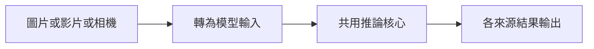

# 第 44 課｜YOLOv8 從圖片到即時檢測的完整教學與比較

[原始文章](https://liusming.pixnet.net/blog/posts/14222899881) · 更新日期：2026-10-29

## 學習目標

比較合成圖片與相機影格兩種輸入均可交給 YOLO 模型。

## 事前準備

需要 Pi 相機、Picamera2、YOLO CPU 虛擬環境與模型檔。

依[安裝操作與實測紀錄](../安裝操作與實測紀錄.md#7-yolo-與-pytorch)建立並啟用 YOLO CPU 環境，再於練習目錄下載模型：

```bash
curl -fL https://github.com/ultralytics/assets/releases/download/v8.3.0/yolov8n.pt -o yolov8n.pt
```

不要使用原文的 CUDA 11.8 索引。

## 程式與執行

將下列已在 RP5 執行的程式存為 `第44課.py`，或使用[範例程式](./範例程式/第44課.py)。先確認目前目錄及檔案，避免覆蓋已有資料。

```python
import numpy as np
from picamera2 import Picamera2
from ultralytics import YOLO

model = YOLO('yolov8n.pt')
image = np.zeros((320, 320, 3), dtype=np.uint8)
still = model.predict(image, imgsz=320, device='cpu', verbose=False)
camera = Picamera2()
try:
    camera.configure(camera.create_still_configuration(main={'size': (320, 240), 'format': 'RGB888'}))
    camera.start()
    frame = camera.capture_array()
finally:
    camera.stop()
    camera.close()
camera_result = model.predict(frame, imgsz=320, device='cpu', verbose=False)
print('synthetic image results', len(still))
print('camera image results', len(camera_result))
```

執行 `python3 第44課.py`。

## 本機實際輸出

```text
synthetic image results 1
camera image results 1
```

兩種輸入均產生結果；仍需另行驗證原文多張圖片、影片與即時顯示的完整流程。

## 背景與核心概念

### 同一模型處理不同來源

圖片、影片與相機都可以提供影像資料，但讀取方式、時間順序及錯誤處理各不相同。模型輸出應搭配來源資訊解讀，不能因模型相同而假設處理流程完全相同。

### 思考、練習與後續應用

列出讀取圖片、影片和相機各有的一個可能失敗原因；本文哪些來源已測、哪些仍待測？

此比較有助設計共用推論核心與不同輸入介面，並評估速度和可重現性。

進一步閱讀：[相關官方文件](https://docs.ultralytics.com/tasks/detect/)。請以下方實測狀態為準；尚未實作或測試的情境不能視為已通過。

## 概念流程圖



此圖用於說明文章的概念或完整目標流程，**不是操作截圖，也不代表每個步驟都已實測**；本機實測範圍請看文章中的標示。

## 與原文章的差異

- 原文涵蓋圖片、影片與即時攝影機；本版先以兩種單張輸入驗證共同流程，影片測試另見第 41 課。
- 真實場景的準確率、速度和操作畫面尚未完整驗證。
- 尚未保存操作畫面截圖。
- 新增初學者背景、概念、思考練習及後續應用，實測範圍仍以本文標示為準。
- 加入教學流程示意；圖中的完整目標流程不代表已逐步實測。
