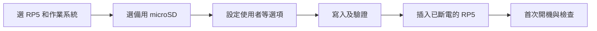

# 第 5 課｜Raspberry Pi OS 安裝完整教學

[原始文章](https://liusming.pixnet.net/blog/posts/14222880489) · 更新日期：2026-10-29

## 學習目標

了解如何使用 Raspberry Pi Imager，為 Raspberry Pi 5 準備 Raspberry Pi OS。這台 RP5 已有可用的 Bookworm 系統；**本次沒有重新燒錄或驗證新安裝流程**。

## 背景與原理

作業系統是管理電腦硬體與程式的基礎軟體。RP5 啟動時需要從可開機的儲存媒體讀取系統；本課介紹使用 microSD 卡。映像檔可理解成準備好的系統資料，Raspberry Pi Imager 幫助使用者選擇設備、系統及目標儲存裝置，再寫入所選裝置。

流程圖是教學概念圖，不是此次的安裝畫面。寫入會覆蓋所選裝置內容，請使用備用卡；本機正在使用的卡不應拿來作此示範。

## 準備工作

需要一台可執行 Raspberry Pi Imager 的電腦、讀卡機，以及準備作為新系統的 microSD。燒錄會清除選定裝置的內容。若要保留目前 RP5 的系統與資料，請使用另外一張卡，並在操作前備份重要資料。

## 安裝步驟

1. 從 [Raspberry Pi 官方下載頁面](https://www.raspberrypi.com/software/) 取得並開啟 Raspberry Pi Imager。
2. 選擇 Raspberry Pi 5 和需要的 64 位元作業系統。若教學需要圖形介面，選擇含桌面的版本。
3. 選擇**備用** microSD，核對容量與裝置名稱；不要選到現有系統碟或其他重要磁碟。
4. 依 Imager 畫面設定帳號、時區、鍵盤、網路及 SSH。帳號與密碼應自行建立，切勿將密碼寫進公開教材。
5. 再次確認目標裝置後開始寫入並等待驗證。完成後安全退出卡片，插入已斷電的 RP5，再接上電源。
6. 首次啟動後，以第二課的方法確認型號、架構及系統版本，再按實際需求安裝課程套件。

## 版本選擇

目前這台機器使用 Bookworm，已用於既有的相機、OpenCV 和部分 AI 測試。若日後使用官方 AI HAT+ 2，請先確認 [官方 AI 軟體文件](https://www.raspberrypi.com/documentation/computers/ai.html)對 Raspberry Pi OS 版本的要求；本次沒有在現有卡上升級或測試 HAT。

Raspberry Pi OS 有不同版本及桌面／Lite 選擇。官方文件列出的版本可能隨時間改變；不要把此教材已測試的 Bookworm 環境誤認為官方當前唯一版本。[Raspberry Pi OS 官方文件](https://www.raspberrypi.com/documentation/computers/os.html)提供最新版本資訊。

## 學生練習與後續應用

1. 解釋為什麼燒錄作業系統前必須辨識目標儲存裝置。
2. 如果要遠端使用且沒有螢幕，初次設定帳號和 SSH 為什麼重要？
3. 比較有桌面的系統和 Lite 版本可能適合什麼情境；不要在沒有備份的現用記憶卡上進行練習。

當裝置要部署為感測節點時，系統選擇會影響儲存空間、維護方式與套件相容性。未來升級到新版前，應先查官方文件與本課所需相機、Python、OpenCV 和 AI 套件的支援情況。

## 測試與畫面狀態

- 已確認現有 RP5 可以開機、SSH 登入並執行 Python。
- 未執行 Imager 寫卡、首次開機及系統升級；沒有把其他機器的輸出冒充為本次結果。
- 尚未補拍安裝畫面。

## 初次安裝前：先辨認哪些是「實測」、哪些是操作指引

以下 Imager 步驟是依官方資料整理，**目前沒有在這台機器重寫系統卡或測試首次啟動**。圖形介面的文字、選項和版本可能改變，應以 [Raspberry Pi 官方安裝說明](https://www.raspberrypi.com/documentation/computers/getting-started.html)及使用中的程式畫面為準。

對大一新生，可以先在紙上畫出「電腦上的 Imager → 備用 microSD → RP5 啟動」的路徑，再請同組同學指出哪個步驟會改寫資料。準備一張新的備用卡後，記錄容量和要安裝的系統版本；在確認目標裝置前不要按寫入。

### 如何驗證真正安裝完成？

當日後使用備用卡完成寫入後，應分別記錄：Imager 是否顯示寫入與驗證完成、RP5 是否啟動、設定的使用者是否能登入、系統版本及需要的網路／相機是否可用。每項都是獨立結果；寫入成功並不等於所有後續套件都相容。

目前可用第二課的型號、系統和記憶體查詢熟悉既有設備，但這只能證明現有系統能使用，不能替代一次全新安裝的驗證。

## 與原文章的差異

- 以目前的 Raspberry Pi Imager 流程描述操作，並明確標出燒錄會清除目標裝置。
- 加入本次使用 Bookworm、AI HAT+ 2 版本選擇，以及備用卡與備份的考量。
- 原文章流程未在本次重新燒錄實測，請以 Imager 當前畫面為準。
- 增加初學者背景、流程示意及備用卡練習；示意圖不代表本次完成燒錄。
- 明確區分官方安裝指引與實際測試，新增學生安裝前檢查及完成後驗證項目。
