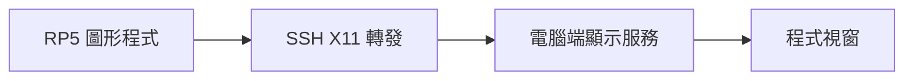

# 第 6 課｜使用 MobaXterm 對 Raspberry Pi 啟用 X11 轉發

[原始文章](https://liusming.pixnet.net/blog/posts/14222855718) · 更新日期：2026-10-29

## 學習目標

了解如何透過 SSH 讓 RP5 上的 X11 程式在電腦顯示。MobaXterm 安裝在 Windows 端；RP5 端則需要 SSH 與 X11 轉發支援。X11 轉發與遠端桌面分享整個畫面是不同功能。

## 事前檢查

本次在 RP5 終端機執行：

```bash
command -v xauth
systemctl is-active ssh
```

實際輸出：

```text
/usr/bin/xauth
active
```

這只確認 `xauth` 存在與 SSH 服務啟動，**不代表 X11 圖形轉發已測試成功**。

## 操作方式

1. 在 Windows 開啟 MobaXterm，建立指向 RP5 的 SSH 連線。
2. 在連線設定中啟用 X11 forwarding，確認 Windows 端的 X server 正在運行。
3. 登入後，使用支援 X11 的測試程式確認視窗是否出現在 Windows。若不能顯示，先確認 RP5 的 SSH 伺服器設定及兩端防火牆，再確認程式是否支援 X11 或 XWayland。
4. 不需要圖形介面時，可以直接使用 SSH 終端機；若需要整個桌面，參考第 10 課的遠端桌面。

## 背景與核心概念

### 遠端執行程式時，視窗要顯示在哪裡？

SSH 主要建立遠端登入通道；X11 轉發則讓遠端程式的圖形視窗透過連線交給本機顯示。圖形程式、遠端 SSH 設定和本機顯示服務都需配合，能登入不代表圖形轉發成功。

### 思考、練習與後續應用

列出 SSH 終端機、X11 單一程式視窗與 VNC 完整桌面的差別；若程式執行卻沒有出現視窗，你會先檢查哪一端？

遠端 GUI 可用於開發和教學，但延遲與系統的圖形環境會影響體驗。

進一步閱讀：[相關官方文件](https://www.raspberrypi.com/documentation/computers/remote-access.html)。下方的程式與輸出以標明的本機實測範圍為準；沒有測過的部分不代表已完成。

## 概念流程圖



此圖用於說明文章的概念或完整目標流程，**不是操作截圖，也不代表每個步驟都已實測**；本機實測範圍請看文章中的標示。

## 與原文章的差異

- 區分 SSH 連線成功與 X11 轉發成功；本次只驗證前者與 `xauth`。
- 不將安裝整套桌面元件列為所有使用者的必備步驟。
- 尚未完成 MobaXterm 轉發實測與畫面截圖。
- 新增初學者背景、概念、思考練習及後續應用，實測範圍仍以本文標示為準。
- 加入教學流程示意；圖中的完整目標流程不代表已逐步實測。
