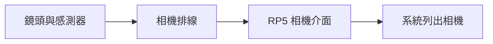
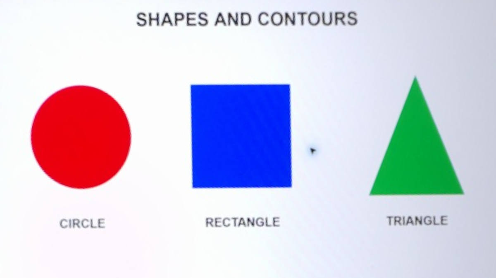

# 第 7 課｜連接 Raspberry Pi 5 相機模組

[原始文章](https://liusming.pixnet.net/blog/posts/14222855742) · 更新日期：2026-10-29

> 本篇為基礎系統或獨立工具教學；Python 課程改用 Thonny 的整體進度請見[逐篇狀態](./Thonny逐篇實測狀態.md) · [圖片與程式下載方式](./練習素材/素材下載與使用.md)。

## 學習目標

認識 Raspberry Pi 5 相機連接方式，並確認作業系統是否偵測相機。操作排線前，請先關機並拔掉電源；確認排線種類、方向及接頭鎖扣，避免強行插入。

## 查詢相機

開機後在 RP5 終端機執行：

```bash
rpicam-hello --list-cameras
```

本次實際輸出節錄：

```text
Available cameras
-----------------
0 : imx708_wide [4608x2592 10-bit RGGB]
```

其他可用影像模式會接在後面；型號及解析度依相機而異。若沒有列出相機，先關機斷電，檢查排線、接頭及相機相容性。

## 測試 Picamera2

本次使用 Picamera2 擷取一張 320 × 240 影格，得到以下實際結果：

```text
Picamera2 capture: (240, 320, 3) uint8
```

這代表已擷取一張三通道影像；它沒有驗證每種解析度、錄影或桌面預覽。

## 背景與核心概念

### 相機模組如何把現場變成資料？

感測器將接收到的光轉換為訊號，相機軟體再產生影格。RP5 的 CAM/DISP 接頭與舊型號接頭尺寸不同；安裝排線時應關機斷電，接頭與線材方向須依官方文件核對。

### 思考、練習與後續應用

說明相機型號、感測器最大解析度與程式設定的影格大小為何可能不同；若系統看不到相機，你會先做哪兩項檢查？

相機可作為設備觀察或檢測輸入，部署時仍需測試角度、光照、線材可靠度和資料隱私。

進一步閱讀：[相關官方文件](https://www.raspberrypi.com/documentation/accessories/camera-software.html)。下方的程式與輸出以標明的本機實測範圍為準；沒有測過的部分不代表已完成。

## 概念流程圖



此圖用於說明文章的概念或完整目標流程，**不是操作截圖，也不代表每個步驟都已實測**；本機實測範圍請看文章中的標示。

## 從接線到第一張畫面

RP5 上標示 `CAM/DISP0` 和 `CAM/DISP1` 的接頭可用於相機或顯示裝置，所需線材需與板端及相機端接頭相容。插拔排線前先關機並拔除電源；對照[官方相機連接說明](https://www.raspberrypi.com/documentation/accessories/camera-software.html)，核對接頭、排線方向與鎖扣，不要強行插入。

已經接好的本機不需為了本課重新拆線。下面的結果來自已連接的相機；列出相機、取得影格及拍照是不同測試。若相機沒列出，應在斷電後檢查接線；如果能列出但拍照失敗，再檢查是否有其他程式占用相機。

### 圖像案例：實拍測試畫面



此圖由第 18 課的 Picamera2 程式拍攝螢幕測試圖後，再由第 29 課程式裁切及透視校正而得；不是相機模組接線照片。原始照片包含周圍環境，未放入公開儲存庫。

### 練習

1. 寫下本機列出的相機名稱，以及你自己的相機名稱；兩者不相同不代表連接失敗。
2. 說明列出感測器與成功拍照為何要分開測試。
3. 先畫出相機、排線、RP5、程式與照片的關係；實際拆接前應先斷電。

## 與原文章的差異

- Bookworm 的官方相機應用程式名稱改為 `rpicam-*`；使用 `rpicam-hello` 查詢相機。
- 加入本機實際相機與影格結果，不再要求先假定相機型號。
- 實際接線與安裝畫面尚未重新拍攝。

參考：[Raspberry Pi 官方相機軟體文件](https://www.raspberrypi.com/documentation/accessories/camera-software.html)。
- 新增初學者背景、概念、思考練習及後續應用，實測範圍仍以本文標示為準。
- 加入教學流程示意；圖中的完整目標流程不代表已逐步實測。
- 加入官方接線概念與 RP5 相機實拍後的校正圖；接線過程本次未重拍。
