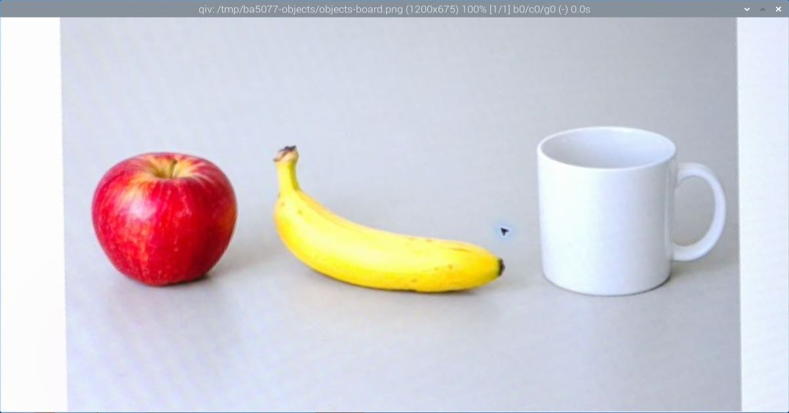

# 第 8 課｜Raspberry Pi 5 安裝與使用 qiv 圖片檢視器

[原始文章](https://liusming.pixnet.net/blog/posts/14222855730) · 更新日期：2026-10-29

> 本篇為基礎系統或獨立工具教學；Python 課程改用 Thonny 的整體進度請見[逐篇狀態](./Thonny逐篇實測狀態.md) · [圖片與程式下載方式](./練習素材/素材下載與使用.md)。

## 學習目標

確認 qiv 是否已安裝，並了解圖形檢視器需要可用的桌面或 X11 顯示連線。沒有圖形桌面的 SSH 終端機不一定能直接開啟視窗。

## 確認程式

```bash
command -v qiv
```

本機實際輸出：

```text
/usr/bin/qiv
```

這表示系統找得到 qiv，不代表已測試所有圖片格式或遠端顯示方式。

## 使用流程

先準備要檢視的圖片，在 RP5 桌面或已確認可用的圖形轉發環境執行 qiv，並選擇該圖片。若出現無法開啟顯示的錯誤，確認是否在可顯示 X11 視窗的工作階段，以及圖片路徑是否正確。

## 背景與核心概念

### 為什麼需要圖片檢視器？

圖片檔案是保存影像資料的方式，檢視器負責解碼並顯示。檔案存在、格式能解碼和有可用的圖形顯示環境是不同條件；遠端終端機本身不一定能顯示視窗。

### 思考、練習與後續應用

列出檔案不存在、格式不支援與圖形顯示不可用時，各應檢查什麼；找一張允許使用的圖片練習查看。

人工檢視輸入和輸出可協助判斷 AI 視覺程式出錯的位置，但不要將私人照片直接公開。

進一步閱讀：[相關官方文件](https://www.raspberrypi.com/documentation/computers/remote-access.html)。下方的程式與輸出以標明的本機實測範圍為準；沒有測過的部分不代表已完成。

## 概念流程圖


此圖用於說明文章的概念或完整目標流程，**不是操作截圖，也不代表每個步驟都已實測**；本機實測範圍請看文章中的標示。

## 實作前：檔案、程式與顯示環境

看一張圖片至少涉及三件事：圖片路徑是否正確、檢視器能否解碼該格式，以及程式能否連到圖形顯示環境。若只透過純文字 SSH 登入，可能沒有可用的圖形顯示；同一命令在 RP5 桌面與遠端終端機的結果可能不同。

本機 `command -v qiv` 實際得到 `/usr/bin/qiv`，後續也已在既有 RP5 桌面測試開啟圖片；qiv 的安裝過程尚未重做。可先用第 18 課產生自己的照片；在具備圖形顯示的環境，再依 qiv 的實際版本說明測試。若圖片涉及他人或工作內容，不應直接公開。

### 課後練習

假設看到「找不到檔案」與「無法開啟顯示」兩種錯誤，分別應先檢查哪個條件？說明為什麼查到程式位置不能保證 GUI 視窗成功顯示。

## 實機操作：用 qiv 開啟圖片

本次使用 RP5 相機拍攝的[測試圖片 objects-board.png](./圖檔/objects-board.png)，圖片本身是螢幕上的 AI 生成物件。下載該檔至練習目錄後，在已登入 RP5 圖形桌面的終端機執行：

```bash
qiv objects-board.png
```

這次透過已登入的 RP5 圖形桌面實際開啟視窗；下圖是遠端桌面擷取後裁切出 qiv 視窗的**操作截圖**，不是單純的圖片檔。實機標題列顯示圖片尺寸 `1200x675`，接著以視窗右上角的關閉按鈕結束。測試使用既有的 qiv 2.3.3，沒有重新執行安裝。



如果從純文字 SSH 執行卻沒有視窗，先確認是否有可用的圖形工作階段；本次是連到 RP5 現有桌面，不代表 MobaXterm X11 轉發已測試。圖片檔不存在時先用 `ls` 檢查檔名和目前目錄。

## 與原文章的差異

- 先檢查本機現有安裝，避免重複安裝。
- 補充 SSH 圖形顯示的前提；新增既有桌面上的 qiv 圖片視窗實測與截圖。
- 新增初學者背景、概念、思考練習及後續應用，實測範圍仍以本文標示為準。
- 加入教學流程示意；圖中的完整目標流程不代表已逐步實測。
- 新增圖片顯示所需條件與排錯練習；qiv 安裝畫面仍待實測。
