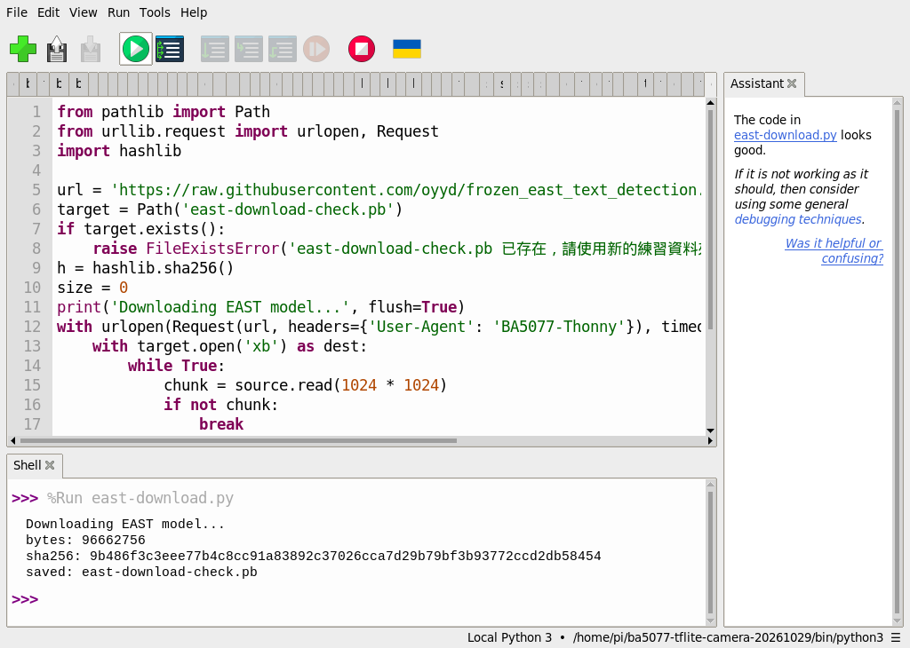
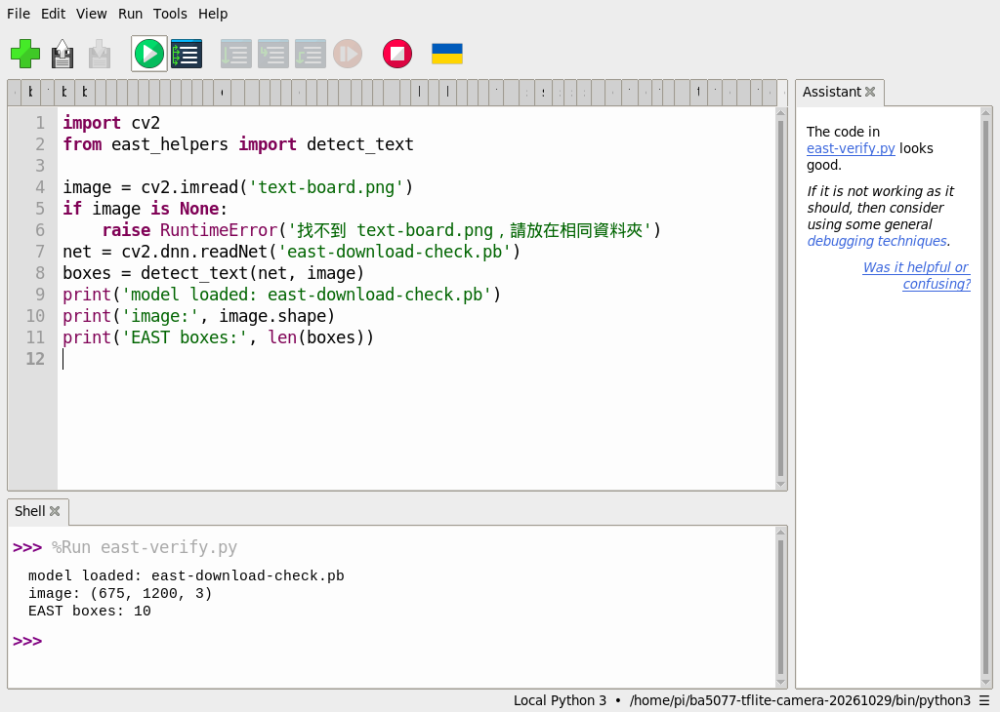
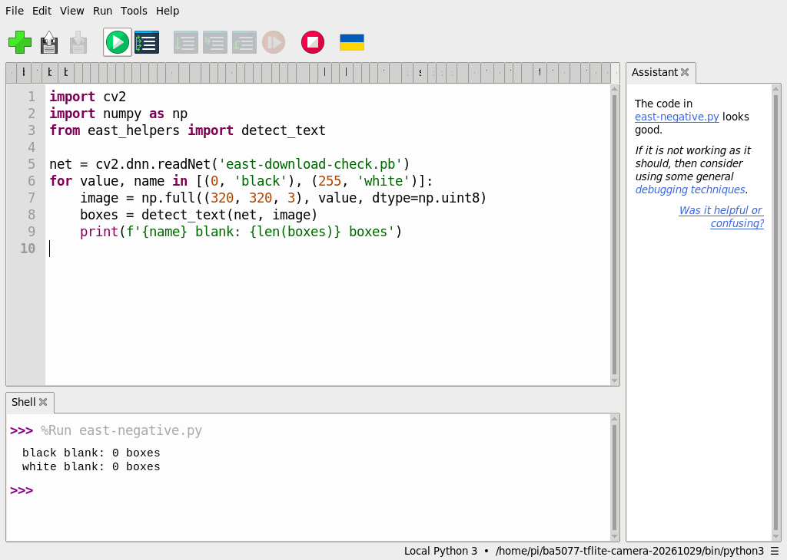
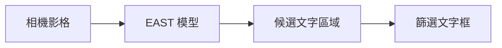
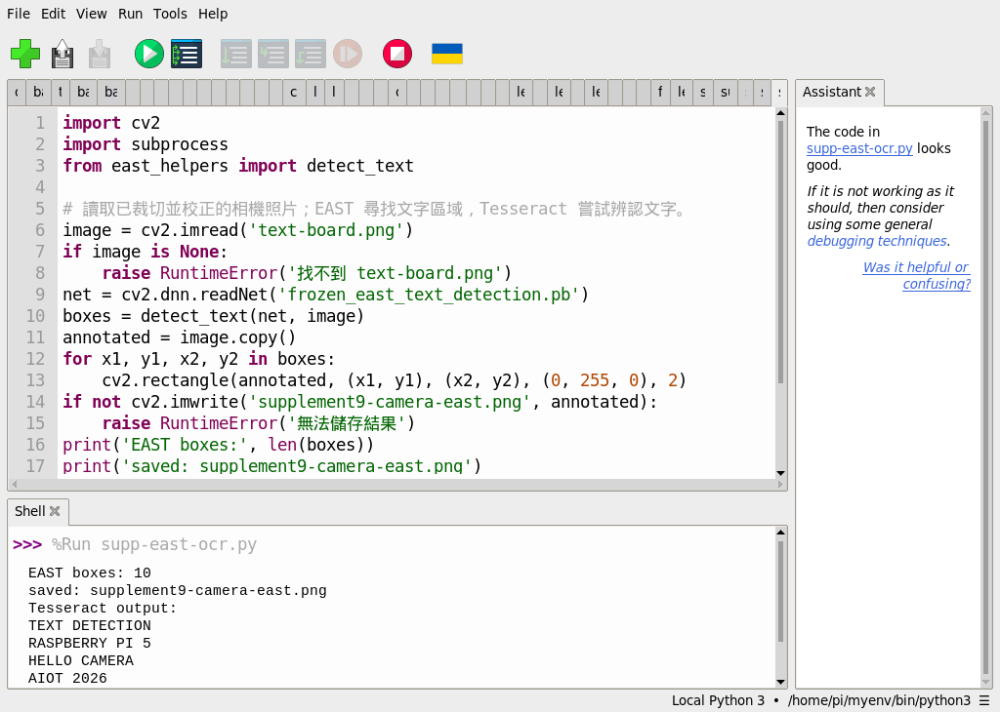
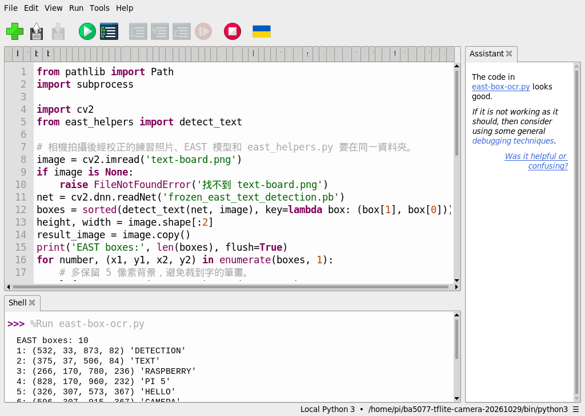
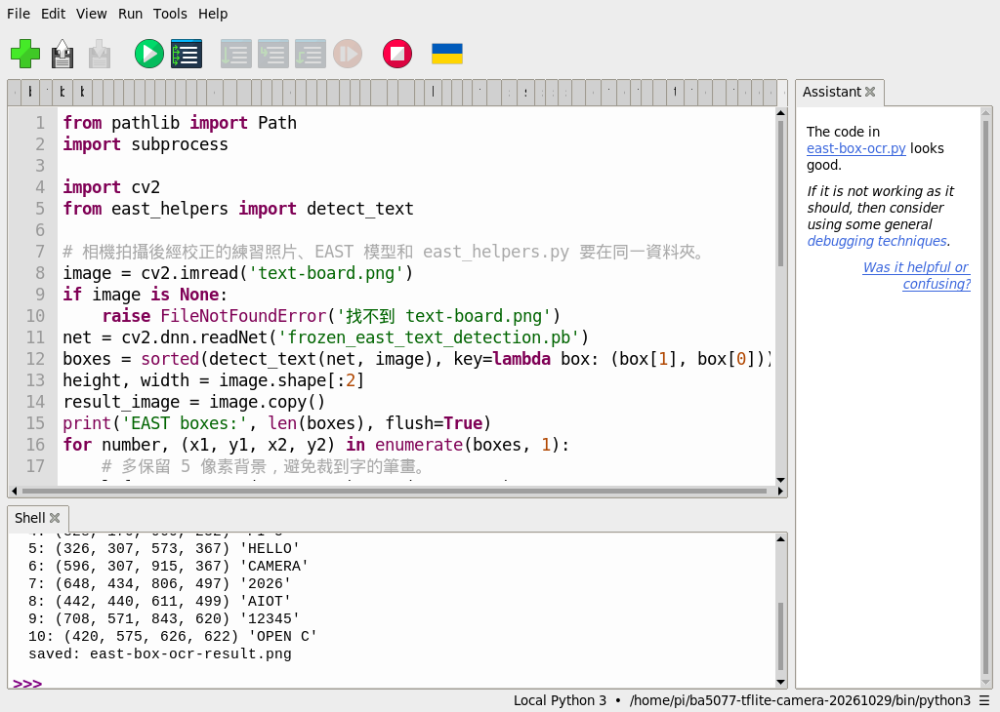
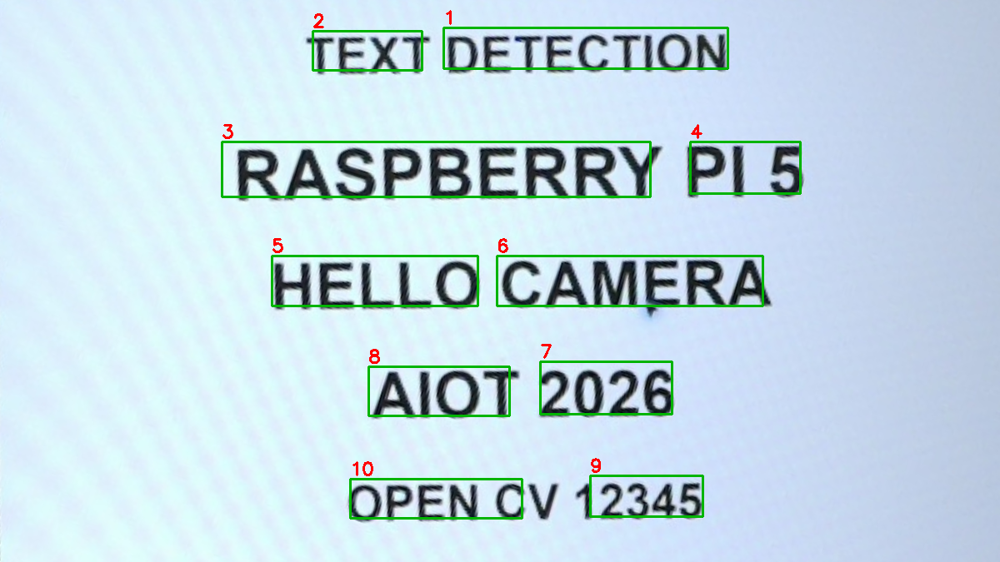

# 補充 10｜PiCamera2 + OpenCV + EAST 模型做即時文字偵測

[原始文章](https://liusming.pixnet.net/blog/posts/14223038343) · 更新日期：2026-10-29

> **部分 Thonny 實測。** 已在 Thonny 測模型下載、相機文字照片；全新系統安裝及即時相機仍待驗證。[逐篇進度](./Thonny逐篇實測狀態.md) · [圖片與程式下載方式](./練習素材/素材下載與使用.md)

## 學習目標

把一張 Pi 相機影格送入 EAST 模型並解析文字框。

## 事前準備

需要 PiCamera2、相機、OpenCV、NumPy、EAST 模型及 east_helpers.py。

### 在 Thonny 下載並檢查 EAST 模型

模型是已訓練好的參數檔，EAST 用它尋找文字位置；辨認文字內容則需另外使用 OCR。模型約 96.7 MB，需要網路及足夠空間。先建立一個新的練習資料夾，下載[模型下載程式](./範例程式/補充9-Thonny下載EAST模型.py)、[模型驗證程式](./範例程式/補充9-Thonny驗證EAST模型.py)、[文字框處理程式 east_helpers.py](./範例程式/east_helpers.py)及[相機文字練習照片](./圖檔/text-board.png)放入同一資料夾。照片是相機拍攝顯示的練習文字後，經裁切及校正的素材；下載方式見[素材說明](./練習素材/素材下載與使用.md)。

1. 在 Thonny 開啟下載程式並按綠色執行鈕，等待 Shell 出現 `saved`。程式使用 Python 標準函式庫，不需額外套件。
2. 2026-10-29 在 RP5 的 Thonny 實際輸出如下；SHA-256 可用來核對本次下載內容，上游 `master` 可能變動，日後若不同應先查明來源。程式不覆寫同名檔案；下載中斷可能留下不完整檔案，請先檢查再移至其他位置或刪除後重試。

```text
Downloading EAST model...
bytes: 96662756
sha256: 9b486f3c3eee77b4c8cc91a83892c37026cca7d29b79bf3b93772ccd2db58454
saved: east-download-check.pb
```



3. 在 Thonny 選取有 OpenCV 和 NumPy 的環境，開啟模型驗證程式並執行。本次使用 `/home/pi/ba5077-tflite-camera-20261029/bin/python3`；它可讀取現有系統 OpenCV，並非全新系統。EAST 找到的框不一定都正確，也不代表已辨識文字。

```text
model loaded: east-download-check.pb
image: (675, 1200, 3)
EAST boxes: 10
```



4. 改名之前，下載[空白圖負例程式](./範例程式/補充9-Thonny文字偵測負例.py)到同一資料夾並在 Thonny 執行。本次用 NumPy 製作 320 × 320 的全黑與全白影像，並使用同一模型與文字框處理程式；RP5 的實際輸出為：

```text
black blank: 0 boxes
white blank: 0 boxes
```



這兩個合成負例均未找到文字框；這不保證真實背景不會誤報，也不表示 OCR 已正確讀出文字。

5. 後續原有範例使用 `frozen_east_text_detection.pb` 這個檔名。確認下載完成後，可在檔案管理員將 `east-download-check.pb` 改名為 `frozen_east_text_detection.pb`，與範例及素材放在同一練習資料夾；若已有同名檔案，請勿覆寫，改用另一個新資料夾。

## 程式與執行

將以下程式存為 `補充10.py`，或使用[已測試的範例程式](./範例程式/補充10.py)。在 Thonny 開啟 `補充10.py`，按綠色執行鈕。

```python
import cv2
from picamera2 import Picamera2
from east_helpers import detect_text

camera = Picamera2()
try:
    camera.configure(camera.create_still_configuration(main={'size': (320, 240), 'format': 'RGB888'}))
    camera.start()
    frame = camera.capture_array()
finally:
    camera.stop()
    camera.close()
net = cv2.dnn.readNet('frozen_east_text_detection.pb')
boxes = detect_text(net, frame)
print('camera frame', frame.shape)
print('frame processed', True)
```

## 本機實際輸出

```text
camera frame (240, 320, 3)
frame processed True
```

已對單張影格執行模型與文字框解析；未保存私人相機畫面，未測即時預覽或準確率。

## 背景與核心概念

### 把相機影格送進文字偵測模型

相機提供影格，EAST 產生文字區域候選，再經後處理得到框。單張照片可以先檢查資料流；即時視訊還需要連續擷取、顯示及計算速度。

### 思考、練習與後續應用

如果相機畫面沒有可辨識文字，模型輸出零個框是否一定表示程式故障？如何設計有文字與無文字的對照？

應用可延伸至標牌定位；部署前需要測試曝光、旋轉、模糊和現場資料使用權。

進一步閱讀：[相關官方文件](https://docs.opencv.org/4.x/d2/d58/tutorial_table_of_content_dnn.html)。請以下方實測狀態為準；尚未實作或測試的情境不能視為已通過。

## 概念流程圖



此圖用於說明文章的概念或完整目標流程，**不是操作截圖，也不代表每個步驟都已實測**；本機實測範圍請看文章中的標示。

## 進一步實驗：RP5 相機拍攝英文測試板

### 準備與執行

1. 在螢幕顯示[相機測試畫面](./練習素材/RP5相機測試.html)的「文字偵測」，由 RP5 相機拍攝，再依[實拍與校正流程](./練習素材/相機實拍與校正流程.md)裁切校正。這次得到的[實拍輸入圖 text-board.png](./圖檔/text-board.png)可供重現。
2. 將該圖片、[east_helpers.py](./範例程式/east_helpers.py) 和[本範例程式](./範例程式/補充9至11-相機文字.py)放入同一個練習目錄，依本文事前準備放入 EAST 模型，並依[安裝紀錄](../安裝操作與實測紀錄.md#6-tesseract-ocr)準備 OpenCV、NumPy、Tesseract 及英文語言資料。
3. 在 Thonny 開啟該目錄中的 `補充9至11-相機文字.py`，按綠色執行鈕。模型和語言資料缺失時先依安裝紀錄處理，不要以其他模型的結果替代。

```python
import cv2
import subprocess
from east_helpers import detect_text

# 讀取已裁切並校正的相機照片；EAST 尋找文字區域，Tesseract 嘗試辨認文字。
image = cv2.imread('text-board.png')
if image is None:
    raise RuntimeError('找不到 text-board.png')
net = cv2.dnn.readNet('frozen_east_text_detection.pb')
boxes = detect_text(net, image)
annotated = image.copy()
for x1, y1, x2, y2 in boxes:
    cv2.rectangle(annotated, (x1, y1), (x2, y2), (0, 255, 0), 2)
if not cv2.imwrite('supplement9-camera-east.png', annotated):
    raise RuntimeError('無法儲存結果')
print('EAST boxes:', len(boxes))
print('saved: supplement9-camera-east.png')
result = subprocess.run(['tesseract', 'text-board.png', 'stdout', '-l', 'eng', '--psm', '6'],
                        check=True, capture_output=True, text=True)
print('Tesseract output:')
print(result.stdout.strip())
```

RP5 本次實際輸出：

```text
EAST boxes: 10
saved: supplement9-camera-east.png
Tesseract output:
TEXT DETECTION
RASPBERRY PI 5
HELLO CAMERA
AIOT 2026
OPEN CV 12345
```


這是對相機實拍圖片畫出的結果圖，並非操作截圖。EAST 的綠框在部分文字有切割或漏框；10 個框不能解讀為 10 行文字，也不是準確率。此程式的 Tesseract 是**直接辨識整張圖片**，不是以 EAST 的每個框裁切後再辨識；前文合成圖片例子才有框選後 OCR。這次只測清楚的英文單張畫面，未測中文、真實街景、連續即時預覽或整體準確率。

練習：比較輸入圖和綠框，指出未被完整涵蓋的字；把「框定位是否正確」與「OCR 字元是否正確」分開評估。

## Thonny 實測：已保存的相機文字照片

本次以 Thonny 右下角選取既有 `/home/pi/myenv/bin/python3`；此環境含 OpenCV，系統已有 Tesseract 英文資料。這次照片辨識使用先前下載的模型副本；其 SHA-256 與後續 Thonny 下載並驗證的模型相同。全新系統安裝尚未測試。先取得[相機校正照片](./圖檔/text-board.png)、[文字框輔助程式](./範例程式/east_helpers.py)及[本次範例](./範例程式/補充9至11-相機文字.py)，連同 EAST 模型放在同一新練習資料夾，在 Thonny 開啟範例並按綠色執行鈕。詳細下載方式見[素材說明](./練習素材/素材下載與使用.md)。

```text
EAST boxes: 10
saved: supplement9-camera-east.png
Tesseract output:
TEXT DETECTION
RASPBERRY PI 5
HELLO CAMERA
AIOT 2026
OPEN CV 12345
```



此圖為先前由 RP5 拍攝文字測試畫面並校正的照片；EAST 偵測文字框，Tesseract 本次對**整張圖片**辨識，沒有逐框送入 OCR。該次結果不代表相機持續預覽或不同場景均已驗證；逐框辨識的另一次實測見下節。上述文字為本次觀察的完整輸出，截圖因視窗高度只顯示其中一部分。

## Thonny 實測：逐框英文辨識

**目標**：先由 EAST 找到可能的文字範圍，再把每個區域裁下來交給 Tesseract。這與前面直接辨識整張照片不同；框是否完整，會影響後續 OCR 的結果。

1. 使用前述步驟取得 `frozen_east_text_detection.pb`；另下載[練習照片](./圖檔/text-board.png)、[east_helpers.py](./範例程式/east_helpers.py)和[逐框辨識程式](./範例程式/補充9至11-Thonny逐框文字辨識.py)，放進同一個新的練習資料夾。照片是 RP5 拍攝測試畫面後裁切校正的實拍素材。下載方式見[素材說明](./練習素材/素材下載與使用.md)。
2. 此範例需要 OpenCV、NumPy 以及系統安裝的 Tesseract 和 `eng` 英文資料；系統層安裝見[安裝紀錄](../安裝操作與實測紀錄.md#6-tesseract-ocr)。本次選用 Thonny 右下角 `/home/pi/ba5077-tflite-camera-20261029/bin/python3`，此環境讀取現有系統 OpenCV；並非全新系統安裝。
3. 在 Thonny 開啟逐框辨識程式，按綠色執行鈕。程式會輸出每框的座標及文字，並在同一資料夾產生 `east-box-ocr-result.png`。為避免覆寫，若結果圖已存在，請移到其他位置或另用新資料夾再執行。

完整程式：

```python
from pathlib import Path
import subprocess

import cv2
from east_helpers import detect_text

# 相機拍攝後經校正的練習照片、EAST 模型和 east_helpers.py 要在同一資料夾。
image = cv2.imread('text-board.png')
if image is None:
    raise FileNotFoundError('找不到 text-board.png')
net = cv2.dnn.readNet('frozen_east_text_detection.pb')
boxes = sorted(detect_text(net, image), key=lambda box: (box[1], box[0]))
height, width = image.shape[:2]
result_image = image.copy()
print('EAST boxes:', len(boxes), flush=True)
for number, (x1, y1, x2, y2) in enumerate(boxes, 1):
    # 多保留 5 像素背景，避免裁到字的筆畫。
    left, top = max(0, x1 - 5), max(0, y1 - 5)
    right, bottom = min(width, x2 + 5), min(height, y2 + 5)
    crop = image[top:bottom, left:right]
    ok, png = cv2.imencode('.png', crop)
    if not ok:
        raise RuntimeError('無法編碼裁切影像')
    # -l eng 使用英文資料，--psm 7 將每個區域視為單行文字。
    process = subprocess.run(
        ['tesseract', 'stdin', 'stdout', '-l', 'eng', '--psm', '7'],
        input=png.tobytes(), capture_output=True, check=True,
    )
    text = process.stdout.decode('utf-8').strip().replace('\n', ' ')
    print(f'{number}: ({x1}, {y1}, {x2}, {y2}) {text!r}', flush=True)
    cv2.rectangle(result_image, (x1, y1), (x2, y2), (0, 180, 0), 2)
    cv2.putText(result_image, str(number), (x1, max(20, y1 - 5)),
                cv2.FONT_HERSHEY_SIMPLEX, 0.7, (0, 0, 255), 2)

output = Path('east-box-ocr-result.png')
if output.exists():
    raise FileExistsError('結果圖已存在，請移至其他資料夾後再執行')
if not cv2.imwrite(str(output), result_image):
    raise RuntimeError('無法儲存結果圖')
print('saved:', output)
```

2026-10-29 此 RP5 的完整 Shell 實測輸出如下。座標是原圖中的左上與右下像素位置，`''` 表示未讀出文字；結果可能隨照片、版本或參數變化。

```text
EAST boxes: 10
1: (532, 33, 873, 82) 'DETECTION'
2: (375, 37, 506, 84) 'TEXT'
3: (266, 170, 780, 236) 'RASPBERRY'
4: (828, 170, 960, 232) 'PI 5'
5: (326, 307, 573, 367) 'HELLO'
6: (596, 307, 915, 367) 'CAMERA'
7: (648, 434, 806, 497) '2026'
8: (442, 440, 611, 499) 'AIOT'
9: (708, 571, 843, 620) '12345'
10: (420, 575, 626, 622) 'OPEN C'
saved: east-box-ocr-result.png
```







綠框與紅色編號是程式產生的結果圖，前兩張是實際操作截圖。請對照原圖與第 10 框：原圖是 `OPEN CV`，但框未涵蓋全部文字，輸出成 `OPEN C`。程式按框的上緣 y 值再按 x 值排序，對同一行高度略有差異的框不一定符合閱讀順序，例如 `DETECTION` 排在 `TEXT` 前；實際應用可先依行分組。這是一張清楚英文照片的示範，不能當作其他場景的準確率；相機即時預覽及逐框 OCR 的整合仍待測。

## 與原文章的差異

- 新增 Thonny 單張相機校正照片的 EAST 框選與整圖英文 OCR 實測；已另測模型下載與載入；另以相機照片測試逐框英文 OCR；即時相機整合仍待測。

- 新增對相機拍攝的英文測試板執行 EAST 及整圖 Tesseract；與原文即時流程的差異仍見下方。

- 原文使用連續攝影機及顯示視窗；本版先完成單張影格與後處理，不宣稱即時畫面已測。
- 本文包含上述 Thonny 測試的操作截圖，測試範圍以各節註記為準。
- 新增初學者背景、概念、思考練習及後續應用，實測範圍仍以本文標示為準。
- 加入教學流程示意；圖中的完整目標流程不代表已逐步實測。
