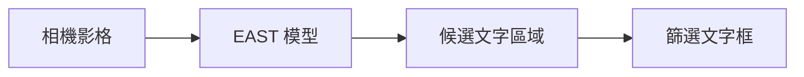

# 補充 10｜PiCamera2 + OpenCV + EAST 模型做即時文字偵測

[原始文章](https://liusming.pixnet.net/blog/posts/14223038343) · 更新日期：2026-10-29

## 學習目標

把一張 Pi 相機影格送入 EAST 模型並解析文字框。

## 事前準備

需要 PiCamera2、相機、OpenCV、NumPy、EAST 模型及 east_helpers.py。

先將[文字框處理程式 east_helpers.py](./範例程式/east_helpers.py)放在練習目錄，並下載本次測試模型（約 97 MB）：

```bash
curl -fL https://raw.githubusercontent.com/oyyd/frozen_east_text_detection.pb/master/frozen_east_text_detection.pb -o frozen_east_text_detection.pb
```

## 程式與執行

將以下程式存為 `補充10.py`，或使用[已測試的範例程式](./範例程式/補充10.py)。在檔案所在目錄執行 `python3 補充10.py`。

```python
import cv2
from picamera2 import Picamera2
from east_helpers import detect_text

camera = Picamera2()
try:
    camera.configure(camera.create_still_configuration(main={'size': (320, 240), 'format': 'RGB888'}))
    camera.start()
    frame = camera.capture_array()
finally:
    camera.stop()
    camera.close()
net = cv2.dnn.readNet('frozen_east_text_detection.pb')
boxes = detect_text(net, frame)
print('camera frame', frame.shape)
print('frame processed', True)
```

## 本機實際輸出

```text
camera frame (240, 320, 3)
frame processed True
```

已對單張影格執行模型與文字框解析；未保存私人相機畫面，未測即時預覽或準確率。

## 背景與核心概念

### 把相機影格送進文字偵測模型

相機提供影格，EAST 產生文字區域候選，再經後處理得到框。單張照片可以先檢查資料流；即時視訊還需要連續擷取、顯示及計算速度。

### 思考、練習與後續應用

如果相機畫面沒有可辨識文字，模型輸出零個框是否一定表示程式故障？如何設計有文字與無文字的對照？

應用可延伸至標牌定位；部署前需要測試曝光、旋轉、模糊和現場資料使用權。

進一步閱讀：[相關官方文件](https://docs.opencv.org/4.x/d2/d58/tutorial_table_of_content_dnn.html)。請以下方實測狀態為準；尚未實作或測試的情境不能視為已通過。

## 概念流程圖



此圖用於說明文章的概念或完整目標流程，**不是操作截圖，也不代表每個步驟都已實測**；本機實測範圍請看文章中的標示。

## 與原文章的差異

- 原文使用連續攝影機及顯示視窗；本版先完成單張影格與後處理，不宣稱即時畫面已測。
- 本機測試範圍僅限上述流程；尚未保存操作畫面截圖。
- 新增初學者背景、概念、思考練習及後續應用，實測範圍仍以本文標示為準。
- 加入教學流程示意；圖中的完整目標流程不代表已逐步實測。
