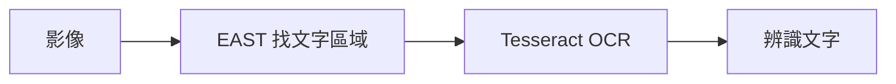
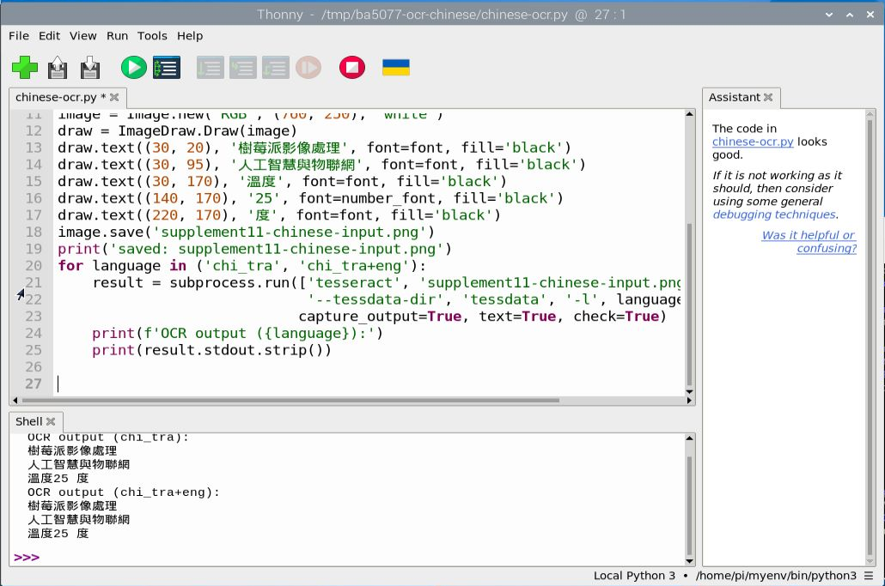
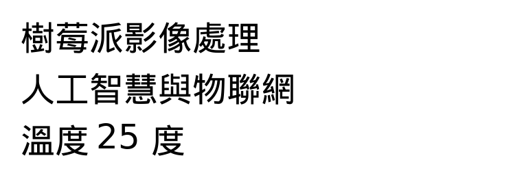
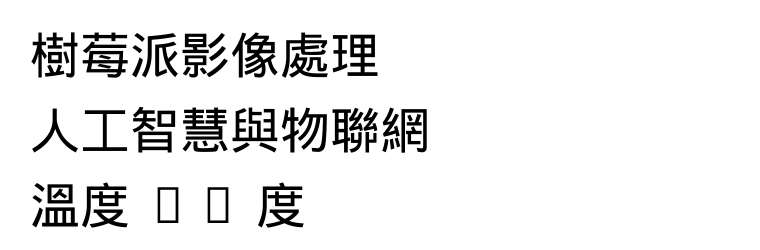

# 補充 11｜🎯 Raspberry Pi 5 上使用 EAST + Tesseract 進行即時文字辨識（含 PiCamera2 即時預覽）

[原始文章](https://liusming.pixnet.net/blog/posts/14223038385) · 更新日期：2026-10-29

> Thonny 重測進行中：請先看本篇標示「Thonny 實測」的段落；其他既有輸出依原測試方式標示，完整情境仍待重測。[逐篇進度](./Thonny逐篇實測狀態.md) · [圖片與程式下載方式](./練習素材/素材下載與使用.md)

## 學習目標

使用 EAST 找到合成圖片的文字區域，再交給 Tesseract 辨識。

## 事前準備

需要 OpenCV、NumPy、EAST 模型、east_helpers.py、Tesseract 和 pytesseract。

### 在 Thonny 下載並檢查 EAST 模型

模型是已訓練好的參數檔，EAST 用它尋找文字位置；辨認文字內容則需另外使用 OCR。模型約 96.7 MB，需要網路及足夠空間。先建立一個新的練習資料夾，下載[模型下載程式](./範例程式/補充9-Thonny下載EAST模型.py)、[模型驗證程式](./範例程式/補充9-Thonny驗證EAST模型.py)、[文字框處理程式 east_helpers.py](./範例程式/east_helpers.py)及[相機文字練習照片](./圖檔/text-board.png)放入同一資料夾。照片是相機拍攝顯示的練習文字後，經裁切及校正的素材；下載方式見[素材說明](./練習素材/素材下載與使用.md)。

1. 在 Thonny 開啟下載程式並按綠色執行鈕，等待 Shell 出現 `saved`。程式使用 Python 標準函式庫，不需額外套件。
2. 2026-10-29 在 RP5 的 Thonny 實際輸出如下；SHA-256 可用來核對本次下載內容，上游 `master` 可能變動，日後若不同應先查明來源。程式不覆寫同名檔案；下載中斷可能留下不完整檔案，請先檢查再移至其他位置或刪除後重試。

```text
Downloading EAST model...
bytes: 96662756
sha256: 9b486f3c3eee77b4c8cc91a83892c37026cca7d29b79bf3b93772ccd2db58454
saved: east-download-check.pb
```


3. 在 Thonny 選取有 OpenCV 和 NumPy 的環境，開啟模型驗證程式並執行。本次使用 `/home/pi/ba5077-tflite-camera-20261029/bin/python3`；它可讀取現有系統 OpenCV，並非全新系統。EAST 找到的框不一定都正確，也不代表已辨識文字。

```text
model loaded: east-download-check.pb
image: (675, 1200, 3)
EAST boxes: 10
```


4. 改名之前，下載[空白圖負例程式](./範例程式/補充9-Thonny文字偵測負例.py)到同一資料夾並在 Thonny 執行。本次用 NumPy 製作 320 × 320 的全黑與全白影像，並使用同一模型與文字框處理程式；RP5 的實際輸出為：

```text
black blank: 0 boxes
white blank: 0 boxes
```


這兩個合成負例均未找到文字框；這不保證真實背景不會誤報，也不表示 OCR 已正確讀出文字。

5. 後續原有範例使用 `frozen_east_text_detection.pb` 這個檔名。確認下載完成後，可在檔案管理員將 `east-download-check.pb` 改名為 `frozen_east_text_detection.pb`，與範例及素材放在同一練習資料夾；若已有同名檔案，請勿覆寫，改用另一個新資料夾。

依[安裝操作與實測紀錄](../安裝操作與實測紀錄.md#6-tesseract-ocr)建立 OCR 環境；本機的 Tesseract 已安裝。

## 程式與執行

將以下程式存為 `補充11.py`，或使用[已測試的範例程式](./範例程式/補充11.py)。此段為先前終端機實測；Thonny 的重測仍待完成。

```python
import cv2
import numpy as np
import pytesseract
from east_helpers import detect_text

image = np.full((320, 320, 3), 255, dtype=np.uint8)
cv2.putText(image, 'HELLO 123', (15, 160), cv2.FONT_HERSHEY_SIMPLEX, 1.1, (0, 0, 0), 2)
net = cv2.dnn.readNet('frozen_east_text_detection.pb')
boxes = detect_text(net, image)
texts = []
for x1, y1, x2, y2 in sorted(boxes, key=lambda box: box[0]):
    crop = image[max(0, y1-5):min(image.shape[0], y2+5), max(0, x1-5):min(image.shape[1], x2+5)]
    texts.append(pytesseract.image_to_string(crop, config='--psm 7').strip())
print('text boxes', len(boxes))
print('OCR:', ' '.join(texts))
```

## 本機實際輸出

```text
text boxes 2
OCR: HELLO 123
```

原先的合成英文文字成功辨識；另在獨立練習目錄準備繁體中文語言資料並進行下方測試。相機即時 OCR 與中文準確率尚未完成。

## 背景與核心概念

### 文字在哪裡，文字是什麼？

文字偵測負責定位區域，OCR 引擎再嘗試辨識區域內的字元。兩者各自會出錯；語言資料、字型、解析度與角度都會影響辨識結果。

### 思考、練習與後續應用

如果框的位置正確但辨識文字錯誤，應優先檢查哪些因素？為何合成英文測試不能推論中文辨識品質？

可延伸到文件整理，但含個人或機密資訊的圖片須有適當授權與保存措施。

進一步閱讀：[相關官方文件](https://tesseract-ocr.github.io/tessdoc/)。請以下方實測狀態為準；尚未實作或測試的情境不能視為已通過。

## 概念流程圖



此圖用於說明文章的概念或完整目標流程，**不是操作截圖，也不代表每個步驟都已實測**；本機實測範圍請看文章中的標示。

## 進一步實驗：RP5 相機拍攝英文測試板

### 準備與執行

1. 在螢幕顯示[相機測試畫面](./練習素材/RP5相機測試.html)的「文字偵測」，由 RP5 相機拍攝，再依[實拍與校正流程](./練習素材/相機實拍與校正流程.md)裁切校正。這次得到的[實拍輸入圖 text-board.png](./圖檔/text-board.png)可供重現。
2. 將該圖片、[east_helpers.py](./範例程式/east_helpers.py) 和[本範例程式](./範例程式/補充9至11-相機文字.py)放入同一個練習目錄，依本文事前準備放入 EAST 模型，並依[安裝紀錄](../安裝操作與實測紀錄.md#6-tesseract-ocr)準備 OpenCV、NumPy、Tesseract 及英文語言資料。
3. 此段為先前的終端機測試；本次 Thonny 重測請參考下方獨立段落。模型和語言資料缺失時先依安裝紀錄處理，不要以其他模型的結果替代。

```python
import cv2
import subprocess
from east_helpers import detect_text

# 讀取已裁切並校正的相機照片；EAST 尋找文字區域，Tesseract 嘗試辨認文字。
image = cv2.imread('text-board.png')
if image is None:
    raise RuntimeError('找不到 text-board.png')
net = cv2.dnn.readNet('frozen_east_text_detection.pb')
boxes = detect_text(net, image)
annotated = image.copy()
for x1, y1, x2, y2 in boxes:
    cv2.rectangle(annotated, (x1, y1), (x2, y2), (0, 255, 0), 2)
if not cv2.imwrite('supplement9-camera-east.png', annotated):
    raise RuntimeError('無法儲存結果')
print('EAST boxes:', len(boxes))
print('saved: supplement9-camera-east.png')
result = subprocess.run(['tesseract', 'text-board.png', 'stdout', '-l', 'eng', '--psm', '6'],
                        check=True, capture_output=True, text=True)
print('Tesseract output:')
print(result.stdout.strip())
```

RP5 本次實際輸出：

```text
EAST boxes: 10
saved: supplement9-camera-east.png
Tesseract output:
TEXT DETECTION
RASPBERRY PI 5
HELLO CAMERA
AIOT 2026
OPEN CV 12345
```


這是對相機實拍圖片畫出的結果圖，並非操作截圖。EAST 的綠框在部分文字有切割或漏框；10 個框不能解讀為 10 行文字，也不是準確率。此程式的 Tesseract 是**直接辨識整張圖片**，不是以 EAST 的每個框裁切後再辨識；前文合成圖片例子才有框選後 OCR。這次只測清楚的英文單張畫面，未測中文、真實街景、連續即時預覽或整體準確率。

練習：比較輸入圖和綠框，指出未被完整涵蓋的字；把「框定位是否正確」與「OCR 字元是否正確」分開評估。

## Thonny 實測：繁體中文合成文字 OCR

文字偵測是找出文字位置；OCR 是把圖片中的字轉為文字。這個練習只測 OCR，**沒有使用 EAST**；它不能取代本課的即時相機整合測試。

本機已安裝 Tesseract 執行程式，並在練習目錄的 `tessdata` 放入 `chi_tra.traineddata` 和 `eng.traineddata`。繁中資料來源為 [Tesseract 官方 tessdata_fast](https://github.com/tesseract-ocr/tessdata_fast)。Python 使用原有 `/home/pi/myenv/bin/python3`，其中已有 Pillow；它與第 14 課新建環境不同。

1. 確認電腦已完成 Tesseract 基礎安裝，準備包含上述兩個語言檔的 `tessdata` 資料夾；本練習另使用系統中的 Droid 中文字型及 DejaVu Sans 數字字型。
2. 在 Thonny 選擇含 Pillow 的環境，開啟[繁體中文 OCR 範例](./範例程式/補充11-繁體中文OCR.py)。確定工作目錄含有 `tessdata`，以免找不到語言檔。檔案會在工作目錄產生 `supplement11-chinese-input.png`，請使用新的練習資料夾，避免覆寫。
3. 點綠色執行按鈕，在 Shell 比較只用繁中資料及繁中加英文資料的結果：

```text
saved: supplement11-chinese-input.png
OCR output (chi_tra):
樹莓派影像處理
人工智慧與物聯網
溫度25 度
OCR output (chi_tra+eng):
樹莓派影像處理
人工智慧與物聯網
溫度25 度
```





本次兩種語言設定輸出相同，數字前後的空格仍與原文排版不同；這只是一張人工合成圖片的觀察，不能推論一般中文準確率。初次測試僅用中文字型時，數字缺字而產生方框，OCR 無法正確讀出 `25`；更換支援數字的字型後才得到上面的結果。練習時先觀察輸入圖，再判斷錯誤來自繪圖字型還是 OCR。



## Thonny 實測：已保存的相機文字照片

本次以 Thonny 右下角選取既有 `/home/pi/myenv/bin/python3`；此環境含 OpenCV，系統已有 Tesseract 英文資料。這次照片辨識使用先前下載的模型副本；其 SHA-256 與後續 Thonny 下載並驗證的模型相同。全新系統安裝尚未測試。先取得[相機校正照片](./圖檔/text-board.png)、[文字框輔助程式](./範例程式/east_helpers.py)及[本次範例](./範例程式/補充9至11-相機文字.py)，連同 EAST 模型放在同一新練習資料夾，在 Thonny 開啟範例並按綠色執行鈕。詳細下載方式見[素材說明](./練習素材/素材下載與使用.md)。

```text
EAST boxes: 10
saved: supplement9-camera-east.png
Tesseract output:
TEXT DETECTION
RASPBERRY PI 5
HELLO CAMERA
AIOT 2026
OPEN CV 12345
```


此圖為先前由 RP5 拍攝文字測試畫面並校正的照片；EAST 偵測文字框，Tesseract 本次對**整張圖片**辨識，沒有逐框送入 OCR。該結果不代表相機持續預覽、逐框辨識或不同場景均已驗證；上述文字為本次觀察的完整輸出，截圖因視窗高度只顯示其中一部分。

## 與原文章的差異

- 新增 Thonny 單張相機校正照片的 EAST 框選與整圖英文 OCR 實測；已另測模型下載與載入；即時相機及逐框 OCR 仍待測。

- 新增 Thonny 執行繁中合成圖片 OCR 的結果與畫面；沒有宣稱這是 EAST 加相機的即時流程。
- 新增對相機拍攝的英文測試板執行 EAST 及整圖 Tesseract；與原文即時流程的差異仍見下方。

- 原文結合 EAST、Tesseract 與相機；本版以合成圖片實測完整偵測到 OCR 的流程，尚未測相機即時整合。
- 本機的繁中合成文字 OCR 有 Thonny 操作截圖；EAST 與相機即時整合的 Thonny 操作截圖尚待補。
- 新增初學者背景、概念、思考練習及後續應用，實測範圍仍以本文標示為準。
- 加入教學流程示意；圖中的完整目標流程不代表已逐步實測。
