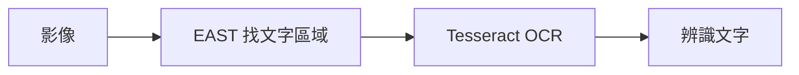

# 補充 11｜🎯 Raspberry Pi 5 上使用 EAST + Tesseract 進行即時文字辨識（含 PiCamera2 即時預覽）

[原始文章](https://liusming.pixnet.net/blog/posts/14223038385) · 更新日期：2026-10-29

## 學習目標

使用 EAST 找到合成圖片的文字區域，再交給 Tesseract 辨識。

## 事前準備

需要 OpenCV、NumPy、EAST 模型、east_helpers.py、Tesseract 和 pytesseract。

先將[文字框處理程式 east_helpers.py](./範例程式/east_helpers.py)放在練習目錄，並下載本次測試模型（約 97 MB）：

```bash
curl -fL https://raw.githubusercontent.com/oyyd/frozen_east_text_detection.pb/master/frozen_east_text_detection.pb -o frozen_east_text_detection.pb
```

依[安裝操作與實測紀錄](../安裝操作與實測紀錄.md#6-tesseract-ocr)建立 OCR 環境；本機的 Tesseract 已安裝。

## 程式與執行

將以下程式存為 `補充11.py`，或使用[已測試的範例程式](./範例程式/補充11.py)。在檔案所在目錄執行 `python3 補充11.py`。

```python
import cv2
import numpy as np
import pytesseract
from east_helpers import detect_text

image = np.full((320, 320, 3), 255, dtype=np.uint8)
cv2.putText(image, 'HELLO 123', (15, 160), cv2.FONT_HERSHEY_SIMPLEX, 1.1, (0, 0, 0), 2)
net = cv2.dnn.readNet('frozen_east_text_detection.pb')
boxes = detect_text(net, image)
texts = []
for x1, y1, x2, y2 in sorted(boxes, key=lambda box: box[0]):
    crop = image[max(0, y1-5):min(image.shape[0], y2+5), max(0, x1-5):min(image.shape[1], x2+5)]
    texts.append(pytesseract.image_to_string(crop, config='--psm 7').strip())
print('text boxes', len(boxes))
print('OCR:', ' '.join(texts))
```

## 本機實際輸出

```text
text boxes 2
OCR: HELLO 123
```

本機合成英文文字成功辨識；目前只有 eng、osd 語言資料。相機即時 OCR 與中文準確率未測。

## 背景與核心概念

### 文字在哪裡，文字是什麼？

文字偵測負責定位區域，OCR 引擎再嘗試辨識區域內的字元。兩者各自會出錯；語言資料、字型、解析度與角度都會影響辨識結果。

### 思考、練習與後續應用

如果框的位置正確但辨識文字錯誤，應優先檢查哪些因素？為何合成英文測試不能推論中文辨識品質？

可延伸到文件整理，但含個人或機密資訊的圖片須有適當授權與保存措施。

進一步閱讀：[相關官方文件](https://tesseract-ocr.github.io/tessdoc/)。請以下方實測狀態為準；尚未實作或測試的情境不能視為已通過。

## 概念流程圖



此圖用於說明文章的概念或完整目標流程，**不是操作截圖，也不代表每個步驟都已實測**；本機實測範圍請看文章中的標示。

## 與原文章的差異

- 原文結合 EAST、Tesseract 與相機；本版以合成圖片實測完整偵測到 OCR 的流程，尚未測相機即時整合。
- 本機測試範圍僅限上述流程；尚未保存操作畫面截圖。
- 新增初學者背景、概念、思考練習及後續應用，實測範圍仍以本文標示為準。
- 加入教學流程示意；圖中的完整目標流程不代表已逐步實測。
