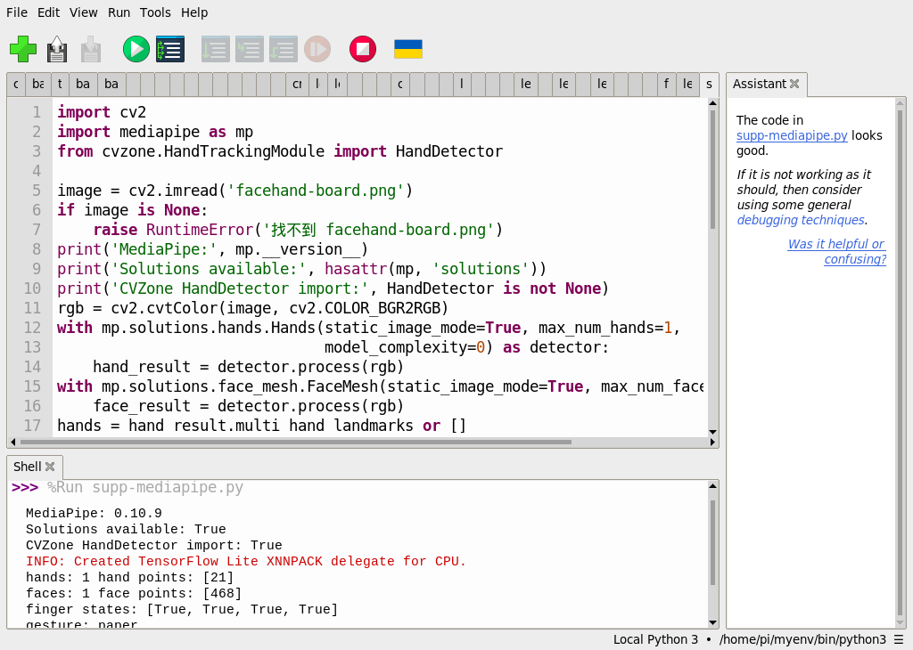
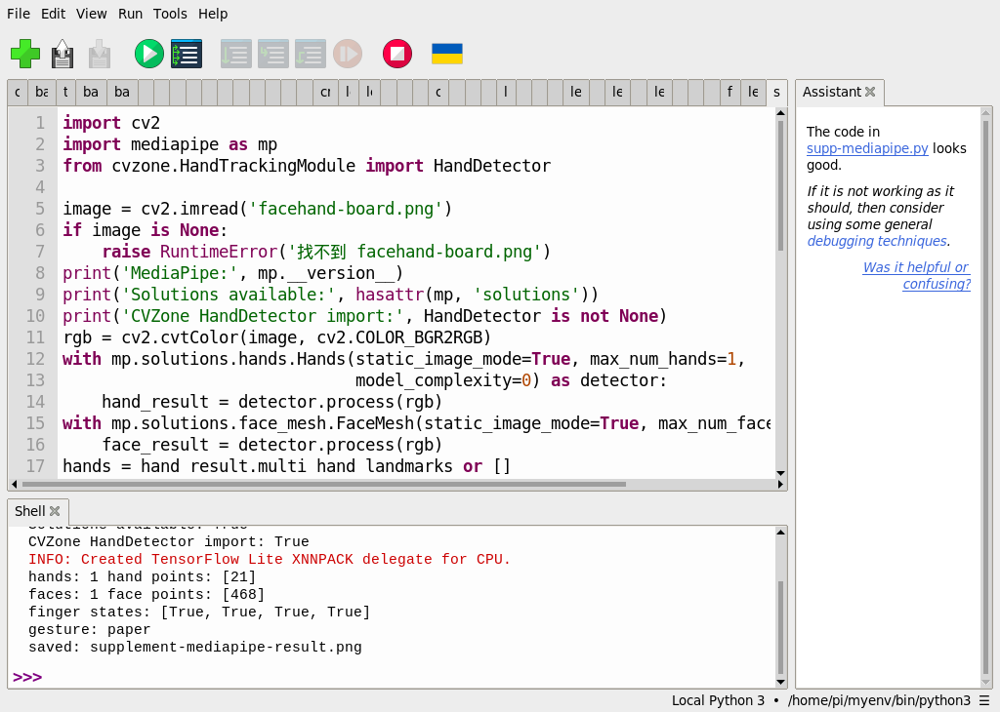
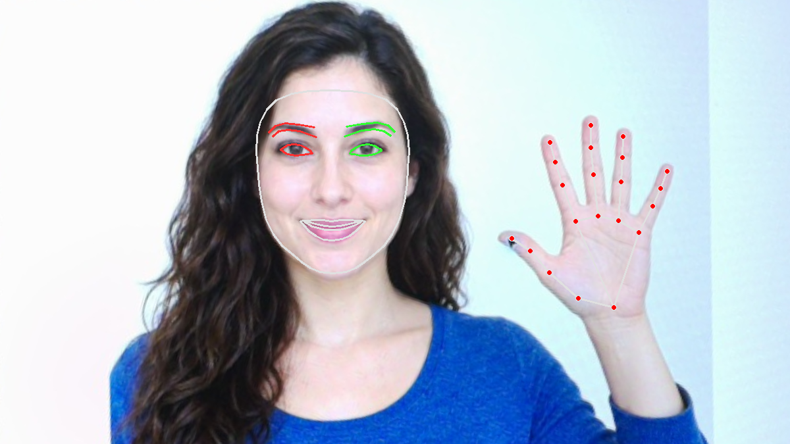

# 補充 1｜🎯 MediaPipe 介紹：Google 開源的跨平台視覺 AI 框架

[原始文章](https://liusming.pixnet.net/blog/posts/14223033861) · 更新日期：2026-10-29

> **部分實測**：本篇共用單張圖片的 Thonny 實驗；即時相機、全部手勢及全新套件安裝尚待驗證。[逐篇進度](./Thonny逐篇實測狀態.md)

## 學習目標與背景

MediaPipe 是影像處理與機器學習的工具框架。版本、API 介面以及模型能否成功推論是不同問題。本次檢查的是 0.10.9 的舊版 Solutions，不能推論較新版本也提供相同介面。

## 準備素材和套件

此次在 RP5 的既有 `/home/pi/myenv/bin/python3` 執行，MediaPipe 0.10.9、OpenCV 和 CVZone 均可在此範例匯入。這個環境混合既有套件；從全新虛擬環境透過 Thonny 安裝 MediaPipe 和 CVZone 的完整流程尚未實測。若缺少 CVZone，共用範例會在匯入時停止；不要把匯入成功當作雙手功能驗證。

依[素材下載與使用說明](./練習素材/素材下載與使用.md)下載並解壓本倉庫，將[共用程式](./範例程式/補充1-2-4-5-6-Thonny.py)與[facehand-board.png](./圖檔/facehand-board.png)複製到同一新練習資料夾。這張圖原先以 AI 生成虛構人物與手，再顯示於螢幕，經 RP5 相機拍攝及透視校正；不是實拍真人。程式會在該資料夾寫入 `supplement-mediapipe-result.png`，請先確認不會覆寫需要保留的檔案。

## 在 Thonny 操作

1. 在「工具 → 選項 → 直譯器」選擇已有 MediaPipe、OpenCV、CVZone 的 Python；開啟共用程式並按綠色執行鈕。
2. 觀察 Shell 的版本、臉手數量和手勢；用檔案管理員開啟輸出圖。下面程式是這次實際執行的內容：

```python
import cv2
import mediapipe as mp
from cvzone.HandTrackingModule import HandDetector

image = cv2.imread('facehand-board.png')
if image is None:
    raise RuntimeError('找不到 facehand-board.png')
print('MediaPipe:', mp.__version__)
print('Solutions available:', hasattr(mp, 'solutions'))
print('CVZone HandDetector import:', HandDetector is not None)
rgb = cv2.cvtColor(image, cv2.COLOR_BGR2RGB)
with mp.solutions.hands.Hands(static_image_mode=True, max_num_hands=1,
                              model_complexity=0) as detector:
    hand_result = detector.process(rgb)
with mp.solutions.face_mesh.FaceMesh(static_image_mode=True, max_num_faces=1) as detector:
    face_result = detector.process(rgb)
hands = hand_result.multi_hand_landmarks or []
faces = face_result.multi_face_landmarks or []
print('hands:', len(hands), 'hand points:', [len(h.landmark) for h in hands])
print('faces:', len(faces), 'face points:', [len(f.landmark) for f in faces])
if hands:
    hand = hands[0]
    up = [hand.landmark[tip].y < hand.landmark[pip].y
          for tip, pip in [(8, 6), (12, 10), (16, 14), (20, 18)]]
    if all(up):
        gesture = 'paper'
    elif not any(up):
        gesture = 'rock'
    elif up == [True, True, False, False]:
        gesture = 'scissors'
    else:
        gesture = 'unknown'
    print('finger states:', up)
    print('gesture:', gesture)
    mp.solutions.drawing_utils.draw_landmarks(image, hand, mp.solutions.hands.HAND_CONNECTIONS)
for face in faces:
    mp.solutions.drawing_utils.draw_landmarks(
        image, face, mp.solutions.face_mesh.FACEMESH_CONTOURS,
        landmark_drawing_spec=None,
        connection_drawing_spec=mp.solutions.drawing_styles.get_default_face_mesh_contours_style())
if not cv2.imwrite('supplement-mediapipe-result.png', image):
    raise RuntimeError('無法儲存結果')
print('saved: supplement-mediapipe-result.png')
```

## 本次 Thonny 實際輸出

```text
MediaPipe: 0.10.9
Solutions available: True
CVZone HandDetector import: True
hands: 1 hand points: [21]
faces: 1 face points: [468]
finger states: [True, True, True, True]
gesture: paper
saved: supplement-mediapipe-result.png
```







上列結果來自同一次共用實驗，不代表每項原文功能都已完成。影像內容、解析度、模型和手部角度改變時結果也可能改變。

## 練習與延伸

試著解釋模型特徵點與程式規則各負責什麼；更換、縮小或旋轉素材後，記錄偵測數量與手勢的變化。要讓程式用在實際互動，還需測試不同人、角度、光線和連續畫面的誤判與延遲。

## 與原文章的差異

- {delta}
- 新增 Thonny 實測程式、輸出、截圖及相機拍攝生成圖的下載方式；全新環境安裝仍待驗證。
