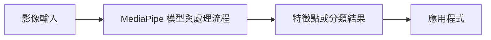

# 補充 1｜🎯 MediaPipe 介紹：Google 開源的跨平台視覺 AI 框架

[原始文章](https://liusming.pixnet.net/blog/posts/14223033861) · 更新日期：2026-10-29

> **Thonny 轉換待完成。** 本篇既有程式、安裝步驟與輸出仍須逐項改寫並在 Thonny 重新操作；現有終端機紀錄不代表已用 Thonny 測試。[逐篇進度](./Thonny逐篇實測狀態.md)

## 學習目標

認識 MediaPipe 與 Solutions API，並檢查舊教材使用的介面是否能匯入。

## 事前準備

使用已驗證的 MediaPipe 0.10.9 虛擬環境。

MediaPipe 的已測試安裝方式請看[安裝操作與實測紀錄](../安裝操作與實測紀錄.md#5-mediapipe-手勢與-face-mesh)。不同專案請使用獨立環境。

## 程式與執行

將以下程式存為 `補充1.py`，或使用[已測試的範例程式](./範例程式/補充1.py)。在檔案所在目錄執行 `python3 補充1.py`。

```python
import mediapipe as mp
print('MediaPipe', mp.__version__)
print('solutions available', hasattr(mp, 'solutions'))
```

## 本機實際輸出

```text
MediaPipe 0.10.9
solutions available True
```

此測試只檢查版本與介面存在；不等同所有模型均已測試。新版 Tasks API 可能與舊 Solutions 寫法不同。

## 背景與核心概念

### 視覺 AI 框架提供什麼？

MediaPipe 將模型、影像前後處理及介面組合成可重用的解決方案。不同版本可能提供不同 API；模組可以匯入只表示該名稱存在，不證明所有模型與相機工作流程可用。

### 思考、練習與後續應用

說明版本、API 名稱與模型推論結果是三個不同檢查項目；你會怎麼記錄實驗環境？

框架可縮短原型開發時間，但升級時仍須依實際平台與 API 重新驗證。

進一步閱讀：[相關官方文件](https://ai.google.dev/edge/mediapipe/solutions/guide)。請以下方實測狀態為準；尚未實作或測試的情境不能視為已通過。

## 概念流程圖



此圖用於說明文章的概念或完整目標流程，**不是操作截圖，也不代表每個步驟都已實測**；本機實測範圍請看文章中的標示。

## 與原文章的差異

- 原文介紹框架與應用；本版加入實際版本與 API 檢查。
- 本機測試範圍僅限上述流程；尚未保存操作畫面截圖。
- 新增初學者背景、概念、思考練習及後續應用，實測範圍仍以本文標示為準。
- 加入教學流程示意；圖中的完整目標流程不代表已逐步實測。
