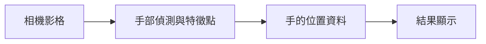

# 補充 2｜🍓 在 Raspberry Pi 5 上用 PiCamera2 + MediaPipe 做手勢偵測

[原始文章](https://liusming.pixnet.net/blog/posts/14223033876) · 更新日期：2026-10-29

## 學習目標

從相機取得一張影格並送入 MediaPipe Hands。

## 事前準備

需要 PiCamera2、相機及已驗證的 MediaPipe 0.10.9 虛擬環境。

MediaPipe 的已測試安裝方式請看[安裝操作與實測紀錄](../安裝操作與實測紀錄.md#5-mediapipe-手勢與-face-mesh)。不同專案請使用獨立環境。

## 程式與執行

將以下程式存為 `補充2.py`，或使用[已測試的範例程式](./範例程式/補充2.py)。在檔案所在目錄執行 `python3 補充2.py`。

```python
import cv2
import mediapipe as mp
from picamera2 import Picamera2

camera = Picamera2()
try:
    camera.configure(camera.create_still_configuration(main={'size': (320, 240), 'format': 'RGB888'}))
    camera.start()
    frame = camera.capture_array()
finally:
    camera.stop()
    camera.close()
with mp.solutions.hands.Hands(static_image_mode=True, max_num_hands=1) as hands:
    result = hands.process(cv2.cvtColor(frame, cv2.COLOR_BGR2RGB))
print('frame processed', result is not None)
```

## 本機實際輸出

```text
frame processed True
```

成功處理一張影格不代表畫面中必有手或偵測準確；未驗證連續視窗與手勢結果。

## 背景與核心概念

### 從手部影像取得特徵點

手部偵測試圖找出手的位置，特徵點模型進一步估計關鍵位置。單張影格的結果會受光線、手的角度和遮擋影響；沒有偵測到手不一定代表安裝失敗。

### 思考、練習與後續應用

如何設計有手、沒有手及手被遮擋的測試？偵測到關鍵點是否等同辨識某個手勢？

可用於互動控制，須考慮誤觸、延遲與使用者同意。

進一步閱讀：[相關官方文件](https://ai.google.dev/edge/mediapipe/solutions/vision/hand_landmarker)。請以下方實測狀態為準；尚未實作或測試的情境不能視為已通過。

## 概念流程圖



此圖用於說明文章的概念或完整目標流程，**不是操作截圖，也不代表每個步驟都已實測**；本機實測範圍請看文章中的標示。

## 與原文章的差異

- 原文以相機連續手勢偵測為主；本版先測單張影格，不宣稱即時辨識完成。
- 本機測試範圍僅限上述流程；尚未保存操作畫面截圖。
- 新增初學者背景、概念、思考練習及後續應用，實測範圍仍以本文標示為準。
- 加入教學流程示意；圖中的完整目標流程不代表已逐步實測。
