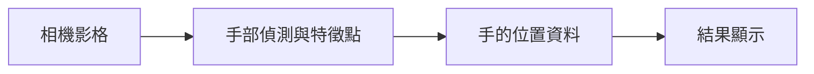
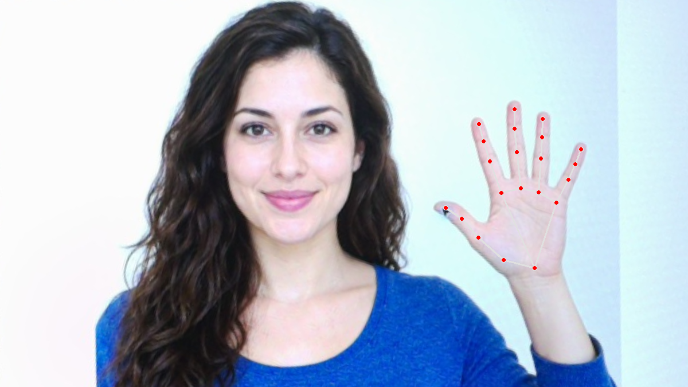

# 補充 2｜🍓 在 Raspberry Pi 5 上用 PiCamera2 + MediaPipe 做手勢偵測

[原始文章](https://liusming.pixnet.net/blog/posts/14223033876) · 更新日期：2026-10-29

> **Thonny 轉換待完成。** 本篇既有程式、安裝步驟與輸出仍須逐項改寫並在 Thonny 重新操作；現有終端機紀錄不代表已用 Thonny 測試。[逐篇進度](./Thonny逐篇實測狀態.md) · [圖片與程式下載方式](./練習素材/素材下載與使用.md)

## 學習目標

從相機取得一張影格並送入 MediaPipe Hands。

## 事前準備

需要 PiCamera2、相機及已驗證的 MediaPipe 0.10.9 虛擬環境。

MediaPipe 的已測試安裝方式請看[安裝操作與實測紀錄](../安裝操作與實測紀錄.md#5-mediapipe-手勢與-face-mesh)。不同專案請使用獨立環境。

## 程式與執行

將以下程式存為 `補充2.py`，或使用[已測試的範例程式](./範例程式/補充2.py)。在檔案所在目錄執行 `python3 補充2.py`。

```python
import cv2
import mediapipe as mp
from picamera2 import Picamera2

camera = Picamera2()
try:
    camera.configure(camera.create_still_configuration(main={'size': (320, 240), 'format': 'RGB888'}))
    camera.start()
    frame = camera.capture_array()
finally:
    camera.stop()
    camera.close()
with mp.solutions.hands.Hands(static_image_mode=True, max_num_hands=1) as hands:
    result = hands.process(cv2.cvtColor(frame, cv2.COLOR_BGR2RGB))
print('frame processed', result is not None)
```

## 本機實際輸出

```text
frame processed True
```

成功處理一張影格不代表畫面中必有手或偵測準確；未驗證連續視窗與手勢結果。

## 背景與核心概念

### 從手部影像取得特徵點

手部偵測試圖找出手的位置，特徵點模型進一步估計關鍵位置。單張影格的結果會受光線、手的角度和遮擋影響；沒有偵測到手不一定代表安裝失敗。

### 思考、練習與後續應用

如何設計有手、沒有手及手被遮擋的測試？偵測到關鍵點是否等同辨識某個手勢？

可用於互動控制，須考慮誤觸、延遲與使用者同意。

進一步閱讀：[相關官方文件](https://ai.google.dev/edge/mediapipe/solutions/vision/hand_landmarker)。請以下方實測狀態為準；尚未實作或測試的情境不能視為已通過。

## 概念流程圖



此圖用於說明文章的概念或完整目標流程，**不是操作截圖，也不代表每個步驟都已實測**；本機實測範圍請看文章中的標示。

## 進階實測：相機拍攝 AI 生成的人臉與手部素材

### 準備與操作

本次素材是 AI 生成的虛構人物，先顯示在螢幕上，RP5 相機再拍攝；拍攝後另以程式裁切及透視校正。這不是實拍真人，也不是安裝操作截圖。完整拍攝與校正方法見[相機實拍與校正流程](./練習素材/相機實拍與校正流程.md)。

需要已驗證可匯入 MediaPipe Solutions 的 Python 環境、OpenCV 及 NumPy；本次使用 MediaPipe 0.10.9 的獨立環境。 可將[本次校正影像](./圖檔/facehand-board.png)下載為 `facehand-board.png`，與[範例程式](./範例程式/補充2-相機手部特徵.py)放在 RP5 的同一練習目錄，先確認輸出檔不會覆蓋現有資料。

```python
import cv2
import mediapipe as mp

image = cv2.imread('facehand-board.png')
if image is None:
    raise RuntimeError('找不到 facehand-board.png')
with mp.solutions.hands.Hands(static_image_mode=True, max_num_hands=1, model_complexity=0) as hands:
    result = hands.process(cv2.cvtColor(image, cv2.COLOR_BGR2RGB))
landmarks = result.multi_hand_landmarks or []
for hand in landmarks:
    mp.solutions.drawing_utils.draw_landmarks(image, hand, mp.solutions.hands.HAND_CONNECTIONS)
if not cv2.imwrite('supplement2-camera-hand.png', image):
    raise RuntimeError('無法儲存結果')
print('hands found:', len(landmarks))
print('landmark counts:', [len(hand.landmark) for hand in landmarks])
print('saved: supplement2-camera-hand.png')
```

```bash
python3 補充2-相機手部特徵.py
```

### 本次 RP5 實際輸出與結果

```text
hands found: 1
landmark counts: [21]
saved: supplement2-camera-hand.png
```



圖中的點與連線由 MediaPipe 根據這次照片的手部結果繪製；這次取得一隻手、21 個特徵點，並非真人樣本。 原始相機全景含螢幕外環境，沒有公開。

### 讀懂原理與結果

先用 BGR 轉 RGB，再把校正影像送到 Hands 模型；結果包含手部特徵點。這是單張影像模式，不代表連續追蹤速度或不同姿勢都已驗證。

學生練習：先預測把測試圖縮小或轉動後可能發生什麼，再自行測試並記錄結果。如果找不到圖或模型，確認目前目錄、路徑及 Python 環境；如果找到零個目標，還應檢查畫面是否清楚。實際拍攝他人時須先取得適當授權，避免將私人照片上傳。

## 與原文章的差異

- 原文以相機連續手勢偵測為主；本版先測單張影格，不宣稱即時辨識完成。
- 本機測試範圍僅限上述流程；尚未保存操作畫面截圖。
- 新增初學者背景、概念、思考練習及後續應用，實測範圍仍以本文標示為準。
- 加入教學流程示意；圖中的完整目標流程不代表已逐步實測。
- 新增相機拍攝 AI 生成手部素材後的單張特徵點實測；原文即時手勢辨識仍待完整驗證。
