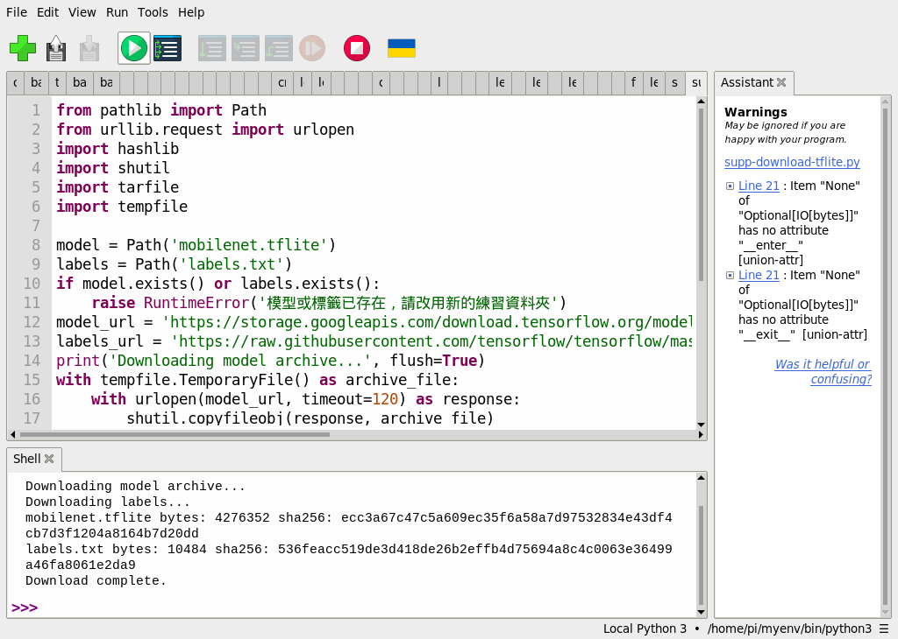
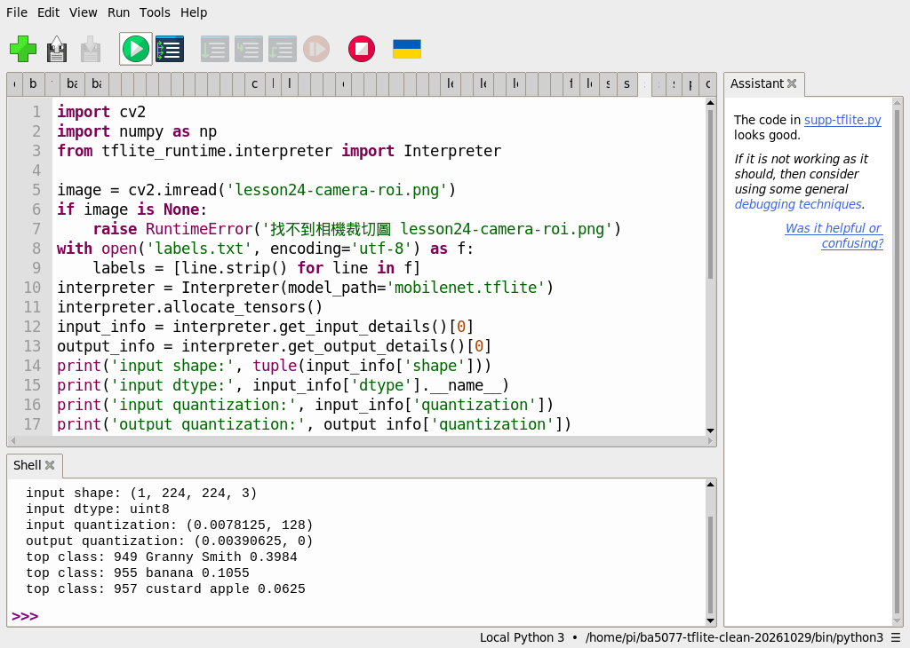
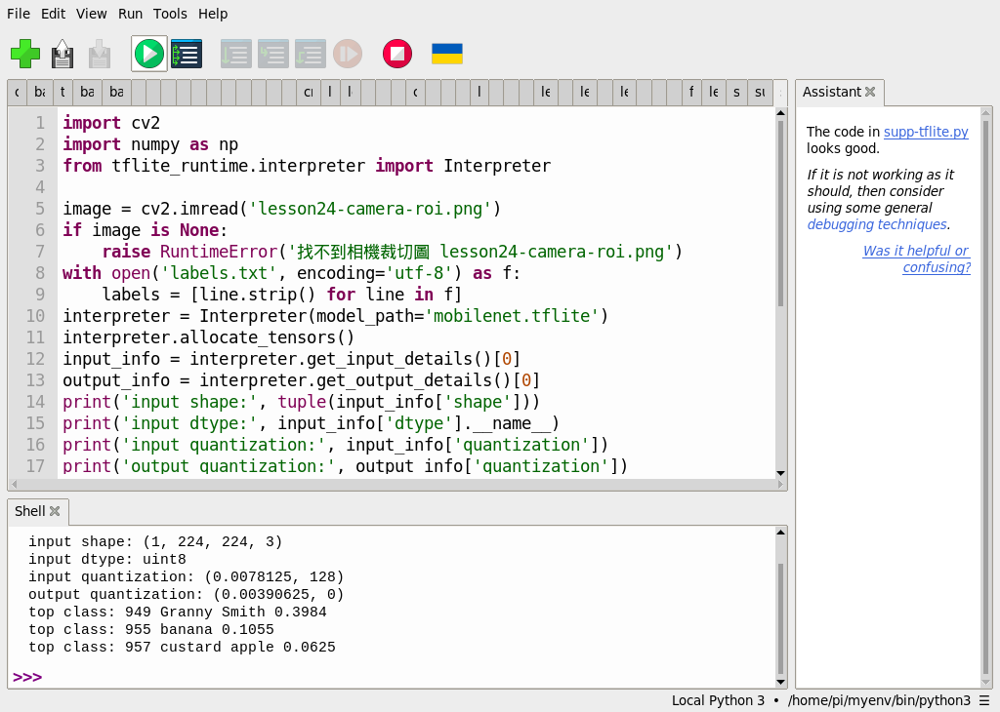
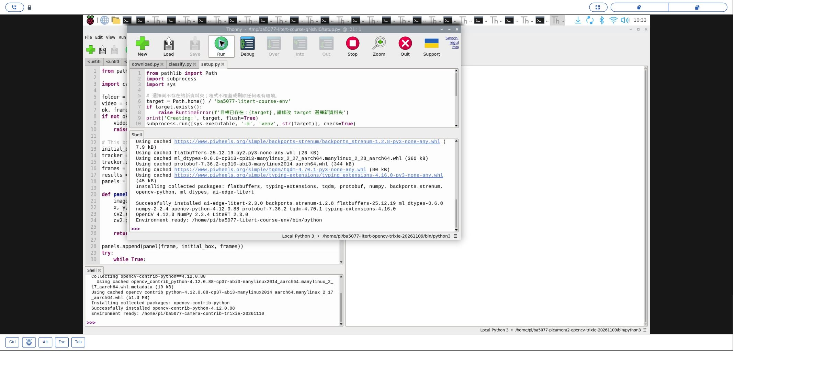
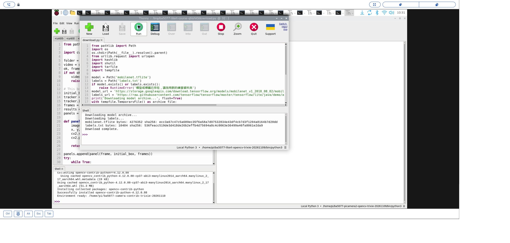
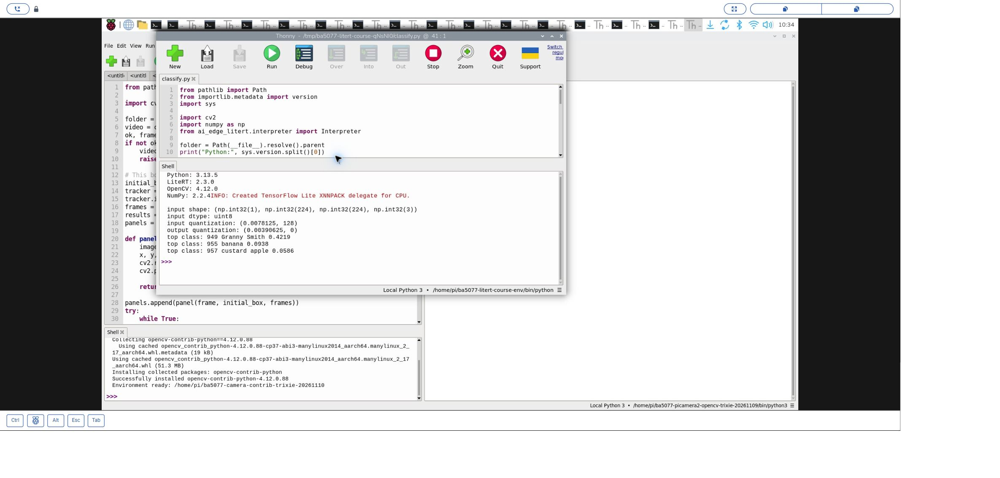

# 補充 3｜🧠 TensorFlow Lite (TFLite) 教學入門指南

[原始文章](https://liusming.pixnet.net/blog/posts/14223033888) · 更新日期：2026-11-10

> **部分實測**：先前 Bookworm 已測 TFLite 單圖與相機分類；2026-11-10 既有 Trixie 另以 Thonny 建立 LiteRT 環境、下載模型並完成單圖分類。Trixie 另已測相機 50 影格（關閉預覽）；預覽及全新系統仍待測。[逐篇進度](./Thonny逐篇實測狀態.md)

## 學習目標與背景

了解推論器、輸入張量、量化輸出與圖像分類。

圖像分類根據整張圖產生各類別分數；它與物件偵測不同，通常不提供物件位置。TFLite Interpreter 載入模型並配置輸入輸出張量，資料的尺寸、型別與模型必須一致。本例使用量化模型：輸出需依 scale 與 zero point 換算；標籤列表必須與模型對應。

## 環境與素材

先前 Bookworm 以 Thonny 建立並選取獨立環境，安裝 NumPy 1.26.4、OpenCV 4.10.0.84 與 `tflite_runtime` 2.14.0，並實測單張分類；請依 [TFLite 環境安裝說明](./Thonny環境與套件安裝.md)操作。此獨立環境尚未整合 Picamera2。模型和標籤來自 TensorFlow；標籤網址追蹤上游 master，日後內容可能改變。

依[素材下載與使用說明](./練習素材/素材下載與使用.md)取得本倉庫，將[模型下載程式](./範例程式/補充3和8-Thonny下載模型.py)、[分類範例](./範例程式/補充3和8-Thonny照片分類.py)和[相機照片裁切圖](./圖檔/lesson24-camera-roi.png)放在同一個新練習資料夾。照片是 RP5 拍攝螢幕上的 AI 生成物件後裁切所得，不是真實水果。

## Thonny 模型下載：已實測

選擇含上述套件的直譯器，在 Thonny 開啟下載程式並按綠色執行鈕。程式下載 TensorFlow 的模型壓縮檔、取出需要的模型及下載標籤，並印出大小與 SHA-256。需要網路及可容納下載暫存檔的空間；若模型或標籤已存在，請改用新的資料夾。

先前 Bookworm 的 Thonny 輸出：

```text
Downloading model archive...
Downloading labels...
mobilenet.tflite bytes: 4276352 sha256: ecc3a67c47c5a609ec35f6a58a7d97532834e43df4cb7d3f1204a8164b7d20dd
labels.txt bytes: 10484 sha256: 536feacc519de3d418de26b2effb4d75694a8c4c0063e36499a46fa8061e2da9
Download complete.
```



## 單張分類範例：Thonny 實測

在同一資料夾準備好模型、標籤與圖片後，在 Thonny 開啟以下範例並按綠色執行鈕。程式先讀取圖片、轉換色彩和尺寸，然後呼叫 Interpreter 並列出前三個類別：

```python
import cv2
import numpy as np
from tflite_runtime.interpreter import Interpreter

image = cv2.imread('lesson24-camera-roi.png')
if image is None:
    raise RuntimeError('找不到相機裁切圖 lesson24-camera-roi.png')
with open('labels.txt', encoding='utf-8') as f:
    labels = [line.strip() for line in f]
interpreter = Interpreter(model_path='mobilenet.tflite')
interpreter.allocate_tensors()
input_info = interpreter.get_input_details()[0]
output_info = interpreter.get_output_details()[0]
print('input shape:', tuple(input_info['shape']))
print('input dtype:', input_info['dtype'].__name__)
print('input quantization:', input_info['quantization'])
print('output quantization:', output_info['quantization'])
if tuple(input_info['shape']) != (1, 224, 224, 3) or input_info['dtype'] != np.uint8:
    raise RuntimeError('此程式預期 MobileNetV1 量化模型的 uint8 224x224 RGB 輸入')
rgb = cv2.cvtColor(image, cv2.COLOR_BGR2RGB)
rgb = cv2.resize(rgb, (224, 224))
interpreter.set_tensor(input_info['index'], np.expand_dims(rgb, axis=0))
interpreter.invoke()
raw = interpreter.get_tensor(output_info['index'])[0]
scale, zero = output_info['quantization']
scores = (raw.astype(np.float32) - zero) * scale
if len(labels) != len(scores):
    raise RuntimeError('標籤數與模型輸出數不一致')
for index in np.argsort(scores)[-3:][::-1]:
    print(f'top class: {index} {labels[index]} {scores[index]:.4f}')
```

先前 Bookworm 環境下，此程式及模型在 RP5 的 Thonny Shell 實際輸出：

```text
input shape: (1, 224, 224, 3)
input dtype: uint8
input quantization: (0.0078125, 128)
output quantization: (0.00390625, 0)
top class: 949 Granny Smith 0.3984
top class: 955 banana 0.1055
top class: 957 custard apple 0.0625
```





*圖：先前保存的 Thonny 單圖分類畫面；畫面顯示的解譯器是 `/home/pi/myenv/bin/python3`，截圖日期未另記。這張圖與上方獨立環境測試為不同環境紀錄，輸出數值相同，不代表本次在 Trixie 重新執行。*

這些是模型對這張生成圖片給出的分數，不能用來確認水果品種或估計整體準確率。不同版本與輸入可能改變結果。

## 既有 Trixie：以 LiteRT 完成單圖分類（2026-11-10）

此項在 RP5 既有 Debian 13 Trixie、Python 3.13.5 測試，與上方 Bookworm 的 `tflite_runtime` 2.14.0 紀錄分開。這裡使用 `ai-edge-litert` 2.3.0 的 Interpreter；模型格式仍是 `.tflite`。本次 Thonny 新建獨立虛擬環境，安裝 NumPy 2.2.4、`opencv-python` 4.12.0.88（匯入顯示 4.12.0）及 LiteRT 2.3.0。pip 使用這台 RP5 的既有快取；全新系統、其他 Python 版本及不同套件版本尚未驗證。

1. 在 Thonny 選擇本機 Python 3.13，開啟[環境建立程式](./範例程式/Thonny建立Trixie-LiteRT環境.py)。將 `target` 改成帳號主目錄下不存在的新資料夾，執行後等待 `Environment ready:`；若名稱已存在，程式會停止，請改名，勿刪除既有資料。若中途失敗，保留該目錄並改用新名稱重試。
2. 在「工具 → 選項 → 直譯器」選擇新環境的 `bin/python`，確認 Thonny 右下角顯示該路徑。將[下載程式](./範例程式/補充3-LiteRT-Thonny下載模型.py)、[分類程式](./範例程式/補充3-LiteRT-Trixie照片分類.py)、[相機裁切圖](./圖檔/lesson24-camera-roi.png)放在同一個新練習資料夾。此圖是相機拍攝螢幕上的 AI 生成物件後裁切，並非真實水果。
3. 在 Thonny 執行下載程式；它將模型及標籤寫入程式所在資料夾，若檔案已存在則停止，避免覆寫。需能連線上游並有下載空間。這次下載畫面使用的是先前已建立的 LiteRT 環境，隨後才在新環境執行分類；下載程式僅使用 Python 標準函式庫。下載得到的 SHA-256 與上方紀錄一致；標籤指向上游 master，未來可能改變。
4. 執行分類程式，確認顯示版本、輸入格式及前三名。這次用同一張圖在新建環境得到下列輸出；分數是模型輸出，不等同正確率，也不能證明水果品種。

```text
Python: 3.13.5
LiteRT: 2.3.0
OpenCV: 4.12.0
NumPy: 2.2.4
input dtype: uint8
input quantization: (0.0078125, 128)
output quantization: (0.00390625, 0)
top class: 949 Granny Smith 0.4219
top class: 955 banana 0.0938
top class: 957 custard apple 0.0586
```







分類完整程式：

```python
from pathlib import Path
from importlib.metadata import version
import sys

import cv2
import numpy as np
from ai_edge_litert.interpreter import Interpreter

folder = Path(__file__).resolve().parent
print("Python:", sys.version.split()[0])
print("LiteRT:", version("ai-edge-litert"))
print("OpenCV:", cv2.__version__)
print("NumPy:", np.__version__)

image = cv2.imread(str(folder / 'lesson24-camera-roi.png'))
if image is None:
    raise RuntimeError('找不到相機裁切圖 lesson24-camera-roi.png')
with open(folder / 'labels.txt', encoding='utf-8') as f:
    labels = [line.strip() for line in f]
interpreter = Interpreter(model_path=str(folder / 'mobilenet.tflite'))
interpreter.allocate_tensors()
input_info = interpreter.get_input_details()[0]
output_info = interpreter.get_output_details()[0]
print('input shape:', tuple(input_info['shape']))
print('input dtype:', input_info['dtype'].__name__)
print('input quantization:', input_info['quantization'])
print('output quantization:', output_info['quantization'])
if tuple(input_info['shape']) != (1, 224, 224, 3) or input_info['dtype'] != np.uint8:
    raise RuntimeError('此程式預期 MobileNetV1 量化模型的 uint8 224x224 RGB 輸入')
rgb = cv2.cvtColor(image, cv2.COLOR_BGR2RGB)
rgb = cv2.resize(rgb, (224, 224))
interpreter.set_tensor(input_info['index'], np.expand_dims(rgb, axis=0))
interpreter.invoke()
raw = interpreter.get_tensor(output_info['index'])[0]
scale, zero = output_info['quantization']
scores = (raw.astype(np.float32) - zero) * scale
if len(labels) != len(scores):
    raise RuntimeError('標籤數與模型輸出數不一致')
for index in np.argsort(scores)[-3:][::-1]:
    print(f'top class: {index} {labels[index]} {scores[index]:.4f}')
```

**排錯：** `No module named ai_edge_litert` 時先確認 Thonny 選的是新環境，而不是只在另一個環境安裝；找不到模型或標籤時檢查是否和程式放在同一資料夾；若下載中斷留下部分檔案，改用新的練習資料夾。相機使用 Picamera2，這個未繼承系統套件的單圖環境未驗證相機。

## 練習與後續應用

解釋為何模型需要 224 × 224 的輸入；比較分類結果與第 40 課的物件偵測框。準備其他圖片測試前，先確認標籤順序及模型輸出是否一致，再紀錄結果與人工觀察差異。

## 與原文章的差異

- 本版保留 Bookworm 的模型下載、圖片及相機結果；既有 Trixie 另實測 LiteRT 單圖及關閉預覽的相機 50 影格；模型轉換及 Trixie 預覽尚未重做。
- 新增相機拍攝生成圖、模型和標籤下載方式及可核對的檔案資訊；即時相機分類及兩分鐘預覽實測見[補充 8](./%E8%A3%9C%E5%85%85%208%EF%BD%9CPiCamera2%20%2B%20TensorFlow%20Lite%20%28MobileNetV1%29%20%2B%20%E5%8D%B3%E6%99%82%E5%BD%B1%E5%83%8F%E5%88%86%E9%A1%9E%20%2B%20%E9%A1%AF%E7%A4%BA%E5%88%86%E9%A1%9E%E6%96%87%E5%AD%97%20%E7%9A%84%20%E5%AE%8C%E6%95%B4%E6%95%99%E5%AD%B8.md)；全新系統安裝仍待驗證。
