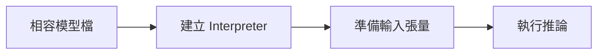
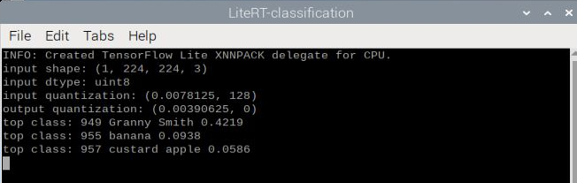

# 補充 3｜🧠 TensorFlow Lite (TFLite) 教學入門指南

[原始文章](https://liusming.pixnet.net/blog/posts/14223033888) · 更新日期：2026-10-29

> **Thonny 轉換待完成。** 本篇既有程式、安裝步驟與輸出仍須逐項改寫並在 Thonny 重新操作；現有終端機紀錄不代表已用 Thonny 測試。[逐篇進度](./Thonny逐篇實測狀態.md) · [圖片與程式下載方式](./練習素材/素材下載與使用.md)

## 學習目標

了解 TFLite 模型的輸入、輸出與 Interpreter 推論流程。

## 事前準備

使用 TFLite 舊版虛擬環境與本次測試的 MobileNet 模型。

依[安裝操作與實測紀錄](../安裝操作與實測紀錄.md)建立對應環境，再在練習目錄下載模型：

```bash
curl -fL https://raw.githubusercontent.com/nnsuite/testcases/master/DeepLearningModels/tensorflow-lite/Mobilenet_v1_1.0_224_quant/mobilenet_v1_1.0_224_quant.tflite -o mobilenet.tflite
```

## 程式與執行

將以下程式存為 `補充3.py`，或使用[已測試的範例程式](./範例程式/補充3.py)。在檔案所在目錄執行 `python3 補充3.py`。

```python
import numpy as np
import tflite_runtime.interpreter as tflite

interpreter = tflite.Interpreter(model_path='mobilenet.tflite')
interpreter.allocate_tensors()
input_info = interpreter.get_input_details()[0]
output_info = interpreter.get_output_details()[0]
interpreter.set_tensor(input_info['index'], np.zeros(input_info['shape'], dtype=input_info['dtype']))
interpreter.invoke()
print('input shape', tuple(input_info['shape']))
print('output shape', interpreter.get_tensor(output_info['index']).shape)
```

## 本機實際輸出

```text
input shape (1, 224, 224, 3)
output shape (1, 1001)
```

此例以全零輸入驗證 Interpreter，並非模型精度測試。原文的模型訓練及轉換流程未在此機重做。

## 背景與核心概念

### 什麼是邊緣推論？

TensorFlow Lite／LiteRT 是用於裝置端推論的技術生態；模型檔定義輸入和輸出，Interpreter 負責載入與執行。輸入形狀、資料型別與量化設定必須符合模型需求。

### 思考、練習與後續應用

為何建立 Interpreter、分配張量與完成一次正確推論是不同檢查？量化模型為何不能直接假設使用浮點輸入？

裝置端推論可降低部分資料傳輸需求，但要實測硬體相容、速度和結果品質。

進一步閱讀：[相關官方文件](https://ai.google.dev/edge/litert)。請以下方實測狀態為準；尚未實作或測試的情境不能視為已通過。

## 概念流程圖



此圖用於說明文章的概念或完整目標流程，**不是操作截圖，也不代表每個步驟都已實測**；本機實測範圍請看文章中的標示。

## 進一步實驗：讀取相機照片並解讀分類結果

### 學習重點

影像分類輸入整張圖片，輸出各類別分數；它不提供物件位置。量化模型使用整數儲存資料，解讀輸出時要查詢比例與零點，再計算 `實數 = (整數 - 零點) × 比例`。類別索引必須對照與模型相容、順序正確的標籤表；標籤數相同並不足以證明順序一定一致。

### 準備素材與模型

1. 依[安裝紀錄](../安裝操作與實測紀錄.md)準備已驗證的 LiteRT 環境（含 `ai_edge_litert`、OpenCV、NumPy）。在新的練習目錄執行，不要覆蓋既有檔案。
2. 下載[相機拍攝照片的裁切圖](./圖檔/lesson24-camera-roi.png)和[範例程式](./範例程式/補充3和8-相機照片分類.py)到同一目錄。原始圖片是 RP5 拍攝顯示在螢幕上的 AI 生成物件，裁切圖並非真實水果。
3. 以下為本次實際下載並測試的 TensorFlow 模型與標籤，模型壓縮檔約 35 MB；下載前確認網路與剩餘空間：

```bash
curl -fL https://storage.googleapis.com/download.tensorflow.org/models/mobilenet_v1_2018_08_02/mobilenet_v1_1.0_224_quant.tgz -o mobilenet.tgz
tar -xOzf mobilenet.tgz ./mobilenet_v1_1.0_224_quant.tflite > mobilenet.tflite
curl -fL https://raw.githubusercontent.com/tensorflow/tensorflow/master/tensorflow/lite/java/demo/app/src/main/assets/labels_mobilenet_quant_v1_224.txt -o labels.txt
sha256sum mobilenet.tflite labels.txt
```

本次檔案的 SHA-256 分別為：

```text
ecc3a67c47c5a609ec35f6a58a7d97532834e43df4cb7d3f1204a8164b7d20dd  mobilenet.tflite
536feacc519de3d418de26b2effb4d75694a8c4c0063e36499a46fa8061e2da9  labels.txt
```

標籤 URL 指向上游 `master`，將來可能變更；若雜湊不同，應查明版本再比較結果。上方檔案與本文其他範例所用的 `mobilenet.tflite` 來源不同，請勿假設兩者二進位內容相同。

### 程式與執行

```python
import cv2
import numpy as np
from ai_edge_litert.interpreter import Interpreter

image = cv2.imread('lesson24-camera-roi.png')
if image is None:
    raise RuntimeError('找不到相機裁切圖 lesson24-camera-roi.png')
with open('labels.txt', encoding='utf-8') as f:
    labels = [line.strip() for line in f]
interpreter = Interpreter(model_path='mobilenet.tflite')
interpreter.allocate_tensors()
input_info = interpreter.get_input_details()[0]
output_info = interpreter.get_output_details()[0]
print('input shape:', tuple(input_info['shape']))
print('input dtype:', input_info['dtype'].__name__)
print('input quantization:', input_info['quantization'])
print('output quantization:', output_info['quantization'])
if tuple(input_info['shape']) != (1, 224, 224, 3) or input_info['dtype'] != np.uint8:
    raise RuntimeError('此程式預期 MobileNetV1 量化模型的 uint8 224x224 RGB 輸入')
rgb = cv2.cvtColor(image, cv2.COLOR_BGR2RGB)
rgb = cv2.resize(rgb, (224, 224))
interpreter.set_tensor(input_info['index'], np.expand_dims(rgb, axis=0))
interpreter.invoke()
raw = interpreter.get_tensor(output_info['index'])[0]
scale, zero = output_info['quantization']
scores = (raw.astype(np.float32) - zero) * scale
if len(labels) != len(scores):
    raise RuntimeError('標籤數與模型輸出數不一致')
for index in np.argsort(scores)[-3:][::-1]:
    print(f'top class: {index} {labels[index]} {scores[index]:.4f}')
```

在啟用 LiteRT 環境、且四個檔案位於相同目錄時執行 `python 補充3和8-相機照片分類.py`。程式檢查輸入形狀與型別，把 OpenCV 讀到的 BGR 轉成 RGB，再縮放為 224×224；輸出以量化資訊還原分數並列出前三名。

RP5 本次實際輸出（略去初始化資訊）：

```text
input shape: (1, 224, 224, 3)
input dtype: uint8
input quantization: (0.0078125, 128)
output quantization: (0.00390625, 0)
top class: 949 Granny Smith 0.4219
top class: 955 banana 0.0938
top class: 957 custard apple 0.0586
```



這是實際執行時的終端機視窗截圖，經裁切只保留測試視窗。最高分的 Granny Smith 是模型給的標籤；測試圖是生成的紅色蘋果外觀，不能據此認定品種或將 0.4219 當成模型整體準確率。這次是**單張已保存的相機照片**，沒有即時相機預覽、真實水果資料集或速度測試。

練習：比較第 40 課的物件偵測框，說明整圖分類與定位有何不同；更換輸入、色彩順序或裁切區域時，應記錄結果如何變化，而非只報告最佳一次。

## 與原文章的差異

- 新增 TensorFlow 來源模型、標籤與相機拍攝生成圖片的單張分類及操作截圖；即時相機和準確率尚未驗證。

- 將系統 pip 改為獨立環境，並以實際輸出記錄 Interpreter；完整模型轉換仍待實測。
- 本機測試範圍僅限上述流程；尚未保存操作畫面截圖。
- 新增初學者背景、概念、思考練習及後續應用，實測範圍仍以本文標示為準。
- 加入教學流程示意；圖中的完整目標流程不代表已逐步實測。
