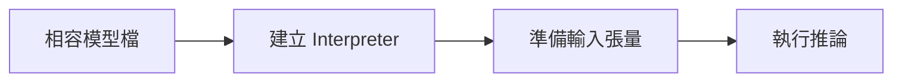

# 補充 3｜🧠 TensorFlow Lite (TFLite) 教學入門指南

[原始文章](https://liusming.pixnet.net/blog/posts/14223033888) · 更新日期：2026-10-29

## 學習目標

了解 TFLite 模型的輸入、輸出與 Interpreter 推論流程。

## 事前準備

使用 TFLite 舊版虛擬環境與本次測試的 MobileNet 模型。

依[安裝操作與實測紀錄](../安裝操作與實測紀錄.md)建立對應環境，再在練習目錄下載模型：

```bash
curl -fL https://raw.githubusercontent.com/nnsuite/testcases/master/DeepLearningModels/tensorflow-lite/Mobilenet_v1_1.0_224_quant/mobilenet_v1_1.0_224_quant.tflite -o mobilenet.tflite
```

## 程式與執行

將以下程式存為 `補充3.py`，或使用[已測試的範例程式](./範例程式/補充3.py)。在檔案所在目錄執行 `python3 補充3.py`。

```python
import numpy as np
import tflite_runtime.interpreter as tflite

interpreter = tflite.Interpreter(model_path='mobilenet.tflite')
interpreter.allocate_tensors()
input_info = interpreter.get_input_details()[0]
output_info = interpreter.get_output_details()[0]
interpreter.set_tensor(input_info['index'], np.zeros(input_info['shape'], dtype=input_info['dtype']))
interpreter.invoke()
print('input shape', tuple(input_info['shape']))
print('output shape', interpreter.get_tensor(output_info['index']).shape)
```

## 本機實際輸出

```text
input shape (1, 224, 224, 3)
output shape (1, 1001)
```

此例以全零輸入驗證 Interpreter，並非模型精度測試。原文的模型訓練及轉換流程未在此機重做。

## 背景與核心概念

### 什麼是邊緣推論？

TensorFlow Lite／LiteRT 是用於裝置端推論的技術生態；模型檔定義輸入和輸出，Interpreter 負責載入與執行。輸入形狀、資料型別與量化設定必須符合模型需求。

### 思考、練習與後續應用

為何建立 Interpreter、分配張量與完成一次正確推論是不同檢查？量化模型為何不能直接假設使用浮點輸入？

裝置端推論可降低部分資料傳輸需求，但要實測硬體相容、速度和結果品質。

進一步閱讀：[相關官方文件](https://ai.google.dev/edge/litert)。請以下方實測狀態為準；尚未實作或測試的情境不能視為已通過。

## 概念流程圖



此圖用於說明文章的概念或完整目標流程，**不是操作截圖，也不代表每個步驟都已實測**；本機實測範圍請看文章中的標示。

## 與原文章的差異

- 將系統 pip 改為獨立環境，並以實際輸出記錄 Interpreter；完整模型轉換仍待實測。
- 本機測試範圍僅限上述流程；尚未保存操作畫面截圖。
- 新增初學者背景、概念、思考練習及後續應用，實測範圍仍以本文標示為準。
- 加入教學流程示意；圖中的完整目標流程不代表已逐步實測。
