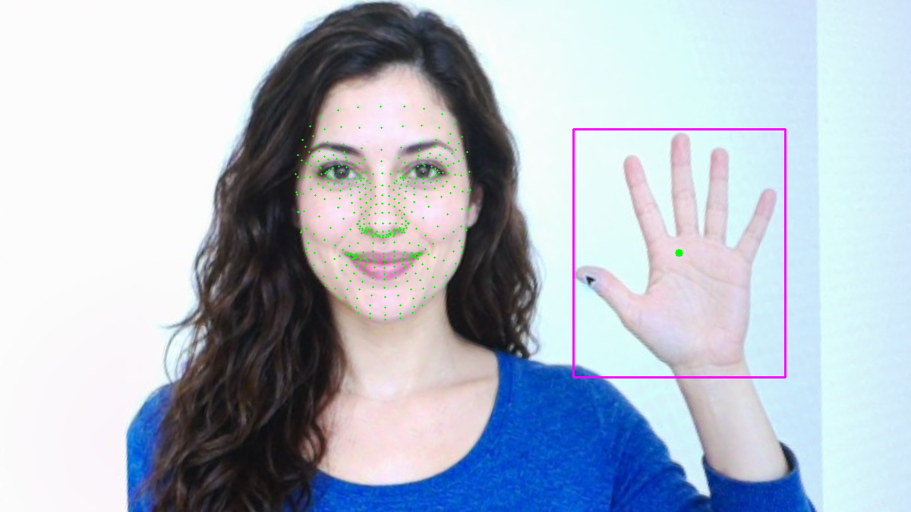
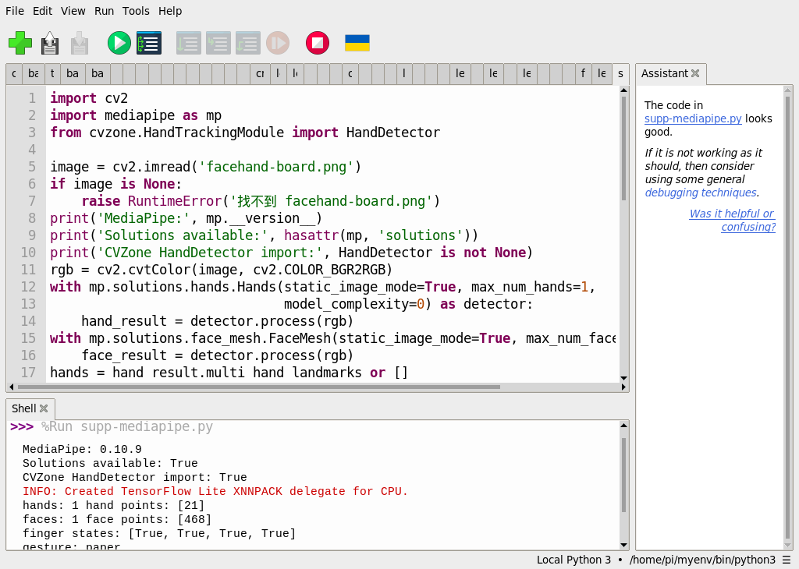
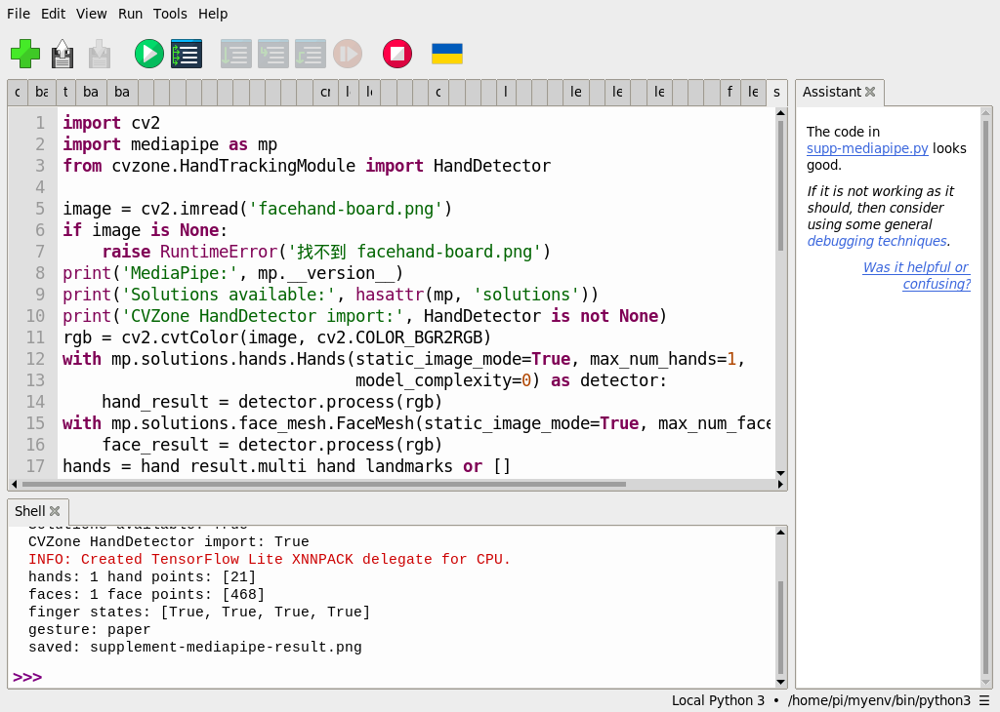

# 補充 4｜📸 Raspberry Pi 5 + PiCamera2 + MediaPipe Face Mesh 教學（支援 468 點臉部特徵點）

[原始文章](https://liusming.pixnet.net/blog/posts/14223033921) · 更新日期：2026-10-29

臉上的許多小點怎樣描述表情？我們先從靜態圖片找出點的位置，再討論它們與真實臉部的關係。

第一次準備環境的同學，可以先讀[課前學習說明](./學習前先讀我.md)；操作遇到紅字時，我們用[排錯故事](./程式卡住時怎麼辦.md)一起找原因。

## 先從這裡開始：在目前的 Trixie 準備 MediaPipe 與 CVZone（2026-11-12 實測）

**為什麼要先讀這一節：**本篇後面的程式與輸出，是在先前 Bookworm（Python 3.11、MediaPipe 0.10.9）的 `/home/pi/myenv` 完成的。目前這台 RP5 是 Debian 13 Trixie、Python 3.13，`/home/pi/myenv` 已不存在；而 Python 3.13 的 ARM64 只能安裝 **MediaPipe 1.x**，它**已經移除舊的 `mp.solutions`**。所以後面舊程式在現在的系統會停在：

```text
AttributeError: module 'mediapipe' has no attribute 'solutions'
```

這不是你打錯字，而是版本換代。我們改用 **CVZone 2.0**：它內部改用 MediaPipe 新的 Tasks API，第一次執行會自動下載模型檔。

### 第一步：在 Thonny 建立環境

1. 在 RP5 桌面開 Thonny，右下角先選系統的 Python 3（`/usr/bin/python3`）。
2. 開啟[環境建立程式](./範例程式/Thonny建立Trixie-MediaPipe環境.py)，把 `target` 改成你主目錄下**還不存在**的資料夾名稱，按綠色執行鈕。它會建立讀得到系統 Picamera2 的虛擬環境，再安裝 `mediapipe==1.2.2` 和 `cvzone==2.0.0`（需要網路，可能要數分鐘）。
3. 看到 `Environment ready:` 才算完成。本次最後兩行實際輸出：

   ```text
   Picamera2 OK; OpenCV 5.0.0 MediaPipe 1.2.2 solutions: False
   Environment ready: /home/pi/ba5077-mediapipe-trixie-20261112/bin/python3
   ```

   `solutions: False` 就是上面說的「舊 API 已移除」，是預期結果。
4. 到「工具 → 選項 → 直譯器」選新環境的 `bin/python3`，確認 Thonny 右下角顯示這個路徑。

### 第二步：找出圖片中的手和臉

1. 建立新的練習資料夾，放入 [facehand-board.png](./圖檔/facehand-board.png) 和[新版共用程式](./範例程式/補充1-2-4-5-6-Trixie-CVZone.py)。圖片是 AI 生成的虛構人物，先顯示在螢幕上再由 RP5 相機拍攝並校正，不是真人照片。
2. 在 Thonny 開啟程式並按綠色執行鈕。第一次執行會把 `hand_landmarker.task`（7,819,105 bytes）和 `face_landmarker.task`（3,758,596 bytes）下載到**目前工作資料夾**，需要網路。
3. 本次實際輸出（2026-11-12，SSH 以同一直譯器執行）：

   ```text
   MediaPipe: 1.2.2 CVZone: 2.0.0
   hands: 1 hand points: [21]
   faces: 1 face points: [478]
   finger states: [True, True, True, True]
   gesture: paper
   saved: supplement-cvzone-result.png
   ```

   

   *圖：程式輸出圖，不是操作截圖。綠點是臉部特徵點，洋紅框是手的範圍。*

**讀懂結果：**手部仍是 21 點；臉部變成 **478 點**，因為新版 Face Landmarker 模型多了左右眼虹膜各 5 點，舊版 Face Mesh 是 468 點。`paper` 由程式規則判斷四指指尖比第二關節高；它只是這一張圖的結果，不代表真人或其他角度都正確。

**卡住時：**`No module named 'cvzone'` 表示右下角選錯直譯器；下載模型失敗時檢查網路，刪掉不完整的 `.task` 檔再執行；程式結束後若看到 `Exception ignored ... __del__` 的長訊息，請確認用的是本頁最新版程式（最後有關閉模型的兩行）。

### 本篇特別注意：468 點變成 478 點

標題的「468 點」是舊版 Face Mesh 的數量。現在的 Face Landmarker 回傳 478 點，前 468 點仍是臉部網格，後 10 點是虹膜。若你的程式寫死 `468`，在新版會算錯，請改用 `len(face)`。真人即時臉部仍需參與者與同意，尚未測試。

## 學習目標與背景

Face Mesh 估計臉部各位置的座標。本次設定回傳 468 點，結果圖只畫輪廓線；特徵點估計不是身分辨識。

## 先前 Bookworm 的做法（保留比較；目前系統不能照做）

此次在 RP5 的既有 `/home/pi/myenv/bin/python3` 執行，MediaPipe 0.10.9、OpenCV 和 CVZone 均可在此範例匯入。這個環境混合既有套件；從全新虛擬環境透過 Thonny 安裝 MediaPipe 和 CVZone 的完整流程尚未實測。若缺少 CVZone，共用範例會在匯入時停止；不要把匯入成功當作雙手功能驗證。

依[素材下載與使用說明](./練習素材/素材下載與使用.md)下載並解壓本倉庫，將[共用程式](./範例程式/補充1-2-4-5-6-Thonny.py)與[facehand-board.png](./圖檔/facehand-board.png)複製到同一新練習資料夾。這張圖原先以 AI 生成虛構人物與手，再顯示於螢幕，經 RP5 相機拍攝及透視校正；不是實拍真人。程式會在該資料夾寫入 `supplement-mediapipe-result.png`，請先確認不會覆寫需要保留的檔案。

## 在 Thonny 操作

1. 在「工具 → 選項 → 直譯器」選擇已有 MediaPipe、OpenCV、CVZone 的 Python；開啟共用程式並按綠色執行鈕。
2. 觀察 Shell 的版本、臉手數量和手勢；用檔案管理員開啟輸出圖。下面程式是這次實際執行的內容：

```python
import cv2
import mediapipe as mp
from cvzone.HandTrackingModule import HandDetector

image = cv2.imread('facehand-board.png')
if image is None:
    raise RuntimeError('找不到 facehand-board.png')
print('MediaPipe:', mp.__version__)
print('Solutions available:', hasattr(mp, 'solutions'))
print('CVZone HandDetector import:', HandDetector is not None)
rgb = cv2.cvtColor(image, cv2.COLOR_BGR2RGB)
with mp.solutions.hands.Hands(static_image_mode=True, max_num_hands=1,
                              model_complexity=0) as detector:
    hand_result = detector.process(rgb)
with mp.solutions.face_mesh.FaceMesh(static_image_mode=True, max_num_faces=1) as detector:
    face_result = detector.process(rgb)
hands = hand_result.multi_hand_landmarks or []
faces = face_result.multi_face_landmarks or []
print('hands:', len(hands), 'hand points:', [len(h.landmark) for h in hands])
print('faces:', len(faces), 'face points:', [len(f.landmark) for f in faces])
if hands:
    hand = hands[0]
    up = [hand.landmark[tip].y < hand.landmark[pip].y
          for tip, pip in [(8, 6), (12, 10), (16, 14), (20, 18)]]
    if all(up):
        gesture = 'paper'
    elif not any(up):
        gesture = 'rock'
    elif up == [True, True, False, False]:
        gesture = 'scissors'
    else:
        gesture = 'unknown'
    print('finger states:', up)
    print('gesture:', gesture)
    mp.solutions.drawing_utils.draw_landmarks(image, hand, mp.solutions.hands.HAND_CONNECTIONS)
for face in faces:
    mp.solutions.drawing_utils.draw_landmarks(
        image, face, mp.solutions.face_mesh.FACEMESH_CONTOURS,
        landmark_drawing_spec=None,
        connection_drawing_spec=mp.solutions.drawing_styles.get_default_face_mesh_contours_style())
if not cv2.imwrite('supplement-mediapipe-result.png', image):
    raise RuntimeError('無法儲存結果')
print('saved: supplement-mediapipe-result.png')
```

## 先前 Bookworm 的 Thonny 實際輸出

```text
MediaPipe: 0.10.9
Solutions available: True
CVZone HandDetector import: True
hands: 1 hand points: [21]
faces: 1 face points: [468]
finger states: [True, True, True, True]
gesture: paper
saved: supplement-mediapipe-result.png
```






上列結果來自同一次共用實驗，不代表每項原文功能都已完成。影像內容、解析度、模型和手部角度改變時結果也可能改變。

## 練習與延伸

試著解釋模型特徵點與程式規則各負責什麼；更換、縮小或旋轉素材後，記錄偵測數量與手勢的變化。要讓程式用在實際互動，還需測試不同人、角度、光線和連續畫面的誤判與延遲。

## 與原文章的差異

- 2026-11-12：新增 Trixie 的 CVZone 2.0 路線，新版臉部模型回傳 478 點（含虹膜）並說明與標題 468 點的差異；真人即時仍缺。修正殘留的範本字串。
- 新增 Thonny 實測程式、輸出、截圖及相機拍攝生成圖的下載方式；全新環境安裝仍待驗證。

<details>
<summary>給教師：原有實測範圍與版本備註</summary>

> **部分實測**：本篇共用單張圖片的 Thonny 實驗；即時相機、全部手勢及全新套件安裝尚待驗證。[逐篇進度](./Thonny逐篇實測狀態.md)

</details>
