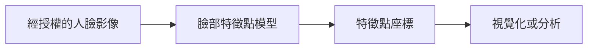
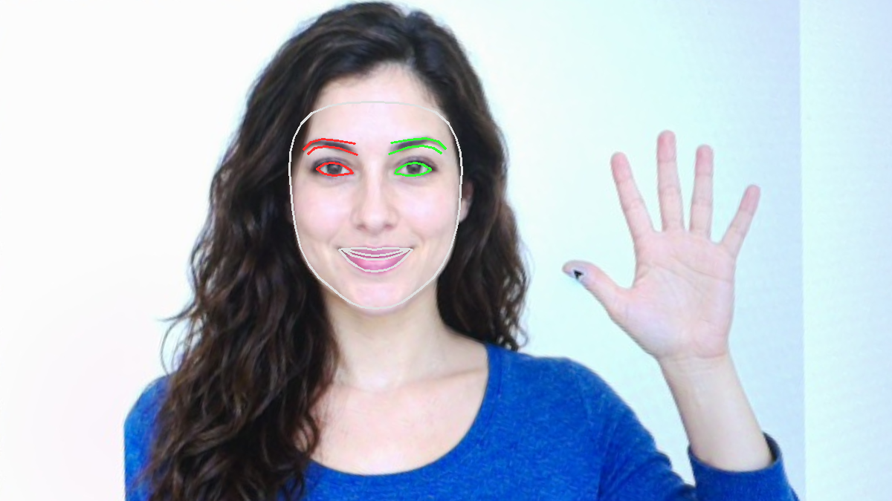

# 補充 4｜📸 Raspberry Pi 5 + PiCamera2 + MediaPipe Face Mesh 教學（支援 468 點臉部特徵點）

[原始文章](https://liusming.pixnet.net/blog/posts/14223033921) · 更新日期：2026-10-29

> **Thonny 轉換待完成。** 本篇既有程式、安裝步驟與輸出仍須逐項改寫並在 Thonny 重新操作；現有終端機紀錄不代表已用 Thonny 測試。[逐篇進度](./Thonny逐篇實測狀態.md) · [圖片與程式下載方式](./練習素材/素材下載與使用.md)

## 學習目標

以 MediaPipe Face Mesh 處理一張 Pi 相機影格。

## 事前準備

需要 PiCamera2、相機及 MediaPipe 0.10.9 虛擬環境。

MediaPipe 的已測試安裝方式請看[安裝操作與實測紀錄](../安裝操作與實測紀錄.md#5-mediapipe-手勢與-face-mesh)。不同專案請使用獨立環境。

## 程式與執行

將以下程式存為 `補充4.py`，或使用[已測試的範例程式](./範例程式/補充4.py)。在檔案所在目錄執行 `python3 補充4.py`。

```python
import cv2
import mediapipe as mp
from picamera2 import Picamera2

camera = Picamera2()
try:
    camera.configure(camera.create_still_configuration(main={'size': (320, 240), 'format': 'RGB888'}))
    camera.start()
    frame = camera.capture_array()
finally:
    camera.stop()
    camera.close()
with mp.solutions.face_mesh.FaceMesh(static_image_mode=True, max_num_faces=1) as mesh:
    result = mesh.process(cv2.cvtColor(frame, cv2.COLOR_BGR2RGB))
print('frame processed', result is not None)
```

## 本機實際輸出

```text
frame processed True
```

成功處理影格不代表一定偵測到臉部或 468 點；真人追蹤、顯示與精度未測。

## 背景與核心概念

### 臉部特徵點和身分辨識

臉部特徵點估計眼睛、鼻子等區域的位置；點的數量與 API／模型版本有關。特徵點不等於臉部身分，也不保證每個姿勢與光線都能正確定位。

### 思考、練習與後續應用

偵測到臉、估計臉部特徵點與辨識身分有何差別？為何空畫面測試不能證明人臉結果？

可用於互動展示；實際人臉影像可能是敏感資料，需事先確認使用目的與授權。

進一步閱讀：[相關官方文件](https://ai.google.dev/edge/mediapipe/solutions/vision/face_landmarker)。請以下方實測狀態為準；尚未實作或測試的情境不能視為已通過。

## 概念流程圖



此圖用於說明文章的概念或完整目標流程，**不是操作截圖，也不代表每個步驟都已實測**；本機實測範圍請看文章中的標示。

## 進階實測：相機拍攝 AI 生成的人臉與手部素材

### 準備與操作

本次素材是 AI 生成的虛構人物，先顯示在螢幕上，RP5 相機再拍攝；拍攝後另以程式裁切及透視校正。這不是實拍真人，也不是安裝操作截圖。完整拍攝與校正方法見[相機實拍與校正流程](./練習素材/相機實拍與校正流程.md)。

需要已驗證可匯入 MediaPipe Solutions 的 Python 環境、OpenCV 及 NumPy；本次使用 MediaPipe 0.10.9 的獨立環境。 可將[本次校正影像](./圖檔/facehand-board.png)下載為 `facehand-board.png`，與[範例程式](./範例程式/補充4-相機臉部特徵.py)放在 RP5 的同一練習目錄，先確認輸出檔不會覆蓋現有資料。

```python
import cv2
import mediapipe as mp

image = cv2.imread('facehand-board.png')
if image is None:
    raise RuntimeError('找不到 facehand-board.png')
with mp.solutions.face_mesh.FaceMesh(static_image_mode=True, max_num_faces=1) as mesh:
    result = mesh.process(cv2.cvtColor(image, cv2.COLOR_BGR2RGB))
landmarks = result.multi_face_landmarks or []
for face in landmarks:
    mp.solutions.drawing_utils.draw_landmarks(
        image, face, mp.solutions.face_mesh.FACEMESH_CONTOURS,
        landmark_drawing_spec=None,
        connection_drawing_spec=mp.solutions.drawing_styles.get_default_face_mesh_contours_style())
if not cv2.imwrite('supplement4-camera-face-mesh.png', image):
    raise RuntimeError('無法儲存結果')
print('faces found:', len(landmarks))
print('landmark counts:', [len(face.landmark) for face in landmarks])
print('saved: supplement4-camera-face-mesh.png')
```

```bash
python3 補充4-相機臉部特徵.py
```

### 本次 RP5 實際輸出與結果

```text
faces found: 1
landmark counts: [468]
saved: supplement4-camera-face-mesh.png
```



圖中的臉部輪廓線由本次 Face Mesh 結果繪製；程式回報一張臉與 468 個點，圖上只畫輪廓連線，不是把全部點逐一顯示。 原始相機全景含螢幕外環境，沒有公開。

### 讀懂原理與結果

MediaPipe Face Mesh 預測臉部特徵點座標；本次使用舊版 Solutions API 與單張影像模式。特徵點數量不等於身分判斷，也不代表不同模型設定都輸出相同點數。

學生練習：先預測把測試圖縮小或轉動後可能發生什麼，再自行測試並記錄結果。如果找不到圖或模型，確認目前目錄、路徑及 Python 環境；如果找到零個目標，還應檢查畫面是否清楚。實際拍攝他人時須先取得適當授權，避免將私人照片上傳。

## 與原文章的差異

- 原文即時臉部網格在本版先縮小成可驗證的單張流程，並不宣稱 GUI 與完整模型表現已通過。
- 本機測試範圍僅限上述流程；尚未保存操作畫面截圖。
- 新增初學者背景、概念、思考練習及後續應用，實測範圍仍以本文標示為準。
- 加入教學流程示意；圖中的完整目標流程不代表已逐步實測。
- 新增相機拍攝 AI 生成臉部素材後的單張 Face Mesh 實測；未驗證真人臉部、即時畫面與身分辨識。
