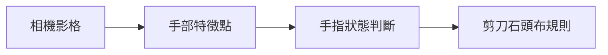
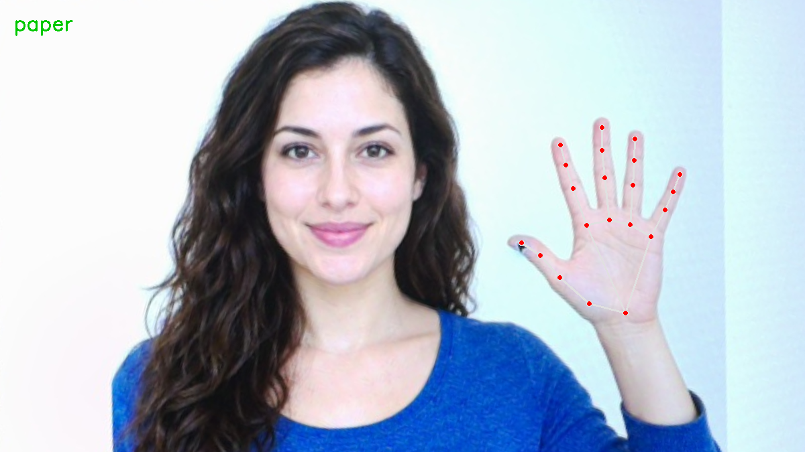

# 補充 5｜✊🤚✌️ Raspberry Pi 5 + PiCamera2 + MediaPipe 手勢辨識遊戲：「剪刀、石頭、布」

[原始文章](https://liusming.pixnet.net/blog/posts/14223033945) · 更新日期：2026-10-29

> **Thonny 轉換待完成。** 本篇既有程式、安裝步驟與輸出仍須逐項改寫並在 Thonny 重新操作；現有終端機紀錄不代表已用 Thonny 測試。[逐篇進度](./Thonny逐篇實測狀態.md) · [圖片與程式下載方式](./練習素材/素材下載與使用.md)

## 學習目標

先驗證剪刀、石頭、布的簡化判斷規則。

## 事前準備

需要 Python；輸入為四根手指的布林狀態。

MediaPipe 的已測試安裝方式請看[安裝操作與實測紀錄](../安裝操作與實測紀錄.md#5-mediapipe-手勢與-face-mesh)。不同專案請使用獨立環境。

## 程式與執行

將以下程式存為 `補充5.py`，或使用[已測試的範例程式](./範例程式/補充5.py)。在檔案所在目錄執行 `python3 補充5.py`。

```python
def classify(index_up, middle_up, ring_up, little_up):
    if not any((index_up, middle_up, ring_up, little_up)):
        return 'rock'
    if index_up and middle_up and not ring_up and not little_up:
        return 'scissors'
    if all((index_up, middle_up, ring_up, little_up)):
        return 'paper'
    return 'unknown'

print('rock test', classify(False, False, False, False))
print('scissors test', classify(True, True, False, False))
print('paper test', classify(True, True, True, True))
```

## 本機實際輸出

```text
rock test rock
scissors test scissors
paper test paper
```

這只測試分類規則；程式沒有使用相機，也沒有從 MediaPipe 關鍵點判斷手指彎曲，不能視為完成互動遊戲。

## 背景與核心概念

### 從特徵點到遊戲規則

手勢遊戲需要先取得手部影像，再推估關鍵點、判斷手指狀態，最後依規則計算勝負。用布林值測試規則只能驗證其中一段，不能證明相機辨識整個遊戲已完成。

### 思考、練習與後續應用

列出剪刀、石頭、布判斷規則可能忽略哪些手指或手部角度；哪些情況應回傳未知而非硬判？

可擴充為互動遊戲，還要驗證誤判、等待時間、平手及無法辨識時的提示。

進一步閱讀：[相關官方文件](https://ai.google.dev/edge/mediapipe/solutions/vision/hand_landmarker)。請以下方實測狀態為準；尚未實作或測試的情境不能視為已通過。

## 概念流程圖



此圖用於說明文章的概念或完整目標流程，**不是操作截圖，也不代表每個步驟都已實測**；本機實測範圍請看文章中的標示。

## 進一步實驗：由相機照片推算手勢

### 輸入、步驟與限制

1. 本次讓 RP5 相機拍攝螢幕上的 AI 生成虛構人物和手部，再裁切並校正成 [facehand-board.png](./圖檔/facehand-board.png)。[拍攝和校正步驟](./練習素材/相機實拍與校正流程.md)說明原始影像與校正方法。
2. 把圖片和下方程式放在同一個練習目錄，使用[已測試的 MediaPipe 環境](../安裝操作與實測紀錄.md#5-mediapipe-手勢與-face-mesh)。圖片可從上面的連結下載；下方程式也提供[檔案](./範例程式/補充5-相機手勢.py)。
3. 執行 `python 補充5-相機手勢.py`，終端機會列出手指狀態與手勢，並存出結果圖。注意使用已安裝 MediaPipe 和 OpenCV 的 Python。

```python
import cv2
import mediapipe as mp

image = cv2.imread('facehand-board.png')
if image is None:
    raise RuntimeError('找不到 facehand-board.png')
with mp.solutions.hands.Hands(static_image_mode=True, max_num_hands=1, model_complexity=0) as detector:
    result = detector.process(cv2.cvtColor(image, cv2.COLOR_BGR2RGB))
hands = result.multi_hand_landmarks or []
print('hands found:', len(hands))
if hands:
    hand = hands[0]
    # 僅適用大致朝上的手：影像的 y 座標從上往下增加。
    up = [hand.landmark[tip].y < hand.landmark[pip].y
          for tip, pip in [(8, 6), (12, 10), (16, 14), (20, 18)]]
    if all(up):
        gesture = 'paper'
    elif not any(up):
        gesture = 'rock'
    elif up == [True, True, False, False]:
        gesture = 'scissors'
    else:
        gesture = 'unknown'
    print('index, middle, ring, little:', up)
    print('predicted gesture:', gesture)
    mp.solutions.drawing_utils.draw_landmarks(image, hand, mp.solutions.hands.HAND_CONNECTIONS)
    cv2.putText(image, gesture, (20, 45), cv2.FONT_HERSHEY_SIMPLEX, 1, (0, 200, 0), 2)
    if not cv2.imwrite('supplement5-camera-gesture.png', image):
        raise RuntimeError('無法儲存結果')
    print('saved: supplement5-camera-gesture.png')
```

RP5 這次的實際輸出：

```text
hands found: 1
index, middle, ring, little: [True, True, True, True]
predicted gesture: paper
saved: supplement5-camera-gesture.png
```



圖是 RP5 對相機照片繪出的結果，並非桌面操作截圖。此規則比較四根手指的指尖與中間關節的影像 y 座標；y 往下增加，所以指尖 y 較小表示在畫面上較高。**只測到這張大致向上的張手圖，並未測試真人、旋轉手掌、石頭、剪刀或遊戲勝負。**拇指不參與此簡化規則；圖片中的 21 點是模型預估，不能保證一定準確。

思考：把手橫放時，單靠 y 座標會怎樣？可進一步使用關節夾角並蒐集多角度樣本，但必須重新評估準確率。

## 與原文章的差異

- 新增相機拍攝生成素材後的單張手勢判斷；與原文的連續互動遊戲不同。

- 原文包含即時相機遊戲；本版先測固定規則，後補單張相機素材的關鍵點到手勢判斷，尚未完成即時遊戲。
- 本機測試範圍僅限上述流程；尚未保存操作畫面截圖。
- 新增初學者背景、概念、思考練習及後續應用，實測範圍仍以本文標示為準。
- 加入教學流程示意；圖中的完整目標流程不代表已逐步實測。
