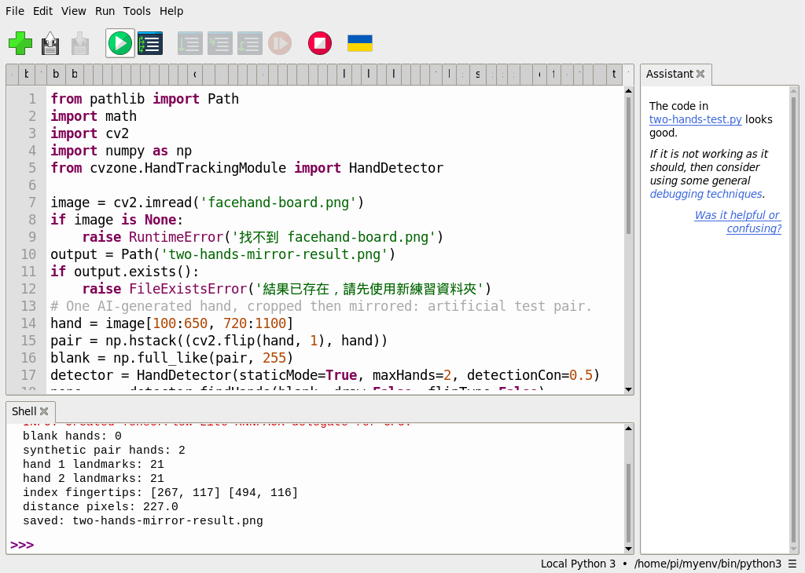
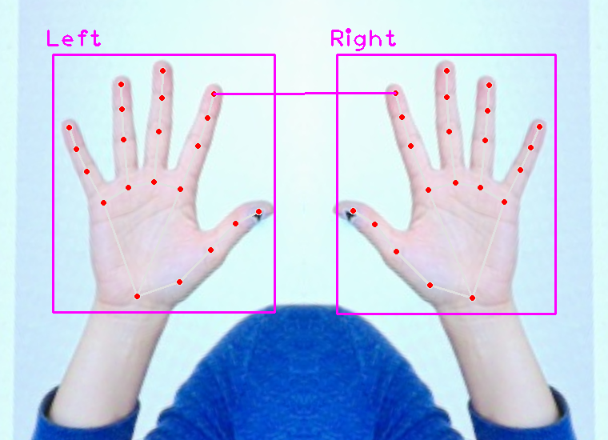
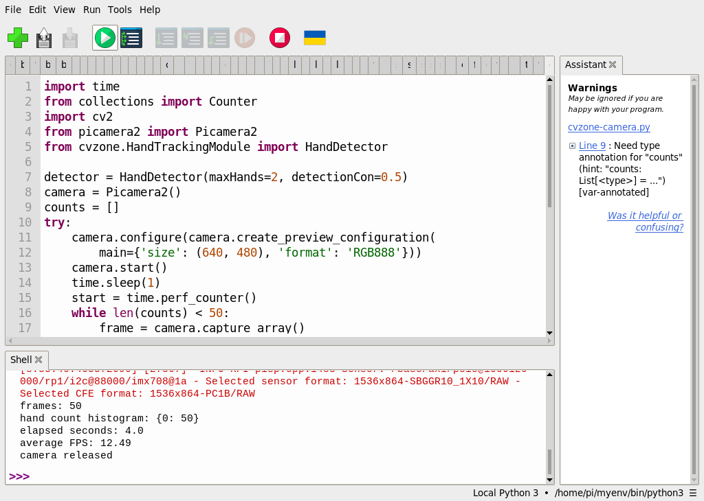

# 補充 6｜🧠 RP5 + CVZone + MediaPipe + PiCamera2 雙手偵測與距離計算教學

[原始文章](https://liusming.pixnet.net/blog/posts/14223033954) · 更新日期：2026-10-29

> **部分實測**：已實測鏡像素材雙手特徵點與像素距離，以及相機 50 張無手影格；真人雙手即時距離與全新套件安裝尚待驗證。[逐篇進度](./Thonny逐篇實測狀態.md)

## 學習目標與背景

CVZone 的 HandDetector 提供手部操作介面。先使用 MediaPipe 偵測一隻手，再用 CVZone 測試合成雙手圖片及像素距離。兩點的像素距離會隨相機角度與遠近改變，不能直接當成公分。

## 準備素材和套件

此次在 RP5 的既有 `/home/pi/myenv/bin/python3` 執行，MediaPipe 0.10.9、OpenCV 和 CVZone 均可在此範例匯入。這個環境混合既有套件；從全新虛擬環境透過 Thonny 安裝 MediaPipe 和 CVZone 的完整流程尚未實測。若缺少 CVZone，範例會在匯入時停止；本次雙手與相機測試都在此既有環境進行。

依[素材下載與使用說明](./練習素材/素材下載與使用.md)下載並解壓本倉庫，將[共用程式](./範例程式/補充1-2-4-5-6-Thonny.py)與[facehand-board.png](./圖檔/facehand-board.png)複製到同一新練習資料夾。這張圖原先以 AI 生成虛構人物與手，再顯示於螢幕，經 RP5 相機拍攝及透視校正；不是實拍真人。程式會在該資料夾寫入 `supplement-mediapipe-result.png`，請先確認不會覆寫需要保留的檔案。

## 在 Thonny 操作

1. 在「工具 → 選項 → 直譯器」選擇已有 MediaPipe、OpenCV、CVZone 的 Python；開啟共用程式並按綠色執行鈕。
2. 觀察 Shell 的版本、臉手數量和手勢；用檔案管理員開啟輸出圖。下面程式是這次實際執行的內容：

```python
import cv2
import mediapipe as mp
from cvzone.HandTrackingModule import HandDetector

image = cv2.imread('facehand-board.png')
if image is None:
    raise RuntimeError('找不到 facehand-board.png')
print('MediaPipe:', mp.__version__)
print('Solutions available:', hasattr(mp, 'solutions'))
print('CVZone HandDetector import:', HandDetector is not None)
rgb = cv2.cvtColor(image, cv2.COLOR_BGR2RGB)
with mp.solutions.hands.Hands(static_image_mode=True, max_num_hands=1,
                              model_complexity=0) as detector:
    hand_result = detector.process(rgb)
with mp.solutions.face_mesh.FaceMesh(static_image_mode=True, max_num_faces=1) as detector:
    face_result = detector.process(rgb)
hands = hand_result.multi_hand_landmarks or []
faces = face_result.multi_face_landmarks or []
print('hands:', len(hands), 'hand points:', [len(h.landmark) for h in hands])
print('faces:', len(faces), 'face points:', [len(f.landmark) for f in faces])
if hands:
    hand = hands[0]
    up = [hand.landmark[tip].y < hand.landmark[pip].y
          for tip, pip in [(8, 6), (12, 10), (16, 14), (20, 18)]]
    if all(up):
        gesture = 'paper'
    elif not any(up):
        gesture = 'rock'
    elif up == [True, True, False, False]:
        gesture = 'scissors'
    else:
        gesture = 'unknown'
    print('finger states:', up)
    print('gesture:', gesture)
    mp.solutions.drawing_utils.draw_landmarks(image, hand, mp.solutions.hands.HAND_CONNECTIONS)
for face in faces:
    mp.solutions.drawing_utils.draw_landmarks(
        image, face, mp.solutions.face_mesh.FACEMESH_CONTOURS,
        landmark_drawing_spec=None,
        connection_drawing_spec=mp.solutions.drawing_styles.get_default_face_mesh_contours_style())
if not cv2.imwrite('supplement-mediapipe-result.png', image):
    raise RuntimeError('無法儲存結果')
print('saved: supplement-mediapipe-result.png')
```

## 本次 Thonny 實際輸出

```text
MediaPipe: 0.10.9
Solutions available: True
CVZone HandDetector import: True
hands: 1 hand points: [21]
faces: 1 face points: [468]
finger states: [True, True, True, True]
gesture: paper
saved: supplement-mediapipe-result.png
```


上列結果來自同一次共用實驗，不代表每項原文功能都已完成。影像內容、解析度、模型和手部角度改變時結果也可能改變。

## 實驗二：兩組手部特徵點與像素距離

### 觀念與素材

座標 `(x, y)` 用影像左上角為原點，向右為 x 增加，向下為 y 增加。每隻手有 21 個特徵點，索引 8 是食指尖；兩點距離依畢氏定理為 `sqrt((x2-x1)**2 + (y2-y1)**2)`。這個距離單位是**像素**，不是公分；解析度、鏡頭遠近、角度與透視都會影響數值。

本次取用[facehand-board.png](./圖檔/facehand-board.png) 中同一隻 AI 生成的手，將局部裁切、左右鏡像並排，形成兩個用於演算法測試的手部影像。來源是 RP5 拍攝螢幕上生成圖的校正照片，**不是兩隻真人手，也不是即時雙手測試**。再用全白圖片當無手負例；兩種輸入可在同一個程式中比較。

### Thonny 步驟

1. 按[素材下載與使用說明](./練習素材/素材下載與使用.md)取得倉庫，將 [facehand-board.png](./圖檔/facehand-board.png) 與[雙手測試程式](./範例程式/補充6-Thonny雙手素材測試.py)放在同一個新練習資料夾。
2. 在 Thonny 選擇前文已具備 CVZone、MediaPipe、NumPy、OpenCV 的環境，開啟程式並按綠色執行鈕；它會先檢查空白圖，再處理合成雙手圖並顯示距離。
3. 若成功偵測兩隻手，程式將結果保存為 `two-hands-mirror-result.png`；若同名檔案已存在，會停止，請改用新資料夾。

完整程式：

```python
from pathlib import Path
import math
import cv2
import numpy as np
from cvzone.HandTrackingModule import HandDetector

image = cv2.imread('facehand-board.png')
if image is None:
    raise RuntimeError('找不到 facehand-board.png')
output = Path('two-hands-mirror-result.png')
if output.exists():
    raise FileExistsError('結果已存在，請先使用新練習資料夾')
# One AI-generated hand, cropped then mirrored: artificial test pair.
hand = image[100:650, 720:1100]
pair = np.hstack((cv2.flip(hand, 1), hand))
blank = np.full_like(pair, 255)
detector = HandDetector(staticMode=True, maxHands=2, detectionCon=0.5)
none, _ = detector.findHands(blank, draw=False, flipType=False)
print('blank hands:', len(none))
hands, annotated = detector.findHands(pair.copy(), draw=True, flipType=False)
print('synthetic pair hands:', len(hands))
for index, item in enumerate(hands):
    print('hand', index + 1, 'landmarks:', len(item['lmList']))
if len(hands) == 2:
    p1 = hands[0]['lmList'][8][:2]
    p2 = hands[1]['lmList'][8][:2]
    distance = math.dist(p1, p2)
    cv2.line(annotated, tuple(p1), tuple(p2), (255, 0, 255), 2)
    print('index fingertips:', p1, p2)
    print('distance pixels:', round(distance, 2))
    if not cv2.imwrite(str(output), annotated):
        raise RuntimeError('無法儲存結果圖片')
    print('saved:', output)
else:
    print('distance unavailable: need exactly two hands')
```

本次 RP5 的 Thonny Shell 輸出：

```text
blank hands: 0
synthetic pair hands: 2
hand 1 landmarks: 21
hand 2 landmarks: 21
index fingertips: [267, 117] [494, 116]
distance pixels: 227.0
saved: two-hands-mirror-result.png
```





上圖為**程式結果圖**；兩手來自同一隻 AI 生成手部的鏡像，並非真實兩手。`227.0` 是當次影像中的像素距離，不能推算真實距離，也不能作為辨識準確率。`Left`、`Right` 是模型對此素材的分類，鏡像處理可能影響左右手判定。

## 實驗三：相機連續讀取與無手情境

本次在原有 `myenv` 中使用 Picamera2 和 CVZone。相機對著桌面與螢幕，沒有手出現在測試場景；50 張都被判定為零隻手。這是單一場景的負例，不證明所有無手場景均不會誤判。

下載[相機手部程式](./範例程式/補充2和6-Thonny相機手部.py)至練習資料夾，在具備 Picamera2、CVZone 和 MediaPipe 的 Thonny 直譯器開啟並執行。程式顯示預覽，最多處理 50 張並自動結束、釋放相機。`q` 提前結束分支尚未單獨實測；先等自動結束。

```python
import time
from collections import Counter
import cv2
from picamera2 import Picamera2
from cvzone.HandTrackingModule import HandDetector

detector = HandDetector(maxHands=2, detectionCon=0.5)
camera = Picamera2()
counts = []
try:
    camera.configure(camera.create_preview_configuration(
        main={'size': (640, 480), 'format': 'RGB888'}))
    camera.start()
    time.sleep(1)
    start = time.perf_counter()
    while len(counts) < 50:
        frame = camera.capture_array()
        hands, shown = detector.findHands(frame, draw=True, flipType=False)
        counts.append(len(hands))
        cv2.imshow('CVZone camera - Q to stop', shown)
        if cv2.waitKey(1) & 0xFF == ord('q'):
            break
    elapsed = time.perf_counter() - start
    print('frames:', len(counts))
    print('hand count histogram:', dict(sorted(Counter(counts).items())))
    print('elapsed seconds:', round(elapsed, 2))
    print('average FPS:', round(len(counts) / elapsed, 2))
finally:
    camera.stop()
    camera.close()
    cv2.destroyAllWindows()
    print('camera released')
```

本次 Thonny Shell 輸出：

```text
frames: 50
hand count histogram: {0: 50}
elapsed seconds: 4.0
average FPS: 12.49
camera released
```



這張是**操作截圖**，不包含相機環境畫面。相機重新開啟與連續無手負例已測；真人一手及雙手、移動、遮擋、角度與長時間測試仍待完成。

## 練習與延伸

試著解釋模型特徵點與程式規則各負責什麼；更換、縮小或旋轉素材後，記錄偵測數量與手勢的變化。要讓程式用在實際互動，還需測試不同人、角度、光線和連續畫面的誤判與延遲。

## 與原文章的差異

- 本版以 Thonny 實測靜態鏡像雙手與像素距離，並測試相機無手影格；原文真人雙手即時操作仍待完成。
- 新增 Thonny 實測程式、輸出、截圖及相機拍攝生成圖的下載方式；全新環境安裝仍待驗證。
